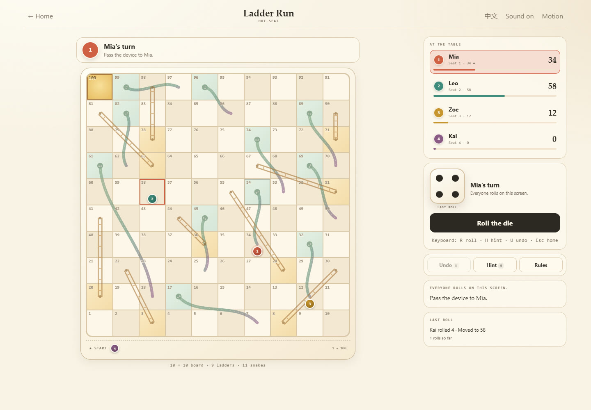
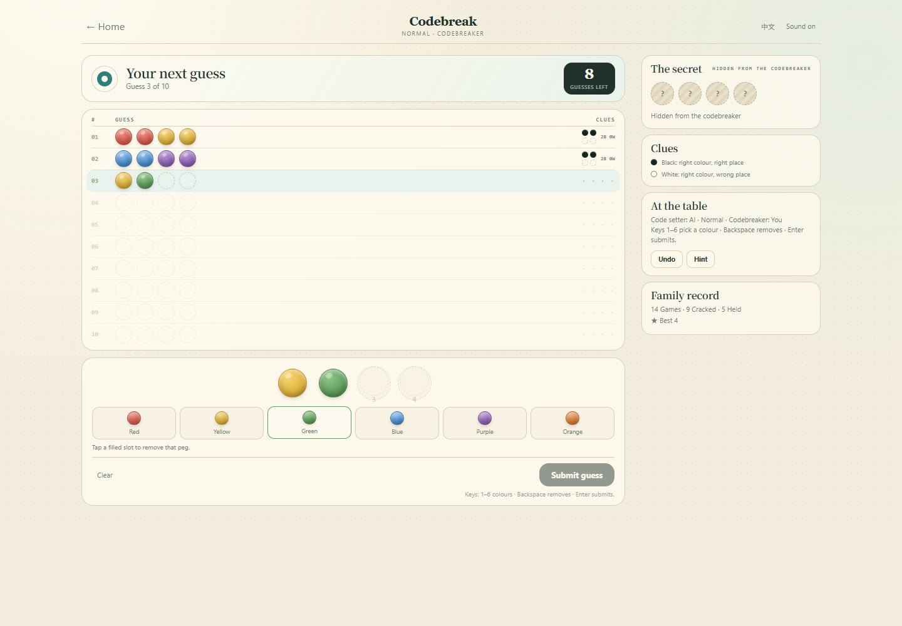
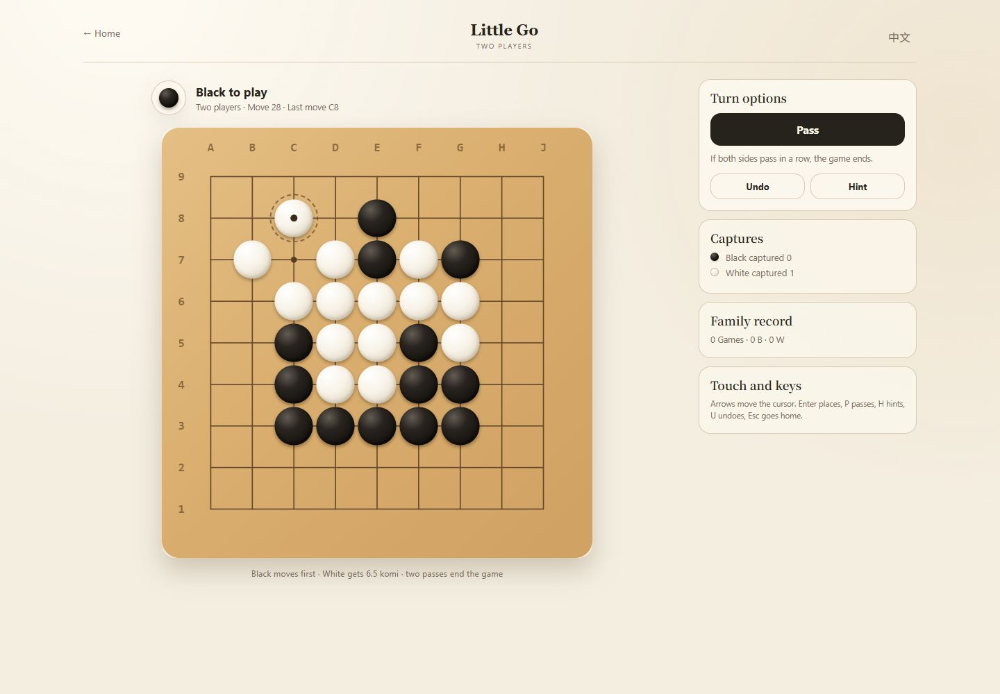

# Family Arcade · 家庭游戏馆

**27 small, offline family games in one repository.** Every game has a single-screen
hot-seat mode, four (or three) AI levels, a real LAN room where phones join from a
browser, a 45–54-second bilingual promo, and its own lightweight Windows installer.

**27 款小巧、离线的家庭游戏，共用一个仓库。** 每一款都有同屏热座、AI、真正的局域网房间
（手机浏览器直接加入）、45–54 秒中英宣传片，以及独立的轻量 Windows 安装包。

[](docs/tour.mp4)

*37-second tour · every clip is real gameplay · [full videos below](#the-classics--两款经典)*

[](https://github.com/YiheHuang/FamilyArcade/releases/download/family-arcade-v1.0.0/FamilyArcade_1.0.0_x64-setup.exe)

**All-in-one Windows app:** [Family Arcade 1.0 launcher](https://github.com/YiheHuang/FamilyArcade/releases/download/family-arcade-v1.0.0/FamilyArcade_1.0.0_x64-setup.exe) — every game and the WebView2 runtime in one installer. Per-game installers are linked under each card.
**WebView2 runtime (only if a single-game installer asks):** [offline x64 installer](https://github.com/YiheHuang/FamilyArcade/releases/download/webview2-runtime-v1.0.0/MicrosoftEdgeWebView2RuntimeInstallerX64.exe)


**2–6 players · ages 6+ · no account · no ads · no telemetry · per-game installers under 4 MB · all-in-one launcher 299 MB (includes WebView2 runtime)**

## The classics · 两款经典

<table>
<tr><td width="25%" valign="top">
<a href="apps/blokus/docs/promo/blokus-promo-en.mp4"></a>

**[Blokus · 角斗士棋](apps/blokus/README.md)**

<sub>2–4 players · 20–30 min · ages 7+</sub>

The classic corner-and-edge block game, with three AI levels and LAN from a phone.

<sub>经典角对角拼放：三档 AI，手机可直接加入局域网。</sub>

<sub>[English trailer](apps/blokus/docs/promo/blokus-promo-en.mp4) · [中文成片](apps/blokus/docs/promo/blokus-promo-zh.mp4) · [installer](https://github.com/YiheHuang/FamilyArcade/releases/download/blokus-v1.7.1/blokus_1.7.1_x64-setup.exe)</sub>
</td>
<td width="25%" valign="top">
<a href="apps/splendor/docs/promo/splendor-promo-en.mp4"></a>

**[Splendor · 宝石商人](apps/splendor/README.md)**

<sub>2–4 players · 30 min · ages 8+</sub>

The family edition with four AI personalities, LAN rooms and a 3.6 MB desktop app.

<sub>家庭版宝石商人：四档 AI、局域网房间和 3.6 MB 桌面应用。</sub>

<sub>[English trailer](apps/splendor/docs/promo/splendor-promo-en.mp4) · [中文成片](apps/splendor/docs/promo/splendor-promo-zh.mp4) · [installer](https://github.com/YiheHuang/FamilyArcade/releases/download/splendor-v2.5.0/splendor_2.5.0_x64-setup.exe)</sub>
</td></tr>
</table>

## The family table · 家庭牌桌

<table>
<tr><td width="25%" valign="top">
<a href="apps/star-leap/docs/promo/star-leap-promo-en.mp4"></a>

**[Star Leap · 星跃](apps/star-leap/README.md)**

<sub>2–4 players · 15–25 min · ages 7+</sub>

Chinese Checkers with four AI levels, hints, replay and a midnight board.

<sub>中国跳棋：四档 AI、提示、复盘和一张午夜星盘。</sub>

<sub>[English trailer](apps/star-leap/docs/promo/star-leap-promo-en.mp4) · [中文成片](apps/star-leap/docs/promo/star-leap-promo-zh.mp4) · [installer](https://github.com/YiheHuang/FamilyArcade/releases/download/star-leap-v0.2.0/star-leap_0.2.0_x64-setup.exe)</sub>
</td>
<td width="25%" valign="top">
<a href="apps/sweet-carousel/docs/promo/sweet-carousel-promo-en.mp4"></a>

**[Sweet Carousel · 甜点转盘](apps/sweet-carousel/README.md)**

<sub>2–5 players · 15 min · ages 7+</sub>

A 72-card dessert draft with privacy covers, crowns and four AI levels.

<sub>72 张甜点轮抽：隐私遮罩、人气王和四档 AI。</sub>

<sub>[English trailer](apps/sweet-carousel/docs/promo/sweet-carousel-promo-en.mp4) · [中文成片](apps/sweet-carousel/docs/promo/sweet-carousel-promo-zh.mp4) · [installer](https://github.com/YiheHuang/FamilyArcade/releases/download/sweet-carousel-v0.1.0/sweet-carousel_0.1.0_x64-setup.exe)</sub>
</td>
<td width="25%" valign="top">
<a href="apps/hue-garden/docs/promo/hue-garden-promo-en.mp4"></a>

**[Hue Garden · 彩庭](apps/hue-garden/README.md)**

<sub>2–4 players · 20–30 min · ages 8+</sub>

108 glazed tiles, six shapes, six-in-a-row blooms and a quiet courtyard.

<sub>108 张釉面瓷砖、六种形状、六连开花的小庭院。</sub>

<sub>[English trailer](apps/hue-garden/docs/promo/hue-garden-promo-en.mp4) · [中文成片](apps/hue-garden/docs/promo/hue-garden-promo-zh.mp4) · [installer](https://github.com/YiheHuang/FamilyArcade/releases/download/hue-garden-v0.1.0/hue-garden_0.1.0_x64-setup.exe)</sub>
</td>
<td width="25%" valign="top">
<a href="apps/field-and-wall/docs/promo/field-and-wall-promo-en.mp4"></a>

**[Field & Wall · 筑野](apps/field-and-wall/README.md)**

<sub>2–4 players · 30–35 min · ages 8+</sub>

54 original tiles, wooden meeples, city/road/monastery scoring; no farms yet.

<sub>54 张原创瓷砖、木人、城市/道路/修道院计分；暂不含农田。</sub>

<sub>[English trailer](apps/field-and-wall/docs/promo/field-and-wall-promo-en.mp4) · [中文成片](apps/field-and-wall/docs/promo/field-and-wall-promo-zh.mp4) · [installer](https://github.com/YiheHuang/FamilyArcade/releases/download/field-and-wall-v0.1.0/field-and-wall_0.1.0_x64-setup.exe)</sub>
</td></tr>
<tr><td width="25%" valign="top">
<a href="apps/balloon-rally/docs/promo/balloon-rally-promo-en.mp4"></a>

**[Balloon Rally · 气球大赛](apps/balloon-rally/README.md)**

<sub>2–6 players · 20–25 min · ages 8+</sub>

Five paper balloons, four rounds of wind, and a whole table guessing together.

<sub>五只纸气球、四轮风、全桌一起猜。</sub>

<sub>[English trailer](apps/balloon-rally/docs/promo/balloon-rally-promo-en.mp4) · [中文成片](apps/balloon-rally/docs/promo/balloon-rally-promo-zh.mp4) · [installer](https://github.com/YiheHuang/FamilyArcade/releases/download/balloon-rally-v0.1.0/balloon-rally_0.1.0_x64-setup.exe)</sub>
</td></tr>
</table>

## The arcade · 二十款小游戏

<table>
<tr><td width="25%" valign="top">
<a href="apps/triple/docs/promo/triple-promo-en.mp4"></a>

**[Triple · 三连棋](apps/triple/README.md)**

<sub>2 players · 10 minutes · ages 6+</sub>

3 × 3 board · 4 AI levels

<sub>3 × 3 棋盘 · 四档 AI</sub>

<sub>[English trailer](apps/triple/docs/promo/triple-promo-en.mp4) · [中文成片](apps/triple/docs/promo/triple-promo-zh.mp4) · [installer](https://github.com/YiheHuang/FamilyArcade/releases/download/triple-v0.1.0/triple_0.1.0_x64-setup.exe)</sub>
</td>
<td width="25%" valign="top">
<a href="apps/four/docs/promo/four-promo-en.mp4"></a>

**[Four · 四子棋](apps/four/README.md)**

<sub>2 players · 10–15 minutes · ages 6+</sub>

7 × 6 board · 4 AI levels

<sub>7 × 6 棋盘 · 四档 AI</sub>

<sub>[English trailer](apps/four/docs/promo/four-promo-en.mp4) · [中文成片](apps/four/docs/promo/four-promo-zh.mp4) · [installer](https://github.com/YiheHuang/FamilyArcade/releases/download/four-v0.1.0/four_0.1.0_x64-setup.exe)</sub>
</td>
<td width="25%" valign="top">
<a href="apps/flip/docs/promo/flip-promo-en.mp4"></a>

**[Flip · 黑白棋](apps/flip/README.md)**

<sub>2 players · 10 minutes · ages 6+</sub>

8 × 8 board · 4 AI levels

<sub>8×8 棋盘 · 四档 AI</sub>

<sub>[English trailer](apps/flip/docs/promo/flip-promo-en.mp4) · [中文成片](apps/flip/docs/promo/flip-promo-zh.mp4) · [installer](https://github.com/YiheHuang/FamilyArcade/releases/download/flip-v0.1.0/flip_0.1.0_x64-setup.exe)</sub>
</td>
<td width="25%" valign="top">
<a href="apps/draughts/docs/promo/draughts-promo-en.mp4"></a>

**[Draughts · 国际跳棋](apps/draughts/README.md)**

<sub>2 players · 20 minutes · ages 7+</sub>

8 × 8 board · 12 men each

<sub>8 × 8 棋盘 · 双方各 12 子</sub>

<sub>[English trailer](apps/draughts/docs/promo/draughts-promo-en.mp4) · [中文成片](apps/draughts/docs/promo/draughts-promo-zh.mp4) · [installer](https://github.com/YiheHuang/FamilyArcade/releases/download/draughts-v0.1.0/draughts_0.1.0_x64-setup.exe)</sub>
</td></tr>
<tr><td width="25%" valign="top">
<a href="apps/mill/docs/promo/mill-promo-en.mp4"></a>

**[Mill · 九子棋](apps/mill/README.md)**

<sub>2 players · 10 minutes · ages 6+</sub>

24-point board · 9 men each

<sub>24 点棋盘 · 每人 9 子</sub>

<sub>[English trailer](apps/mill/docs/promo/mill-promo-en.mp4) · [中文成片](apps/mill/docs/promo/mill-promo-zh.mp4) · [installer](https://github.com/YiheHuang/FamilyArcade/releases/download/mill-v0.1.0/mill_0.1.0_x64-setup.exe)</sub>
</td>
<td width="25%" valign="top">
<a href="apps/boxes/docs/promo/boxes-promo-en.mp4"></a>

**[Boxes · 点格棋](apps/boxes/README.md)**

<sub>2 players · 15 minutes · ages 6+</sub>

6×6 dots · 25 boxes · 4 AI levels

<sub>6×6 点阵 · 25 个格 · 四档 AI</sub>

<sub>[English trailer](apps/boxes/docs/promo/boxes-promo-en.mp4) · [中文成片](apps/boxes/docs/promo/boxes-promo-zh.mp4) · [installer](https://github.com/YiheHuang/FamilyArcade/releases/download/boxes-v0.1.0/boxes_0.1.0_x64-setup.exe)</sub>
</td>
<td width="25%" valign="top">
<a href="apps/sowing/docs/promo/sowing-promo-en.mp4"></a>

**[Sowing · 播棋](apps/sowing/README.md)**

<sub>2 players · 10 minutes · ages 6+</sub>

12 pits + 2 stores · 4 AI levels

<sub>12 坑 + 2 仓 · 四档 AI</sub>

<sub>[English trailer](apps/sowing/docs/promo/sowing-promo-en.mp4) · [中文成片](apps/sowing/docs/promo/sowing-promo-zh.mp4) · [installer](https://github.com/YiheHuang/FamilyArcade/releases/download/sowing-v0.1.0/sowing_0.1.0_x64-setup.exe)</sub>
</td>
<td width="25%" valign="top">
<a href="apps/tables/docs/promo/tables-promo-en.mp4"></a>

**[Tables · 双陆棋](apps/tables/README.md)**

<sub>2 players · 15 minutes · ages 8+</sub>

24-point board · 15 checkers each

<sub>24 个点 · 每人 15 枚棋子</sub>

<sub>[English trailer](apps/tables/docs/promo/tables-promo-en.mp4) · [中文成片](apps/tables/docs/promo/tables-promo-zh.mp4) · [installer](https://github.com/YiheHuang/FamilyArcade/releases/download/tables-v0.1.0/tables_0.1.0_x64-setup.exe)</sub>
</td></tr>
<tr><td width="25%" valign="top">
<a href="apps/race-home/docs/promo/race-home-promo-en.mp4"></a>

**[Race Home · 飞行棋](apps/race-home/README.md)**

<sub>2–4 players · 20–30 minutes · ages 6+</sub>

2–4 players · 4 AI levels

<sub>2–4 人 · 四档 AI</sub>

<sub>[English trailer](apps/race-home/docs/promo/race-home-promo-en.mp4) · [中文成片](apps/race-home/docs/promo/race-home-promo-zh.mp4) · [installer](https://github.com/YiheHuang/FamilyArcade/releases/download/race-home-v0.1.0/race-home_0.1.0_x64-setup.exe)</sub>
</td>
<td width="25%" valign="top">
<a href="apps/ladder-run/docs/promo/ladder-run-promo-en.mp4"></a>

**[Ladder Run · 蛇梯棋](apps/ladder-run/README.md)**

<sub>2–4 players · 15 minutes · ages 5+</sub>

10 × 10 board · 2–4 players

<sub>10 × 10 棋盘 · 2–4 人</sub>

<sub>[English trailer](apps/ladder-run/docs/promo/ladder-run-promo-en.mp4) · [中文成片](apps/ladder-run/docs/promo/ladder-run-promo-zh.mp4) · [installer](https://github.com/YiheHuang/FamilyArcade/releases/download/ladder-run-v0.1.0/ladder-run_0.1.0_x64-setup.exe)</sub>
</td>
<td width="25%" valign="top">
<a href="apps/pair-up/docs/promo/pair-up-promo-en.mp4"></a>

**[Pair Up · 翻牌记忆](apps/pair-up/README.md)**

<sub>2–6 players · 10–20 minutes · ages 5+</sub>

4 × 4 or 6 × 6 dessert deck · 2–6 players · 4 AI levels

<sub>4 × 4 或 6 × 6 甜点牌组 · 2–6 人 · 四档 AI</sub>

<sub>[English trailer](apps/pair-up/docs/promo/pair-up-promo-en.mp4) · [中文成片](apps/pair-up/docs/promo/pair-up-promo-zh.mp4) · [installer](https://github.com/YiheHuang/FamilyArcade/releases/download/pair-up-v0.1.0/pair-up_0.1.0_x64-setup.exe)</sub>
</td>
<td width="25%" valign="top">
<a href="apps/domino-line/docs/promo/domino-line-promo-en.mp4"></a>

**[Domino Line · 多米诺](apps/domino-line/README.md)**

<sub>2–4 players · 15–25 minutes · ages 7+</sub>

28 tiles · first to 100 · 2–4 players

<sub>28 张牌 · 先到 100 分 · 2–4 人</sub>

<sub>[English trailer](apps/domino-line/docs/promo/domino-line-promo-en.mp4) · [中文成片](apps/domino-line/docs/promo/domino-line-promo-zh.mp4) · [installer](https://github.com/YiheHuang/FamilyArcade/releases/download/domino-line-v0.1.0/domino-line_0.1.0_x64-setup.exe)</sub>
</td></tr>
<tr><td width="25%" valign="top">
<a href="apps/color-chain/docs/promo/color-chain-promo-en.mp4"></a>

**[Color Chain · 颜色接龙](apps/color-chain/README.md)**

<sub>2–6 players · 20 minutes · ages 6+</sub>

108 cards · 2–6 players

<sub>108 张牌 · 2–6 人</sub>

<sub>[English trailer](apps/color-chain/docs/promo/color-chain-promo-en.mp4) · [中文成片](apps/color-chain/docs/promo/color-chain-promo-zh.mp4) · [installer](https://github.com/YiheHuang/FamilyArcade/releases/download/color-chain-v0.1.0/color-chain_0.1.0_x64-setup.exe)</sub>
</td>
<td width="25%" valign="top">
<a href="apps/five-dice/docs/promo/five-dice-promo-en.mp4"></a>

**[Five Dice · 五骰](apps/five-dice/README.md)**

<sub>2–4 players · 20 minutes · ages 6+</sub>

5 dice · 3 rolls · 13 scoring boxes

<sub>5 颗骰子 · 3 次掷骰 · 13 个记分格</sub>

<sub>[English trailer](apps/five-dice/docs/promo/five-dice-promo-en.mp4) · [中文成片](apps/five-dice/docs/promo/five-dice-promo-zh.mp4) · [installer](https://github.com/YiheHuang/FamilyArcade/releases/download/five-dice-v0.1.0/five-dice_0.1.0_x64-setup.exe)</sub>
</td>
<td width="25%" valign="top">
<a href="apps/fleet/docs/promo/fleet-promo-en.mp4"></a>

**[Fleet · 海战棋](apps/fleet/README.md)**

<sub>2 players · 10 minutes · ages 6+</sub>

10 × 10 chart · 4 AI levels

<sub>10 × 10 海图 · 四档 AI</sub>

<sub>[English trailer](apps/fleet/docs/promo/fleet-promo-en.mp4) · [中文成片](apps/fleet/docs/promo/fleet-promo-zh.mp4) · [installer](https://github.com/YiheHuang/FamilyArcade/releases/download/fleet-v0.1.0/fleet_0.1.0_x64-setup.exe)</sub>
</td>
<td width="25%" valign="top">
<a href="apps/codebreak/docs/promo/codebreak-promo-en.mp4"></a>

**[Codebreak · 猜色](apps/codebreak/README.md)**

<sub>2 players · 10 minutes · ages 6+</sub>

4-peg secret code · 6 colours · 10 guesses

<sub>四位秘密密码 · 6 种颜色 · 10 次机会</sub>

<sub>[English trailer](apps/codebreak/docs/promo/codebreak-promo-en.mp4) · [中文成片](apps/codebreak/docs/promo/codebreak-promo-zh.mp4) · [installer](https://github.com/YiheHuang/FamilyArcade/releases/download/codebreak-v0.1.0/codebreak_0.1.0_x64-setup.exe)</sub>
</td></tr>
<tr><td width="25%" valign="top">
<a href="apps/triple-find/docs/promo/triple-find-promo-en.mp4"></a>

**[Triple Find · 三连找](apps/triple-find/README.md)**

<sub>2–4 players · 5 minutes · ages 6+</sub>

81 cards · 4 clues on every card · 2–4 players · 5-minute table

<sub>81 张牌 · 每张四条线索 · 2–4 人 · 一局 5 分钟</sub>

<sub>[English trailer](apps/triple-find/docs/promo/triple-find-promo-en.mp4) · [中文成片](apps/triple-find/docs/promo/triple-find-promo-zh.mp4) · [installer](https://github.com/YiheHuang/FamilyArcade/releases/download/triple-find-v0.1.0/triple-find_0.1.0_x64-setup.exe)</sub>
</td>
<td width="25%" valign="top">
<a href="apps/little-go/docs/promo/little-go-promo-en.mp4"></a>

**[Little Go · 小围棋](apps/little-go/README.md)**

<sub>2 players · 15 minutes · ages 6+</sub>

9 × 9 board · 4 AI levels

<sub>9 × 9 棋盘 · 四档 AI</sub>

<sub>[English trailer](apps/little-go/docs/promo/little-go-promo-en.mp4) · [中文成片](apps/little-go/docs/promo/little-go-promo-zh.mp4) · [installer](https://github.com/YiheHuang/FamilyArcade/releases/download/little-go-v0.1.0/little-go_0.1.0_x64-setup.exe)</sub>
</td>
<td width="25%" valign="top">
<a href="apps/mini-chess/docs/promo/mini-chess-promo-en.mp4"></a>

**[Mini Chess · 迷你棋](apps/mini-chess/README.md)**

<sub>2 players · 10 minutes · ages 6+</sub>

5×6 board · 10 pieces a side · No queens · promote to rook, bishop or knight

<sub>5×6 棋盘 · 每方 10 子 · 无皇后 · 兵可升变为车、象、马</sub>

<sub>[English trailer](apps/mini-chess/docs/promo/mini-chess-promo-en.mp4) · [中文成片](apps/mini-chess/docs/promo/mini-chess-promo-zh.mp4) · [installer](https://github.com/YiheHuang/FamilyArcade/releases/download/mini-chess-v0.1.0/mini-chess_0.1.0_x64-setup.exe)</sub>
</td>
<td width="25%" valign="top">
<a href="apps/hex/docs/promo/hex-promo-en.mp4"></a>

**[Hex · 六角棋](apps/hex/README.md)**

<sub>2 players · 15 minutes · ages 7+</sub>

11 × 11 hex board · Four AI levels

<sub>11 × 11 六角棋盘 · 四档 AI</sub>

<sub>[English trailer](apps/hex/docs/promo/hex-promo-en.mp4) · [中文成片](apps/hex/docs/promo/hex-promo-zh.mp4) · [installer](https://github.com/YiheHuang/FamilyArcade/releases/download/hex-v0.1.0/hex_0.1.0_x64-setup.exe)</sub>
</td></tr>
</table>

## One repository, 27 releases

Each game is a standalone app under `apps/<slug>/`. Releases are **per game**, not one
giant bundle:

- [`releases/`](releases/) contains one NSIS installer per game (`<slug>_<version>_x64-setup.exe`).
- `.github/workflows/release.yml` rebuilds the same matrix on a version tag.
- Every installer contains the game, its built web app and the embedded LAN relay.
- The Windows build is unsigned; SmartScreen will ask once. WebView2 uses the standard
  bootstrapper.

## What “finished” means here

| Gate | Result |
| --- | --- |
| Rules engines | Pure, deterministic, no DOM/network/clock/`Math.random` |
| Tests | **1,000+** unit/integration tests across 27 apps |
| Browser E2E | Playwright: solo, hot-seat, undo, resume, mobile, LAN |
| AI | Companion / Easy / Normal / Hard (Blokus has three) |
| LAN | Host-authoritative rooms, 4-digit code, QR invite, reconnect tokens |
| Video | 45–54 s, 1920×1080, 60 fps, H.264/AAC, EN + ZH, loudness-mastered |
| Readme | Bilingual, real screenshots, five-second rules, honest limitations |
| Installer | Per-game Tauri NSIS, current-user install, no admin |

## Run a game

```bash
cd apps/triple
npm install
npm run dev            # browser
npm run lan            # local relay for phone guests (serves dist/)
npm run check          # tsc + tests + production build
node scripts/e2e.mjs   # real Chrome; start npm run dev first
```

Desktop build:

```bash
cd apps/triple
npm install
npx tauri build --bundles nsis
```

## LAN in one paragraph

The host starts the embedded relay and keeps the authoritative game state. Guests open
the host's LAN address (or scan the QR code) on a phone; the relay is only a message bus.
Each guest sends intents, the host validates and applies them through the same pure
engine, and hidden-information games send each seat only its own filtered view. No
accounts, no cloud, no internet.

## The promo studio

All arcade promos are rendered from one Remotion project:

```bash
cd video
npm install
npm run collect     # screenshots + 336 voice clips + SRTs
npm run render      # 42 cuts, 4 jobs at a time
npm run master      # loudnorm + posters -> apps/*/docs/promo/
```

Star Leap, Sweet Carousel, Hue Garden, Field & Wall, Balloon Rally and Splendor keep
their bespoke promo projects. Every video links back to the game's own README and
`FACTS`/script.

## Repository map

```
apps/            27 games, each with src/, tests/, docs/, src-tauri/, video.json
packages/lan/    shared host/guest WebSocket protocol
crates/lan-host/ shared Rust static server + WebSocket relay
video/           shared Remotion promo studio
tools/           scaffolder, LAN relay, installer builder, README builder
releases/        per-game NSIS installers and build logs
docs/            cover and shared screenshots
```

## Honest limits

- LAN is IPv4 on the same Wi-Fi/subnet. No internet matchmaking, spectators or cloud
  saves. A 4-digit room code is a family filter, not cryptographic security.
- Blokus, Splendor and the five original games keep their existing feature sets; the
  arcade games are smaller by design.
- The installers are unsigned and built locally. SmartScreen will warn.
- AI strength varies by game; each README states what its Hard level actually does.
- Physical-phone testing is limited to the LAN E2E and browser device emulation.

## License

Code MIT, original art/copy MIT or CC BY 4.0 as noted per game. Every game is an
independent, non-commercial family project; trademarks belong to their owners.
