English · [简体中文](README.zh-CN.md)

# Family Arcade

**53 offline family games. AI, hot-seat and LAN in every game.**

[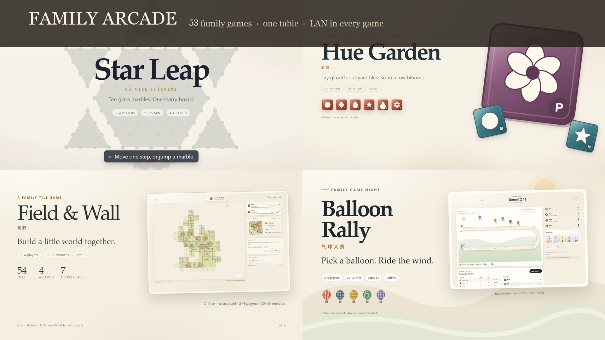](docs/tour.mp4)

[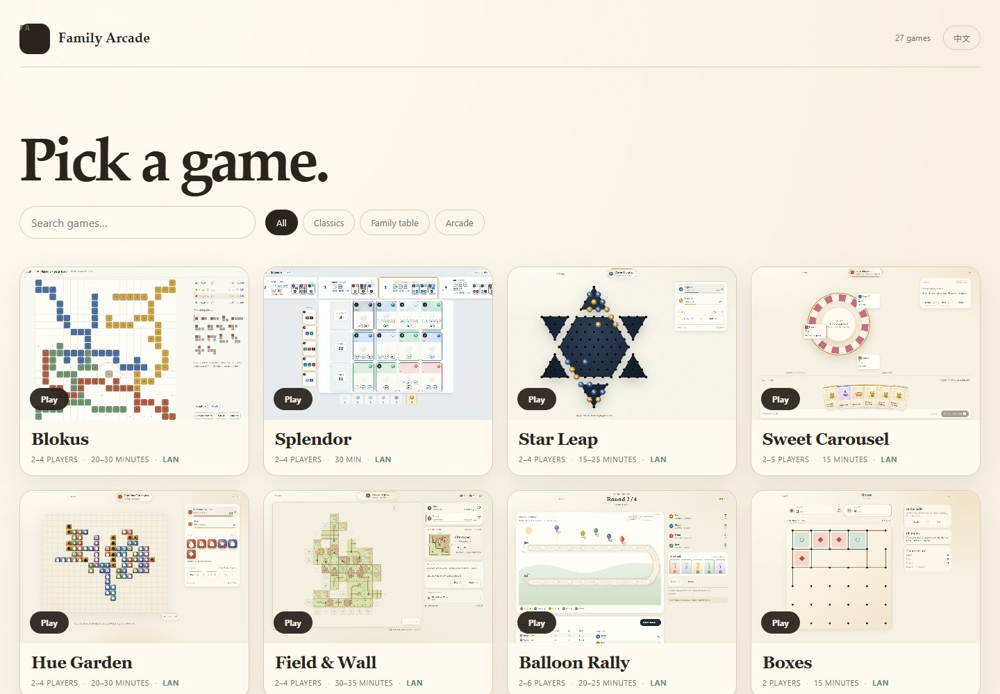](https://github.com/YiheHuang/FamilyArcade/releases/download/family-arcade-v3.1.0/FamilyArcade_3.1.0_x64-setup.exe)

**Offline:** [Family Arcade 3.1.0](https://github.com/YiheHuang/FamilyArcade/releases/download/family-arcade-v3.1.0/FamilyArcade_3.1.0_x64-setup.exe) · **Slim (no bundled runtime):** [Family Arcade Slim](https://github.com/YiheHuang/FamilyArcade/releases/download/family-arcade-v3.1.0/FamilyArcade_3.1.0_slim_x64-setup.exe) · **Lite (download games on demand):** [Family Arcade Lite](https://github.com/YiheHuang/FamilyArcade/releases/download/family-arcade-v3.1.0/FamilyArcade_Lite_3.1.0_x64-setup.exe) · **WebView2 runtime (only if needed):** [offline x64](https://github.com/YiheHuang/FamilyArcade/releases/download/webview2-runtime-v1.0.0/MicrosoftEdgeWebView2RuntimeInstallerX64.exe)

## Classics

<table>
<tr><td width="25%" valign="top">
<a href="apps/blokus/docs/promo/blokus-promo-en.mp4">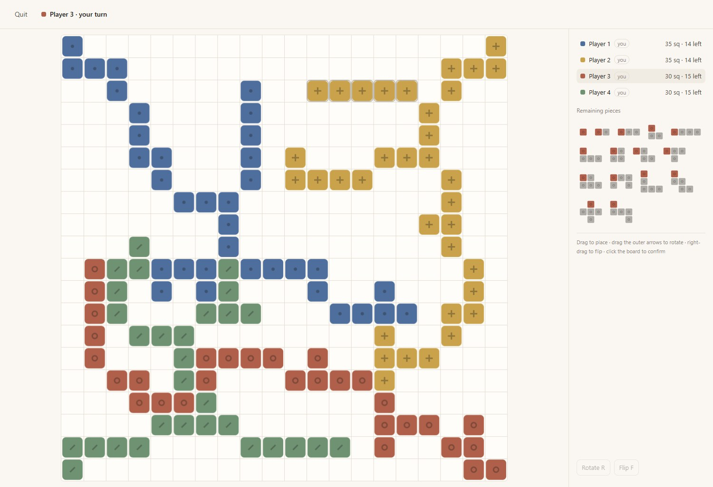</a>

**[Blokus](apps/blokus/README.md)**

<sub>2–4 players · 20–30 min · ages 7+</sub>

<sub>[Trailer](apps/blokus/docs/promo/blokus-promo-en.mp4)</sub>
</td>
<td width="25%" valign="top">
<a href="apps/splendor/docs/promo/splendor-promo-en.mp4">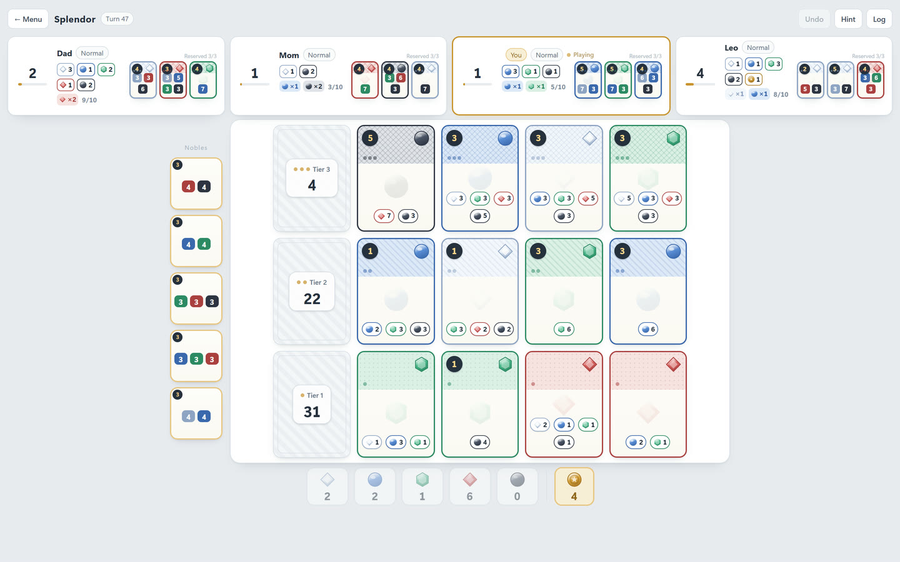</a>

**[Splendor](apps/splendor/README.md)**

<sub>2–4 players · 30 min · ages 8+</sub>

<sub>[Trailer](apps/splendor/docs/promo/splendor-promo-en.mp4)</sub>
</td>
<td width="25%" valign="top">
<a href="apps/gomoku/docs/promo/gomoku-promo-en.mp4">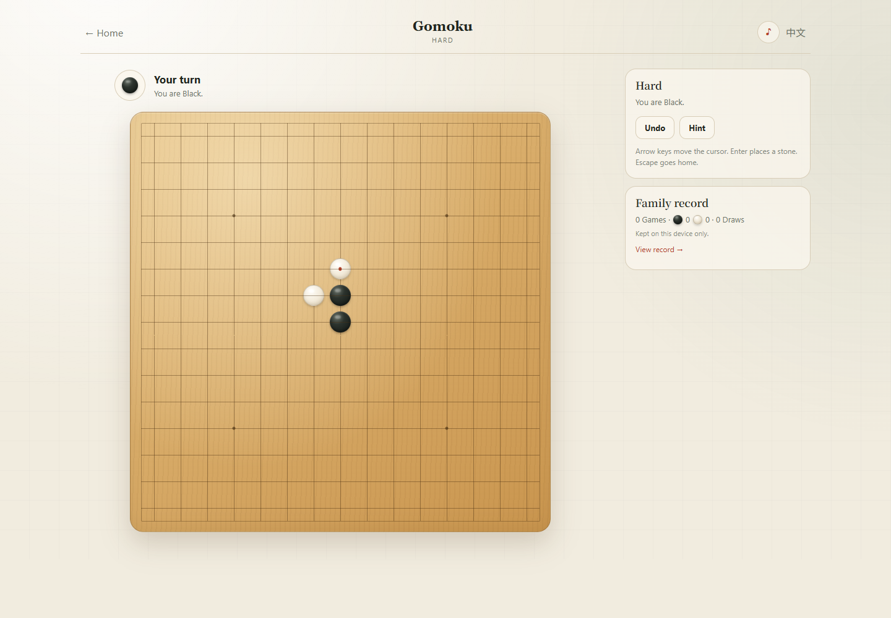</a>

**[Gomoku](apps/gomoku/README.md)**

<sub>2 players · 10–20 min · ages 6+</sub>

<sub>[Trailer](apps/gomoku/docs/promo/gomoku-promo-en.mp4)</sub>
</td>
<td width="25%" valign="top">
<a href="apps/xiangqi/docs/promo/xiangqi-promo-en.mp4">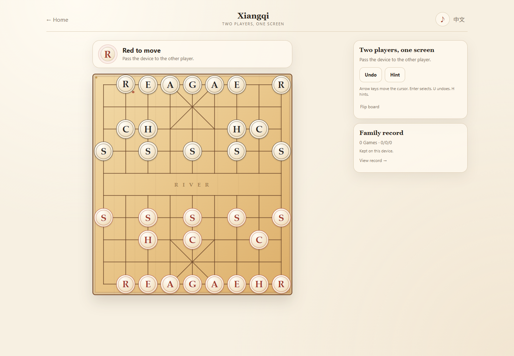</a>

**[Xiangqi](apps/xiangqi/README.md)**

<sub>2 players · 20 min · ages 8+</sub>

<sub>[Trailer](apps/xiangqi/docs/promo/xiangqi-promo-en.mp4)</sub>
</td></tr>
<tr><td width="25%" valign="top">
<a href="apps/chess/docs/promo/chess-promo-en.mp4">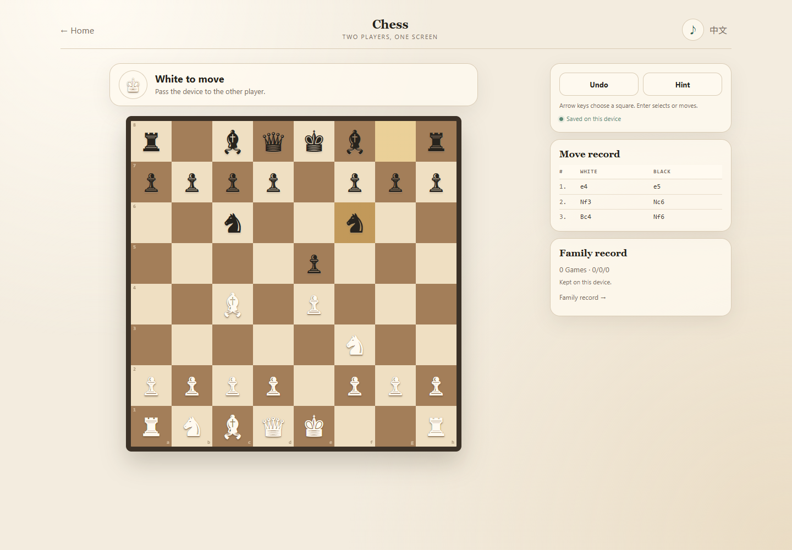</a>

**[Chess](apps/chess/README.md)**

<sub>2 players · 30 min · ages 6+</sub>

<sub>[Trailer](apps/chess/docs/promo/chess-promo-en.mp4)</sub>
</td>
<td width="25%" valign="top">
<a href="apps/go/docs/promo/go-promo-en.mp4">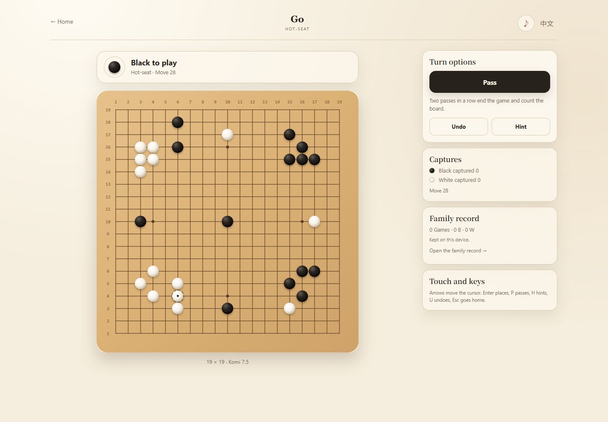</a>

**[Go](apps/go/README.md)**

<sub>2 players · 30 min · ages 6+</sub>

<sub>[Trailer](apps/go/docs/promo/go-promo-en.mp4)</sub>
</td>
<td width="25%" valign="top">
<a href="apps/shogi/docs/promo/shogi-promo-en.mp4">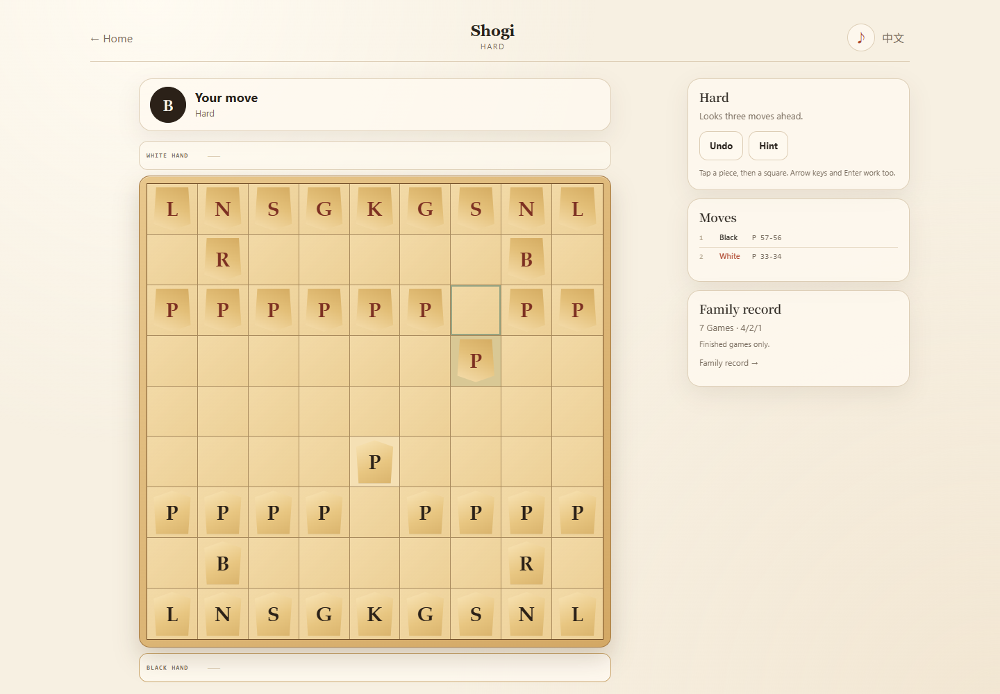</a>

**[Shogi](apps/shogi/README.md)**

<sub>2 players · 20 min · ages 8+</sub>

<sub>[Trailer](apps/shogi/docs/promo/shogi-promo-en.mp4)</sub>
</td>
<td width="25%" valign="top">
<a href="apps/intl-draughts/docs/promo/intl-draughts-promo-en.mp4">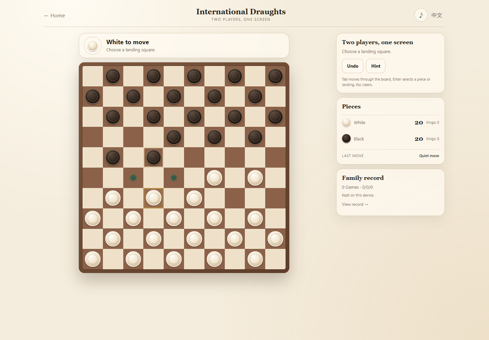</a>

**[International Draughts](apps/intl-draughts/README.md)**

<sub>2 players · 15–30 min · ages 7+</sub>

<sub>[Trailer](apps/intl-draughts/docs/promo/intl-draughts-promo-en.mp4)</sub>
</td></tr>
<tr><td width="25%" valign="top">
<a href="apps/jungle-chess/docs/promo/jungle-chess-promo-en.mp4">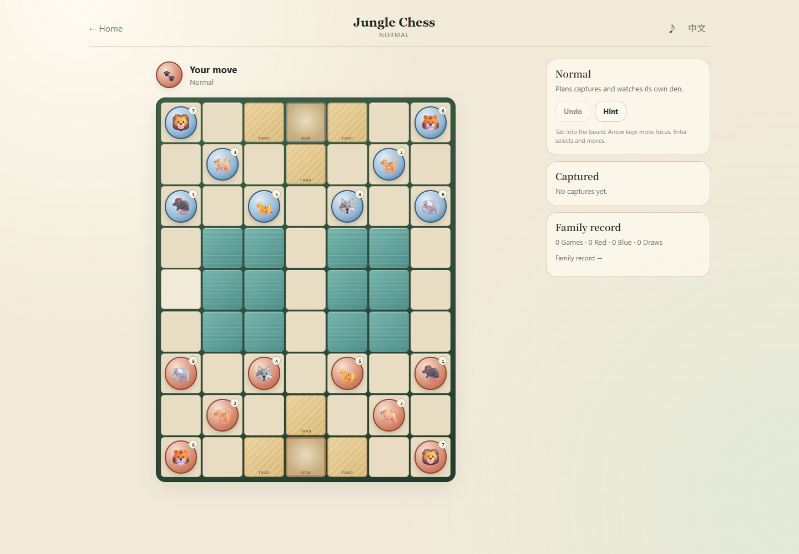</a>

**[Jungle Chess](apps/jungle-chess/README.md)**

<sub>2 players · 15 min · ages 6+</sub>

<sub>[Trailer](apps/jungle-chess/docs/promo/jungle-chess-promo-en.mp4)</sub>
</td>
<td width="25%" valign="top">
<a href="apps/abalone/docs/promo/abalone-promo-en.mp4">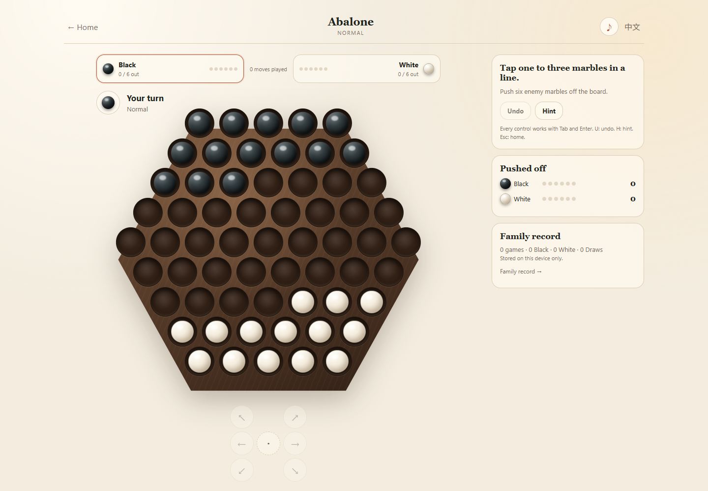</a>

**[Abalone](apps/abalone/README.md)**

<sub>2 players · 15 min · ages 7+</sub>

<sub>[Trailer](apps/abalone/docs/promo/abalone-promo-en.mp4)</sub>
</td>
<td width="25%" valign="top">
<a href="apps/hive/docs/promo/hive-promo-en.mp4">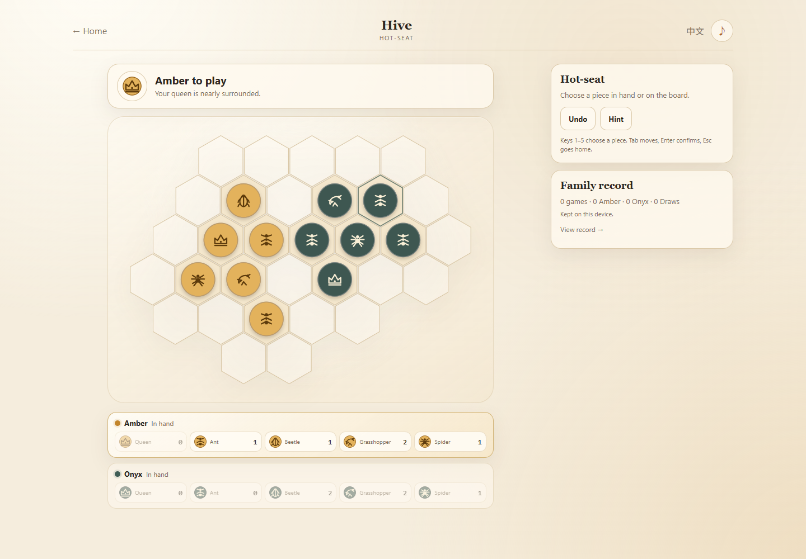</a>

**[Hive](apps/hive/README.md)**

<sub>2 players · 25 min · ages 8+</sub>

<sub>[Trailer](apps/hive/docs/promo/hive-promo-en.mp4)</sub>
</td>
<td width="25%" valign="top">
<a href="apps/quarto/docs/promo/quarto-promo-en.mp4">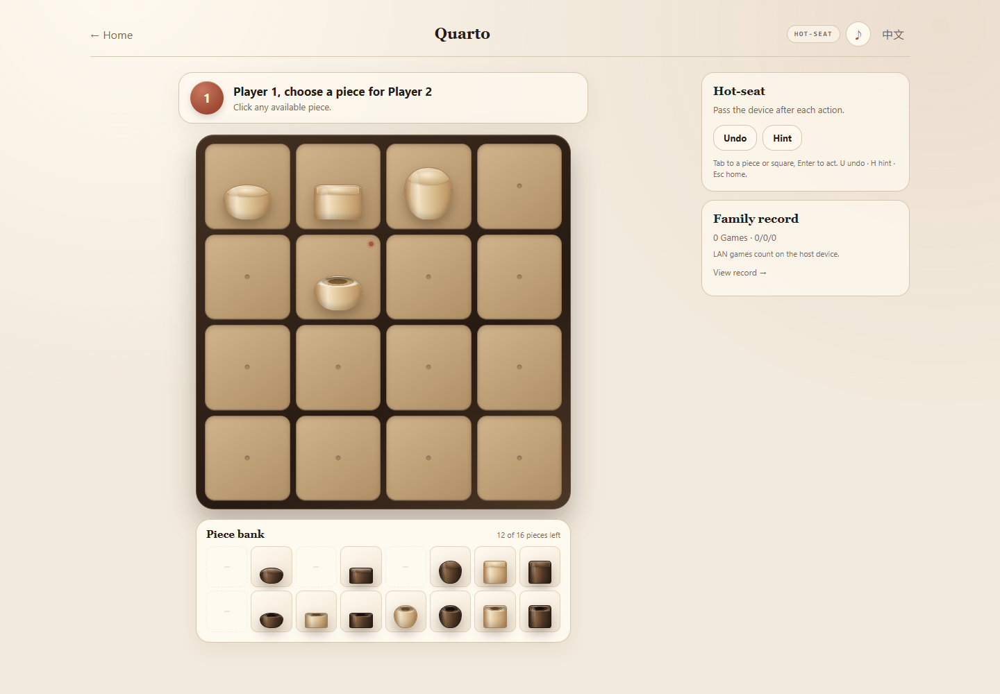</a>

**[Quarto](apps/quarto/README.md)**

<sub>2 players · 10 min · ages 6+</sub>

<sub>[Trailer](apps/quarto/docs/promo/quarto-promo-en.mp4)</sub>
</td></tr>
<tr><td width="25%" valign="top">
<a href="apps/mahjong/docs/promo/mahjong-promo-en.mp4">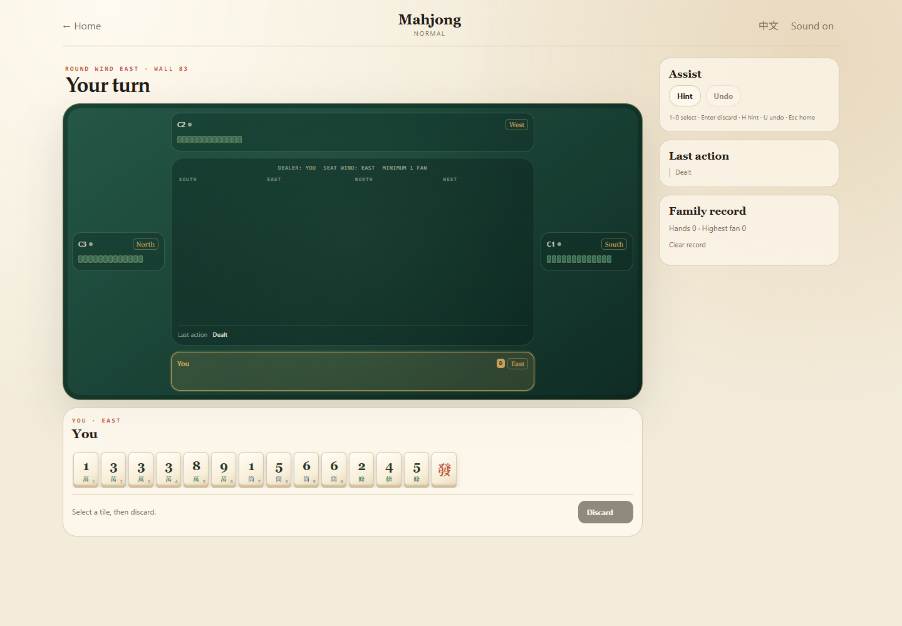</a>

**[Mahjong](apps/mahjong/README.md)**

<sub>4 players · 10–20 min · ages 8+</sub>

<sub>[Trailer](apps/mahjong/docs/promo/mahjong-promo-en.mp4)</sub>
</td>
<td width="25%" valign="top">
<a href="apps/nanchang-mahjong/docs/promo/nanchang-mahjong-promo-en.mp4">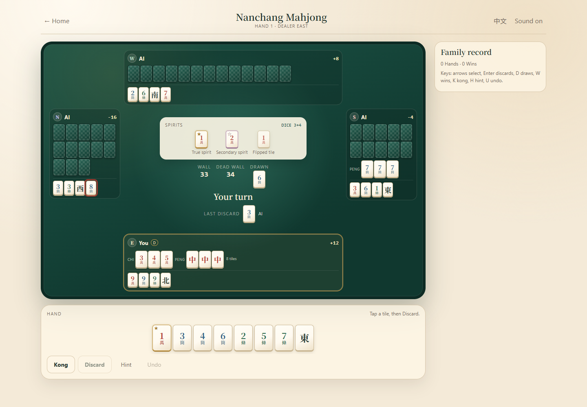</a>

**[Nanchang Mahjong](apps/nanchang-mahjong/README.md)**

<sub>4 players · 15–25 min · ages 10+</sub>

<sub>[Trailer](apps/nanchang-mahjong/docs/promo/nanchang-mahjong-promo-en.mp4)</sub>
</td></tr>
</table>

## Family table

<table>
<tr><td width="25%" valign="top">
<a href="apps/star-leap/docs/promo/star-leap-promo-en.mp4"></a>

**[Star Leap](apps/star-leap/README.md)**

<sub>2–4 players · 15–25 min · ages 7+</sub>

<sub>[Trailer](apps/star-leap/docs/promo/star-leap-promo-en.mp4)</sub>
</td>
<td width="25%" valign="top">
<a href="apps/sweet-carousel/docs/promo/sweet-carousel-promo-en.mp4">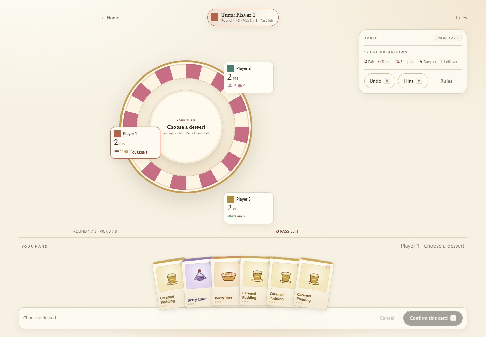</a>

**[Sweet Carousel](apps/sweet-carousel/README.md)**

<sub>2–5 players · 15 min · ages 7+</sub>

<sub>[Trailer](apps/sweet-carousel/docs/promo/sweet-carousel-promo-en.mp4)</sub>
</td>
<td width="25%" valign="top">
<a href="apps/hue-garden/docs/promo/hue-garden-promo-en.mp4">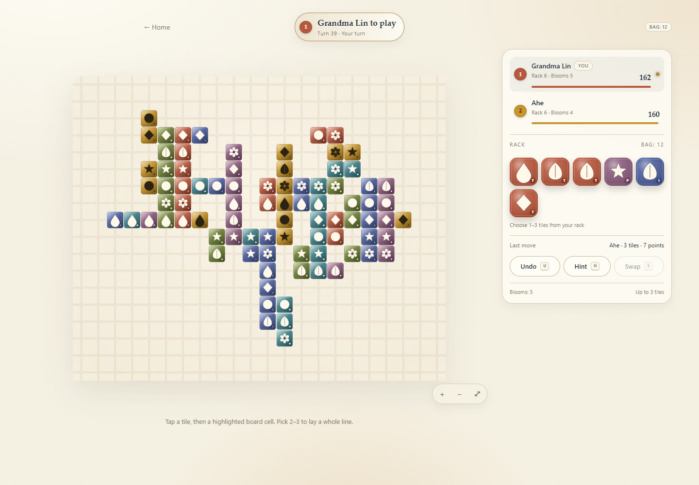</a>

**[Hue Garden](apps/hue-garden/README.md)**

<sub>2–4 players · 20–30 min · ages 8+</sub>

<sub>[Trailer](apps/hue-garden/docs/promo/hue-garden-promo-en.mp4)</sub>
</td>
<td width="25%" valign="top">
<a href="apps/field-and-wall/docs/promo/field-and-wall-promo-en.mp4">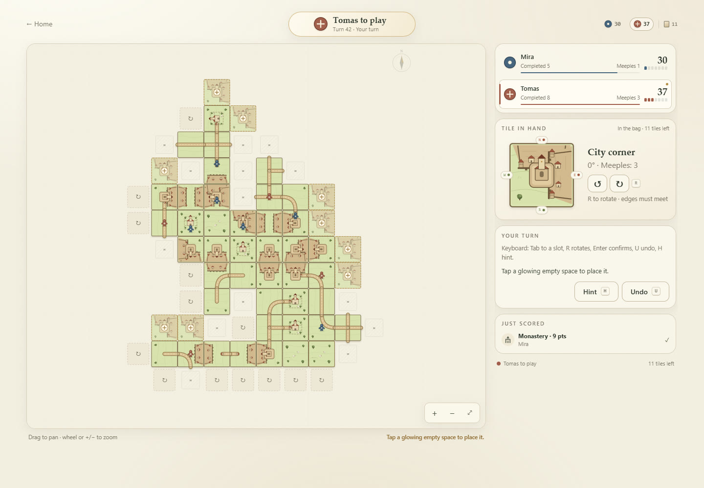</a>

**[Field & Wall](apps/field-and-wall/README.md)**

<sub>2–4 players · 30–35 min · ages 8+</sub>

<sub>[Trailer](apps/field-and-wall/docs/promo/field-and-wall-promo-en.mp4)</sub>
</td></tr>
<tr><td width="25%" valign="top">
<a href="apps/balloon-rally/docs/promo/balloon-rally-promo-en.mp4"></a>

**[Balloon Rally](apps/balloon-rally/README.md)**

<sub>2–6 players · 20–25 min · ages 8+</sub>

<sub>[Trailer](apps/balloon-rally/docs/promo/balloon-rally-promo-en.mp4)</sub>
</td>
<td width="25%" valign="top">
<a href="apps/hearts/docs/promo/hearts-promo-en.mp4">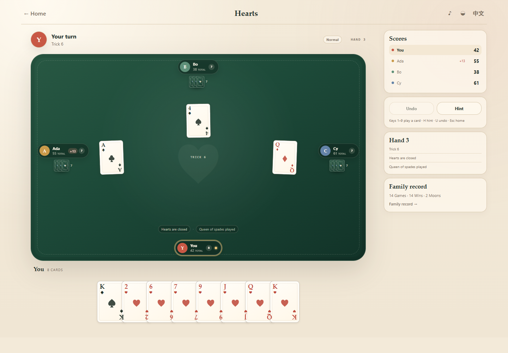</a>

**[Hearts](apps/hearts/README.md)**

<sub>4 players · 25 min · ages 8+</sub>

<sub>[Trailer](apps/hearts/docs/promo/hearts-promo-en.mp4)</sub>
</td>
<td width="25%" valign="top">
<a href="apps/spades/docs/promo/spades-promo-en.mp4">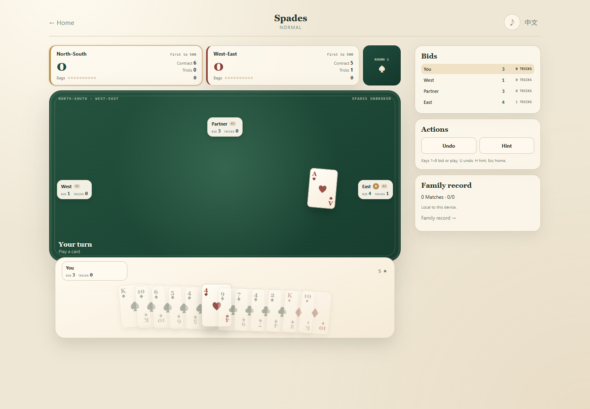</a>

**[Spades](apps/spades/README.md)**

<sub>4 players · 20–30 min · ages 8+</sub>

<sub>[Trailer](apps/spades/docs/promo/spades-promo-en.mp4)</sub>
</td>
<td width="25%" valign="top">
<a href="apps/rummy-500/docs/promo/rummy-500-promo-en.mp4">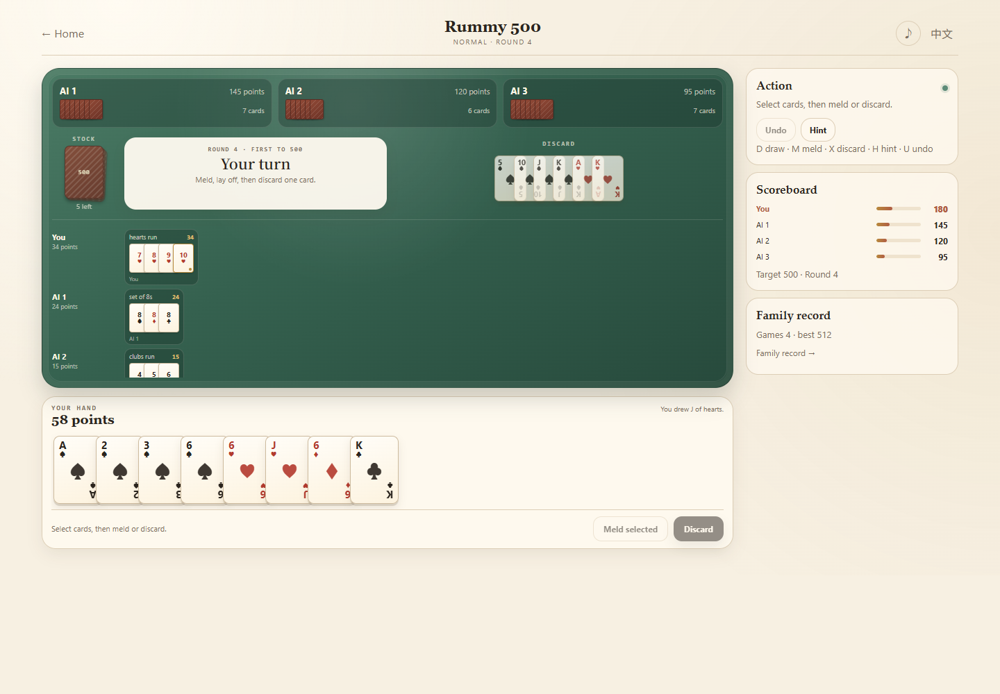</a>

**[Rummy 500](apps/rummy-500/README.md)**

<sub>2–4 players · 20–30 min · ages 8+</sub>

<sub>[Trailer](apps/rummy-500/docs/promo/rummy-500-promo-en.mp4)</sub>
</td></tr>
<tr><td width="25%" valign="top">
<a href="apps/cribbage/docs/promo/cribbage-promo-en.mp4">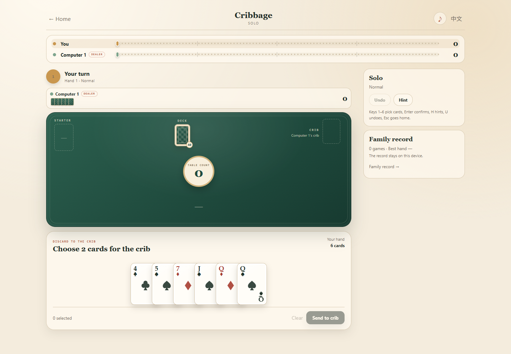</a>

**[Cribbage](apps/cribbage/README.md)**

<sub>2–4 players · 20 min · ages 8+</sub>

<sub>[Trailer](apps/cribbage/docs/promo/cribbage-promo-en.mp4)</sub>
</td>
<td width="25%" valign="top">
<a href="apps/president/docs/promo/president-promo-en.mp4">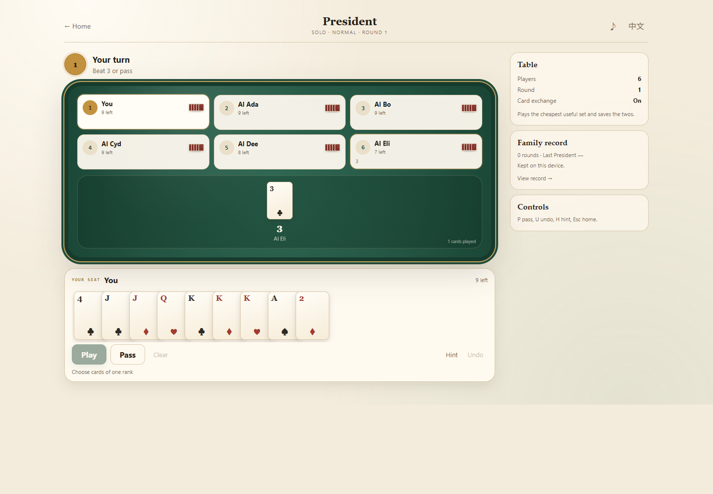</a>

**[President](apps/president/README.md)**

<sub>3–6 players · 20 min · ages 8+</sub>

<sub>[Trailer](apps/president/docs/promo/president-promo-en.mp4)</sub>
</td>
<td width="25%" valign="top">
<a href="apps/doudizhu/docs/promo/doudizhu-promo-en.mp4">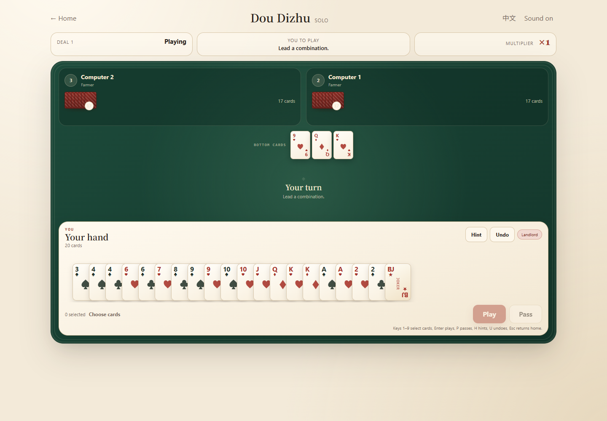</a>

**[Dou Dizhu](apps/doudizhu/README.md)**

<sub>3 players · 10–15 min · ages 8+</sub>

<sub>[Trailer](apps/doudizhu/docs/promo/doudizhu-promo-en.mp4)</sub>
</td>
<td width="25%" valign="top">
<a href="apps/texas-holdem/docs/promo/texas-holdem-promo-en.mp4">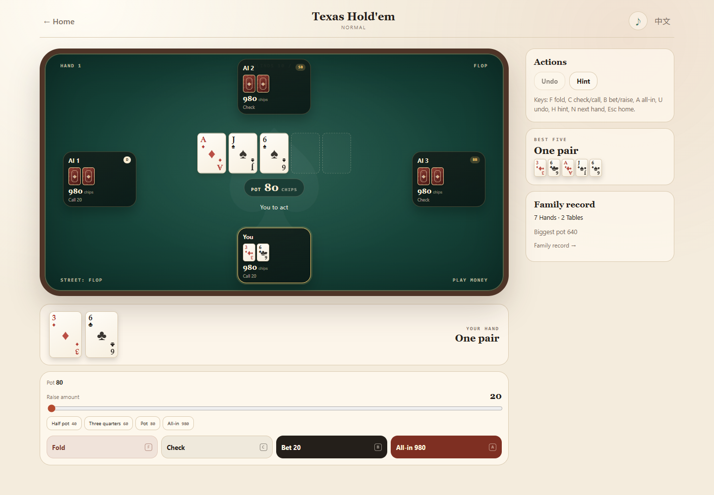</a>

**[Texas Hold'em](apps/texas-holdem/README.md)**

<sub>2–6 players · 15 min · ages 8+</sub>

<sub>[Trailer](apps/texas-holdem/docs/promo/texas-holdem-promo-en.mp4)</sub>
</td></tr>
<tr><td width="25%" valign="top">
<a href="apps/zheng-shangyou/docs/promo/zheng-shangyou-promo-en.mp4">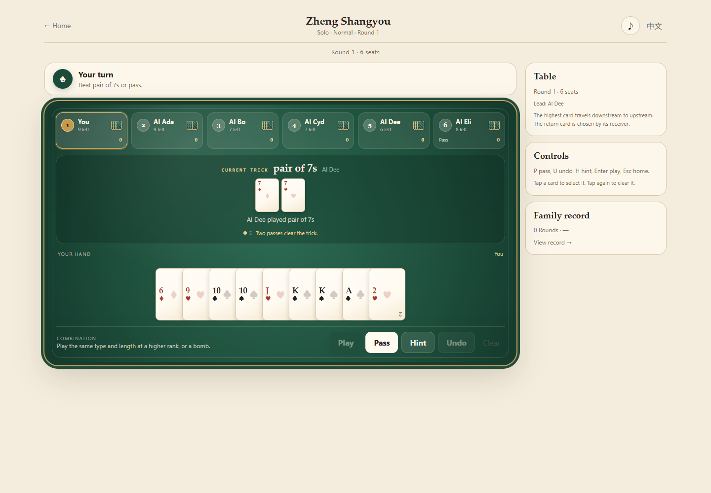</a>

**[Zheng Shangyou](apps/zheng-shangyou/README.md)**

<sub>3–6 players · 15–25 min · ages 8+</sub>

<sub>[Trailer](apps/zheng-shangyou/docs/promo/zheng-shangyou-promo-en.mp4)</sub>
</td>
<td width="25%" valign="top">
<a href="apps/guandan/docs/promo/guandan-promo-en.mp4">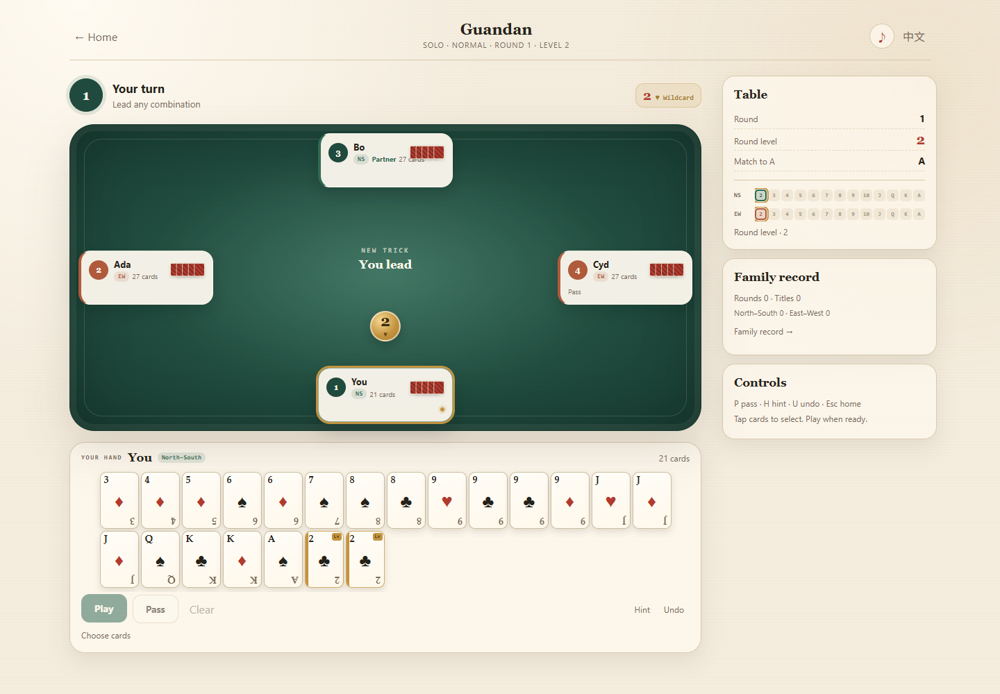</a>

**[Guandan](apps/guandan/README.md)**

<sub>4 players · 30 min · ages 10+</sub>

<sub>[Trailer](apps/guandan/docs/promo/guandan-promo-en.mp4)</sub>
</td>
<td width="25%" valign="top">
<a href="apps/big-two/docs/promo/big-two-promo-en.mp4">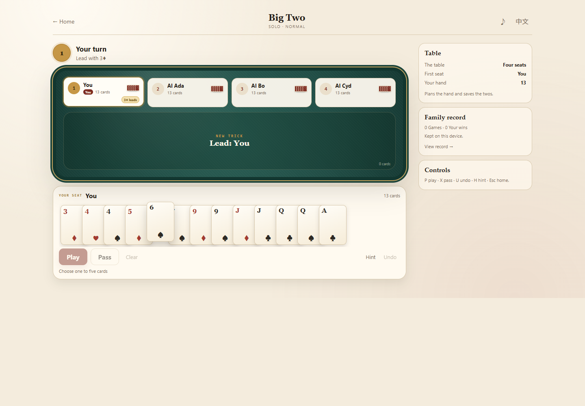</a>

**[Big Two](apps/big-two/README.md)**

<sub>4 players · 15 min · ages 8+</sub>

<sub>[Trailer](apps/big-two/docs/promo/big-two-promo-en.mp4)</sub>
</td>
<td width="25%" valign="top">
<a href="apps/sheng-ji/docs/promo/sheng-ji-promo-en.mp4"></a>

**[Sheng Ji](apps/sheng-ji/README.md)**

<sub>4 players · 30 min · ages 8+</sub>

<sub>[Trailer](apps/sheng-ji/docs/promo/sheng-ji-promo-en.mp4)</sub>
</td></tr>
<tr><td width="25%" valign="top">
<a href="apps/liars-dice/docs/promo/liars-dice-promo-en.mp4">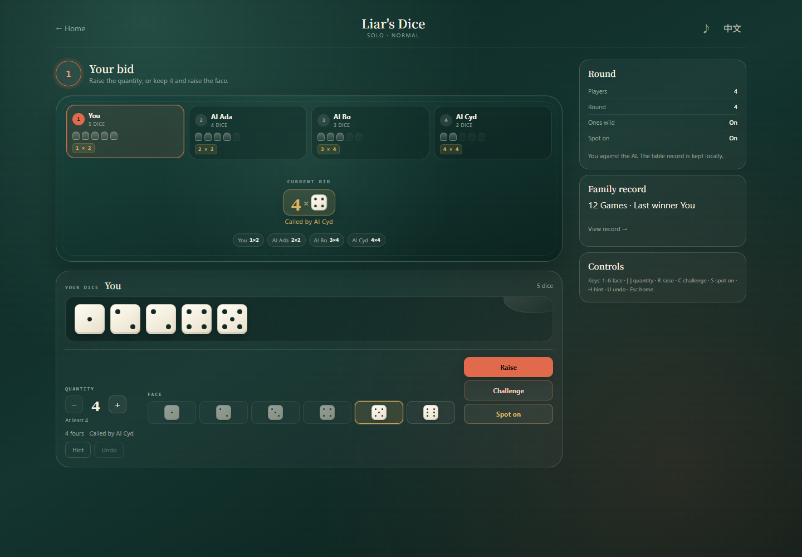</a>

**[Liar's Dice](apps/liars-dice/README.md)**

<sub>2–6 players · 15 min · ages 8+</sub>

<sub>[Trailer](apps/liars-dice/docs/promo/liars-dice-promo-en.mp4)</sub>
</td>
<td width="25%" valign="top">
<a href="apps/idiom-chain/docs/promo/idiom-chain-promo-en.mp4">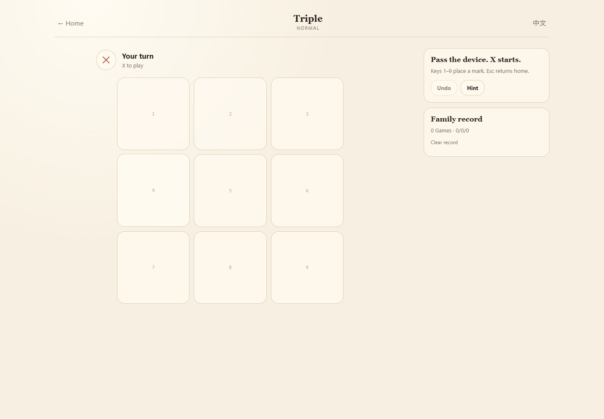</a>

**[Idiom Chain](apps/idiom-chain/README.md)**

<sub>2–6 players · 10–20 min · ages 7+</sub>

<sub>[Trailer](apps/idiom-chain/docs/promo/idiom-chain-promo-en.mp4)</sub>
</td></tr>
</table>

## Arcade

<table>
<tr><td width="25%" valign="top">
<a href="apps/jokers-table/docs/promo/jokers-table-promo-en.mp4">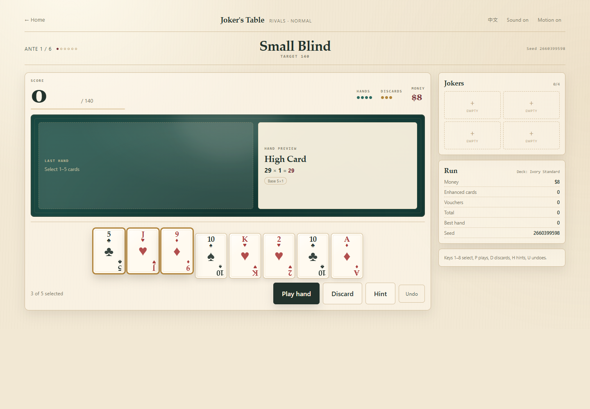</a>

**[Joker's Table](apps/jokers-table/README.md)**

<sub>1–4 players · 20–35 min · ages 10+</sub>

<sub>[Trailer](apps/jokers-table/docs/promo/jokers-table-promo-en.mp4)</sub>
</td>
<td width="25%" valign="top">
<a href="apps/triple/docs/promo/triple-promo-en.mp4">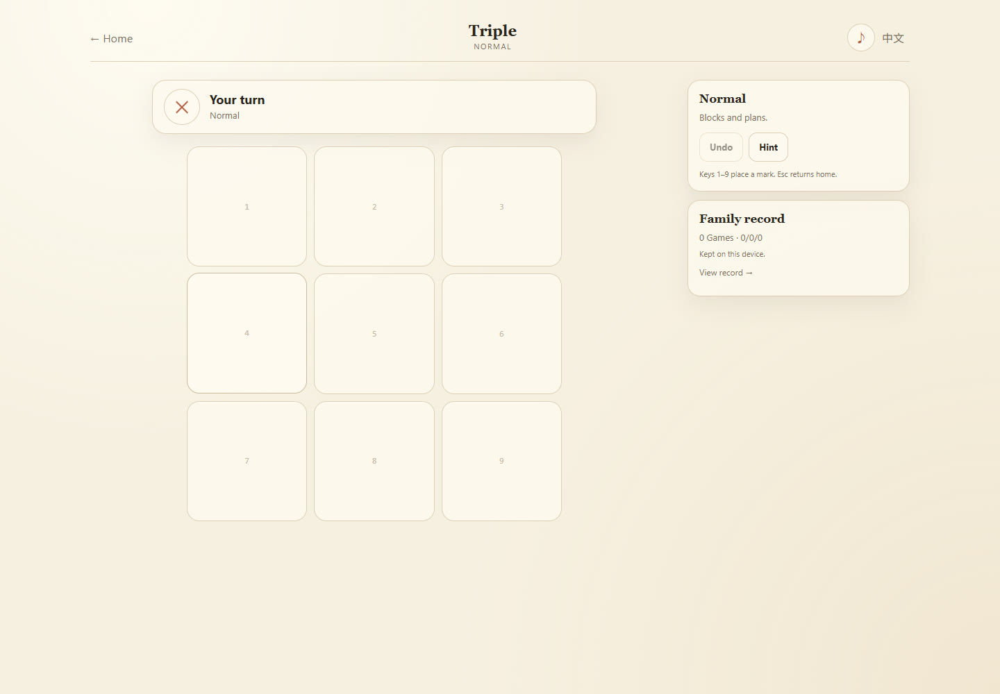</a>

**[Triple](apps/triple/README.md)**

<sub>2 players · 10 min · ages 6+</sub>

<sub>[Trailer](apps/triple/docs/promo/triple-promo-en.mp4)</sub>
</td>
<td width="25%" valign="top">
<a href="apps/four/docs/promo/four-promo-en.mp4">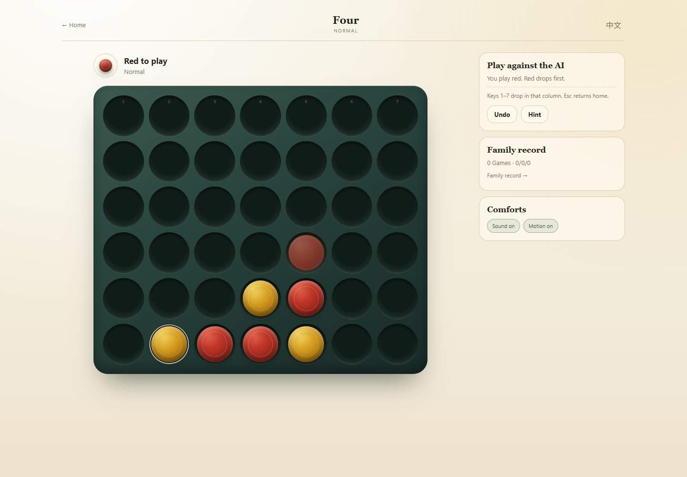</a>

**[Four](apps/four/README.md)**

<sub>2 players · 10–15 min · ages 6+</sub>

<sub>[Trailer](apps/four/docs/promo/four-promo-en.mp4)</sub>
</td>
<td width="25%" valign="top">
<a href="apps/flip/docs/promo/flip-promo-en.mp4">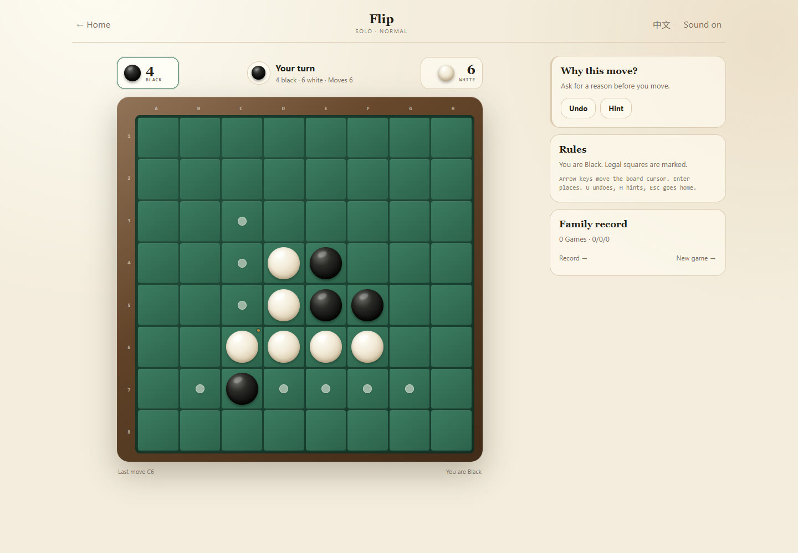</a>

**[Flip](apps/flip/README.md)**

<sub>2 players · 10 min · ages 6+</sub>

<sub>[Trailer](apps/flip/docs/promo/flip-promo-en.mp4)</sub>
</td></tr>
<tr><td width="25%" valign="top">
<a href="apps/draughts/docs/promo/draughts-promo-en.mp4"></a>

**[Draughts](apps/draughts/README.md)**

<sub>2 players · 20 min · ages 7+</sub>

<sub>[Trailer](apps/draughts/docs/promo/draughts-promo-en.mp4)</sub>
</td>
<td width="25%" valign="top">
<a href="apps/mill/docs/promo/mill-promo-en.mp4">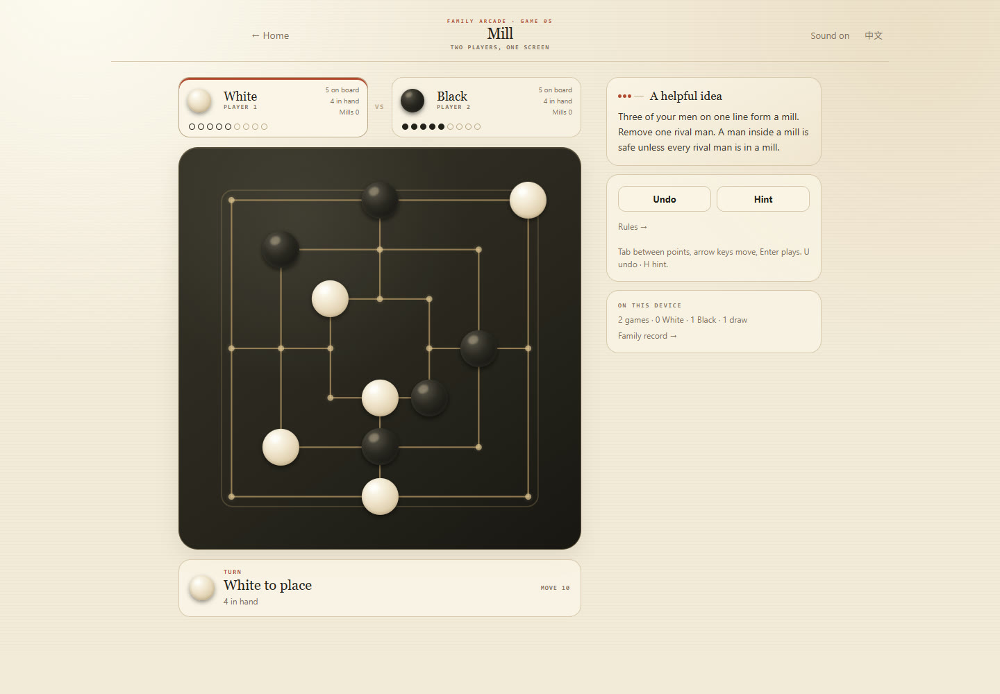</a>

**[Mill](apps/mill/README.md)**

<sub>2 players · 10 min · ages 6+</sub>

<sub>[Trailer](apps/mill/docs/promo/mill-promo-en.mp4)</sub>
</td>
<td width="25%" valign="top">
<a href="apps/boxes/docs/promo/boxes-promo-en.mp4">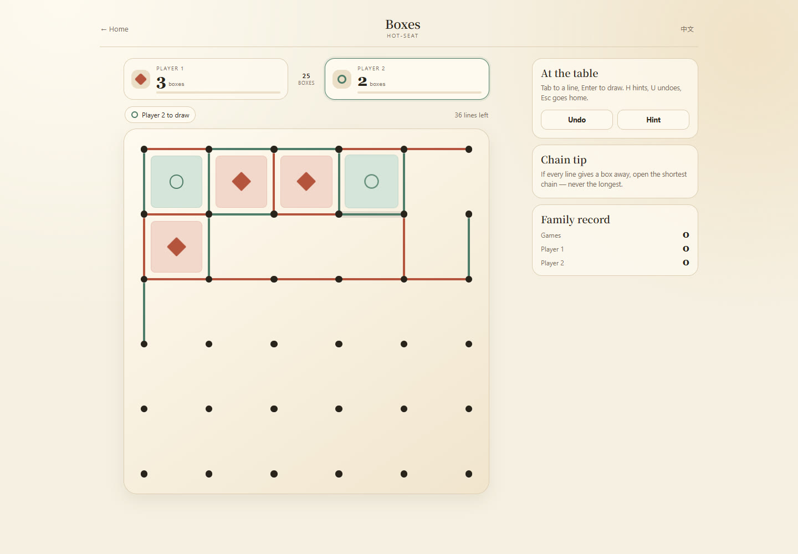</a>

**[Boxes](apps/boxes/README.md)**

<sub>2 players · 15 min · ages 6+</sub>

<sub>[Trailer](apps/boxes/docs/promo/boxes-promo-en.mp4)</sub>
</td>
<td width="25%" valign="top">
<a href="apps/sowing/docs/promo/sowing-promo-en.mp4">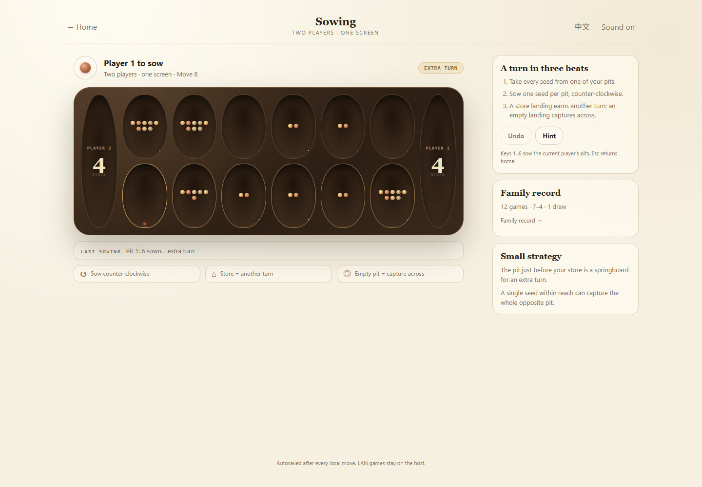</a>

**[Sowing](apps/sowing/README.md)**

<sub>2 players · 10 min · ages 6+</sub>

<sub>[Trailer](apps/sowing/docs/promo/sowing-promo-en.mp4)</sub>
</td></tr>
<tr><td width="25%" valign="top">
<a href="apps/tables/docs/promo/tables-promo-en.mp4">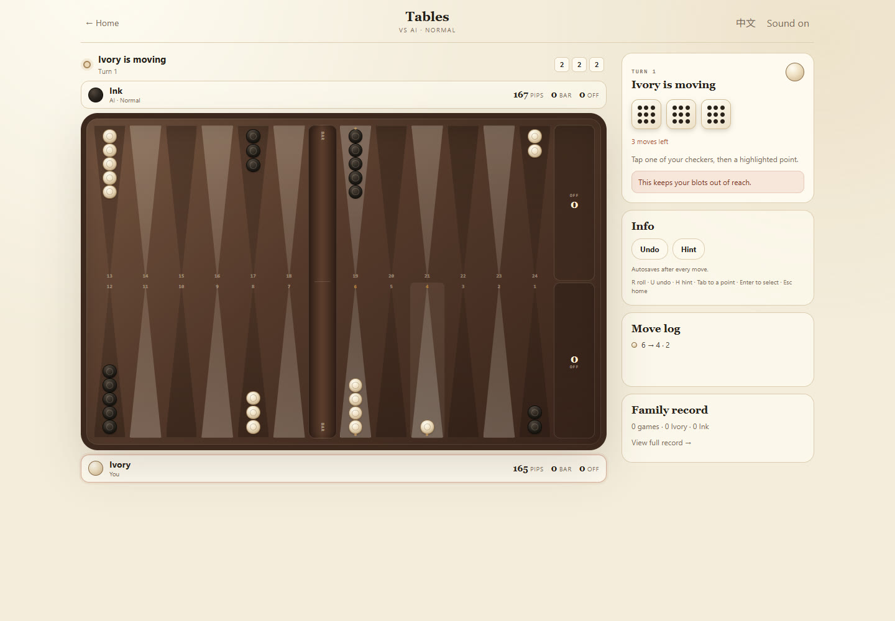</a>

**[Tables](apps/tables/README.md)**

<sub>2 players · 15 min · ages 8+</sub>

<sub>[Trailer](apps/tables/docs/promo/tables-promo-en.mp4)</sub>
</td>
<td width="25%" valign="top">
<a href="apps/race-home/docs/promo/race-home-promo-en.mp4">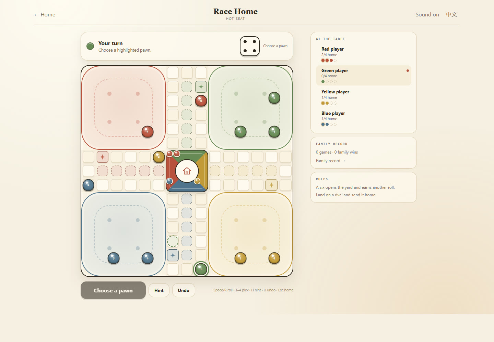</a>

**[Race Home](apps/race-home/README.md)**

<sub>2–4 players · 20–30 min · ages 6+</sub>

<sub>[Trailer](apps/race-home/docs/promo/race-home-promo-en.mp4)</sub>
</td>
<td width="25%" valign="top">
<a href="apps/ladder-run/docs/promo/ladder-run-promo-en.mp4"></a>

**[Ladder Run](apps/ladder-run/README.md)**

<sub>2–4 players · 15 min · ages 5+</sub>

<sub>[Trailer](apps/ladder-run/docs/promo/ladder-run-promo-en.mp4)</sub>
</td>
<td width="25%" valign="top">
<a href="apps/pair-up/docs/promo/pair-up-promo-en.mp4">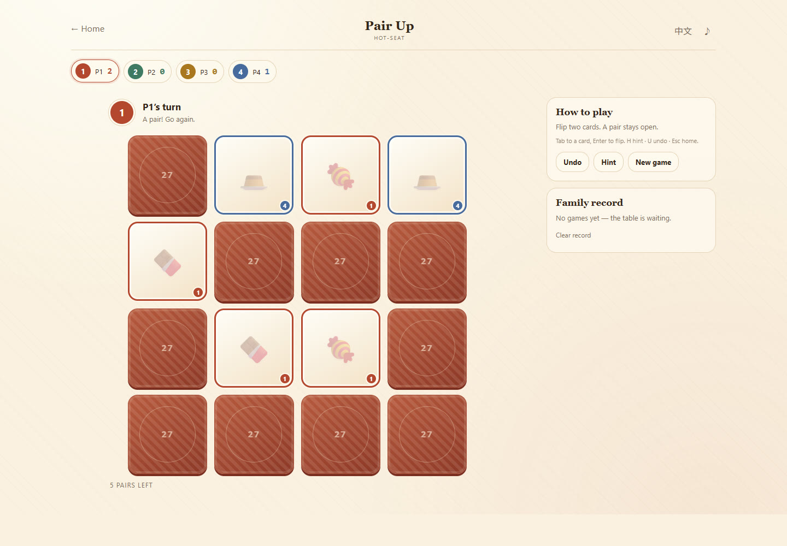</a>

**[Pair Up](apps/pair-up/README.md)**

<sub>2–6 players · 10–20 min · ages 5+</sub>

<sub>[Trailer](apps/pair-up/docs/promo/pair-up-promo-en.mp4)</sub>
</td></tr>
<tr><td width="25%" valign="top">
<a href="apps/domino-line/docs/promo/domino-line-promo-en.mp4">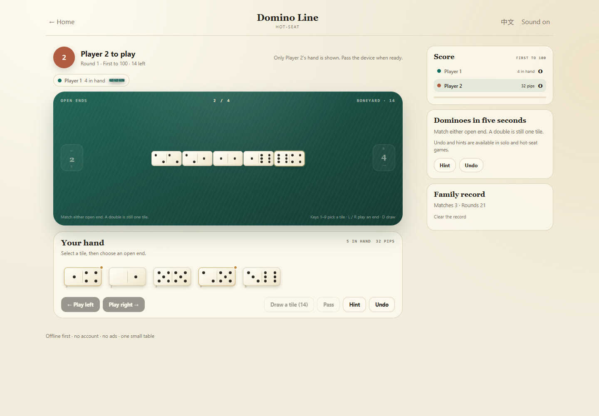</a>

**[Domino Line](apps/domino-line/README.md)**

<sub>2–4 players · 15–25 min · ages 7+</sub>

<sub>[Trailer](apps/domino-line/docs/promo/domino-line-promo-en.mp4)</sub>
</td>
<td width="25%" valign="top">
<a href="apps/color-chain/docs/promo/color-chain-promo-en.mp4"></a>

**[Color Chain](apps/color-chain/README.md)**

<sub>2–6 players · 20 min · ages 6+</sub>

<sub>[Trailer](apps/color-chain/docs/promo/color-chain-promo-en.mp4)</sub>
</td>
<td width="25%" valign="top">
<a href="apps/five-dice/docs/promo/five-dice-promo-en.mp4">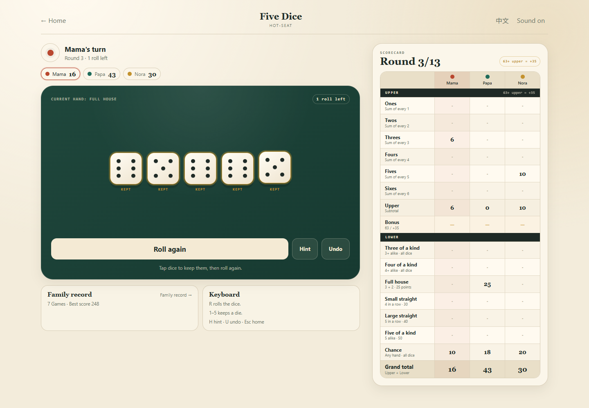</a>

**[Five Dice](apps/five-dice/README.md)**

<sub>2–4 players · 20 min · ages 6+</sub>

<sub>[Trailer](apps/five-dice/docs/promo/five-dice-promo-en.mp4)</sub>
</td>
<td width="25%" valign="top">
<a href="apps/fleet/docs/promo/fleet-promo-en.mp4">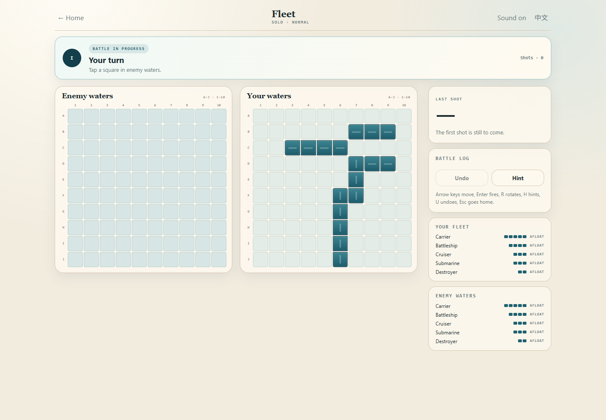</a>

**[Fleet](apps/fleet/README.md)**

<sub>2 players · 10 min · ages 6+</sub>

<sub>[Trailer](apps/fleet/docs/promo/fleet-promo-en.mp4)</sub>
</td></tr>
<tr><td width="25%" valign="top">
<a href="apps/codebreak/docs/promo/codebreak-promo-en.mp4">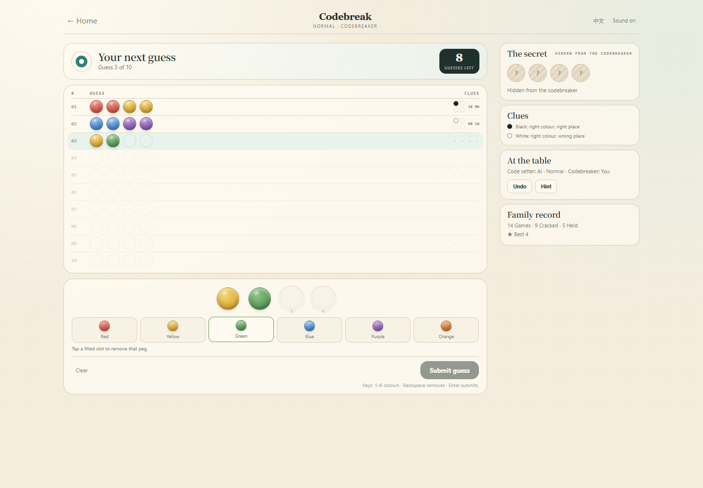</a>

**[Codebreak](apps/codebreak/README.md)**

<sub>2 players · 10 min · ages 6+</sub>

<sub>[Trailer](apps/codebreak/docs/promo/codebreak-promo-en.mp4)</sub>
</td>
<td width="25%" valign="top">
<a href="apps/triple-find/docs/promo/triple-find-promo-en.mp4">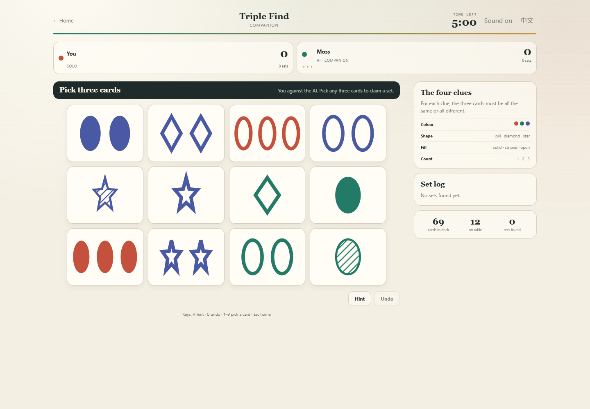</a>

**[Triple Find](apps/triple-find/README.md)**

<sub>2–4 players · 5 min · ages 6+</sub>

<sub>[Trailer](apps/triple-find/docs/promo/triple-find-promo-en.mp4)</sub>
</td>
<td width="25%" valign="top">
<a href="apps/little-go/docs/promo/little-go-promo-en.mp4"></a>

**[Little Go](apps/little-go/README.md)**

<sub>2 players · 15 min · ages 6+</sub>

<sub>[Trailer](apps/little-go/docs/promo/little-go-promo-en.mp4)</sub>
</td>
<td width="25%" valign="top">
<a href="apps/mini-chess/docs/promo/mini-chess-promo-en.mp4">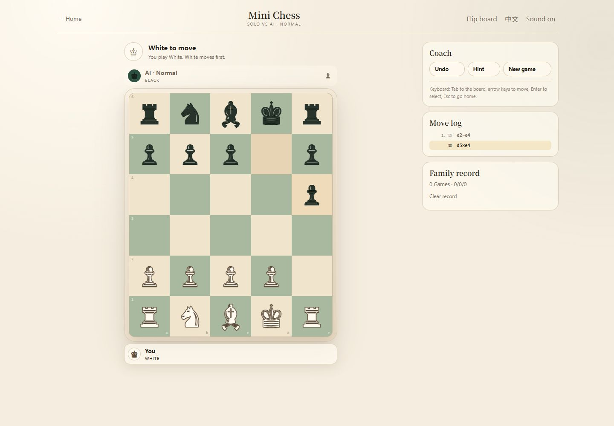</a>

**[Mini Chess](apps/mini-chess/README.md)**

<sub>2 players · 10 min · ages 6+</sub>

<sub>[Trailer](apps/mini-chess/docs/promo/mini-chess-promo-en.mp4)</sub>
</td></tr>
<tr><td width="25%" valign="top">
<a href="apps/hex/docs/promo/hex-promo-en.mp4">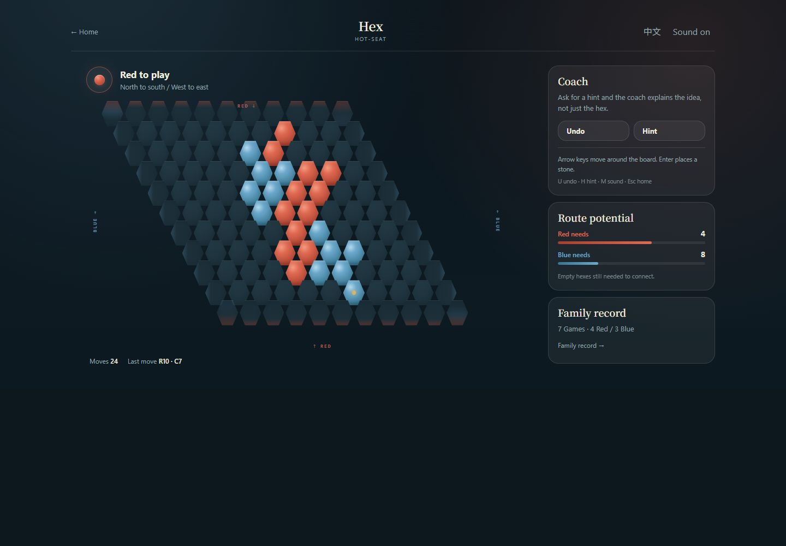</a>

**[Hex](apps/hex/README.md)**

<sub>2 players · 15 min · ages 7+</sub>

<sub>[Trailer](apps/hex/docs/promo/hex-promo-en.mp4)</sub>
</td></tr>
</table>

## Releases

There are three launcher builds under [Releases](https://github.com/YiheHuang/FamilyArcade/releases): **Offline** (all
53 games plus the WebView2 runtime), **Slim** (all games, no bundled
runtime, about 200 MB smaller), and **Lite** (download only the games you play, about
8 MB). Lite installs WebView2 automatically if Windows is missing it. See each game
README for rules, LAN and limitations.

## Build

```bash
cd apps/triple
npm install
npm run check
node scripts/e2e.mjs
```

The shared promo studio is in `video/`. The launcher is in `apps/family-arcade/`.

## License

MIT code; original art/copy. See [NOTICE.md](NOTICE.md).
