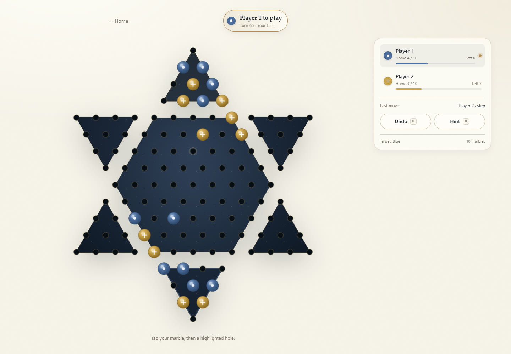
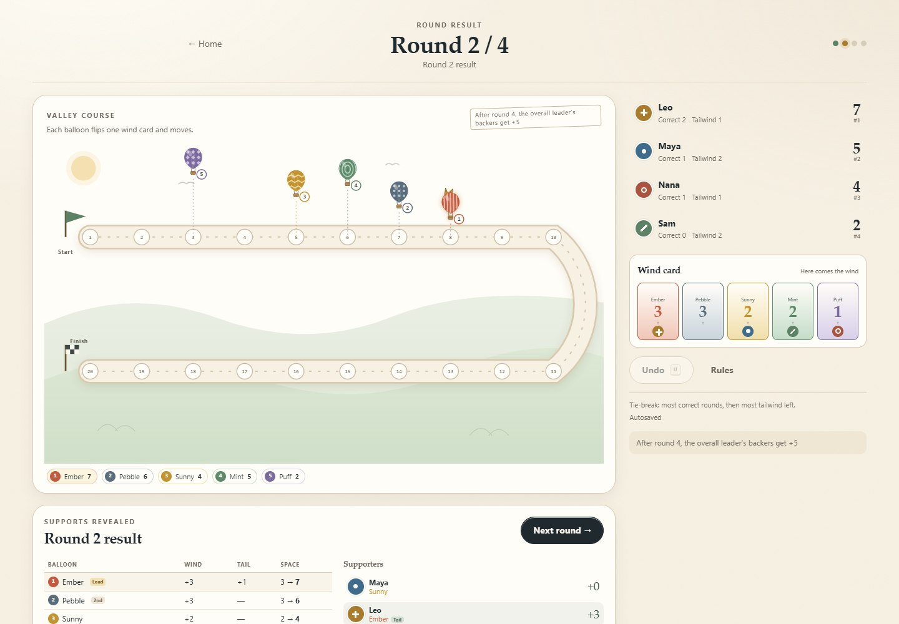
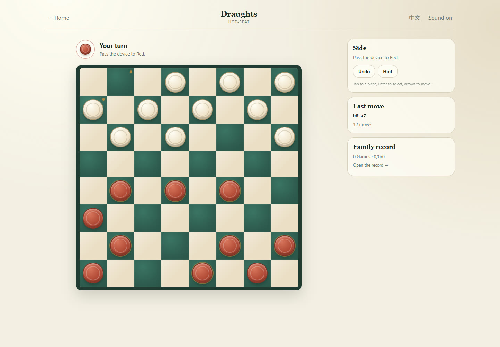
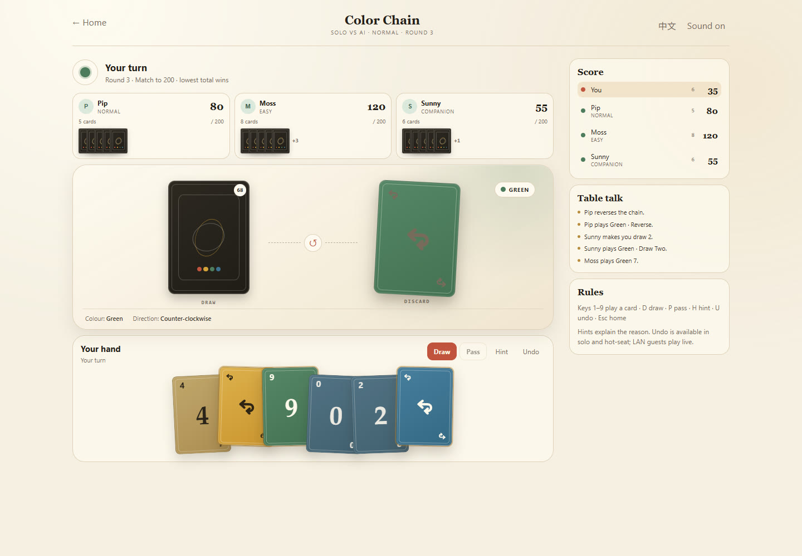
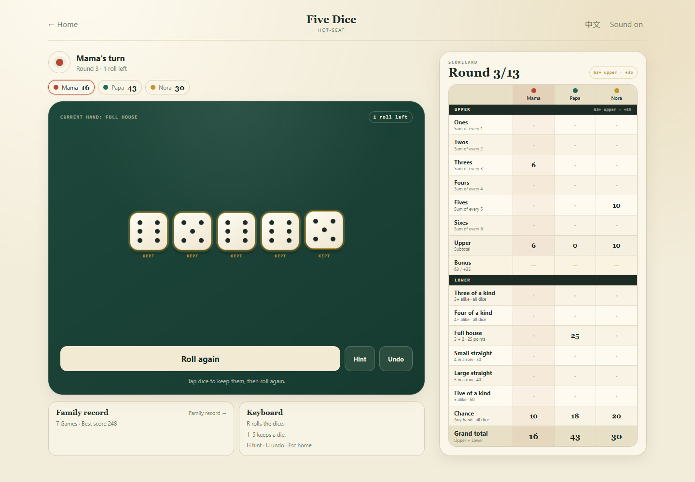
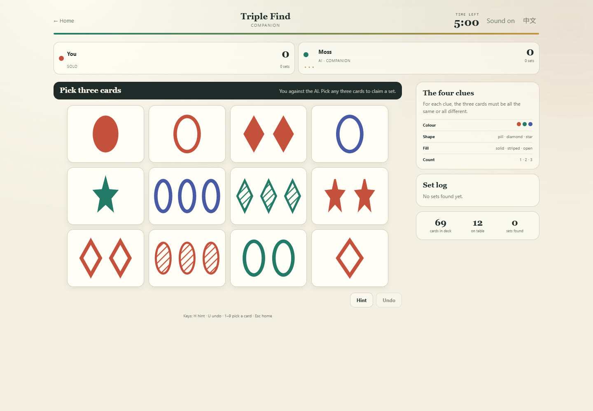

English · [简体中文](README.zh-CN.md)

# Family Arcade

**27 offline family games. AI, hot-seat and LAN in every game.**

[](docs/tour.mp4)

[](https://github.com/YiheHuang/FamilyArcade/releases/download/family-arcade-v1.0.1/FamilyArcade_1.0.1_x64-setup.exe)

**All-in-one:** [Family Arcade 1.0.1](https://github.com/YiheHuang/FamilyArcade/releases/download/family-arcade-v1.0.1/FamilyArcade_1.0.1_x64-setup.exe) · **WebView2 runtime (only if needed):** [offline x64](https://github.com/YiheHuang/FamilyArcade/releases/download/webview2-runtime-v1.0.0/MicrosoftEdgeWebView2RuntimeInstallerX64.exe)

## Classics

<table>
<tr><td width="25%" valign="top">
<a href="apps/blokus/docs/promo/blokus-promo-en.mp4"></a>

**[Blokus](apps/blokus/README.md)**

<sub>2–4 players · 20–30 min · ages 7+</sub>

<sub>[Trailer](apps/blokus/docs/promo/blokus-promo-en.mp4) · [Installer](https://github.com/YiheHuang/FamilyArcade/releases/download/blokus-v1.7.1/blokus_1.7.1_x64-setup.exe)</sub>
</td>
<td width="25%" valign="top">
<a href="apps/splendor/docs/promo/splendor-promo-en.mp4"></a>

**[Splendor](apps/splendor/README.md)**

<sub>2–4 players · 30 min · ages 8+</sub>

<sub>[Trailer](apps/splendor/docs/promo/splendor-promo-en.mp4) · [Installer](https://github.com/YiheHuang/FamilyArcade/releases/download/splendor-v2.5.0/splendor_2.5.0_x64-setup.exe)</sub>
</td></tr>
</table>

## Family table

<table>
<tr><td width="25%" valign="top">
<a href="apps/star-leap/docs/promo/star-leap-promo-en.mp4"></a>

**[Star Leap](apps/star-leap/README.md)**

<sub>2–4 players · 15–25 min · ages 7+</sub>

<sub>[Trailer](apps/star-leap/docs/promo/star-leap-promo-en.mp4) · [Installer](https://github.com/YiheHuang/FamilyArcade/releases/download/star-leap-v0.2.0/star-leap_0.2.0_x64-setup.exe)</sub>
</td>
<td width="25%" valign="top">
<a href="apps/sweet-carousel/docs/promo/sweet-carousel-promo-en.mp4"></a>

**[Sweet Carousel](apps/sweet-carousel/README.md)**

<sub>2–5 players · 15 min · ages 7+</sub>

<sub>[Trailer](apps/sweet-carousel/docs/promo/sweet-carousel-promo-en.mp4) · [Installer](https://github.com/YiheHuang/FamilyArcade/releases/download/sweet-carousel-v0.1.0/sweet-carousel_0.1.0_x64-setup.exe)</sub>
</td>
<td width="25%" valign="top">
<a href="apps/hue-garden/docs/promo/hue-garden-promo-en.mp4"></a>

**[Hue Garden](apps/hue-garden/README.md)**

<sub>2–4 players · 20–30 min · ages 8+</sub>

<sub>[Trailer](apps/hue-garden/docs/promo/hue-garden-promo-en.mp4) · [Installer](https://github.com/YiheHuang/FamilyArcade/releases/download/hue-garden-v0.1.0/hue-garden_0.1.0_x64-setup.exe)</sub>
</td>
<td width="25%" valign="top">
<a href="apps/field-and-wall/docs/promo/field-and-wall-promo-en.mp4"></a>

**[Field & Wall](apps/field-and-wall/README.md)**

<sub>2–4 players · 30–35 min · ages 8+</sub>

<sub>[Trailer](apps/field-and-wall/docs/promo/field-and-wall-promo-en.mp4) · [Installer](https://github.com/YiheHuang/FamilyArcade/releases/download/field-and-wall-v0.1.0/field-and-wall_0.1.0_x64-setup.exe)</sub>
</td></tr>
<tr><td width="25%" valign="top">
<a href="apps/balloon-rally/docs/promo/balloon-rally-promo-en.mp4"></a>

**[Balloon Rally](apps/balloon-rally/README.md)**

<sub>2–6 players · 20–25 min · ages 8+</sub>

<sub>[Trailer](apps/balloon-rally/docs/promo/balloon-rally-promo-en.mp4) · [Installer](https://github.com/YiheHuang/FamilyArcade/releases/download/balloon-rally-v0.1.0/balloon-rally_0.1.0_x64-setup.exe)</sub>
</td></tr>
</table>

## Arcade

<table>
<tr><td width="25%" valign="top">
<a href="apps/triple/docs/promo/triple-promo-en.mp4"></a>

**[Triple](apps/triple/README.md)**

<sub>2 players · 10 min · ages 6+</sub>

<sub>[Trailer](apps/triple/docs/promo/triple-promo-en.mp4) · [Installer](https://github.com/YiheHuang/FamilyArcade/releases/download/triple-v0.1.0/triple_0.1.0_x64-setup.exe)</sub>
</td>
<td width="25%" valign="top">
<a href="apps/four/docs/promo/four-promo-en.mp4"></a>

**[Four](apps/four/README.md)**

<sub>2 players · 10–15 min · ages 6+</sub>

<sub>[Trailer](apps/four/docs/promo/four-promo-en.mp4) · [Installer](https://github.com/YiheHuang/FamilyArcade/releases/download/four-v0.1.0/four_0.1.0_x64-setup.exe)</sub>
</td>
<td width="25%" valign="top">
<a href="apps/flip/docs/promo/flip-promo-en.mp4"></a>

**[Flip](apps/flip/README.md)**

<sub>2 players · 10 min · ages 6+</sub>

<sub>[Trailer](apps/flip/docs/promo/flip-promo-en.mp4) · [Installer](https://github.com/YiheHuang/FamilyArcade/releases/download/flip-v0.1.0/flip_0.1.0_x64-setup.exe)</sub>
</td>
<td width="25%" valign="top">
<a href="apps/draughts/docs/promo/draughts-promo-en.mp4"></a>

**[Draughts](apps/draughts/README.md)**

<sub>2 players · 20 min · ages 7+</sub>

<sub>[Trailer](apps/draughts/docs/promo/draughts-promo-en.mp4) · [Installer](https://github.com/YiheHuang/FamilyArcade/releases/download/draughts-v0.1.0/draughts_0.1.0_x64-setup.exe)</sub>
</td></tr>
<tr><td width="25%" valign="top">
<a href="apps/mill/docs/promo/mill-promo-en.mp4"></a>

**[Mill](apps/mill/README.md)**

<sub>2 players · 10 min · ages 6+</sub>

<sub>[Trailer](apps/mill/docs/promo/mill-promo-en.mp4) · [Installer](https://github.com/YiheHuang/FamilyArcade/releases/download/mill-v0.1.0/mill_0.1.0_x64-setup.exe)</sub>
</td>
<td width="25%" valign="top">
<a href="apps/boxes/docs/promo/boxes-promo-en.mp4"></a>

**[Boxes](apps/boxes/README.md)**

<sub>2 players · 15 min · ages 6+</sub>

<sub>[Trailer](apps/boxes/docs/promo/boxes-promo-en.mp4) · [Installer](https://github.com/YiheHuang/FamilyArcade/releases/download/boxes-v0.1.0/boxes_0.1.0_x64-setup.exe)</sub>
</td>
<td width="25%" valign="top">
<a href="apps/sowing/docs/promo/sowing-promo-en.mp4"></a>

**[Sowing](apps/sowing/README.md)**

<sub>2 players · 10 min · ages 6+</sub>

<sub>[Trailer](apps/sowing/docs/promo/sowing-promo-en.mp4) · [Installer](https://github.com/YiheHuang/FamilyArcade/releases/download/sowing-v0.1.0/sowing_0.1.0_x64-setup.exe)</sub>
</td>
<td width="25%" valign="top">
<a href="apps/tables/docs/promo/tables-promo-en.mp4"></a>

**[Tables](apps/tables/README.md)**

<sub>2 players · 15 min · ages 8+</sub>

<sub>[Trailer](apps/tables/docs/promo/tables-promo-en.mp4) · [Installer](https://github.com/YiheHuang/FamilyArcade/releases/download/tables-v0.1.0/tables_0.1.0_x64-setup.exe)</sub>
</td></tr>
<tr><td width="25%" valign="top">
<a href="apps/race-home/docs/promo/race-home-promo-en.mp4"></a>

**[Race Home](apps/race-home/README.md)**

<sub>2–4 players · 20–30 min · ages 6+</sub>

<sub>[Trailer](apps/race-home/docs/promo/race-home-promo-en.mp4) · [Installer](https://github.com/YiheHuang/FamilyArcade/releases/download/race-home-v0.1.0/race-home_0.1.0_x64-setup.exe)</sub>
</td>
<td width="25%" valign="top">
<a href="apps/ladder-run/docs/promo/ladder-run-promo-en.mp4"></a>

**[Ladder Run](apps/ladder-run/README.md)**

<sub>2–4 players · 15 min · ages 5+</sub>

<sub>[Trailer](apps/ladder-run/docs/promo/ladder-run-promo-en.mp4) · [Installer](https://github.com/YiheHuang/FamilyArcade/releases/download/ladder-run-v0.1.0/ladder-run_0.1.0_x64-setup.exe)</sub>
</td>
<td width="25%" valign="top">
<a href="apps/pair-up/docs/promo/pair-up-promo-en.mp4"></a>

**[Pair Up](apps/pair-up/README.md)**

<sub>2–6 players · 10–20 min · ages 5+</sub>

<sub>[Trailer](apps/pair-up/docs/promo/pair-up-promo-en.mp4) · [Installer](https://github.com/YiheHuang/FamilyArcade/releases/download/pair-up-v0.1.0/pair-up_0.1.0_x64-setup.exe)</sub>
</td>
<td width="25%" valign="top">
<a href="apps/domino-line/docs/promo/domino-line-promo-en.mp4"></a>

**[Domino Line](apps/domino-line/README.md)**

<sub>2–4 players · 15–25 min · ages 7+</sub>

<sub>[Trailer](apps/domino-line/docs/promo/domino-line-promo-en.mp4) · [Installer](https://github.com/YiheHuang/FamilyArcade/releases/download/domino-line-v0.1.0/domino-line_0.1.0_x64-setup.exe)</sub>
</td></tr>
<tr><td width="25%" valign="top">
<a href="apps/color-chain/docs/promo/color-chain-promo-en.mp4"></a>

**[Color Chain](apps/color-chain/README.md)**

<sub>2–6 players · 20 min · ages 6+</sub>

<sub>[Trailer](apps/color-chain/docs/promo/color-chain-promo-en.mp4) · [Installer](https://github.com/YiheHuang/FamilyArcade/releases/download/color-chain-v0.1.0/color-chain_0.1.0_x64-setup.exe)</sub>
</td>
<td width="25%" valign="top">
<a href="apps/five-dice/docs/promo/five-dice-promo-en.mp4"></a>

**[Five Dice](apps/five-dice/README.md)**

<sub>2–4 players · 20 min · ages 6+</sub>

<sub>[Trailer](apps/five-dice/docs/promo/five-dice-promo-en.mp4) · [Installer](https://github.com/YiheHuang/FamilyArcade/releases/download/five-dice-v0.1.0/five-dice_0.1.0_x64-setup.exe)</sub>
</td>
<td width="25%" valign="top">
<a href="apps/fleet/docs/promo/fleet-promo-en.mp4"></a>

**[Fleet](apps/fleet/README.md)**

<sub>2 players · 10 min · ages 6+</sub>

<sub>[Trailer](apps/fleet/docs/promo/fleet-promo-en.mp4) · [Installer](https://github.com/YiheHuang/FamilyArcade/releases/download/fleet-v0.1.0/fleet_0.1.0_x64-setup.exe)</sub>
</td>
<td width="25%" valign="top">
<a href="apps/codebreak/docs/promo/codebreak-promo-en.mp4"></a>

**[Codebreak](apps/codebreak/README.md)**

<sub>2 players · 10 min · ages 6+</sub>

<sub>[Trailer](apps/codebreak/docs/promo/codebreak-promo-en.mp4) · [Installer](https://github.com/YiheHuang/FamilyArcade/releases/download/codebreak-v0.1.0/codebreak_0.1.0_x64-setup.exe)</sub>
</td></tr>
<tr><td width="25%" valign="top">
<a href="apps/triple-find/docs/promo/triple-find-promo-en.mp4"></a>

**[Triple Find](apps/triple-find/README.md)**

<sub>2–4 players · 5 min · ages 6+</sub>

<sub>[Trailer](apps/triple-find/docs/promo/triple-find-promo-en.mp4) · [Installer](https://github.com/YiheHuang/FamilyArcade/releases/download/triple-find-v0.1.0/triple-find_0.1.0_x64-setup.exe)</sub>
</td>
<td width="25%" valign="top">
<a href="apps/little-go/docs/promo/little-go-promo-en.mp4"></a>

**[Little Go](apps/little-go/README.md)**

<sub>2 players · 15 min · ages 6+</sub>

<sub>[Trailer](apps/little-go/docs/promo/little-go-promo-en.mp4) · [Installer](https://github.com/YiheHuang/FamilyArcade/releases/download/little-go-v0.1.0/little-go_0.1.0_x64-setup.exe)</sub>
</td>
<td width="25%" valign="top">
<a href="apps/mini-chess/docs/promo/mini-chess-promo-en.mp4"></a>

**[Mini Chess](apps/mini-chess/README.md)**

<sub>2 players · 10 min · ages 6+</sub>

<sub>[Trailer](apps/mini-chess/docs/promo/mini-chess-promo-en.mp4) · [Installer](https://github.com/YiheHuang/FamilyArcade/releases/download/mini-chess-v0.1.0/mini-chess_0.1.0_x64-setup.exe)</sub>
</td>
<td width="25%" valign="top">
<a href="apps/hex/docs/promo/hex-promo-en.mp4"></a>

**[Hex](apps/hex/README.md)**

<sub>2 players · 15 min · ages 7+</sub>

<sub>[Trailer](apps/hex/docs/promo/hex-promo-en.mp4) · [Installer](https://github.com/YiheHuang/FamilyArcade/releases/download/hex-v0.1.0/hex_0.1.0_x64-setup.exe)</sub>
</td></tr>
</table>

## Releases

Every game has a separate installer under [Releases](https://github.com/YiheHuang/FamilyArcade/releases). The all-in-one
installer includes the launcher, all 27 games and the WebView2 runtime. Individual
installers are 1–4 MB. See each game README for rules, LAN and limitations.

## Build

```bash
cd apps/triple
npm install
npm run check
node scripts/e2e.mjs
```

The shared promo studio is in `video/`. The launcher is in `apps/family-arcade/`.

## License

MIT code; original art/copy. See [NOTICE.md](NOTICE.md).
