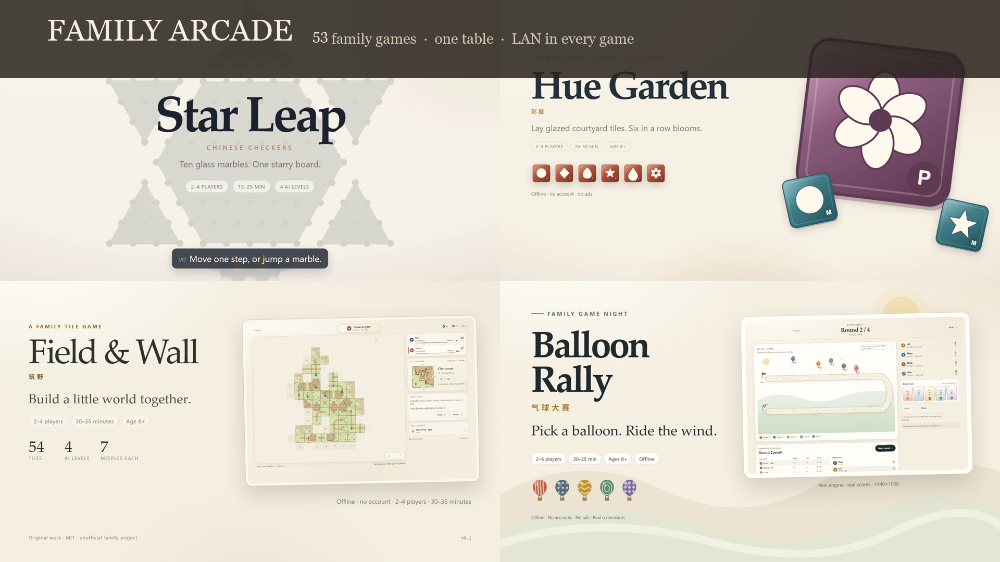
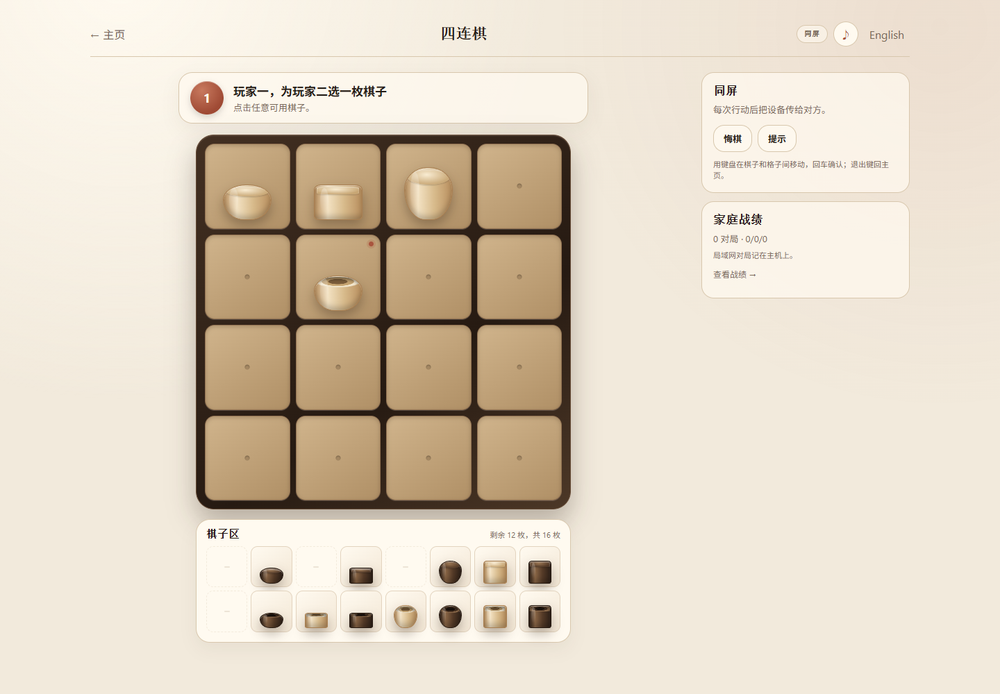
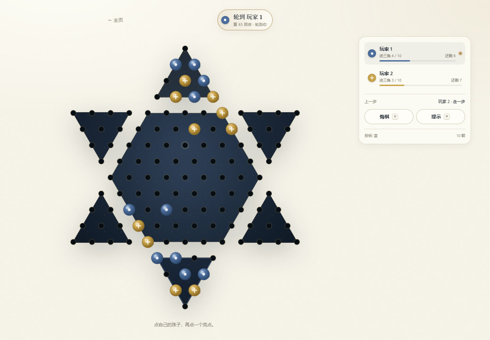
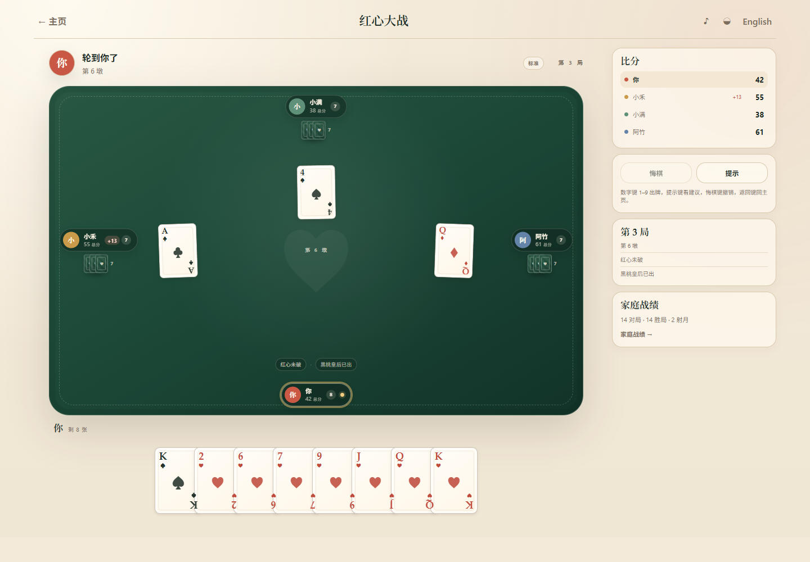
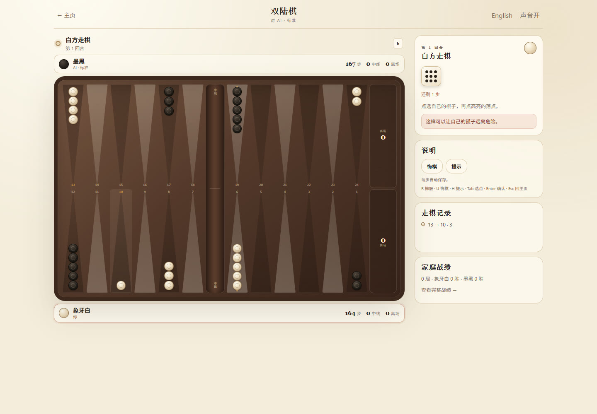
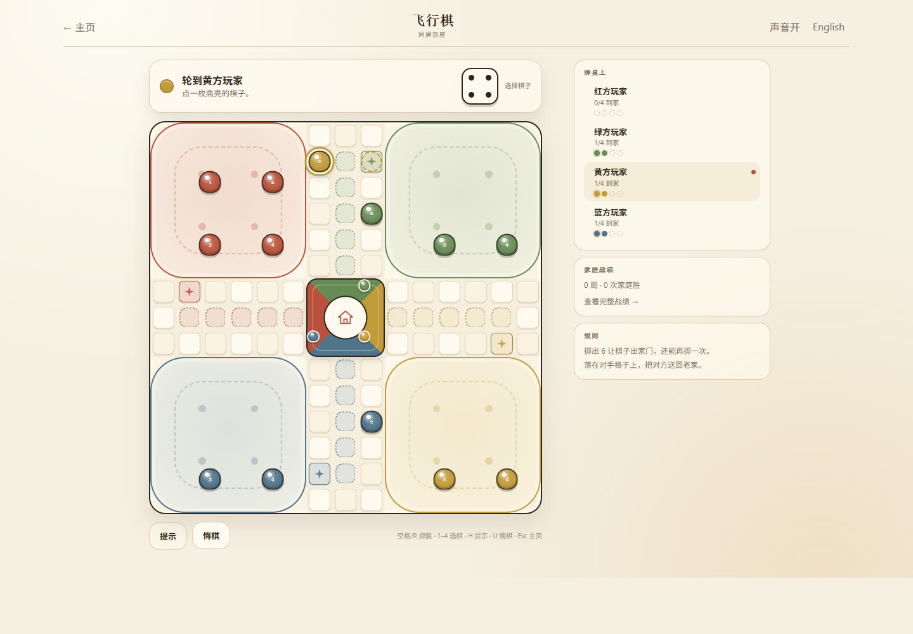
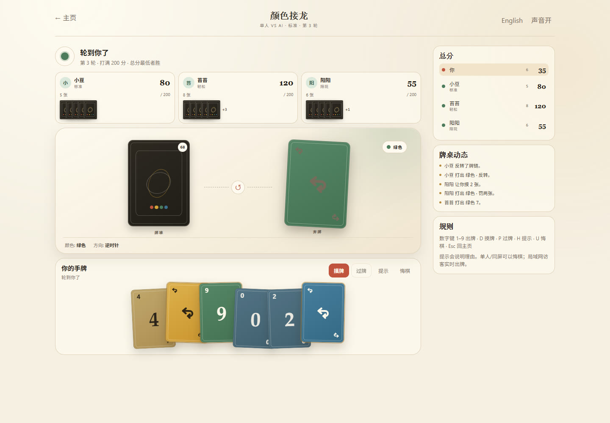
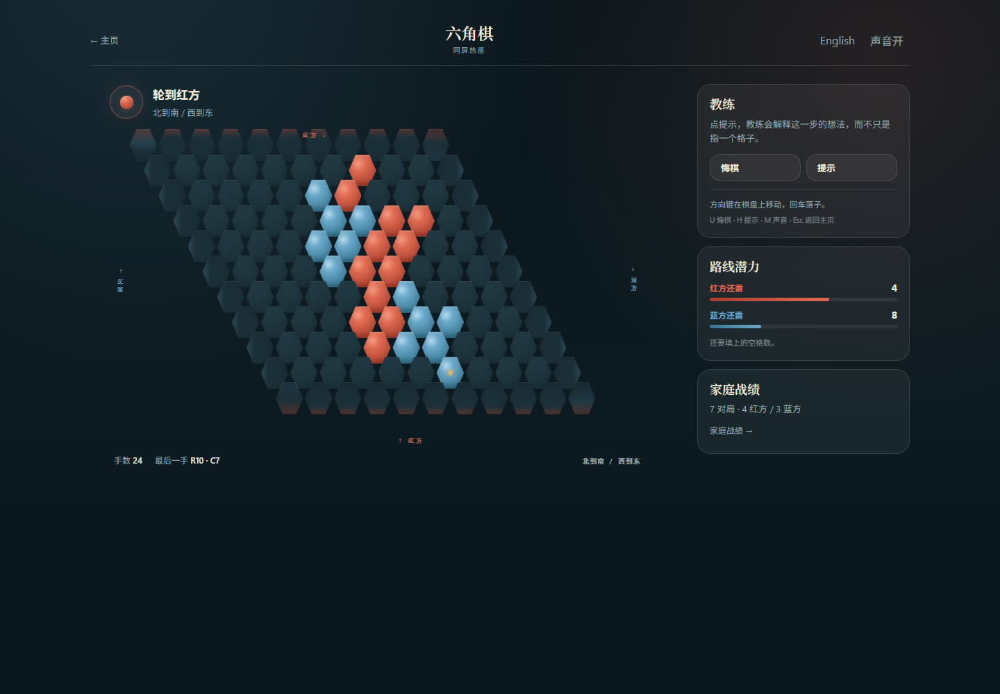

[English](README.md) · 简体中文

# 家庭游戏馆

**42 款离线家庭游戏。每一款都有 AI、同屏热座和局域网。**

[](docs/tour.mp4)

[](https://github.com/YiheHuang/FamilyArcade/releases/download/family-arcade-v2.0.0/FamilyArcade_2.0.0_x64-setup.exe)

**一体化安装包：** [Family Arcade 2.0.0](https://github.com/YiheHuang/FamilyArcade/releases/download/family-arcade-v2.0.0/FamilyArcade_2.0.0_x64-setup.exe) · **WebView2 运行时（仅在需要时）：** [离线 x64](https://github.com/YiheHuang/FamilyArcade/releases/download/webview2-runtime-v1.0.0/MicrosoftEdgeWebView2RuntimeInstallerX64.exe)

## 经典

<table>
<tr><td width="25%" valign="top">
<a href="apps/blokus/docs/promo/blokus-promo-zh.mp4"></a>

**[角斗士棋](apps/blokus/README.zh-CN.md)**

<sub>2–4 人 · 20–30 分钟 · 7 岁+</sub>

<sub>[宣传片](apps/blokus/docs/promo/blokus-promo-zh.mp4) · [安装包](https://github.com/YiheHuang/FamilyArcade/releases/download/blokus-v1.7.1/blokus_1.7.1_x64-setup.exe)</sub>
</td>
<td width="25%" valign="top">
<a href="apps/splendor/docs/promo/splendor-promo-zh.mp4"></a>

**[宝石商人](apps/splendor/README.zh-CN.md)**

<sub>2–4 人 · 30 分钟 · 8 岁+</sub>

<sub>[宣传片](apps/splendor/docs/promo/splendor-promo-zh.mp4) · [安装包](https://github.com/YiheHuang/FamilyArcade/releases/download/splendor-v2.5.0/splendor_2.5.0_x64-setup.exe)</sub>
</td>
<td width="25%" valign="top">
<a href="apps/gomoku/docs/promo/gomoku-promo-zh.mp4"></a>

**[五子棋](apps/gomoku/README.zh-CN.md)**

<sub>2 人 · 10–20 分钟 · 6 岁+</sub>

<sub>[宣传片](apps/gomoku/docs/promo/gomoku-promo-zh.mp4) · [安装包](https://github.com/YiheHuang/FamilyArcade/releases/download/gomoku-v0.1.0/gomoku_0.1.0_x64-setup.exe)</sub>
</td>
<td width="25%" valign="top">
<a href="apps/xiangqi/docs/promo/xiangqi-promo-zh.mp4"></a>

**[中国象棋](apps/xiangqi/README.zh-CN.md)**

<sub>2 人 · 20 分钟 · 8 岁+</sub>

<sub>[宣传片](apps/xiangqi/docs/promo/xiangqi-promo-zh.mp4) · [安装包](https://github.com/YiheHuang/FamilyArcade/releases/download/xiangqi-v0.1.0/xiangqi_0.1.0_x64-setup.exe)</sub>
</td></tr>
<tr><td width="25%" valign="top">
<a href="apps/chess/docs/promo/chess-promo-zh.mp4"></a>

**[国际象棋](apps/chess/README.zh-CN.md)**

<sub>2 人 · 30 分钟 · 6 岁+</sub>

<sub>[宣传片](apps/chess/docs/promo/chess-promo-zh.mp4) · [安装包](https://github.com/YiheHuang/FamilyArcade/releases/download/chess-v0.1.0/chess_0.1.0_x64-setup.exe)</sub>
</td>
<td width="25%" valign="top">
<a href="apps/go/docs/promo/go-promo-zh.mp4"></a>

**[围棋](apps/go/README.zh-CN.md)**

<sub>2 人 · 30 分钟 · 6 岁+</sub>

<sub>[宣传片](apps/go/docs/promo/go-promo-zh.mp4) · [安装包](https://github.com/YiheHuang/FamilyArcade/releases/download/go-v0.1.0/go_0.1.0_x64-setup.exe)</sub>
</td>
<td width="25%" valign="top">
<a href="apps/shogi/docs/promo/shogi-promo-zh.mp4"></a>

**[将棋](apps/shogi/README.zh-CN.md)**

<sub>2 人 · 20 分钟 · 8 岁+</sub>

<sub>[宣传片](apps/shogi/docs/promo/shogi-promo-zh.mp4) · [安装包](https://github.com/YiheHuang/FamilyArcade/releases/download/shogi-v0.1.0/shogi_0.1.0_x64-setup.exe)</sub>
</td>
<td width="25%" valign="top">
<a href="apps/intl-draughts/docs/promo/intl-draughts-promo-zh.mp4"></a>

**[国际跳棋](apps/intl-draughts/README.zh-CN.md)**

<sub>2 人 · 15–30 分钟 · 7 岁+</sub>

<sub>[宣传片](apps/intl-draughts/docs/promo/intl-draughts-promo-zh.mp4) · [安装包](https://github.com/YiheHuang/FamilyArcade/releases/download/intl-draughts-v0.1.0/intl-draughts_0.1.0_x64-setup.exe)</sub>
</td></tr>
<tr><td width="25%" valign="top">
<a href="apps/jungle-chess/docs/promo/jungle-chess-promo-zh.mp4"></a>

**[斗兽棋](apps/jungle-chess/README.zh-CN.md)**

<sub>2 人 · 15 分钟 · 6 岁+</sub>

<sub>[宣传片](apps/jungle-chess/docs/promo/jungle-chess-promo-zh.mp4) · [安装包](https://github.com/YiheHuang/FamilyArcade/releases/download/jungle-chess-v0.1.0/jungle-chess_0.1.0_x64-setup.exe)</sub>
</td>
<td width="25%" valign="top">
<a href="apps/abalone/docs/promo/abalone-promo-zh.mp4"></a>

**[大力士棋](apps/abalone/README.zh-CN.md)**

<sub>2 人 · 15 分钟 · 7 岁+</sub>

<sub>[宣传片](apps/abalone/docs/promo/abalone-promo-zh.mp4) · [安装包](https://github.com/YiheHuang/FamilyArcade/releases/download/abalone-v0.1.0/abalone_0.1.0_x64-setup.exe)</sub>
</td>
<td width="25%" valign="top">
<a href="apps/hive/docs/promo/hive-promo-zh.mp4"></a>

**[虫虫棋](apps/hive/README.zh-CN.md)**

<sub>2 人 · 25 分钟 · 8 岁+</sub>

<sub>[宣传片](apps/hive/docs/promo/hive-promo-zh.mp4) · [安装包](https://github.com/YiheHuang/FamilyArcade/releases/download/hive-v0.1.0/hive_0.1.0_x64-setup.exe)</sub>
</td>
<td width="25%" valign="top">
<a href="apps/quarto/docs/promo/quarto-promo-zh.mp4"></a>

**[四连棋](apps/quarto/README.zh-CN.md)**

<sub>2 人 · 10 分钟 · 6 岁+</sub>

<sub>[宣传片](apps/quarto/docs/promo/quarto-promo-zh.mp4) · [安装包](https://github.com/YiheHuang/FamilyArcade/releases/download/quarto-v0.1.0/quarto_0.1.0_x64-setup.exe)</sub>
</td></tr>
</table>

## 家庭牌桌

<table>
<tr><td width="25%" valign="top">
<a href="apps/star-leap/docs/promo/star-leap-promo-zh.mp4"></a>

**[星跃](apps/star-leap/README.zh-CN.md)**

<sub>2–4 人 · 15–25 分钟 · 7 岁+</sub>

<sub>[宣传片](apps/star-leap/docs/promo/star-leap-promo-zh.mp4) · [安装包](https://github.com/YiheHuang/FamilyArcade/releases/download/star-leap-v0.2.0/star-leap_0.2.0_x64-setup.exe)</sub>
</td>
<td width="25%" valign="top">
<a href="apps/sweet-carousel/docs/promo/sweet-carousel-promo-zh.mp4"></a>

**[甜点转盘](apps/sweet-carousel/README.zh-CN.md)**

<sub>2–5 人 · 15 分钟 · 7 岁+</sub>

<sub>[宣传片](apps/sweet-carousel/docs/promo/sweet-carousel-promo-zh.mp4) · [安装包](https://github.com/YiheHuang/FamilyArcade/releases/download/sweet-carousel-v0.1.0/sweet-carousel_0.1.0_x64-setup.exe)</sub>
</td>
<td width="25%" valign="top">
<a href="apps/hue-garden/docs/promo/hue-garden-promo-zh.mp4"></a>

**[彩庭](apps/hue-garden/README.zh-CN.md)**

<sub>2–4 人 · 20–30 分钟 · 8 岁+</sub>

<sub>[宣传片](apps/hue-garden/docs/promo/hue-garden-promo-zh.mp4) · [安装包](https://github.com/YiheHuang/FamilyArcade/releases/download/hue-garden-v0.1.0/hue-garden_0.1.0_x64-setup.exe)</sub>
</td>
<td width="25%" valign="top">
<a href="apps/field-and-wall/docs/promo/field-and-wall-promo-zh.mp4"></a>

**[筑野](apps/field-and-wall/README.zh-CN.md)**

<sub>2–4 人 · 30–35 分钟 · 8 岁+</sub>

<sub>[宣传片](apps/field-and-wall/docs/promo/field-and-wall-promo-zh.mp4) · [安装包](https://github.com/YiheHuang/FamilyArcade/releases/download/field-and-wall-v0.1.0/field-and-wall_0.1.0_x64-setup.exe)</sub>
</td></tr>
<tr><td width="25%" valign="top">
<a href="apps/balloon-rally/docs/promo/balloon-rally-promo-zh.mp4"></a>

**[气球大赛](apps/balloon-rally/README.zh-CN.md)**

<sub>2–6 人 · 20–25 分钟 · 8 岁+</sub>

<sub>[宣传片](apps/balloon-rally/docs/promo/balloon-rally-promo-zh.mp4) · [安装包](https://github.com/YiheHuang/FamilyArcade/releases/download/balloon-rally-v0.1.0/balloon-rally_0.1.0_x64-setup.exe)</sub>
</td>
<td width="25%" valign="top">
<a href="apps/hearts/docs/promo/hearts-promo-zh.mp4"></a>

**[红心大战](apps/hearts/README.zh-CN.md)**

<sub>4 人 · 25 分钟 · 8 岁+</sub>

<sub>[宣传片](apps/hearts/docs/promo/hearts-promo-zh.mp4) · [安装包](https://github.com/YiheHuang/FamilyArcade/releases/download/hearts-v0.1.0/hearts_0.1.0_x64-setup.exe)</sub>
</td>
<td width="25%" valign="top">
<a href="apps/spades/docs/promo/spades-promo-zh.mp4"></a>

**[黑桃皇后](apps/spades/README.zh-CN.md)**

<sub>4 人 · 20–30 分钟 · 8 岁+</sub>

<sub>[宣传片](apps/spades/docs/promo/spades-promo-zh.mp4) · [安装包](https://github.com/YiheHuang/FamilyArcade/releases/download/spades-v0.1.0/spades_0.1.0_x64-setup.exe)</sub>
</td>
<td width="25%" valign="top">
<a href="apps/rummy-500/docs/promo/rummy-500-promo-zh.mp4"></a>

**[五百分拉米](apps/rummy-500/README.zh-CN.md)**

<sub>2–4 人 · 20–30 分钟 · 8 岁+</sub>

<sub>[宣传片](apps/rummy-500/docs/promo/rummy-500-promo-zh.mp4) · [安装包](https://github.com/YiheHuang/FamilyArcade/releases/download/rummy-500-v0.1.0/rummy-500_0.1.0_x64-setup.exe)</sub>
</td></tr>
<tr><td width="25%" valign="top">
<a href="apps/cribbage/docs/promo/cribbage-promo-zh.mp4"></a>

**[克里比奇](apps/cribbage/README.zh-CN.md)**

<sub>2–4 人 · 20 分钟 · 8 岁+</sub>

<sub>[宣传片](apps/cribbage/docs/promo/cribbage-promo-zh.mp4) · [安装包](https://github.com/YiheHuang/FamilyArcade/releases/download/cribbage-v0.1.0/cribbage_0.1.0_x64-setup.exe)</sub>
</td>
<td width="25%" valign="top">
<a href="apps/president/docs/promo/president-promo-zh.mp4"></a>

**[排位赛](apps/president/README.zh-CN.md)**

<sub>3–6 人 · 20 分钟 · 8 岁+</sub>

<sub>[宣传片](apps/president/docs/promo/president-promo-zh.mp4) · [安装包](https://github.com/YiheHuang/FamilyArcade/releases/download/president-v0.1.0/president_0.1.0_x64-setup.exe)</sub>
</td></tr>
</table>

## 小游戏

<table>
<tr><td width="25%" valign="top">
<a href="apps/triple/docs/promo/triple-promo-zh.mp4"></a>

**[三连棋](apps/triple/README.zh-CN.md)**

<sub>2 人 · 10 分钟 · 6 岁+</sub>

<sub>[宣传片](apps/triple/docs/promo/triple-promo-zh.mp4) · [安装包](https://github.com/YiheHuang/FamilyArcade/releases/download/triple-v0.1.0/triple_0.1.0_x64-setup.exe)</sub>
</td>
<td width="25%" valign="top">
<a href="apps/four/docs/promo/four-promo-zh.mp4"></a>

**[四子棋](apps/four/README.zh-CN.md)**

<sub>2 人 · 10–15 分钟 · 6 岁+</sub>

<sub>[宣传片](apps/four/docs/promo/four-promo-zh.mp4) · [安装包](https://github.com/YiheHuang/FamilyArcade/releases/download/four-v0.1.0/four_0.1.0_x64-setup.exe)</sub>
</td>
<td width="25%" valign="top">
<a href="apps/flip/docs/promo/flip-promo-zh.mp4"></a>

**[黑白棋](apps/flip/README.zh-CN.md)**

<sub>2 人 · 10 分钟 · 6 岁+</sub>

<sub>[宣传片](apps/flip/docs/promo/flip-promo-zh.mp4) · [安装包](https://github.com/YiheHuang/FamilyArcade/releases/download/flip-v0.1.0/flip_0.1.0_x64-setup.exe)</sub>
</td>
<td width="25%" valign="top">
<a href="apps/draughts/docs/promo/draughts-promo-zh.mp4"></a>

**[国际跳棋](apps/draughts/README.zh-CN.md)**

<sub>2 人 · 20 分钟 · 7 岁+</sub>

<sub>[宣传片](apps/draughts/docs/promo/draughts-promo-zh.mp4) · [安装包](https://github.com/YiheHuang/FamilyArcade/releases/download/draughts-v0.1.0/draughts_0.1.0_x64-setup.exe)</sub>
</td></tr>
<tr><td width="25%" valign="top">
<a href="apps/mill/docs/promo/mill-promo-zh.mp4"></a>

**[九子棋](apps/mill/README.zh-CN.md)**

<sub>2 人 · 约 10 分钟 · 6 岁+</sub>

<sub>[宣传片](apps/mill/docs/promo/mill-promo-zh.mp4) · [安装包](https://github.com/YiheHuang/FamilyArcade/releases/download/mill-v0.1.0/mill_0.1.0_x64-setup.exe)</sub>
</td>
<td width="25%" valign="top">
<a href="apps/boxes/docs/promo/boxes-promo-zh.mp4"></a>

**[点格棋](apps/boxes/README.zh-CN.md)**

<sub>2 人 · 15 分钟 · 6 岁+</sub>

<sub>[宣传片](apps/boxes/docs/promo/boxes-promo-zh.mp4) · [安装包](https://github.com/YiheHuang/FamilyArcade/releases/download/boxes-v0.1.0/boxes_0.1.0_x64-setup.exe)</sub>
</td>
<td width="25%" valign="top">
<a href="apps/sowing/docs/promo/sowing-promo-zh.mp4"></a>

**[播棋](apps/sowing/README.zh-CN.md)**

<sub>2 人 · 10 分钟 · 6 岁+</sub>

<sub>[宣传片](apps/sowing/docs/promo/sowing-promo-zh.mp4) · [安装包](https://github.com/YiheHuang/FamilyArcade/releases/download/sowing-v0.1.0/sowing_0.1.0_x64-setup.exe)</sub>
</td>
<td width="25%" valign="top">
<a href="apps/tables/docs/promo/tables-promo-zh.mp4"></a>

**[双陆棋](apps/tables/README.zh-CN.md)**

<sub>2 人 · 15 分钟 · 8 岁+</sub>

<sub>[宣传片](apps/tables/docs/promo/tables-promo-zh.mp4) · [安装包](https://github.com/YiheHuang/FamilyArcade/releases/download/tables-v0.1.0/tables_0.1.0_x64-setup.exe)</sub>
</td></tr>
<tr><td width="25%" valign="top">
<a href="apps/race-home/docs/promo/race-home-promo-zh.mp4"></a>

**[飞行棋](apps/race-home/README.zh-CN.md)**

<sub>2–4 人 · 20–30 分钟 · 6 岁+</sub>

<sub>[宣传片](apps/race-home/docs/promo/race-home-promo-zh.mp4) · [安装包](https://github.com/YiheHuang/FamilyArcade/releases/download/race-home-v0.1.0/race-home_0.1.0_x64-setup.exe)</sub>
</td>
<td width="25%" valign="top">
<a href="apps/ladder-run/docs/promo/ladder-run-promo-zh.mp4"></a>

**[蛇梯棋](apps/ladder-run/README.zh-CN.md)**

<sub>2–4 人 · 15 分钟 · 5 岁+</sub>

<sub>[宣传片](apps/ladder-run/docs/promo/ladder-run-promo-zh.mp4) · [安装包](https://github.com/YiheHuang/FamilyArcade/releases/download/ladder-run-v0.1.0/ladder-run_0.1.0_x64-setup.exe)</sub>
</td>
<td width="25%" valign="top">
<a href="apps/pair-up/docs/promo/pair-up-promo-zh.mp4"></a>

**[翻牌记忆](apps/pair-up/README.zh-CN.md)**

<sub>2–6 人 · 10–20 分钟 · 5 岁+</sub>

<sub>[宣传片](apps/pair-up/docs/promo/pair-up-promo-zh.mp4) · [安装包](https://github.com/YiheHuang/FamilyArcade/releases/download/pair-up-v0.1.0/pair-up_0.1.0_x64-setup.exe)</sub>
</td>
<td width="25%" valign="top">
<a href="apps/domino-line/docs/promo/domino-line-promo-zh.mp4"></a>

**[多米诺](apps/domino-line/README.zh-CN.md)**

<sub>2–4 人 · 15–25 分钟 · 7 岁+</sub>

<sub>[宣传片](apps/domino-line/docs/promo/domino-line-promo-zh.mp4) · [安装包](https://github.com/YiheHuang/FamilyArcade/releases/download/domino-line-v0.1.0/domino-line_0.1.0_x64-setup.exe)</sub>
</td></tr>
<tr><td width="25%" valign="top">
<a href="apps/color-chain/docs/promo/color-chain-promo-zh.mp4"></a>

**[颜色接龙](apps/color-chain/README.zh-CN.md)**

<sub>2–6 人 · 20 分钟 · 6 岁+</sub>

<sub>[宣传片](apps/color-chain/docs/promo/color-chain-promo-zh.mp4) · [安装包](https://github.com/YiheHuang/FamilyArcade/releases/download/color-chain-v0.1.0/color-chain_0.1.0_x64-setup.exe)</sub>
</td>
<td width="25%" valign="top">
<a href="apps/five-dice/docs/promo/five-dice-promo-zh.mp4"></a>

**[五骰](apps/five-dice/README.zh-CN.md)**

<sub>2–4 人 · 20 分钟 · 6 岁+</sub>

<sub>[宣传片](apps/five-dice/docs/promo/five-dice-promo-zh.mp4) · [安装包](https://github.com/YiheHuang/FamilyArcade/releases/download/five-dice-v0.1.0/five-dice_0.1.0_x64-setup.exe)</sub>
</td>
<td width="25%" valign="top">
<a href="apps/fleet/docs/promo/fleet-promo-zh.mp4"></a>

**[海战棋](apps/fleet/README.zh-CN.md)**

<sub>2 人 · 10 分钟 · 6 岁+</sub>

<sub>[宣传片](apps/fleet/docs/promo/fleet-promo-zh.mp4) · [安装包](https://github.com/YiheHuang/FamilyArcade/releases/download/fleet-v0.1.0/fleet_0.1.0_x64-setup.exe)</sub>
</td>
<td width="25%" valign="top">
<a href="apps/codebreak/docs/promo/codebreak-promo-zh.mp4"></a>

**[猜色](apps/codebreak/README.zh-CN.md)**

<sub>2 人 · 10 分钟 · 6 岁+</sub>

<sub>[宣传片](apps/codebreak/docs/promo/codebreak-promo-zh.mp4) · [安装包](https://github.com/YiheHuang/FamilyArcade/releases/download/codebreak-v0.1.0/codebreak_0.1.0_x64-setup.exe)</sub>
</td></tr>
<tr><td width="25%" valign="top">
<a href="apps/triple-find/docs/promo/triple-find-promo-zh.mp4"></a>

**[三连找](apps/triple-find/README.zh-CN.md)**

<sub>2–4 人 · 5 分钟 · 6 岁+</sub>

<sub>[宣传片](apps/triple-find/docs/promo/triple-find-promo-zh.mp4) · [安装包](https://github.com/YiheHuang/FamilyArcade/releases/download/triple-find-v0.1.0/triple-find_0.1.0_x64-setup.exe)</sub>
</td>
<td width="25%" valign="top">
<a href="apps/little-go/docs/promo/little-go-promo-zh.mp4"></a>

**[小围棋](apps/little-go/README.zh-CN.md)**

<sub>2 人 · 15 分钟 · 6 岁+</sub>

<sub>[宣传片](apps/little-go/docs/promo/little-go-promo-zh.mp4) · [安装包](https://github.com/YiheHuang/FamilyArcade/releases/download/little-go-v0.1.0/little-go_0.1.0_x64-setup.exe)</sub>
</td>
<td width="25%" valign="top">
<a href="apps/mini-chess/docs/promo/mini-chess-promo-zh.mp4"></a>

**[迷你棋](apps/mini-chess/README.zh-CN.md)**

<sub>2 人 · 10 分钟 · 6 岁+</sub>

<sub>[宣传片](apps/mini-chess/docs/promo/mini-chess-promo-zh.mp4) · [安装包](https://github.com/YiheHuang/FamilyArcade/releases/download/mini-chess-v0.1.0/mini-chess_0.1.0_x64-setup.exe)</sub>
</td>
<td width="25%" valign="top">
<a href="apps/hex/docs/promo/hex-promo-zh.mp4"></a>

**[六角棋](apps/hex/README.zh-CN.md)**

<sub>2 人 · 15 分钟 · 7 岁+</sub>

<sub>[宣传片](apps/hex/docs/promo/hex-promo-zh.mp4) · [安装包](https://github.com/YiheHuang/FamilyArcade/releases/download/hex-v0.1.0/hex_0.1.0_x64-setup.exe)</sub>
</td></tr>
</table>

## 发布

每款游戏在 [Releases](https://github.com/YiheHuang/FamilyArcade/releases) 有独立安装包。一体化安装包包含启动器、42 款游戏和 WebView2 运行时；单游戏安装包约 1–4 MB。规则、局域网和限制见各游戏 README。

## 构建

```bash
cd apps/triple
npm install
npm run check
node scripts/e2e.mjs
```

共享宣传片工程在 `video/`，启动器在 `apps/family-arcade/`。

## 许可

代码 MIT，原创美术与文案。见 [NOTICE.md](NOTICE.md)。
