[English](README.md) · 简体中文

# 家庭游戏馆

**53 款离线家庭游戏。每一款都有 AI、同屏热座和局域网。**

[](docs/tour.mp4)

[](https://github.com/YiheHuang/FamilyArcade/releases/download/family-arcade-v3.0.0/FamilyArcade_3.0.0_x64-setup.exe)

**离线版：** [Family Arcade 3.0.0](https://github.com/YiheHuang/FamilyArcade/releases/download/family-arcade-v3.0.0/FamilyArcade_3.0.0_x64-setup.exe) · **精简版（不带运行时）：** [Family Arcade Slim](https://github.com/YiheHuang/FamilyArcade/releases/download/family-arcade-v3.0.0/FamilyArcade_3.0.0_slim_x64-setup.exe) · **Lite（按需下载游戏）：** [Family Arcade Lite](https://github.com/YiheHuang/FamilyArcade/releases/download/family-arcade-v3.0.0/FamilyArcade_Lite_3.0.0_x64-setup.exe) · **WebView2 运行时（仅在需要时）：** [离线 x64](https://github.com/YiheHuang/FamilyArcade/releases/download/webview2-runtime-v1.0.0/MicrosoftEdgeWebView2RuntimeInstallerX64.exe)

## 经典

<table>
<tr><td width="25%" valign="top">
<a href="apps/blokus/docs/promo/blokus-promo-zh.mp4">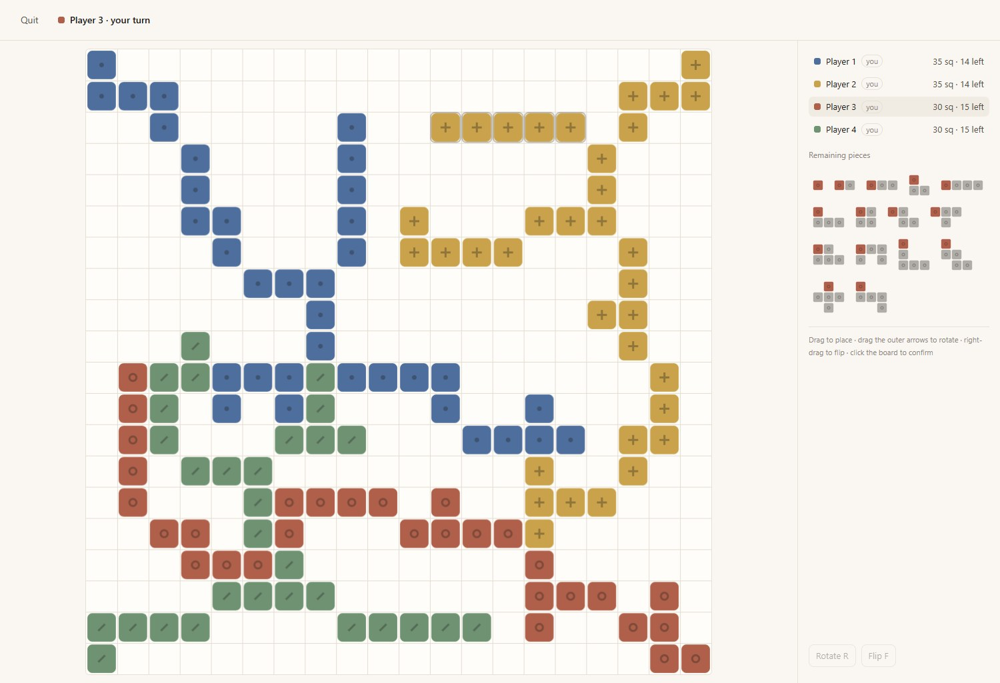</a>

**[角斗士棋](apps/blokus/README.zh-CN.md)**

<sub>2–4 人 · 20–30 分钟 · 7 岁+</sub>

<sub>[宣传片](apps/blokus/docs/promo/blokus-promo-zh.mp4)</sub>
</td>
<td width="25%" valign="top">
<a href="apps/splendor/docs/promo/splendor-promo-zh.mp4"></a>

**[宝石商人](apps/splendor/README.zh-CN.md)**

<sub>2–4 人 · 30 分钟 · 8 岁+</sub>

<sub>[宣传片](apps/splendor/docs/promo/splendor-promo-zh.mp4)</sub>
</td>
<td width="25%" valign="top">
<a href="apps/gomoku/docs/promo/gomoku-promo-zh.mp4"></a>

**[五子棋](apps/gomoku/README.zh-CN.md)**

<sub>2 人 · 10–20 分钟 · 6 岁+</sub>

<sub>[宣传片](apps/gomoku/docs/promo/gomoku-promo-zh.mp4)</sub>
</td>
<td width="25%" valign="top">
<a href="apps/xiangqi/docs/promo/xiangqi-promo-zh.mp4"></a>

**[中国象棋](apps/xiangqi/README.zh-CN.md)**

<sub>2 人 · 20 分钟 · 8 岁+</sub>

<sub>[宣传片](apps/xiangqi/docs/promo/xiangqi-promo-zh.mp4)</sub>
</td></tr>
<tr><td width="25%" valign="top">
<a href="apps/chess/docs/promo/chess-promo-zh.mp4">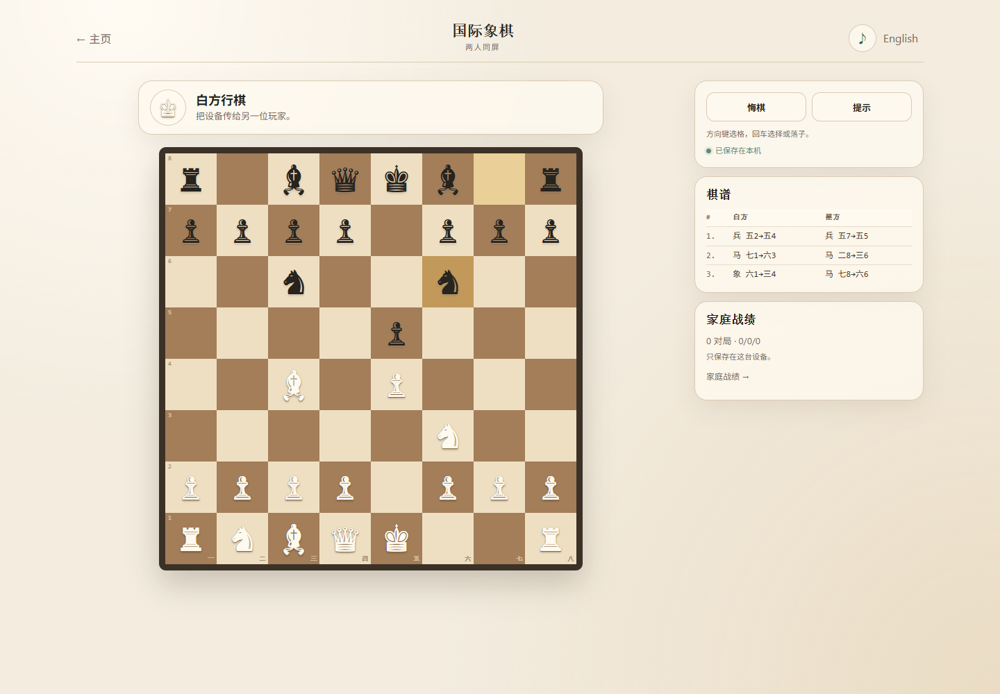</a>

**[国际象棋](apps/chess/README.zh-CN.md)**

<sub>2 人 · 30 分钟 · 6 岁+</sub>

<sub>[宣传片](apps/chess/docs/promo/chess-promo-zh.mp4)</sub>
</td>
<td width="25%" valign="top">
<a href="apps/go/docs/promo/go-promo-zh.mp4"></a>

**[围棋](apps/go/README.zh-CN.md)**

<sub>2 人 · 30 分钟 · 6 岁+</sub>

<sub>[宣传片](apps/go/docs/promo/go-promo-zh.mp4)</sub>
</td>
<td width="25%" valign="top">
<a href="apps/shogi/docs/promo/shogi-promo-zh.mp4"></a>

**[将棋](apps/shogi/README.zh-CN.md)**

<sub>2 人 · 20 分钟 · 8 岁+</sub>

<sub>[宣传片](apps/shogi/docs/promo/shogi-promo-zh.mp4)</sub>
</td>
<td width="25%" valign="top">
<a href="apps/intl-draughts/docs/promo/intl-draughts-promo-zh.mp4">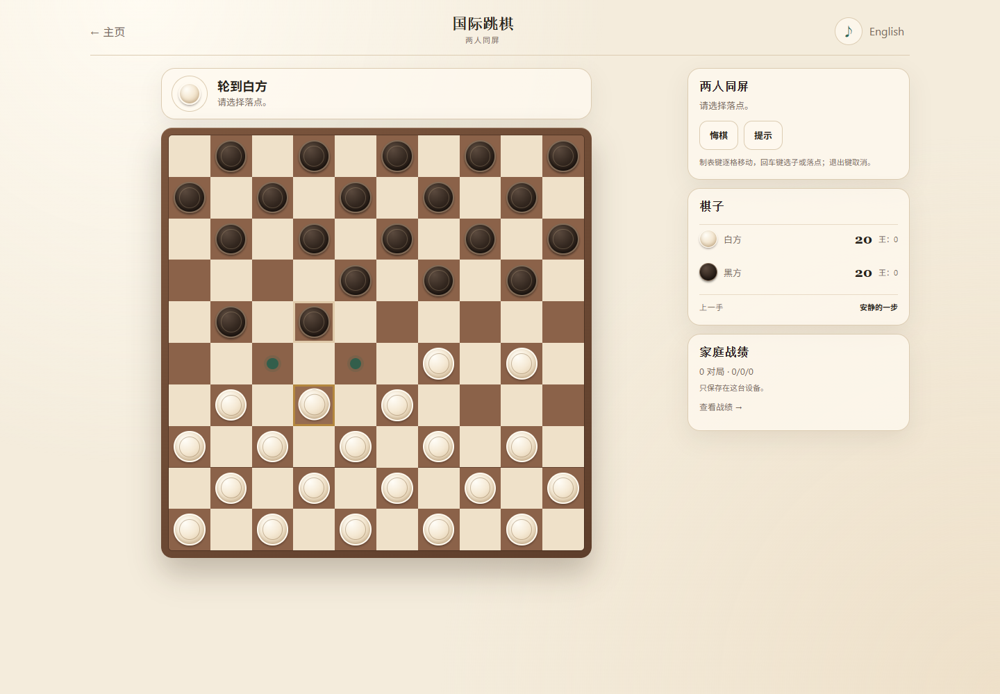</a>

**[国际跳棋](apps/intl-draughts/README.zh-CN.md)**

<sub>2 人 · 15–30 分钟 · 7 岁+</sub>

<sub>[宣传片](apps/intl-draughts/docs/promo/intl-draughts-promo-zh.mp4)</sub>
</td></tr>
<tr><td width="25%" valign="top">
<a href="apps/jungle-chess/docs/promo/jungle-chess-promo-zh.mp4">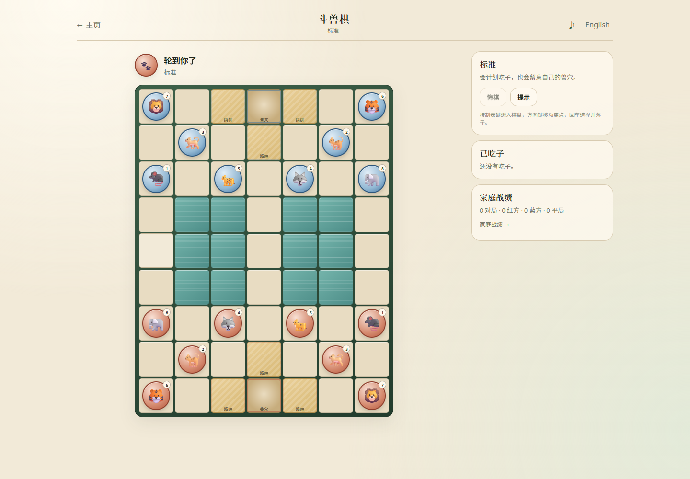</a>

**[斗兽棋](apps/jungle-chess/README.zh-CN.md)**

<sub>2 人 · 15 分钟 · 6 岁+</sub>

<sub>[宣传片](apps/jungle-chess/docs/promo/jungle-chess-promo-zh.mp4)</sub>
</td>
<td width="25%" valign="top">
<a href="apps/abalone/docs/promo/abalone-promo-zh.mp4">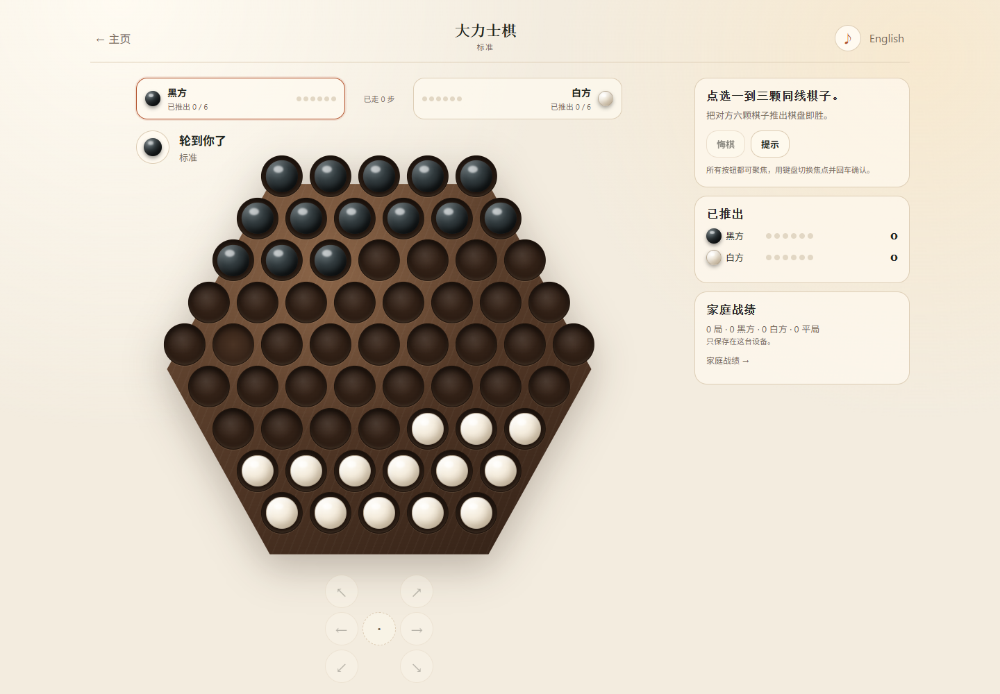</a>

**[大力士棋](apps/abalone/README.zh-CN.md)**

<sub>2 人 · 15 分钟 · 7 岁+</sub>

<sub>[宣传片](apps/abalone/docs/promo/abalone-promo-zh.mp4)</sub>
</td>
<td width="25%" valign="top">
<a href="apps/hive/docs/promo/hive-promo-zh.mp4">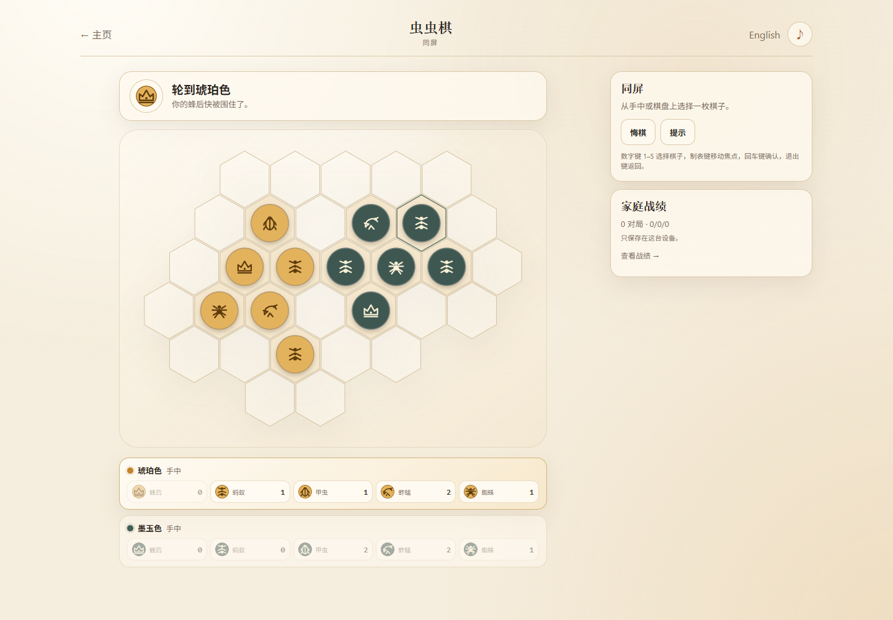</a>

**[虫虫棋](apps/hive/README.zh-CN.md)**

<sub>2 人 · 25 分钟 · 8 岁+</sub>

<sub>[宣传片](apps/hive/docs/promo/hive-promo-zh.mp4)</sub>
</td>
<td width="25%" valign="top">
<a href="apps/quarto/docs/promo/quarto-promo-zh.mp4"></a>

**[四连棋](apps/quarto/README.zh-CN.md)**

<sub>2 人 · 10 分钟 · 6 岁+</sub>

<sub>[宣传片](apps/quarto/docs/promo/quarto-promo-zh.mp4)</sub>
</td></tr>
<tr><td width="25%" valign="top">
<a href="apps/mahjong/docs/promo/mahjong-promo-zh.mp4"></a>

**[麻将](apps/mahjong/README.zh-CN.md)**

<sub>4 人 · 10–20 分钟 · 8 岁+</sub>

<sub>[宣传片](apps/mahjong/docs/promo/mahjong-promo-zh.mp4)</sub>
</td>
<td width="25%" valign="top">
<a href="apps/nanchang-mahjong/docs/promo/nanchang-mahjong-promo-zh.mp4"></a>

**[南昌麻将](apps/nanchang-mahjong/README.zh-CN.md)**

<sub>4 人 · 15–25 分钟 · 10 岁+</sub>

<sub>[宣传片](apps/nanchang-mahjong/docs/promo/nanchang-mahjong-promo-zh.mp4)</sub>
</td></tr>
</table>

## 家庭牌桌

<table>
<tr><td width="25%" valign="top">
<a href="apps/star-leap/docs/promo/star-leap-promo-zh.mp4"></a>

**[星跃](apps/star-leap/README.zh-CN.md)**

<sub>2–4 人 · 15–25 分钟 · 7 岁+</sub>

<sub>[宣传片](apps/star-leap/docs/promo/star-leap-promo-zh.mp4)</sub>
</td>
<td width="25%" valign="top">
<a href="apps/sweet-carousel/docs/promo/sweet-carousel-promo-zh.mp4"></a>

**[甜点转盘](apps/sweet-carousel/README.zh-CN.md)**

<sub>2–5 人 · 15 分钟 · 7 岁+</sub>

<sub>[宣传片](apps/sweet-carousel/docs/promo/sweet-carousel-promo-zh.mp4)</sub>
</td>
<td width="25%" valign="top">
<a href="apps/hue-garden/docs/promo/hue-garden-promo-zh.mp4"></a>

**[彩庭](apps/hue-garden/README.zh-CN.md)**

<sub>2–4 人 · 20–30 分钟 · 8 岁+</sub>

<sub>[宣传片](apps/hue-garden/docs/promo/hue-garden-promo-zh.mp4)</sub>
</td>
<td width="25%" valign="top">
<a href="apps/field-and-wall/docs/promo/field-and-wall-promo-zh.mp4">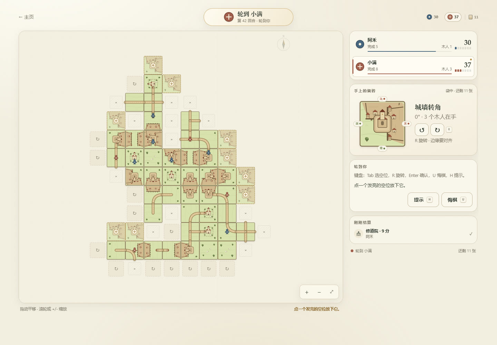</a>

**[筑野](apps/field-and-wall/README.zh-CN.md)**

<sub>2–4 人 · 30–35 分钟 · 8 岁+</sub>

<sub>[宣传片](apps/field-and-wall/docs/promo/field-and-wall-promo-zh.mp4)</sub>
</td></tr>
<tr><td width="25%" valign="top">
<a href="apps/balloon-rally/docs/promo/balloon-rally-promo-zh.mp4"></a>

**[气球大赛](apps/balloon-rally/README.zh-CN.md)**

<sub>2–6 人 · 20–25 分钟 · 8 岁+</sub>

<sub>[宣传片](apps/balloon-rally/docs/promo/balloon-rally-promo-zh.mp4)</sub>
</td>
<td width="25%" valign="top">
<a href="apps/hearts/docs/promo/hearts-promo-zh.mp4"></a>

**[红心大战](apps/hearts/README.zh-CN.md)**

<sub>4 人 · 25 分钟 · 8 岁+</sub>

<sub>[宣传片](apps/hearts/docs/promo/hearts-promo-zh.mp4)</sub>
</td>
<td width="25%" valign="top">
<a href="apps/spades/docs/promo/spades-promo-zh.mp4">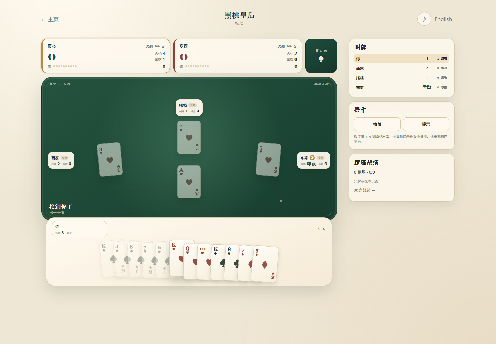</a>

**[黑桃皇后](apps/spades/README.zh-CN.md)**

<sub>4 人 · 20–30 分钟 · 8 岁+</sub>

<sub>[宣传片](apps/spades/docs/promo/spades-promo-zh.mp4)</sub>
</td>
<td width="25%" valign="top">
<a href="apps/rummy-500/docs/promo/rummy-500-promo-zh.mp4">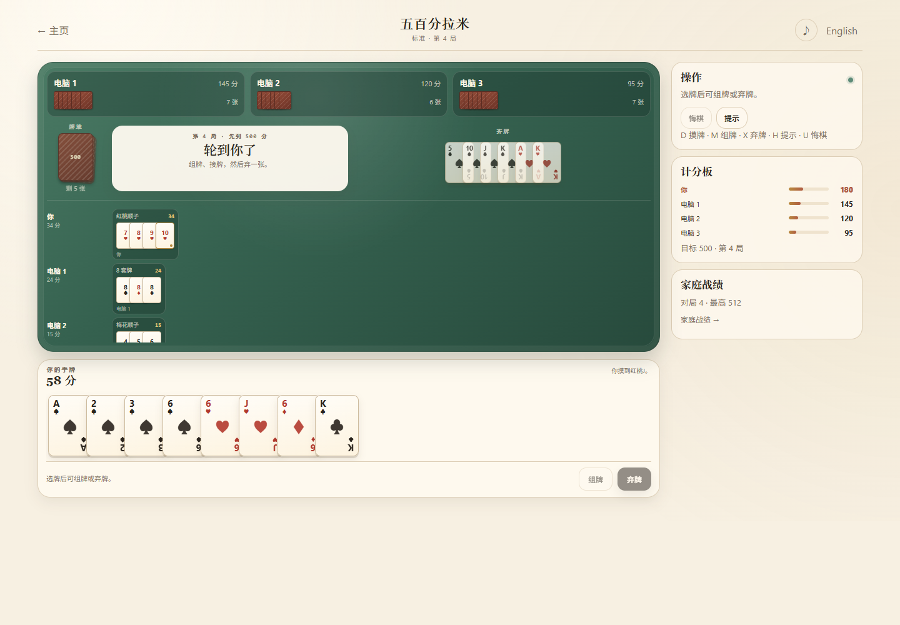</a>

**[五百分拉米](apps/rummy-500/README.zh-CN.md)**

<sub>2–4 人 · 20–30 分钟 · 8 岁+</sub>

<sub>[宣传片](apps/rummy-500/docs/promo/rummy-500-promo-zh.mp4)</sub>
</td></tr>
<tr><td width="25%" valign="top">
<a href="apps/cribbage/docs/promo/cribbage-promo-zh.mp4">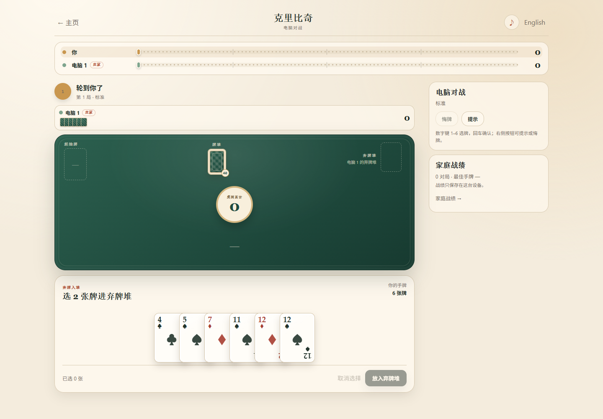</a>

**[克里比奇](apps/cribbage/README.zh-CN.md)**

<sub>2–4 人 · 20 分钟 · 8 岁+</sub>

<sub>[宣传片](apps/cribbage/docs/promo/cribbage-promo-zh.mp4)</sub>
</td>
<td width="25%" valign="top">
<a href="apps/president/docs/promo/president-promo-zh.mp4"></a>

**[排位赛](apps/president/README.zh-CN.md)**

<sub>3–6 人 · 20 分钟 · 8 岁+</sub>

<sub>[宣传片](apps/president/docs/promo/president-promo-zh.mp4)</sub>
</td>
<td width="25%" valign="top">
<a href="apps/doudizhu/docs/promo/doudizhu-promo-zh.mp4"></a>

**[斗地主](apps/doudizhu/README.zh-CN.md)**

<sub>3 人 · 10–15 分钟 · 8 岁+</sub>

<sub>[宣传片](apps/doudizhu/docs/promo/doudizhu-promo-zh.mp4)</sub>
</td>
<td width="25%" valign="top">
<a href="apps/texas-holdem/docs/promo/texas-holdem-promo-zh.mp4"></a>

**[德州扑克](apps/texas-holdem/README.zh-CN.md)**

<sub>2–6 人 · 15 分钟 · 8 岁+</sub>

<sub>[宣传片](apps/texas-holdem/docs/promo/texas-holdem-promo-zh.mp4)</sub>
</td></tr>
<tr><td width="25%" valign="top">
<a href="apps/zheng-shangyou/docs/promo/zheng-shangyou-promo-zh.mp4"></a>

**[争上游](apps/zheng-shangyou/README.zh-CN.md)**

<sub>3–6 人 · 15–25 分钟 · 8 岁+</sub>

<sub>[宣传片](apps/zheng-shangyou/docs/promo/zheng-shangyou-promo-zh.mp4)</sub>
</td>
<td width="25%" valign="top">
<a href="apps/guandan/docs/promo/guandan-promo-zh.mp4"></a>

**[掼蛋](apps/guandan/README.zh-CN.md)**

<sub>4 人 · 30 分钟 · 10 岁+</sub>

<sub>[宣传片](apps/guandan/docs/promo/guandan-promo-zh.mp4)</sub>
</td>
<td width="25%" valign="top">
<a href="apps/big-two/docs/promo/big-two-promo-zh.mp4"></a>

**[大老二](apps/big-two/README.zh-CN.md)**

<sub>4 人 · 15 分钟 · 8 岁+</sub>

<sub>[宣传片](apps/big-two/docs/promo/big-two-promo-zh.mp4)</sub>
</td>
<td width="25%" valign="top">
<a href="apps/sheng-ji/docs/promo/sheng-ji-promo-zh.mp4"></a>

**[升级](apps/sheng-ji/README.zh-CN.md)**

<sub>4 人 · 30 分钟 · 8 岁+</sub>

<sub>[宣传片](apps/sheng-ji/docs/promo/sheng-ji-promo-zh.mp4)</sub>
</td></tr>
<tr><td width="25%" valign="top">
<a href="apps/liars-dice/docs/promo/liars-dice-promo-zh.mp4"></a>

**[吹牛骰](apps/liars-dice/README.zh-CN.md)**

<sub>2–6 人 · 15 分钟 · 8 岁+</sub>

<sub>[宣传片](apps/liars-dice/docs/promo/liars-dice-promo-zh.mp4)</sub>
</td>
<td width="25%" valign="top">
<a href="apps/idiom-chain/docs/promo/idiom-chain-promo-zh.mp4"></a>

**[成语接龙](apps/idiom-chain/README.zh-CN.md)**

<sub>2–6 人 · 10–20 分钟 · 7 岁+</sub>

<sub>[宣传片](apps/idiom-chain/docs/promo/idiom-chain-promo-zh.mp4)</sub>
</td></tr>
</table>

## 小游戏

<table>
<tr><td width="25%" valign="top">
<a href="apps/jokers-table/docs/promo/jokers-table-promo-zh.mp4"></a>

**[小丑牌桌](apps/jokers-table/README.zh-CN.md)**

<sub>1–4 人 · 20–35 分钟 · 10 岁+</sub>

<sub>[宣传片](apps/jokers-table/docs/promo/jokers-table-promo-zh.mp4)</sub>
</td>
<td width="25%" valign="top">
<a href="apps/triple/docs/promo/triple-promo-zh.mp4">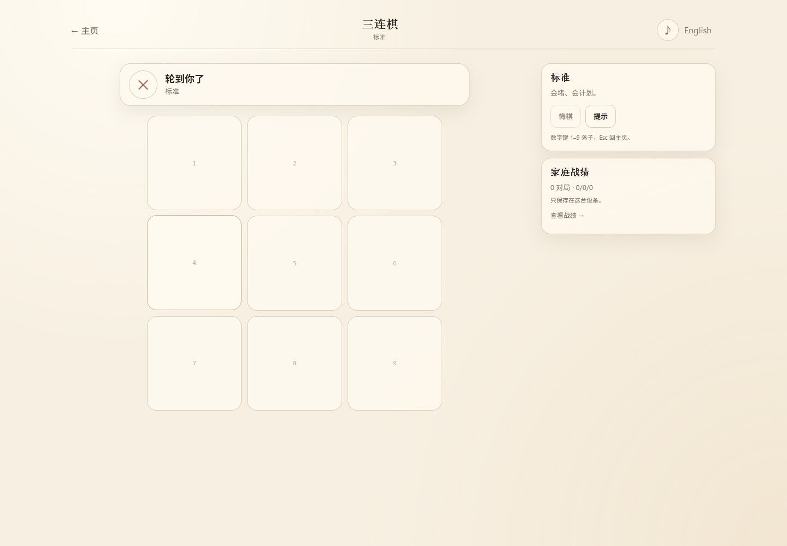</a>

**[三连棋](apps/triple/README.zh-CN.md)**

<sub>2 人 · 10 分钟 · 6 岁+</sub>

<sub>[宣传片](apps/triple/docs/promo/triple-promo-zh.mp4)</sub>
</td>
<td width="25%" valign="top">
<a href="apps/four/docs/promo/four-promo-zh.mp4"></a>

**[四子棋](apps/four/README.zh-CN.md)**

<sub>2 人 · 10–15 分钟 · 6 岁+</sub>

<sub>[宣传片](apps/four/docs/promo/four-promo-zh.mp4)</sub>
</td>
<td width="25%" valign="top">
<a href="apps/flip/docs/promo/flip-promo-zh.mp4"></a>

**[黑白棋](apps/flip/README.zh-CN.md)**

<sub>2 人 · 10 分钟 · 6 岁+</sub>

<sub>[宣传片](apps/flip/docs/promo/flip-promo-zh.mp4)</sub>
</td></tr>
<tr><td width="25%" valign="top">
<a href="apps/draughts/docs/promo/draughts-promo-zh.mp4">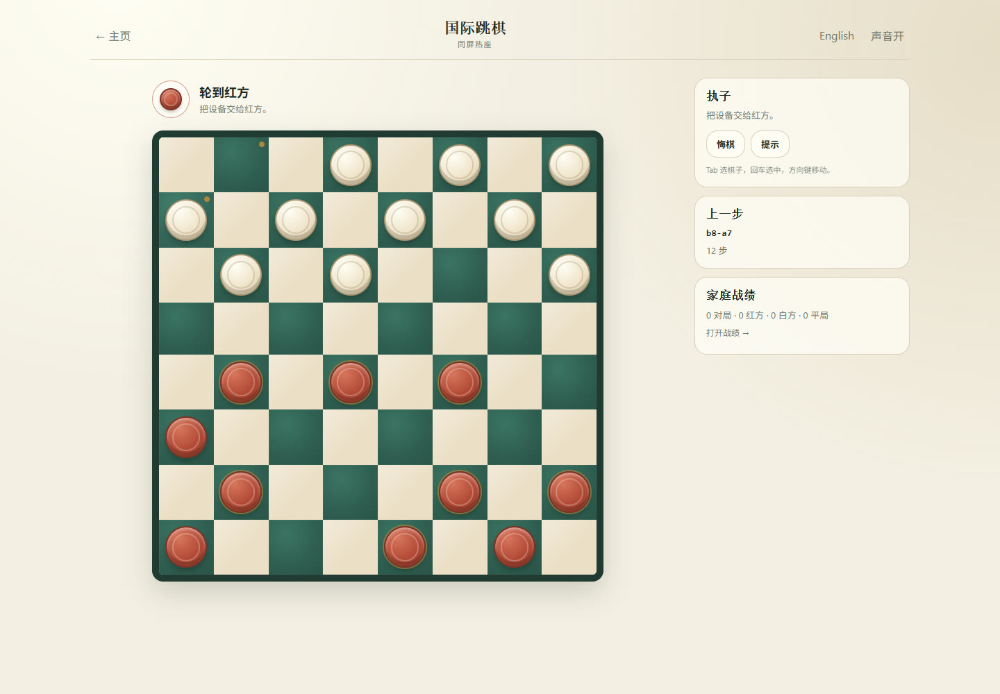</a>

**[国际跳棋](apps/draughts/README.zh-CN.md)**

<sub>2 人 · 20 分钟 · 7 岁+</sub>

<sub>[宣传片](apps/draughts/docs/promo/draughts-promo-zh.mp4)</sub>
</td>
<td width="25%" valign="top">
<a href="apps/mill/docs/promo/mill-promo-zh.mp4">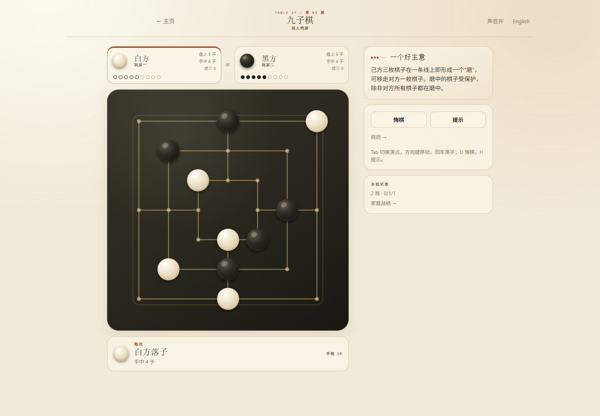</a>

**[九子棋](apps/mill/README.zh-CN.md)**

<sub>2 人 · 约 10 分钟 · 6 岁+</sub>

<sub>[宣传片](apps/mill/docs/promo/mill-promo-zh.mp4)</sub>
</td>
<td width="25%" valign="top">
<a href="apps/boxes/docs/promo/boxes-promo-zh.mp4"></a>

**[点格棋](apps/boxes/README.zh-CN.md)**

<sub>2 人 · 15 分钟 · 6 岁+</sub>

<sub>[宣传片](apps/boxes/docs/promo/boxes-promo-zh.mp4)</sub>
</td>
<td width="25%" valign="top">
<a href="apps/sowing/docs/promo/sowing-promo-zh.mp4">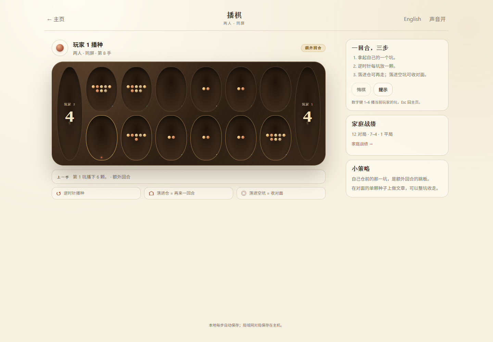</a>

**[播棋](apps/sowing/README.zh-CN.md)**

<sub>2 人 · 10 分钟 · 6 岁+</sub>

<sub>[宣传片](apps/sowing/docs/promo/sowing-promo-zh.mp4)</sub>
</td></tr>
<tr><td width="25%" valign="top">
<a href="apps/tables/docs/promo/tables-promo-zh.mp4"></a>

**[双陆棋](apps/tables/README.zh-CN.md)**

<sub>2 人 · 15 分钟 · 8 岁+</sub>

<sub>[宣传片](apps/tables/docs/promo/tables-promo-zh.mp4)</sub>
</td>
<td width="25%" valign="top">
<a href="apps/race-home/docs/promo/race-home-promo-zh.mp4"></a>

**[飞行棋](apps/race-home/README.zh-CN.md)**

<sub>2–4 人 · 20–30 分钟 · 6 岁+</sub>

<sub>[宣传片](apps/race-home/docs/promo/race-home-promo-zh.mp4)</sub>
</td>
<td width="25%" valign="top">
<a href="apps/ladder-run/docs/promo/ladder-run-promo-zh.mp4">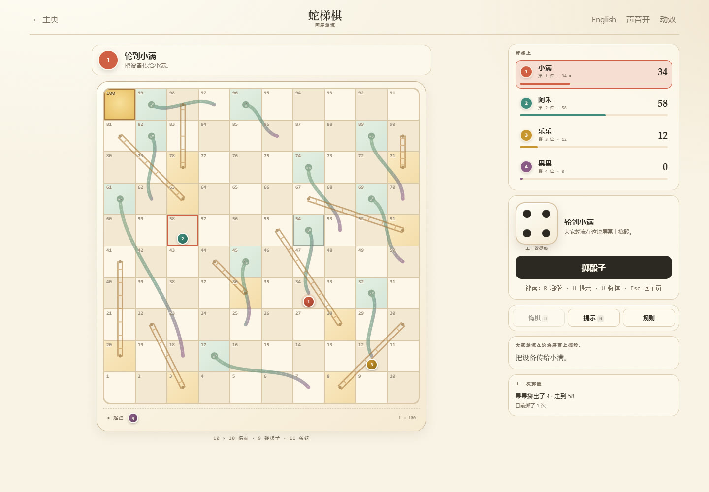</a>

**[蛇梯棋](apps/ladder-run/README.zh-CN.md)**

<sub>2–4 人 · 15 分钟 · 5 岁+</sub>

<sub>[宣传片](apps/ladder-run/docs/promo/ladder-run-promo-zh.mp4)</sub>
</td>
<td width="25%" valign="top">
<a href="apps/pair-up/docs/promo/pair-up-promo-zh.mp4"></a>

**[翻牌记忆](apps/pair-up/README.zh-CN.md)**

<sub>2–6 人 · 10–20 分钟 · 5 岁+</sub>

<sub>[宣传片](apps/pair-up/docs/promo/pair-up-promo-zh.mp4)</sub>
</td></tr>
<tr><td width="25%" valign="top">
<a href="apps/domino-line/docs/promo/domino-line-promo-zh.mp4"></a>

**[多米诺](apps/domino-line/README.zh-CN.md)**

<sub>2–4 人 · 15–25 分钟 · 7 岁+</sub>

<sub>[宣传片](apps/domino-line/docs/promo/domino-line-promo-zh.mp4)</sub>
</td>
<td width="25%" valign="top">
<a href="apps/color-chain/docs/promo/color-chain-promo-zh.mp4"></a>

**[颜色接龙](apps/color-chain/README.zh-CN.md)**

<sub>2–6 人 · 20 分钟 · 6 岁+</sub>

<sub>[宣传片](apps/color-chain/docs/promo/color-chain-promo-zh.mp4)</sub>
</td>
<td width="25%" valign="top">
<a href="apps/five-dice/docs/promo/five-dice-promo-zh.mp4">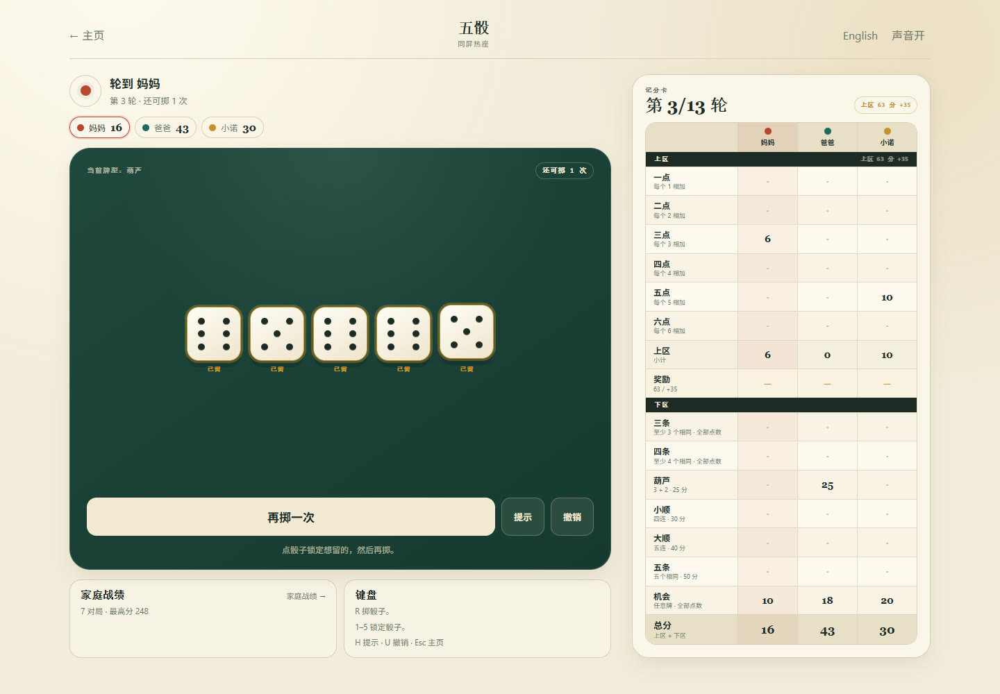</a>

**[五骰](apps/five-dice/README.zh-CN.md)**

<sub>2–4 人 · 20 分钟 · 6 岁+</sub>

<sub>[宣传片](apps/five-dice/docs/promo/five-dice-promo-zh.mp4)</sub>
</td>
<td width="25%" valign="top">
<a href="apps/fleet/docs/promo/fleet-promo-zh.mp4">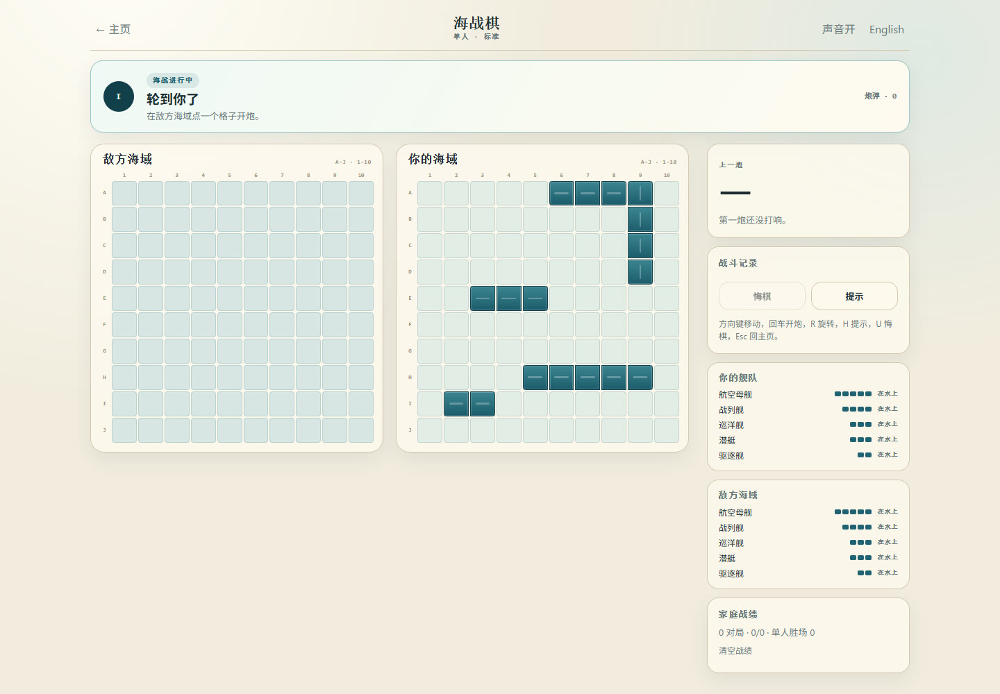</a>

**[海战棋](apps/fleet/README.zh-CN.md)**

<sub>2 人 · 10 分钟 · 6 岁+</sub>

<sub>[宣传片](apps/fleet/docs/promo/fleet-promo-zh.mp4)</sub>
</td></tr>
<tr><td width="25%" valign="top">
<a href="apps/codebreak/docs/promo/codebreak-promo-zh.mp4">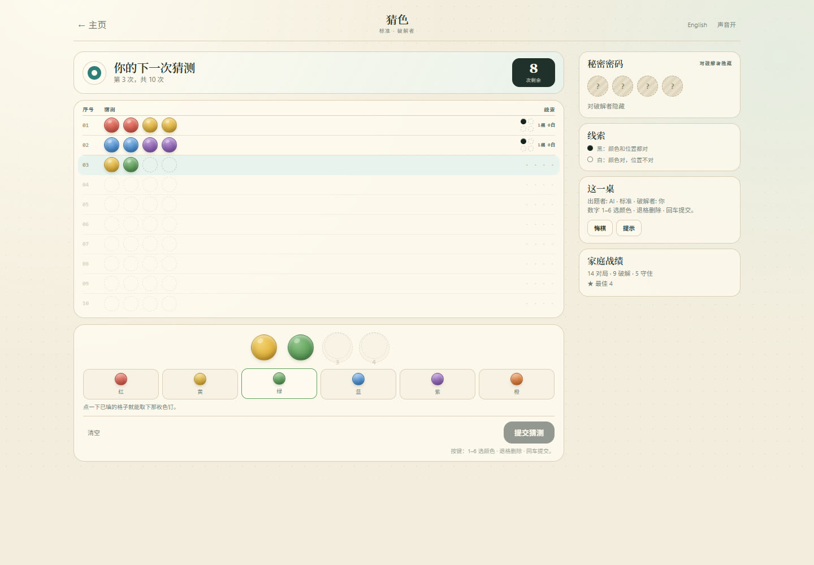</a>

**[猜色](apps/codebreak/README.zh-CN.md)**

<sub>2 人 · 10 分钟 · 6 岁+</sub>

<sub>[宣传片](apps/codebreak/docs/promo/codebreak-promo-zh.mp4)</sub>
</td>
<td width="25%" valign="top">
<a href="apps/triple-find/docs/promo/triple-find-promo-zh.mp4">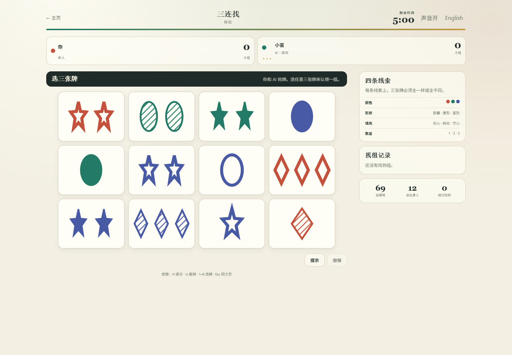</a>

**[三连找](apps/triple-find/README.zh-CN.md)**

<sub>2–4 人 · 5 分钟 · 6 岁+</sub>

<sub>[宣传片](apps/triple-find/docs/promo/triple-find-promo-zh.mp4)</sub>
</td>
<td width="25%" valign="top">
<a href="apps/little-go/docs/promo/little-go-promo-zh.mp4">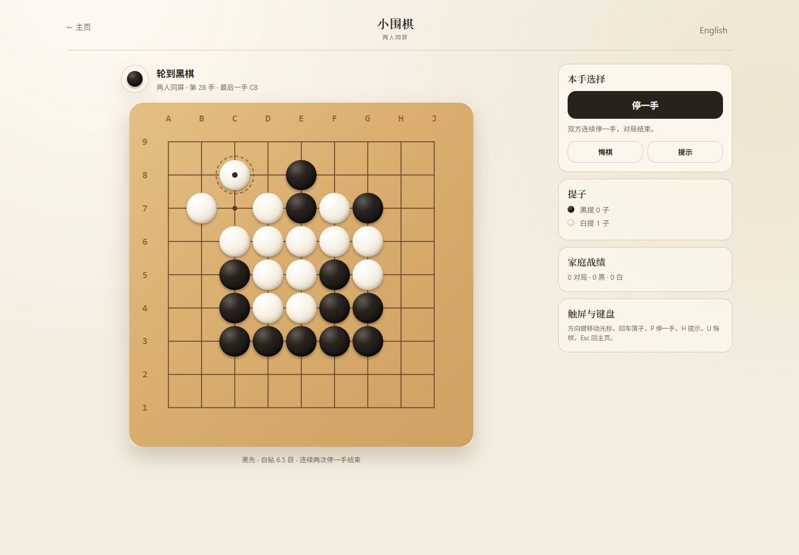</a>

**[小围棋](apps/little-go/README.zh-CN.md)**

<sub>2 人 · 15 分钟 · 6 岁+</sub>

<sub>[宣传片](apps/little-go/docs/promo/little-go-promo-zh.mp4)</sub>
</td>
<td width="25%" valign="top">
<a href="apps/mini-chess/docs/promo/mini-chess-promo-zh.mp4"></a>

**[迷你棋](apps/mini-chess/README.zh-CN.md)**

<sub>2 人 · 10 分钟 · 6 岁+</sub>

<sub>[宣传片](apps/mini-chess/docs/promo/mini-chess-promo-zh.mp4)</sub>
</td></tr>
<tr><td width="25%" valign="top">
<a href="apps/hex/docs/promo/hex-promo-zh.mp4"></a>

**[六角棋](apps/hex/README.zh-CN.md)**

<sub>2 人 · 15 分钟 · 7 岁+</sub>

<sub>[宣传片](apps/hex/docs/promo/hex-promo-zh.mp4)</sub>
</td></tr>
</table>

## 发布

[Releases](https://github.com/YiheHuang/FamilyArcade/releases) 提供三个启动器：**离线版**（全部 53 款游戏 + WebView2 运行时）、**精简版**（全部游戏、不带运行时，约小 200 MB）、**Lite**（玩什么装什么，约 8 MB）。Lite 会在需要时自动安装 WebView2。规则、局域网和限制见各游戏 README。

## 构建

```bash
cd apps/triple
npm install
npm run check
node scripts/e2e.mjs
```

共享宣传片工程在 `video/`，启动器在 `apps/family-arcade/`。

## 许可

代码 MIT，原创美术与文案。见 [NOTICE.md](NOTICE.md)。
