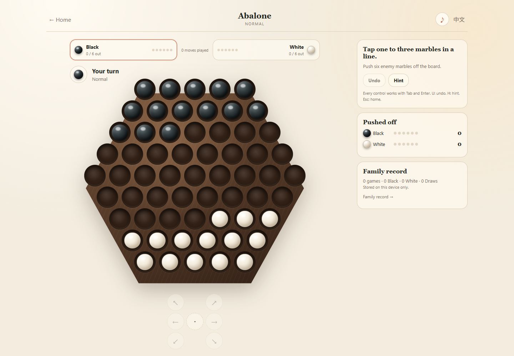
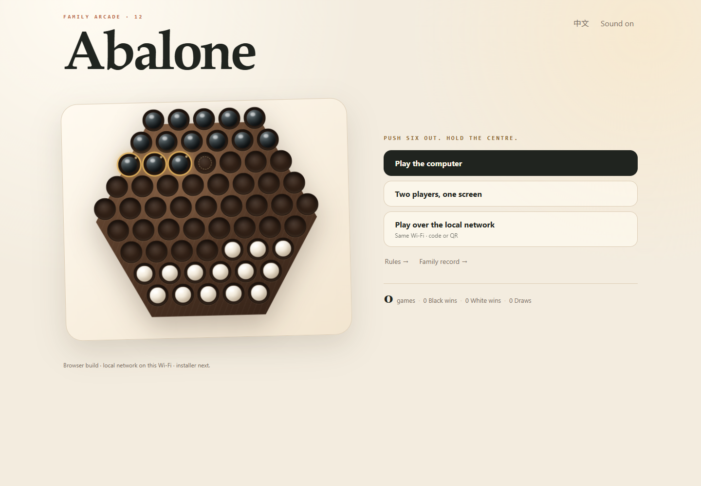
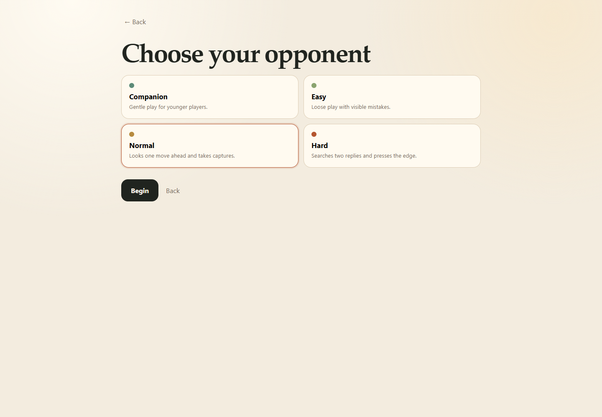
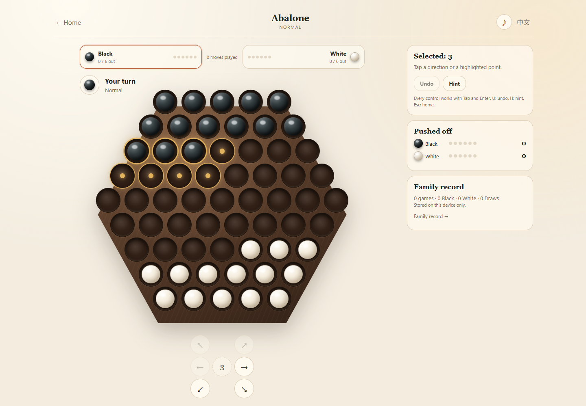
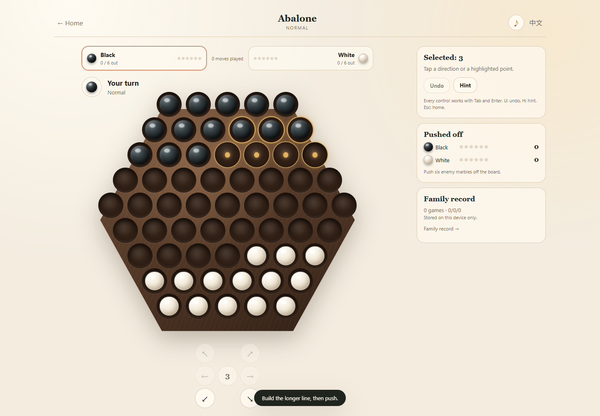
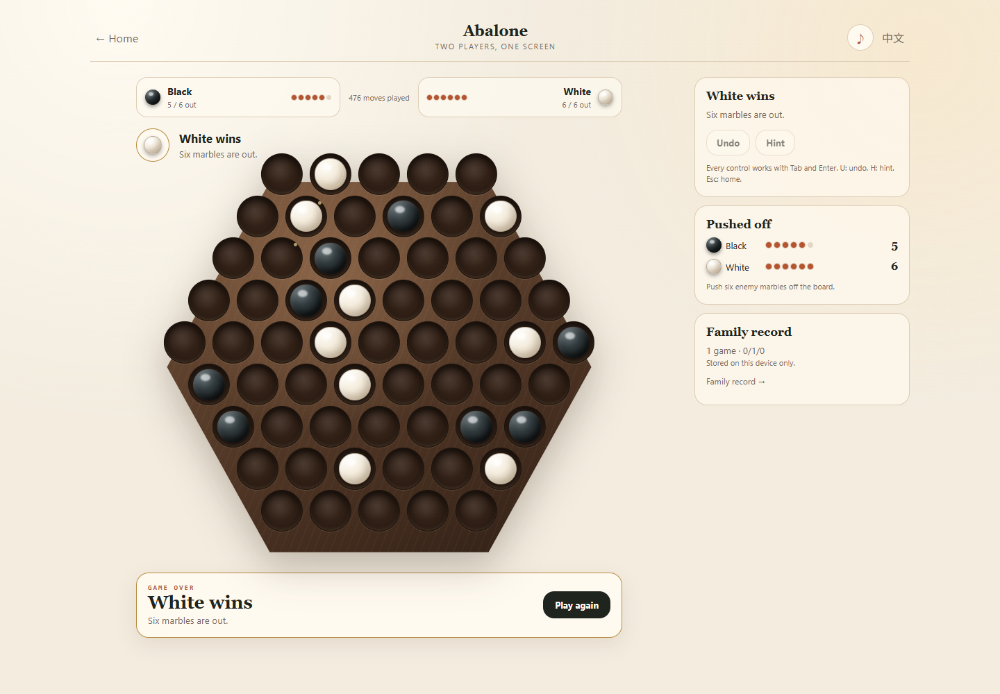
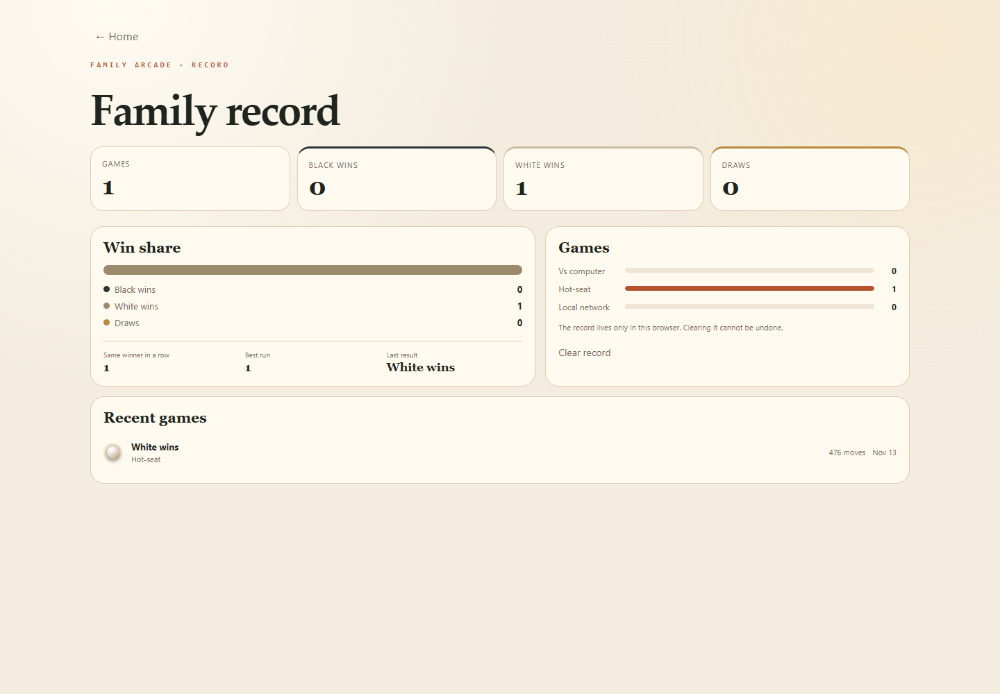

English · [简体中文](README.zh-CN.md)

# Abalone

Family Arcade · two players · 61-point hexagon



Abalone is the classic marble-pushing duel: keep your marbles together, find a
longer line, and push your opponent off the rim. This is a complete, original
implementation with a pure TypeScript engine, four computer levels, hot-seat play,
local-network play, undo, hints, autosave and a family record. It runs offline with
no accounts, ads, telemetry, remote fonts or downloaded art.

## Five-second rules

- The board has 61 points. Each side starts with 14 marbles; Black moves first.
- Move one, two or three of your own marbles in a straight line.
- In-line moves may push. Broadside moves slide the line sideways into empty points.
- You may only push when your line is longer than the enemy line in front of it.
- A marble pushed off the rim is out. The first player to push off six enemy marbles wins.

## What is included

| Mode | Details |
| --- | --- |
| Solo | Four levels: Companion, Easy, Normal, Hard |
| Hot-seat | Two players on one device, with undo and hints |
| Local network | Host or join a room with a four-digit code or QR invite |
| Comforts | Undo, hint with a reason, autosave/resume, sound toggle, reduced motion, keyboard path |
| Record | Games, wins, streaks, mode split and recent results in `localStorage` |
| Languages | Complete English and Simplified Chinese UI, switchable at any time |

### Computer levels

| Level | Character |
| --- | --- |
| Companion | Gentle; takes a win but avoids unnecessary captures |
| Easy | Loose; sometimes picks a random legal move |
| Normal | Looks one reply ahead and takes captures |
| Hard | Beam search over two replies, edge pressure and push lanes |

## Screenshots

| Home | Choose an opponent |
| --- | --- |
|  |  |

| Select a line | Hint with a reason |
| --- | --- |
|  |  |

| Game over | Family record |
| --- | --- |
|  |  |

Mobile screenshots are in `docs/screenshots/en/home-mobile.png` and
`docs/screenshots/en/game-mobile.png`. Chinese captures mirror the set in
`docs/screenshots/zh/`.

## Run it

```bash
npm install
npm run dev       # http://localhost:5212
npm run check     # tsc + 32 engine/AI tests + production build
npm run e2e       # with dev running: rules, undo, hint, AI, autosave, win, record, mobile, bilingual
npm run shots     # with dev running: regenerate docs/screenshots/{en,zh}
```

## Local network

Browser build:

```bash
# terminal 1 — renderer
npm run dev

# terminal 2 — shared relay + guest page on :8080
npm run build
npm run lan
```

Open the host page on `http://localhost:5212`, choose **Play over the local
network**, and create a room. The guest opens the shown `http://…:8080/?lan=…`
link (or scans the QR code) on the same Wi-Fi. The host owns the game state;
the guest sends a move intent and receives a fresh view after every move.

Desktop build: the Tauri shell embeds the shared LAN relay, so no separate Node
server is needed. The host creates a room and the guest opens the displayed URL.

## Tauri installer

The shell in `src-tauri` is the shared Family Arcade relay shell. From this folder:

```bash
npm run build
npm run tauri build
```

That produces an unsigned NSIS installer for Windows. The central build agent is
responsible for running Tauri builds; this game was verified with `tsc`, Vitest,
Vite and Playwright in the browser.

## Project layout

```text
src/game/abalone.ts   pure hexagonal engine (no DOM, network, clock or Math.random)
src/ai/ai.ts          four AI levels + hint classifier
src/App.tsx           home, setup, game, record, rules, LAN host/guest
src/components/       hexagonal board and marble rendering
src/net.ts            Tauri or browser relay detection
src/storage.ts        autosave and family record
tests/game.test.ts    32 engine and AI tests
docs/rules.md         rule-by-rule audit
docs/limitations.md   honest limitations
```

## Known limitations

No repetition/draw rule, no tournament clock, no online matchmaking, no spectator
seat, and Hard is a two-reply beam search rather than a solved opponent. LAN play is
local-subnet only and the four-digit room code keeps honest family members apart, not
a determined attacker. See [docs/limitations.md](docs/limitations.md).

## License

MIT. See [LICENSE](LICENSE). Abalone is a classic abstract strategy game; this
implementation is original, non-commercial and not affiliated with any publisher.
