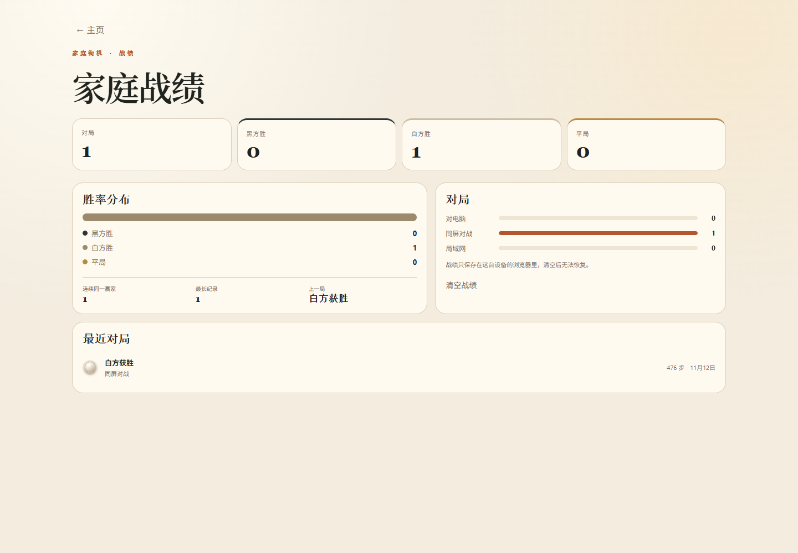

# 大力士棋 · Abalone

家庭街机 · 第 12 款 · 双人对弈 · 61 格六角棋盘


大力士棋是经典的推子棋：让自己的棋子连成一线，用更长的队列把对方顶出棋盘。
这是一个完整的原创实现，包含纯 TypeScript 规则引擎、四档电脑对手、同屏对战、
局域网对战、悔棋、提示、自动保存和家庭战绩。离线运行，无账号、无广告、无遥测，
也不使用远程字体或下载素材。

## 五秒规则

- 棋盘有 61 个点位，双方各 14 颗棋子，黑方先行。
- 每次沿直线移动一到三颗自己的棋子。
- 沿线移动可以推；横移是整排侧移，落点必须为空。
- 只有自己的队列比对方长，才能推动对方的棋子。
- 被推出边线的棋子离场。先把对方六颗棋子推出棋盘者获胜。

## 内容

| 模式 | 说明 |
| --- | --- |
| 单人 | 四档电脑对手：陪玩、轻松、标准、挑战 |
| 同屏 | 两人共用一台设备，可用悔棋和提示 |
| 局域网 | 开房间或用四位房间码、二维码加入 |
| 舒适功能 | 悔棋、带理由的提示、自动保存/继续、声音开关、减少动态、键盘操作 |
| 家庭战绩 | 对局数、胜负、连胜、模式分布和最近对局，保存在本机 |
| 语言 | 完整中文与英文界面，可随时切换 |

### 电脑难度

| 难度 | 风格 |
| --- | --- |
| 陪玩 | 温和，会取胜但避免不必要的推子 |
| 轻松 | 会随意走棋，偶尔犯错 |
| 标准 | 会看一步回合并抓住推子机会 |
| 挑战 | 两层束搜索，重视边线压力和推子通道 |

## 截图

| 主页 | 选择对手 |
| --- | --- |
|  |  |

| 选择队列 | 带理由的提示 |
| --- | --- |
|  |  |

| 对局结束 | 家庭战绩 |
| --- | --- |
|  |  |

手机截图见 `docs/screenshots/zh/home-mobile.png` 和
`docs/screenshots/zh/game-mobile.png`。英文截图在 `docs/screenshots/en/`。

## 运行

```bash
npm install
npm run dev       # http://localhost:5212
npm run check     # 类型检查 + 32 个引擎/电脑测试 + 生产构建
npm run e2e       # 先启动 dev：规则、悔棋、提示、电脑、自动保存、胜利、战绩、手机、双语
npm run shots     # 先启动 dev：重新生成 docs/screenshots/{en,zh}
```

## 局域网

浏览器版：

```bash
# 终端 1 —— 页面
npm run dev

# 终端 2 —— 共享中继 + 客人页面，端口 8080
npm run build
npm run lan
```

在 `http://localhost:5212` 打开主机页面，选择“局域网对战”并开房间。客人在同一
无线网络下打开显示的 `http://…:8080/?lan=…` 链接，或扫描二维码加入。主机保存
棋局状态；客人只发送走子意图，每一步后收到新的局面。

桌面版：Tauri 外壳内置共享局域网中继，不需要另开 Node 服务。主机开房间后，客人
打开屏幕上显示的地址即可。

## Tauri 安装包

`src-tauri` 是家庭街机共享的局域网中继外壳。在本目录执行：

```bash
npm run build
npm run tauri build
```

会生成 Windows 的未签名 NSIS 安装包。集中构建由主代理负责；本游戏已在浏览器端
通过类型检查、Vitest、Vite 构建和 Playwright 验证。

## 目录

```text
src/game/abalone.ts   纯六角棋引擎（无 DOM、网络、时钟或 Math.random）
src/ai/ai.ts          四档电脑对手 + 提示分类
src/App.tsx           主页、设置、对局、战绩、规则、局域网主机/客人
src/components/       六角棋盘与棋子
src/net.ts            Tauri 或浏览器中继检测
src/storage.ts        自动保存与家庭战绩
tests/game.test.ts    32 个引擎与电脑测试
docs/rules.md         逐条规则审计
docs/limitations.md   已知限制
```

## 已知限制

没有重复局面/和棋规则，没有计时器，没有在线匹配，没有观战席；“挑战”是两层束
搜索，不是已解算的完美对手。局域网仅限同一子网，四位房间码防的是诚实的家人，
不是有心的攻击者。详见 [docs/limitations.md](docs/limitations.md)。

## 许可

MIT，见 [LICENSE](LICENSE)。大力士棋是经典抽象棋；本实现为原创、非商业项目，
与任何发行商无关。
