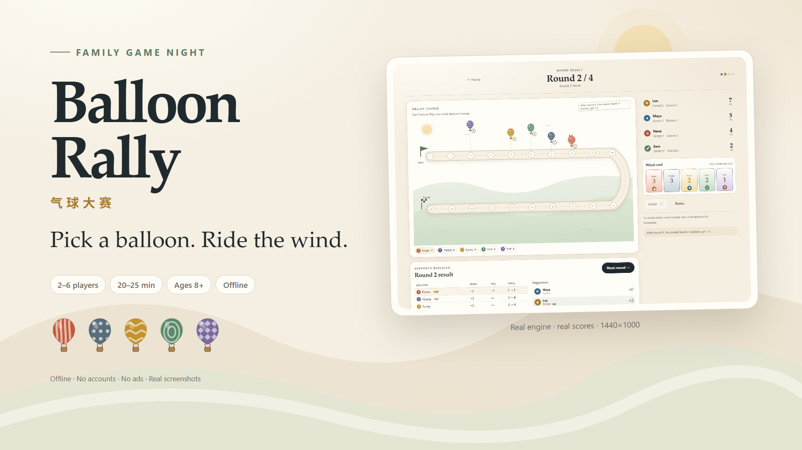
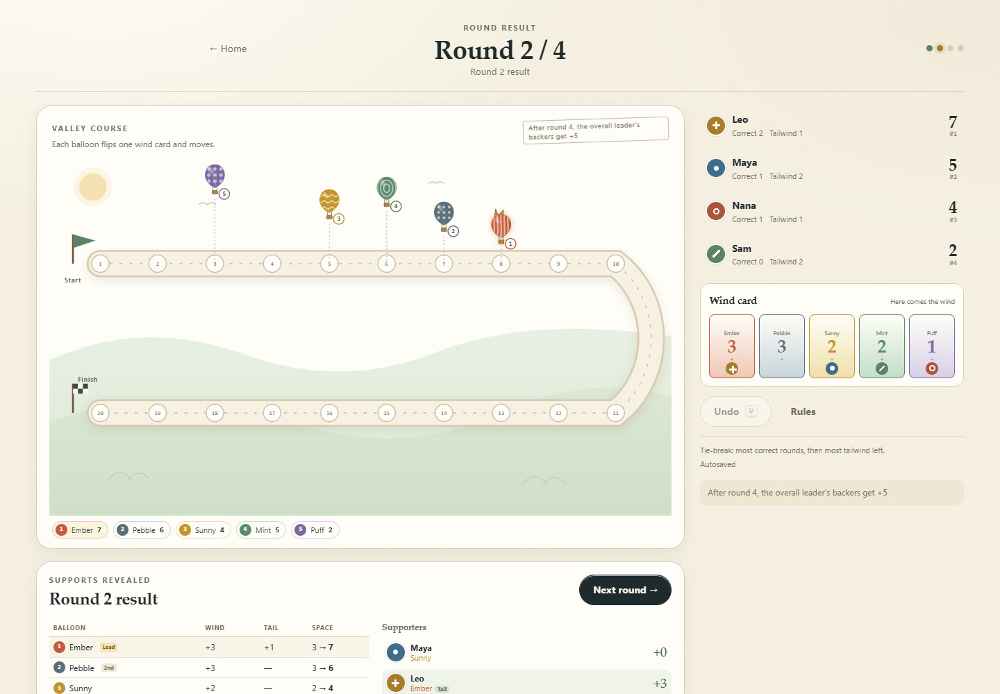
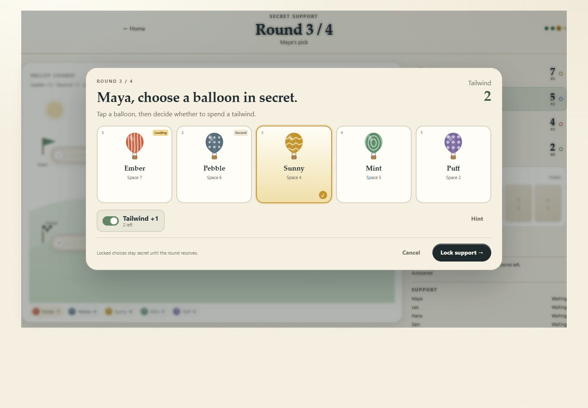
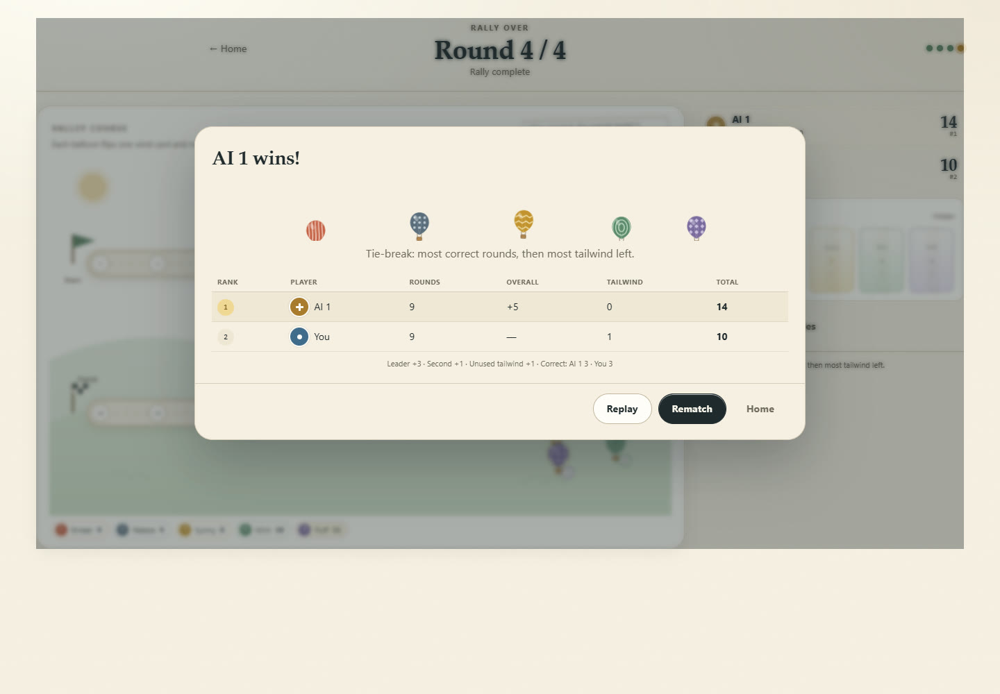
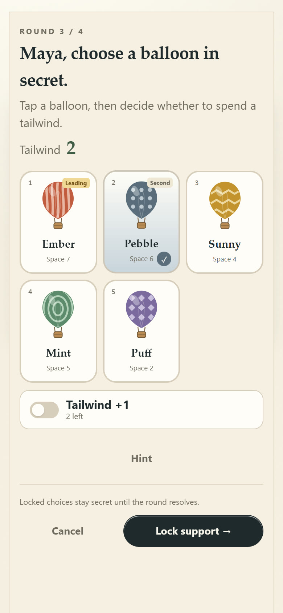
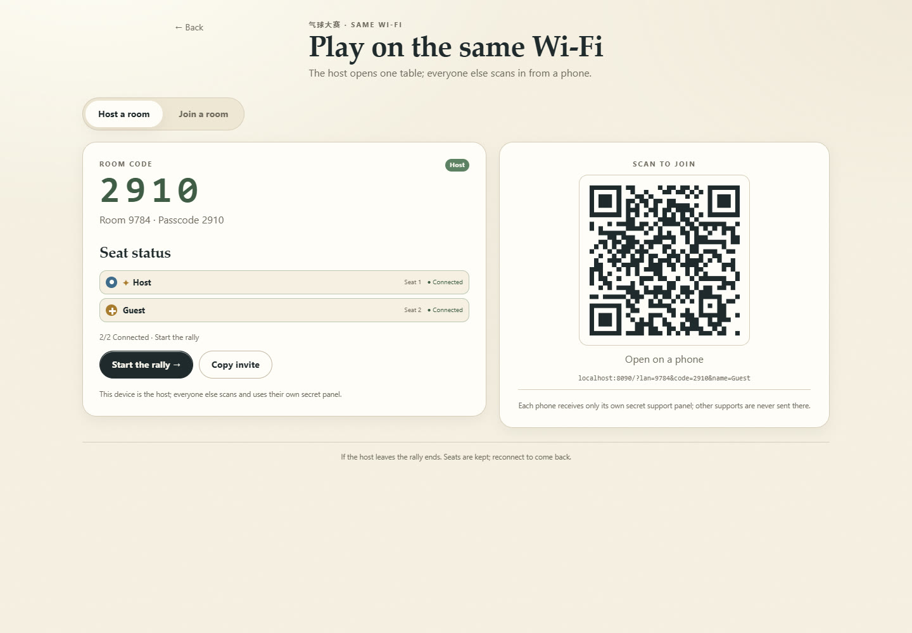
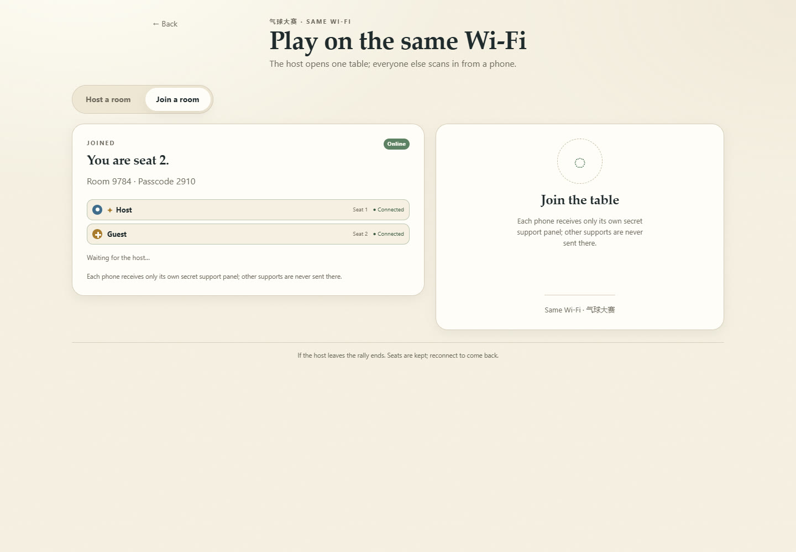

# Balloon Rally · 气球大赛

[中文](README.zh-CN.md) · **English**

> **Pick a balloon. Ride the wind.**
> Five paper balloons, four rounds of wind, one table guessing together.

**v0.1 · browser + Tauri shell** · 2–6 players · 20–25 min · ages 8+ · offline · no accounts · no ads. Solo, hot-seat, and **real LAN host/guest** are included. A prebuilt Windows installer is not in this workspace; the Tauri shell builds with `npm run tauri build`.

[](docs/promo/balloon-rally-promo-en.mp4)

[Watch the 45 s English cut](docs/promo/balloon-rally-promo-en.mp4) · [Chinese cut](docs/promo/balloon-rally-promo-zh.mp4) · [video script](video/SCRIPT.md) · [FACTS gate](video/FACTS.md)

## Five-second rules

| Each round | How to score | How it ends |
| --- | --- | --- |
| Back one balloon in secret. Two tailwind tokens can add +1 before reveal. Five wind cards (1–3) then move the balloons. | Round leader's backers +3; second +1. Each unused tailwind +1. | After four rounds, backers of the overall leader +5. Highest total wins. |

Ties: most correct round supports, then most tailwind left; still tied means a shared win.

## What is inside

- **A real rules engine.** 5 balloons, a 20-space valley, 4 rounds, 5 wind cards (1, 2, 2, 3, 3), 2 tailwind tokens. Every rule has a code and test row in [`docs/rules.md`](docs/rules.md); `npm run data:verify` checks the course data.
- **Three complete ways to play.** Solo against four AI levels (Companion, Easy, Normal, Hard), 2–6 player hot-seat with a privacy cover, and LAN host/guest with room code, QR, seat status, and reconnect. AI runs in a Web Worker with an ≤80 ms budget.
- **LAN keeps secrets.** The host owns the full state; each guest receives only `view(state, guestSeat)`. Other supports and the future wind plan never leave the host.
- **A table that looks after people.** Secret support cover, hints with a reason, undo, autosave/resume, replay, family stats, JSON export, keyboard path, reduced motion, sound off, and a portrait phone layout.
- **Family-safe by design.** Support, wind, and cheers only; the vocabulary stays playful and age-appropriate. The interface uses colour + pattern + number, not colour alone.
- **Small and private.** Static browser build, no CDN, no remote fonts, no accounts, no telemetry. The built JS+CSS is about 0.4 MB before gzip.

## Screenshots

All screenshots come from the running app at 1440×1000 (mobile: 390×844 at 2×). Fixed seed and language; no mockups.

| A real round | Secret support |
| --- | --- |
|  |  |

| Final ranking | Portrait phone |
| --- | --- |
|  |  |

| LAN host lobby | Guest join |
| --- | --- |
|  |  |

More: [home](docs/screenshots/en/home.jpg) · [setup](docs/screenshots/en/setup.jpg) · [rules](docs/screenshots/en/rules.jpg) · [stats](docs/screenshots/en/stats.jpg) · [settings](docs/screenshots/en/settings.jpg) · [all Chinese screenshots](docs/screenshots/zh/).

Sizes and the capture command are recorded in [`docs/screenshots/README.md`](docs/screenshots/README.md).

## Download and install

There is **no prebuilt installer in this workspace**. The browser game is fully playable, and the Tauri shell is configured and ready to build centrally.

```bash
npm install
npm run dev        # http://localhost:5177
# or a production browser build + LAN relay
npm run build
npm run lan        # http://localhost:8090, serves dist + WebSocket relay
# Tauri installer (not run in this parallel pass)
npm run tauri build
```

- Tauri uses `src-tauri/` and the shared `family-arcade-lan-host` relay. The config targets NSIS, per-user install, Simplified Chinese + English.
- `npx tauri info` parses the app config and sees WebView2 + Rust; this machine is missing the MSVC Build Tools, so the installer is built centrally rather than here.
- The unsigned installer will trigger SmartScreen: **More info → Run anyway**. Allow private-network access when Windows Firewall asks for the LAN relay.
- The app is offline after files are served; no account, no analytics, no remote fonts.
- If you host `dist/` yourself, serve it over HTTP. The browser relay defaults to port **8090** because this monorepo may run other apps on 8080.

## LAN night

LAN is implemented:

1. On the host computer run `npm run build && npm run lan` and open `http://localhost:8090` (or use the Tauri app, which starts the relay itself). For phones on the Wi-Fi, open the host page through the computer's LAN IP, e.g. `http://192.168.1.23:8090`, so the QR carries a reachable address.
2. Choose **LAN → Host a room**, pick 2–6 players, and share the 4-digit room code or QR.
3. Guests scan the QR or open the invite link, enter their name, and join. Seat status updates live.
4. When every seat is connected, the host starts. The host advances between rounds.
5. Each guest receives **only their own filtered view**; the host keeps the full state and resolves supports. Other supports never reach the guest phone.
6. If a guest reloads or drops, the host keeps the seat. Rejoin with the same invite; the host resends that seat's view. If the host leaves, the rally ends.

The browser relay is `node tools/lan-server.mjs`; the Tauri build uses the shared Rust relay on ports 8080–8087. The relay only forwards JSON; the host validates every intent. LAN seats are human guests; solo AI remains a separate mode. Spectator mode is not in v0.1.

## How to play

1. Each round, every player **secretly backs one balloon**. Pass the device only after the cover opens.
2. You have **two tailwind tokens per rally**. Before reveal, spend one to add **+1** to the balloon you backed. At most one per round.
3. Shuffle the five wind cards (values **1–3**) and deal one to each balloon. Reveal and move.
4. Backers of the round leader(s) score **+3**; backers of the second position score **+1**. Ties count.
5. After four rounds, backers of the overall leader(s) score **+5**. Each unused tailwind is **+1**. Highest total wins.

### Scoring and edge cases

| Item | Points |
| --- | --- |
| Round leader's backers (all tied leaders) | +3 |
| Next distinct position's backers (all tied) | +1 |
| Overall leader's backers after round 4 (all tied leaders) | +5 |
| Each unused tailwind token | +1 |

- “Second” means the **next distinct position**, not the second balloon in seat order. If every balloon ties, there is no second.
- The final +5 goes to players whose **round-4 support** is an overall leader. Earlier supports do not pay again.
- The track ends at space 20. Movement is capped; there is no finish bonus. The highest position is the overall leader.
- Unused tailwind points are shown in the live total and are guaranteed unless spent.
- Exact ranking: total → most round-leader supports → most tailwind left → shared win.

### Controls

|  | Mouse | Touch | Keyboard |
| --- | --- | --- | --- |
| Pick a balloon | Click a balloon card | Tap a balloon card | `1`–`5` |
| Tailwind | Tick “Tailwind +1” | Tap the switch | `T` |
| Confirm | Click “Lock support” | Tap “Lock support” | `Enter` |
| Undo | Click Undo | Tap Undo | `U` |
| Clear selection | Click Cancel | Tap Cancel | `Esc` |

All buttons have visible focus. The support panel is a real dialog; the screen behind it contains only public information.

## After a rally

- **Replay:** step through every round, auto-play, see supports, winds, movement, and scores.
- **Family stats:** games, wins by name, win rate, best score, current/best streak, favourite balloon, tailwind and correct-support totals.
- **Export:** one JSON download with version, players, wins, best score, favourite balloons; no device fingerprint.
- **Autosave:** after every action in solo/hot-seat. Reload and the home screen offers Continue; the privacy cover reappears on the current human seat. LAN games are session-only (host leaving ends the rally), but a guest can reconnect to the saved seat while the host stays online.

## Video

- 45 s · 1920×1080 · 60 fps · H.264/AAC · 7.09 MB (English) / 6.98 MB (Chinese).
- [English MP4](docs/promo/balloon-rally-promo-en.mp4) · [Chinese MP4](docs/promo/balloon-rally-promo-zh.mp4)
- [English poster](docs/promo/balloon-rally-poster-en.png) · [Chinese poster](docs/promo/balloon-rally-poster-zh.png) · [English SRT](docs/promo/balloon-rally-promo-en.srt) · [Chinese SRT](docs/promo/balloon-rally-promo-zh.srt)
- Mastered to **−14.05 LUFS / −1.42 dBTP** (EN) and **−14.08 LUFS / −1.49 dBTP** (ZH); measurements in [`audio-report.json`](docs/promo/audio-report.json).
- Bilingual synthetic narration + original procedural music/SFX. [Remotion project](video/) · [storyboard and narration](video/SCRIPT.md) · [FACTS gate](video/FACTS.md).
- Monorepo promo manifest: [`video.json`](video.json) — eight EN/ZH narration lines, facts, accent, and three screenshot names for the root studio.

## Development

```bash
npm install
npm run data:verify      # course.json: 5 balloons, 20 spaces, 5 winds, 4 rounds
npm run check            # data + tsc + vitest + production build
npx vitest run           # 47 unit/integration tests
npm run build            # static dist/
npm run e2e              # requires dev server + built dist; includes LAN E2E
npm run screenshots      # requires dev server + built dist + system Chrome
npm run lan              # browser relay + dist on :8090
npm run ai:calibrate     # 200 games per matchup, writes docs/ai-calibration.md
```

The E2E script plays a full solo rally, checks hot-seat privacy/undo/resume, opens the first-run tutorial, checks the 390 px layout, then runs a real LAN host/guest round through the shared relay. The LAN leg also verifies that guest WebSocket frames contain no `windPlan` or other `supports`, reloads/rejoins the guest, and checks that only the host can advance. Screenshots use Playwright `channel: 'chrome'` with fixed viewports.

Video commands:

```bash
cd video
npm install
npm run prep             # data, screenshots, audio, SRT, FACTS
npm run voice            # optional: requires edge-tts; committed voice files exist
npm run poster:en
npm run poster:zh
npm run render:en
npm run render:zh
npm run master
```

### Tests and evidence

- `npx tsc --noEmit`: pass.
- `npx vitest run`: 47/47 pass, including 120 seeded full rallies with invariants.
- `npm run build`: pass.
- `node scripts/e2e.mjs`: pass — includes real LAN host/guest with hidden-view and reconnect checks.
- `npm run data:verify`: pass.
- AI calibration: 200 games per matchup — Hard 53.1% vs Normal, Normal 50.6% vs Easy, Easy 64.7% vs Companion. Ordering is correct, but the first two miss the 60–70% band; see [`docs/ai-calibration.md`](docs/ai-calibration.md) and [`docs/limitations.md`](docs/limitations.md).
- Video FACTS: 11/11 PASS.
- Mastered audio: EN −14.05 LUFS / −1.42 dBTP; ZH −14.08 LUFS / −1.49 dBTP.

## Architecture

```
src/game/     pure rules: types, data, engine, seeded RNG, replay
src/ai/       four levels, evaluation, Web Worker client
src/net.ts    browser/Tauri LAN detection, invite and WebSocket URLs
src/ui/       React screens, SVG track, support, summary, LAN lobby
src/i18n.ts   complete zh/en dictionary
src/storage.ts autosave, settings, stats, export
src-tauri/    shared Tauri shell + LAN relay (config ready, not built here)
data/         course.json + verifier
tests/        engine, privacy, scoring, 120-game simulation, AI, data/i18n
video/        optional 45 s promo assets; monorepo manifest is video.json
docs/         rules audit, limitations, AI calibration, screenshots, promo
```

The engine is pure: no DOM, network, time, or `Math.random`. Wind plans use an injected seeded RNG, `apply` returns immutable states, and every action is checked by `invariants`. `view(state, seat)` removes other players' current supports and the future wind plan, so AI, hot-seat, and LAN guests cannot read hidden information. LAN uses `@family-arcade/lan`: the host owns `GameState`, applies seats' intents, and sends each guest only `view(state, guestSeat)`.

## Limitations

See [`docs/limitations.md`](docs/limitations.md). Short version: no cloud or prebuilt installer in this workspace; LAN host/guest is implemented but spectator mode is not; 2–4 players is the sweet spot although 2–6 works; single-rally replay only; AI calibration runs 200 games per matchup but Hard/Normal miss the standard 60–70% band (ordering is correct; documented honestly); video narration is synthetic, not a human recording.

## License and notices

MIT for code. Original SVG art, data, UI copy, and audio generated for this project. Screenshots are from the real app. Non-official, non-commercial family project; not adapted from any publisher's name, art, or card text. Third-party trademarks remain with their owners. See [`NOTICE.md`](NOTICE.md) and [`LICENSE`](LICENSE).
