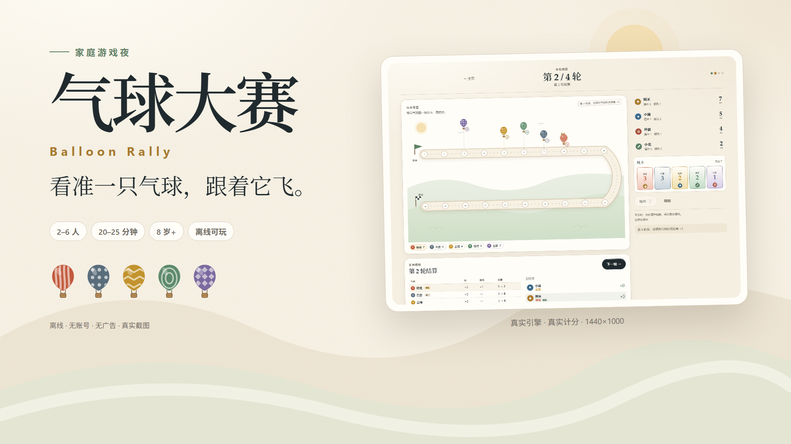
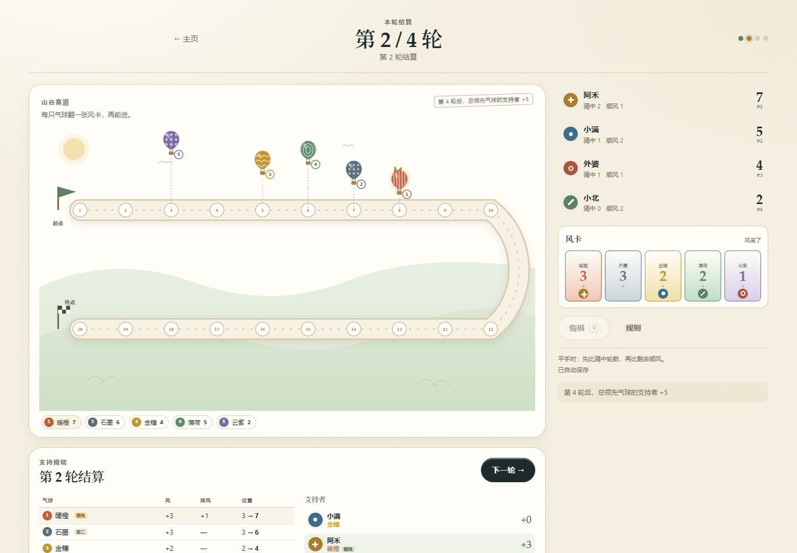
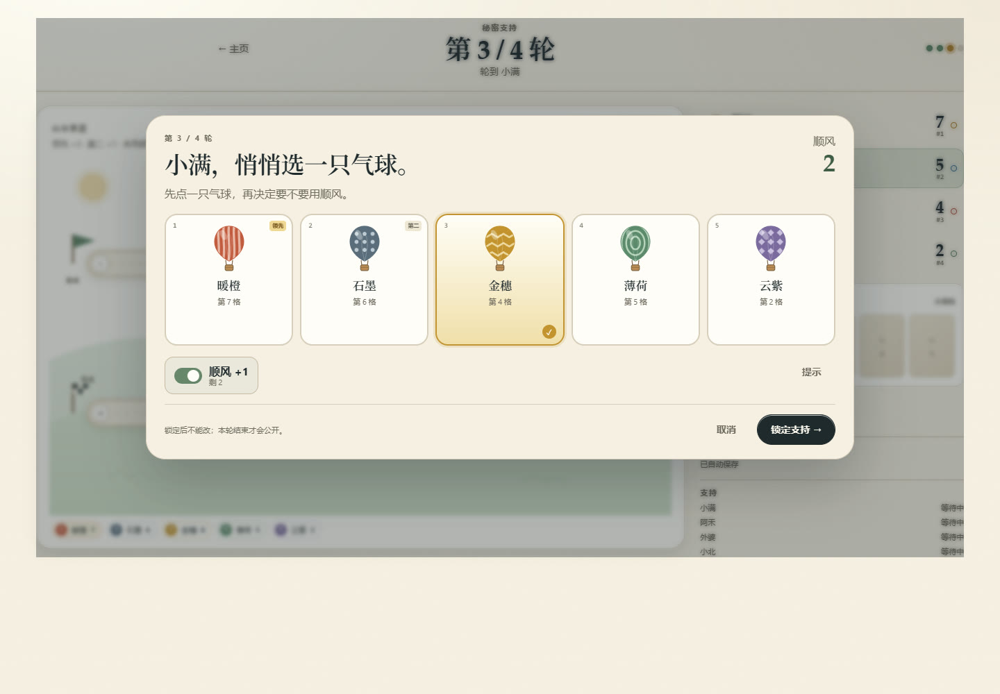
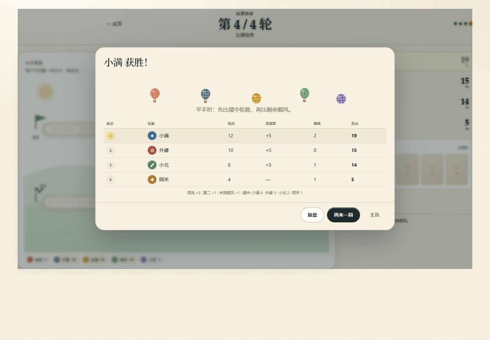
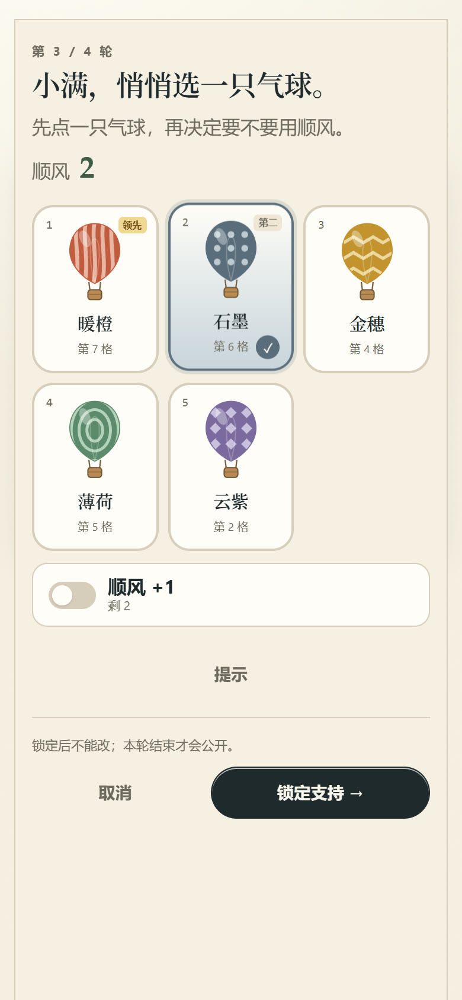
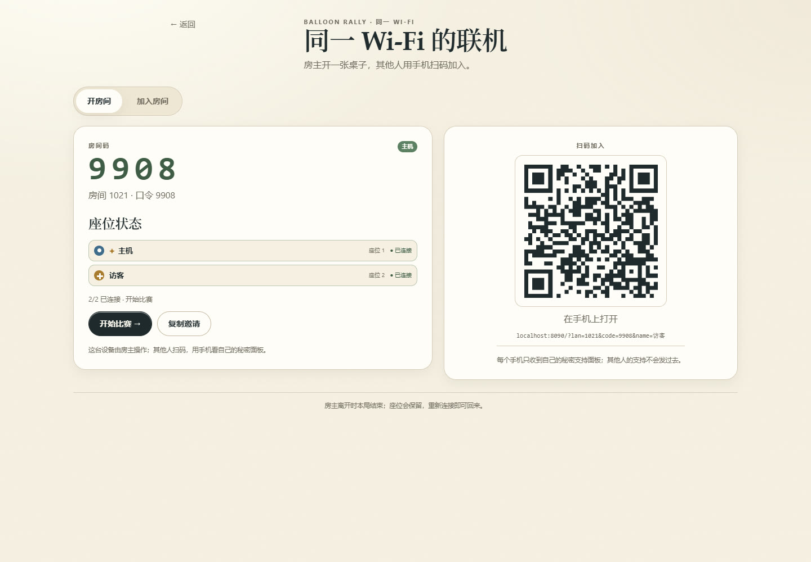
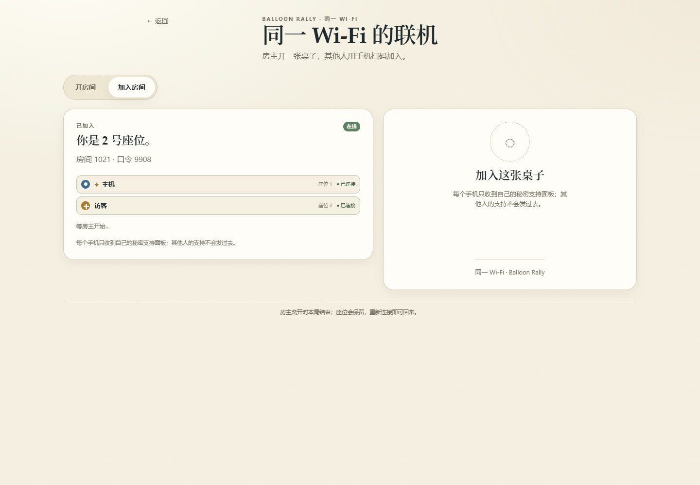

# 气球大赛 · Balloon Rally

**中文** · [English](README.md)

> **看准一只气球，跟着它飞。**
> 五只纸气球、四轮风、全桌一起猜。

**v0.1 · 浏览器 + Tauri 壳** · 2–6 人 · 20–25 分钟 · 8 岁+ · 离线 · 无账号 · 无广告。单人、同屏热座与**真实的局域网主/客机**都已实现。本工作区不带预编译安装包；Tauri 壳可用 `npm run tauri build` 构建。

[](docs/promo/balloon-rally-promo-zh.mp4)

[观看 45 秒中文版](docs/promo/balloon-rally-promo-zh.mp4) · [English cut](docs/promo/balloon-rally-promo-en.mp4) · [视频脚本](video/SCRIPT.md) · [FACTS 门禁](video/FACTS.md)

## 五秒规则

| 每轮做什么 | 怎么得分 | 怎么结束 |
| --- | --- | --- |
| 每人秘密支持一只气球。每局两枚顺风，揭晓前可 +1。五张风卡（1–3）随后让气球前进。 | 本轮领先支持者 +3，第二 +1；未用顺风每枚 +1。 | 四轮后，总领先气球的支持者 +5，总分最高者胜。 |

平手：先比猜中轮数，再比剩余顺风；仍相同则并列。

## 里面有什么

- **真正的规则引擎。** 5 只气球、20 格山谷、4 轮、5 张风卡（1、2、2、3、3）、每人 2 枚顺风。每条规则在 [`docs/rules.md`](docs/rules.md) 都有代码位置与测试；`npm run data:verify` 检查赛道数据。
- **三种完整玩法。** 单人四档 AI（陪玩、轻松、标准、挑战）、2–6 人同屏热座、以及带房间码、二维码、座位状态和重连的局域网主/客机。AI 在 Web Worker 中运行，预算 ≤80ms。
- **联机也守秘密。** 房主持有完整状态；每个访客只收到 `view(state, guestSeat)`。其他玩家的支持与未来风卡不会发到访客手机。
- **桌子会照顾人。** 隐私遮罩、带理由的提示、悔棋、自动保存/继续、复盘、家庭战绩、JSON 导出、键盘路径、减少动效、静音可玩、手机竖屏布局。
- **家庭安全。** 只有支持、顺风和掌声；用词保持家庭友好。颜色之外还有图案和编号。
- **小而私密。** 静态网页构建，不用 CDN、远程字体、账号或遥测。压缩前 JS+CSS 约 0.4MB。

## 截图

全部来自真实运行的应用，1440×1000（手机 390×844 @2×），固定语言与种子；没有手绘假界面。

| 真实一轮 | 秘密支持 |
| --- | --- |
|  |  |

| 终局排名 | 手机竖屏 |
| --- | --- |
|  |  |

| 局域网房主大厅 | 访客加入 |
| --- | --- |
|  |  |

更多：[主页](docs/screenshots/zh/home.jpg) · [设置人数](docs/screenshots/zh/setup.jpg) · [规则](docs/screenshots/zh/rules.jpg) · [战绩](docs/screenshots/zh/stats.jpg) · [设置](docs/screenshots/zh/settings.jpg) · [全部英文截图](docs/screenshots/en/)。

尺寸与截图命令见 [`docs/screenshots/README.md`](docs/screenshots/README.md)。

## 下载与安装

本工作区**不带预编译安装包**。浏览器游戏完整可玩，Tauri 壳已配置好，由主构建统一打包。

```bash
npm install
npm run dev        # http://localhost:5177
# 或生产构建 + 局域网中继
npm run build
npm run lan        # http://localhost:8090，同时提供 dist 与 WebSocket 中继
# Tauri 安装包（本轮并行构建不运行）
npm run tauri build
```

- Tauri 使用 `src-tauri/` 与共享的 `family-arcade-lan-host` 中继；配置目标为 NSIS、按用户安装、简中/英文。
- `npx tauri info` 能解析应用配置并识别 WebView2 + Rust；本机缺少 MSVC Build Tools，因此安装包由主构建机统一生成，不在这里构建。
- 未签名安装包会触发 SmartScreen：**更多信息 → 仍要运行**。Windows 防火墙询问时允许专用网络。
- 文件由本地服务提供后完全离线；无账号、无遥测、无远程字体。
- 自行部署 `dist/` 时请用 HTTP。浏览器中继默认端口 **8090**，因为本 monorepo 可能已有应用占用 8080。

## 局域网之夜

局域网已经可用：

1. 在房主电脑运行 `npm run build && npm run lan`，打开 `http://localhost:8090`；或直接用 Tauri 版（自动开中继）。要让手机扫码，请用电脑的局域网 IP 打开房主页，例如 `http://192.168.1.23:8090`，这样二维码里的地址才可达。
2. 选择 **局域网 → 开房间**，选 2–6 人，分享 4 位房间码或二维码。
3. 访客扫码/打开邀请链接，输入名字加入；座位状态实时更新。
4. 所有座位连上后房主开始。每轮之间由房主进入下一轮。
5. 每个访客只收到**自己的过滤视图**；房主持有完整状态并结算支持。其他玩家的支持不会发到访客手机。
6. 访客刷新/掉线后座位保留；用同一邀请重新加入，房主会补发该座位的视图。房主离开则本局结束。

浏览器中继由 `node tools/lan-server.mjs` 提供；Tauri 版使用共享 Rust 中继（端口 8080–8087）。中继只转发 JSON，所有意图由房主验证。局域网座位都是真人访客；单人 AI 仍是独立模式。v0.1 没有观战模式。

## 怎么玩

1. 每轮每人**秘密支持一只气球**。遮罩打开后，才把设备交给下一位。
2. 每局有**两枚顺风**。揭晓前用一枚，给支持的气球 **+1**；每轮最多一枚。
3. 洗五张风卡（**1–3**），每只气球随机分一张；翻开并前进。
4. 本轮领先气球的支持者 **+3**，第二位置 **+1**；并列都算。
5. 四轮后，总领先气球的支持者 **+5**；每枚未用顺风 **+1**。总分最高者胜。

### 计分与边界

| 项目 | 分 |
| --- | --- |
| 本轮领先支持者（并列全算） | +3 |
| 下一个不同位置的支持者（并列全算） | +1 |
| 四轮后总领先支持者（并列全算） | +5 |
| 每枚未用顺风 | +1 |

- “第二”指**下一个不同位置**，不是按座位顺序的第二只气球。若五只全并列，则没有第二。
- 最后的 +5 只发给**第 4 轮支持了总领先气球**的人；之前的支持不重复计奖。
- 赛道终点是第 20 格，移动封顶，没有冲线奖励；最高位置即总领先。
- 未用顺风的分已计入实时总分；用掉才会失去这 1 分。
- 名次：总分 → 猜中轮数 → 剩余顺风 → 仍相同则并列。

### 操作

|  | 鼠标 | 触屏 | 键盘 |
| --- | --- | --- | --- |
| 选气球 | 点气球卡 | 轻点气球卡 | `1`–`5` |
| 顺风 | 勾选“顺风 +1” | 轻点开关 | `T` |
| 确认 | 点“锁定支持” | 轻点“锁定支持” | `Enter` |
| 悔棋 | 点“悔棋” | 轻点“悔棋” | `U` |
| 取消选择 | 点“取消” | 轻点“取消” | `Esc` |

所有按钮都有可见焦点。支持面板是真正的对话框；背景只包含公开信息。

## 一局之后

- **复盘：** 逐轮查看支持、风卡、移动与得分，可自动播放。
- **家庭战绩：** 总对局、按玩家胜场、胜率、最高分、当前/最长连胜、最常支持的气球、顺风与猜中次数。
- **导出：** 下载一份 JSON，含版本、玩家、胜场、最高分、最爱气球；不含设备指纹。
- **自动保存：** 单人/热座每步保存。刷新后主页出现“继续上局”，当前真人座位重新出现遮罩。局域网局不跨房主保存（房主离开即结束），但访客在房主在线时可以重新连接回自己的座位。

## 视频

- 45 秒 · 1920×1080 · 60fps · H.264/AAC · 7.09MB（英文）/ 6.98MB（中文）。
- [英文成片](docs/promo/balloon-rally-promo-en.mp4) · [中文成片](docs/promo/balloon-rally-promo-zh.mp4)
- [英文海报](docs/promo/balloon-rally-poster-en.png) · [中文海报](docs/promo/balloon-rally-poster-zh.png) · [英文字幕](docs/promo/balloon-rally-promo-en.srt) · [中文字幕](docs/promo/balloon-rally-promo-zh.srt)
- 母带：英文 **−14.05 LUFS / −1.42 dBTP**；中文 **−14.08 LUFS / −1.49 dBTP**；测量见 [`audio-report.json`](docs/promo/audio-report.json)。
- 双语合成旁白 + 原创程序化音乐/音效。[Remotion 工程](video/) · [分镜与旁白](video/SCRIPT.md) · [FACTS 门禁](video/FACTS.md)。
- Monorepo 宣传清单：[`video.json`](video.json)，含 8 句中英旁白、事实、主色与三张截图名，供根目录 studio 渲染。

## 开发

```bash
npm install
npm run data:verify      # course.json：5 气球、20 格、5 风卡、4 轮
npm run check            # 数据 + tsc + vitest + 生产构建
npx vitest run           # 47 个单元/集成测试
npm run build            # 静态 dist/
npm run e2e              # 需要开发服务器 + 已构建 dist；包含局域网 E2E
npm run screenshots      # 需要开发服务器 + 已构建 dist + 系统 Chrome
npm run lan              # 浏览器中继 + dist，端口 8090
npm run ai:calibrate     # 每个对局 200 局，写入 docs/ai-calibration.md
```

E2E 会完整玩一局单人赛、检查热座隐私/悔棋/继续、打开首次引导、检查 390px 布局，然后通过共享中继跑一局真实局域网主/客机。局域网部分还会检查访客 WebSocket 帧中没有 `windPlan` 或其他 `supports`，刷新/重连访客，并确认只有房主能进入下一轮。截图使用 Playwright `channel: 'chrome'` 与固定视口。

视频命令：

```bash
cd video
npm install
npm run prep             # 数据、截图、音频、SRT、FACTS
npm run voice            # 可选：需要 edge-tts；仓库已带旁白文件
npm run poster:en
npm run poster:zh
npm run render:en
npm run render:zh
npm run master
```

### 测试与证据

- `npx tsc --noEmit`：通过。
- `npx vitest run`：47/47 通过，含 120 局带种子的完整随机对局与不变量检查。
- `npm run build`：通过。
- `node scripts/e2e.mjs`：通过，包含真实局域网主/客机、隐藏视图与重连检查。
- `npm run data:verify`：通过。
- AI 校准：每个对局 200 局——Hard 对 Normal 53.1%，Normal 对 Easy 50.6%，Easy 对 Companion 64.7%。强弱顺序正确，但前两项未达到 60–70% 区间；见 [`docs/ai-calibration.md`](docs/ai-calibration.md) 与 [`docs/limitations.md`](docs/limitations.md)。
- 视频 FACTS：11/11 PASS。
- 母带：英文 −14.05 LUFS / −1.42 dBTP；中文 −14.08 LUFS / −1.49 dBTP。

## 架构

```
src/game/     纯规则：types、data、engine、种子随机、replay
src/ai/       四档 AI、评估、Web Worker 客户端
src/net.ts    浏览器/Tauri 联机检测、邀请与 WebSocket 地址
src/ui/       React 页面、SVG 赛道、支持、结算、局域网大厅
src/i18n.ts   完整中英字典
src/storage.ts 自动保存、设置、战绩、导出
src-tauri/    共享 Tauri 壳 + 局域网中继（配置就绪，本轮不构建）
data/         course.json + 校验脚本
tests/        引擎、隐私、计分、120 局模拟、AI、数据/双语
video/        可选 45 秒宣传物料；monorepo 清单为 video.json
docs/         规则审计、限制、AI 校准、截图、宣传物料
```

引擎是纯函数：不碰 DOM、网络、时间或 `Math.random`。风卡计划来自注入的种子 RNG；`apply` 返回新状态，每个动作都过 `invariants`。`view(state, seat)` 会删掉其他玩家本轮的支持与未来风卡，AI、热座和局域网访客都无法读取隐藏信息。局域网使用 `@family-arcade/lan`：房主持有 `GameState`，验证座位意图，并只向访客发送 `view(state, guestSeat)`。

## 已知限制

详见 [`docs/limitations.md`](docs/limitations.md)。简版：没有云同步或预编译安装包；局域网主/客机已实现，但没有观战；2–6 人都能玩，但 2–4 人体验最好；只保留当前一局的复盘；AI 校准每个对局跑 200 局，但 Hard/Normal 未达到标准 60–70% 区间（顺序正确，已如实记录）；视频为双语合成旁白，尚非真人录制。

## 许可与声明

代码 MIT。SVG 美术、数据、界面文案与音频均为本项目原创或程序生成。截图来自真实应用。非官方、非商业家庭项目；不改编任何出版方的名称、美术或卡牌文字。第三方商标归其权利人。见 [`NOTICE.md`](NOTICE.md) 与 [`LICENSE`](LICENSE)。
