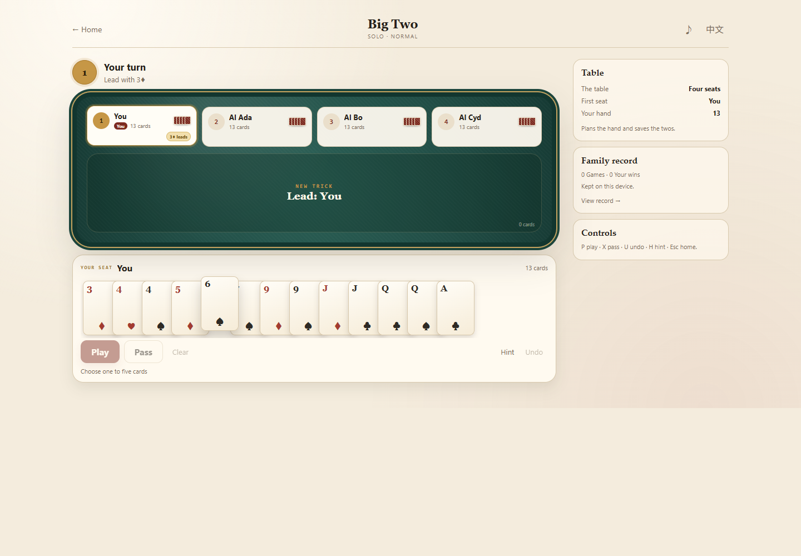
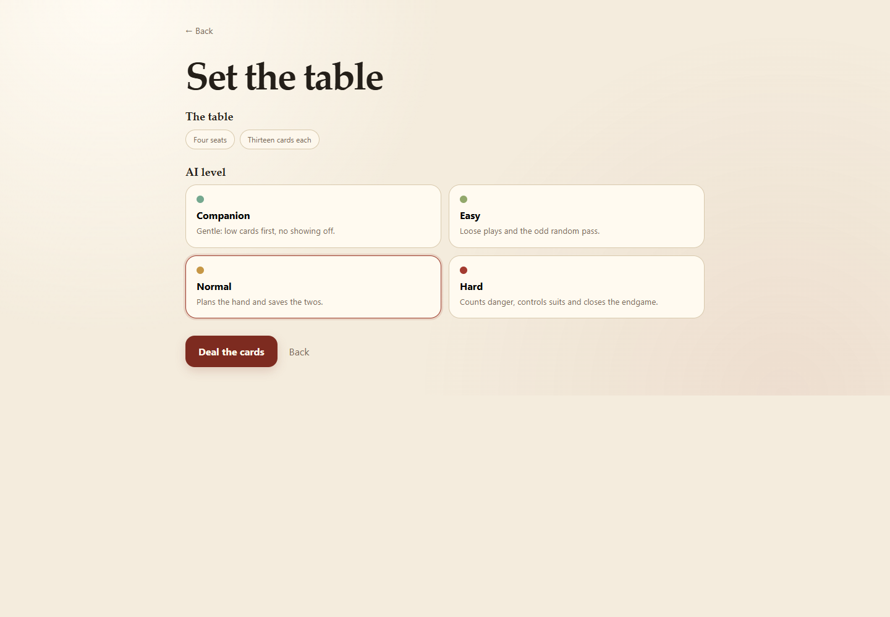
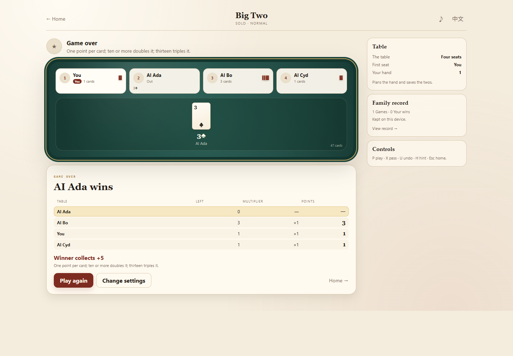
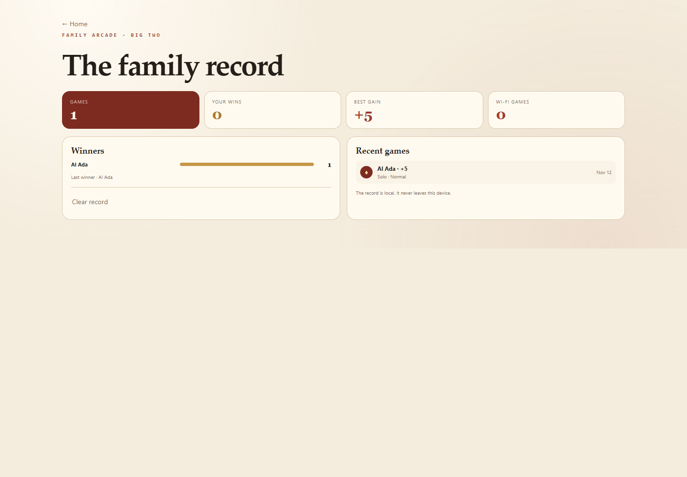
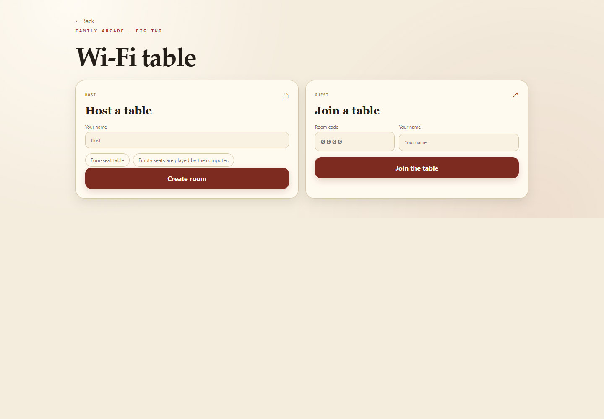
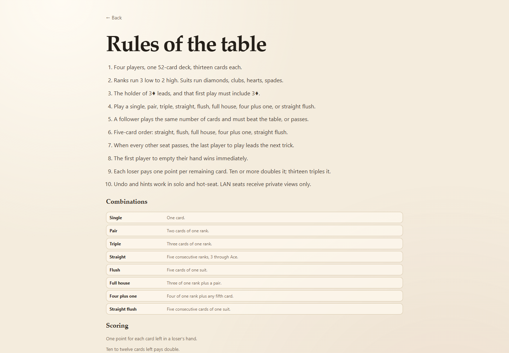
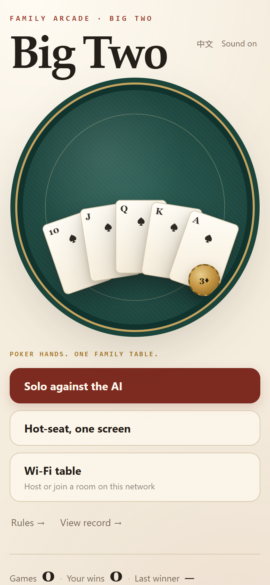
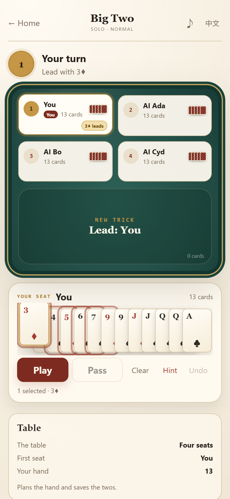

# Big Two

**English** · [简体中文](README.zh-CN.md)

> **Poker hands. One family table.**

A four-player Big Two table for the family. Fifty-two cards, thirteen each, four
AI levels, one-screen hot-seat with a privacy curtain, and a LAN room with a
private view for every seat. No account, no ads, no cloud; LAN play stays on your
own network.


## A turn, in five seconds

| Lead | Follow | Win |
| --- | --- | --- |
| The holder of 3♦ starts and must include it. | Play the same number of cards and beat the table, or pass. | Empty your hand first. Every card left in the other hands scores. |

Ranks run 3 low to 2 high. Suits run diamonds < clubs < hearts < spades. Five-card
hands rank straight < flush < full house < four plus one < straight flush.

## What is inside

- **A real, tested engine.** Pure TypeScript, deterministic, **40 tests**, no DOM,
  network, clock or `Math.random` in the rules. See [`docs/rules.md`](docs/rules.md).
- **Four AI levels.** Companion is gentle and steps aside for a short-handed child;
  Easy is loose; Normal plans the hand and saves the twos; Hard counts danger,
  controls suits and closes the endgame. Hard never reads hidden cards.
- **Three ways to play.** Solo against three AI seats, four-player hot-seat on one
  screen, or a LAN room with four private seats and AI filling empty chairs.
- **Real Big Two combinations.** Single, pair, triple, straight, flush, full house,
  four plus one and straight flush. The first lead must include 3♦; a pass locks you
  out until the trick clears; the last player to play leads again.
- **Scoring that matches the table.** One point per remaining card, doubled at ten
  or more and tripled for thirteen. The winner collects the three penalties and the
  result table shows every hand.
- **A local family record.** Games, your wins, best gain, winner tally, mode split
  and the eight newest games. LAN games are recorded on the host device.
- **Small comforts.** Undo and a hint that explains *why* in solo/hot-seat, autosave
  and resume, sound on/off, keyboard play, reduced-motion support, complete
  Chinese/English UI, and a mobile layout designed as a first-class way to play.
- **Private by default.** No accounts, no telemetry, no ads, no remote fonts.

## Screenshots

| A real turn | AI setup |
| --- | --- |
|  |  |

| Hint with a reason | The table is set |
| --- | --- |
|  |  |

| Family record | LAN lobby |
| --- | --- |
|  |  |

| Rules | Phone home | Phone table |
| --- | --- | --- |
|  |  |  |

All screenshots come from the running app at 1440×1000 (phone 780×1688,
390×844 @2×).

## Play locally

```bash
npm install
npm run dev        # http://localhost:5222
npm run check      # tsc + 40 tests + production build
npm run e2e        # real Chrome, dev server required
npm run lan:e2e    # starts its own relay; set LAN_PORT=19022
npm run shots      # regenerate all EN/ZH screenshots
```

Keyboard: Tab to a card, Space selects it; **P** play, **X** pass, **U** undo,
**H** hint, **Esc** home. On a phone, tap a card to select it and tap again to
clear it.

## LAN night

Browser/dev:

```bash
npm run build
npm run lan        # relay on :8080, serves dist/
# open http://localhost:5222, choose Wi-Fi table, Create room
# guest: scan the QR, or open the invite and type the four-digit code
```

Desktop: the Tauri build starts the same relay internally and serves the built app
to phones. The host creates a four-seat room and shows a four-digit code and QR
invite. Empty seats are filled by the AI, so one guest is enough to start. A guest
who arrives after the deal can take over an AI seat. Each guest opens the address
on the same Wi-Fi and works from a private view containing only their own hand.

The relay is a dumb message bus. The host keeps the authoritative state and sends
only each guest's own view. Every intent carries the current action count; stale
intents, spoofed seats and wrong turns are ignored. A dropped guest seat is played
by the host after a short wait, so the table never freezes. The guest's result
screen is read-only and waits for the host to deal again.

## Build the Windows installer

```bash
npm install
npx tauri build --bundles nsis
# src-tauri/target/release/bundle/nsis/Big Two_0.1.0_x64-setup.exe
```

The installer is per-game and lightweight; WebView2 uses the standard bootstrapper.
A Windows SmartScreen warning is expected for an unsigned family build.

## Known limitations

- Exactly four players. No two- or three-player variant.
- No jokers, no wild twos, no A-2-3-4-5 wheel. Ace is high in a straight and the 2
  never appears in one.
- Five-card hands compare across categories as specified: a flush beats a straight.
  Some house rules require the same five-card type to follow.
- The deal ends at the first empty hand; there is no continued race for second and
  third. All remaining cards still score.
- No cumulative match total. Each deal records a winner, gain and penalties.
- Undo and hints are disabled in LAN play. LAN is IPv4 on the same subnet; phone
  guests need the host firewall to allow the app.
- A browser-hosted QR may use `localhost`; use the desktop build or open the host
  machine's LAN IP for a phone on the Wi-Fi.
- Hard is a strong heuristic opponent, not a solved game.
- The 45-second promo is rendered centrally from [`video.json`](video.json); no
  Remotion project or media asset is stored in this app.

See [`docs/limitations.md`](docs/limitations.md).

## Credits

Original code, card faces, table and copy for Family Arcade. MIT. See
[`NOTICE.md`](NOTICE.md).
