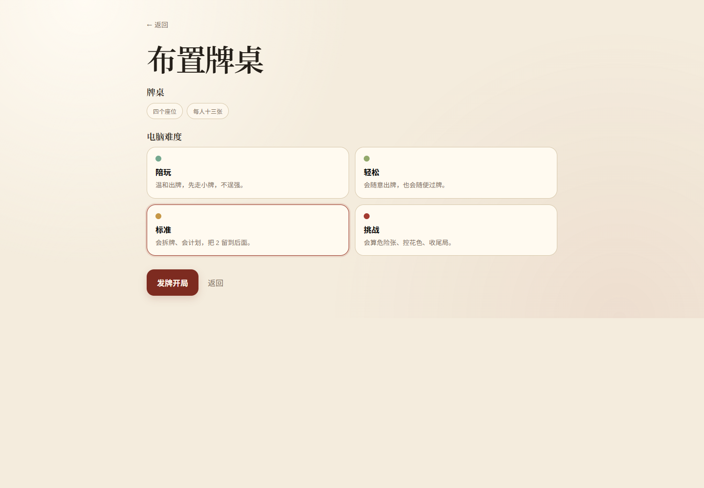
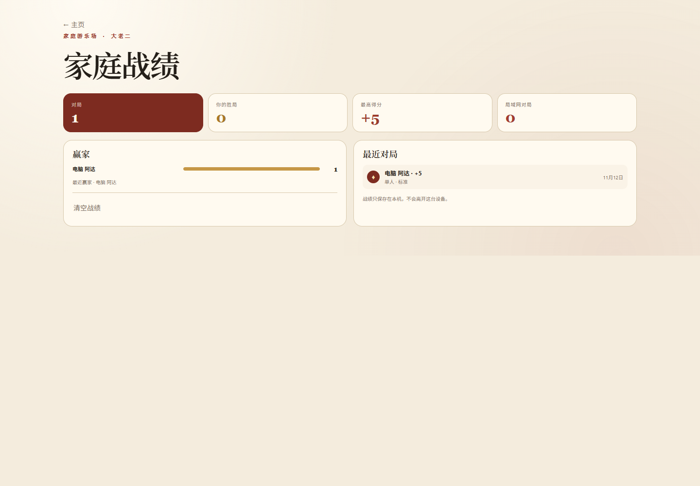
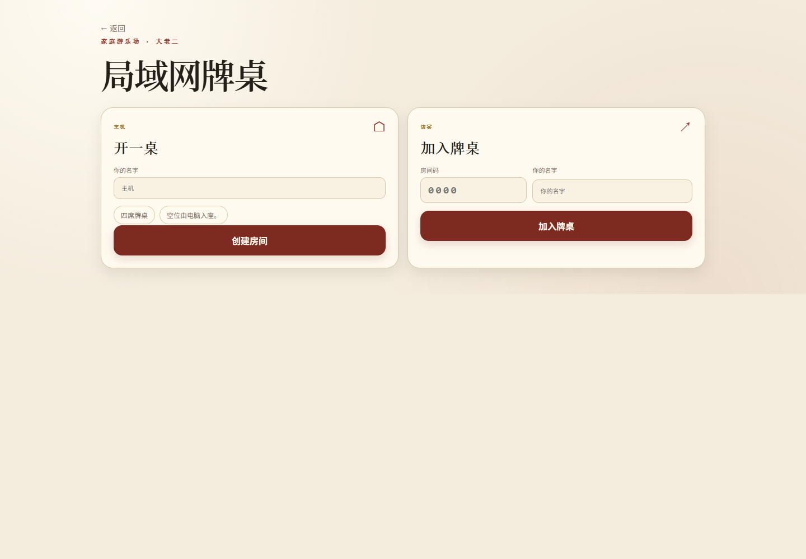
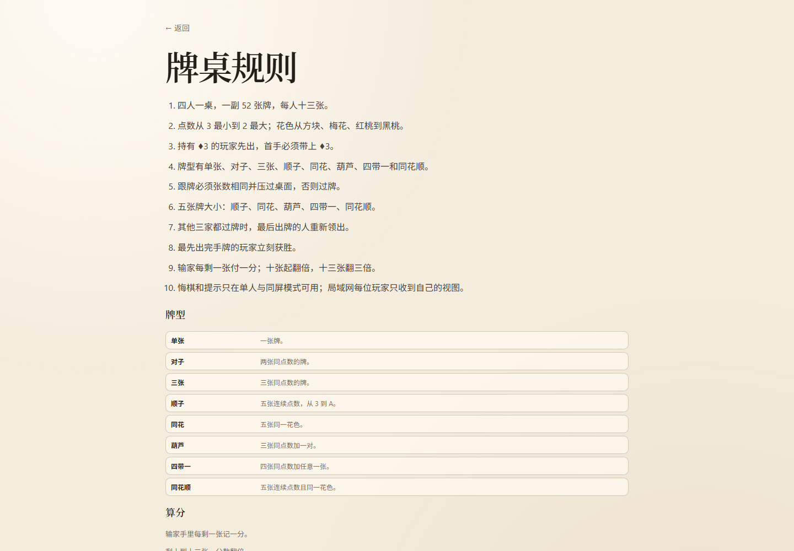
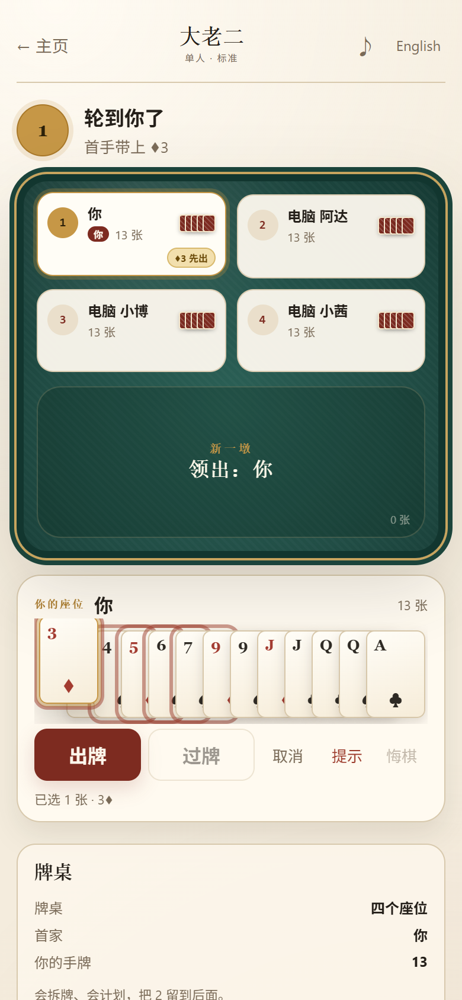

# 大老二

[English](README.md) · **简体中文**

> **扑克牌型，一家人一桌。**

四人一桌的大老二。五十二张牌，每人十三张，四档电脑对手，同屏热座带传递幕布，
局域网牌桌每位玩家都有自己的私密视图。无账号、无广告、无云端；局域网对局只在
自己的网络内进行。


## 五秒看懂一局

| 领出 | 跟牌 | 获胜 |
| --- | --- | --- |
| 持有 ♦3 的玩家先出，首手必须带上它。 | 出同样张数并压过桌面，或者过牌。 | 最先出完手牌的人获胜，其他三家剩下的牌都要算分。 |

点数从 3 最小到 2 最大；花色从方块、梅花、红桃到黑桃。五张牌型大小：
顺子、同花、葫芦、四带一、同花顺。

## 里面有什么

- **经过测试的纯引擎。** TypeScript 编写，可复现，**40 个测试**，规则层不依赖
  页面、网络、时钟或 `Math.random`。详见 [`docs/rules.md`](docs/rules.md)。
- **四档电脑对手。** 陪玩温和，会给手牌少的小朋友让路；轻松会随意出牌；
  标准会拆牌、会计划，把 2 留到后面；挑战会算危险张、控花色、收尾局。
  挑战难度也不会偷看别人的手牌。
- **三种玩法。** 单人对抗三个电脑座位，四人同屏热座，或者四席局域网牌桌；
  局域网空位由电脑补上。
- **完整的大老二牌型。** 单张、对子、三张、顺子、同花、葫芦、四带一、同花顺。
  首手必须带 ♦3；过牌后要等这一墩结束才能再出；其他三家都过牌时，最后出牌的
  人重新领出。
- **按牌桌规则算分。** 输家每剩一张付一分；十张起翻倍，十三张翻三倍。赢家收下
  三家分数，结算表会列出每个座位。
- **本机家庭战绩。** 对局数、你的胜局、最高得分、赢家统计、模式分布和最近八局。
  局域网对局记录在主机上。
- **小细节。** 单人/同屏模式有悔棋和带理由的提示；自动保存与继续；声音开关；
  键盘操作；减少动态效果；完整中英文界面；手机布局按一等玩法设计。
- **默认私密。** 无账号、无遥测、无广告、无远程字体。

## 截图

| 真实牌局 | 电脑难度 |
| --- | --- |
|  |  |

| 带理由的提示 | 本局结算 |
| --- | --- |
|  |  |

| 家庭战绩 | 局域网大厅 |
| --- | --- |
|  |  |

| 规则 | 手机主页 | 手机牌桌 |
| --- | --- | --- |
|  |  |  |

所有截图都来自真实运行的应用：桌面 1440×1000，手机 780×1688
（390×844，二倍像素密度）。

## 本机运行

```bash
npm install
npm run dev        # http://localhost:5222
npm run check      # 类型检查 + 40 个测试 + 生产构建
npm run e2e        # 真实 Chrome，需要先开开发服务器
npm run lan:e2e    # 自己启动中继；使用 LAN_PORT=19022
npm run shots      # 重新生成中英文截图
```

键盘：Tab 选牌，空格选中；**P** 出牌，**X** 过牌，**U** 悔棋，**H** 提示，
**Esc** 回主页。手机上点一张牌选中，再点一次取消。

## 局域网牌桌

浏览器 / 开发环境：

```bash
npm run build
npm run lan        # 中继在 :8080，同时提供 dist/
# 在 http://localhost:5222 打开主机页面，选择局域网牌桌，创建房间
# 访客扫码，或打开邀请链接并输入四位房间码
```

桌面版：桌面安装包会在内部启动同一个中继，并把构建好的页面提供给手机。主机创建
四席房间，显示四位房间码和二维码。空位由电脑补上，所以一位访客也能开局。发牌后
再加入的访客可以接手电脑空位。每位访客在同一 Wi-Fi 下打开地址，只会收到自己的
手牌和公开牌桌信息。

中继只负责转发消息。主机持有权威状态，只向每位访客发送该座位的视图。每个操作都
带当前操作计数；过期操作、伪造座位和错误轮次都会被忽略。访客掉线后，主机会在短暂
等待后替该座位出牌，牌桌不会卡住。访客的结算页只读，等待主机再次发牌。

## 构建 Windows 安装包

```bash
npm install
npx tauri build --bundles nsis
# src-tauri/target/release/bundle/nsis/Big Two_0.1.0_x64-setup.exe
```

安装包按游戏单独构建，体积轻；WebView2 使用标准引导程序。家庭内部未签名构建出现
Windows SmartScreen 提示是正常现象。

## 已知限制

- 固定四人。没有两人或三人变体。
- 不用王，不设任意 2 百搭，也不支持 A-2-3-4-5 的轮子顺。A 在顺子里只作最大，
  2 不参与顺子。
- 五张牌型按需求跨类比较：同花可以压顺子。有些家庭牌桌要求同类型才能跟牌。
- 第一位出完手牌就结束，不再继续争第二、第三名；剩余手牌仍全部算分。
- 不做跨局累计总分。每一局记录赢家、得分和三家罚分。
- 局域网模式不使用悔棋和提示。局域网只支持同一网段的 IPv4；手机访客需要主机
  防火墙放行。
- 浏览器里生成的二维码可能使用 localhost，手机无法访问；请用桌面版，或在手机上
  打开主机的局域网地址。
- 挑战难度是很强的启发式对手，不是已解出的完美程序。
- 45 秒宣传片由仓库根目录的统一工具根据 [`video.json`](video.json) 渲染；本应用
  不保存单独的 Remotion 工程或媒体素材。

详见 [`docs/limitations.md`](docs/limitations.md)。

## 致谢

家庭游乐场的原创代码、牌面、牌桌和文案。MIT 许可。详见
[`NOTICE.md`](NOTICE.md)。
