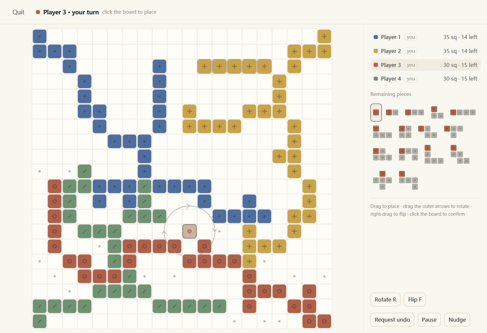
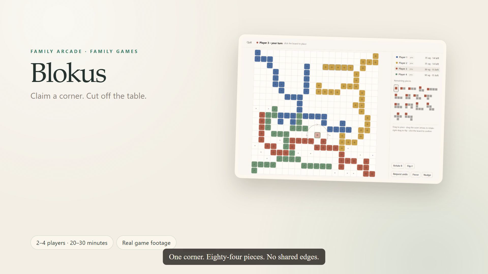
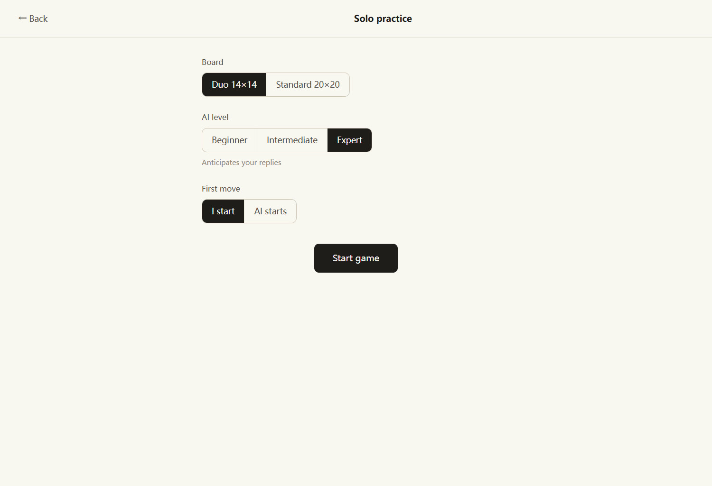
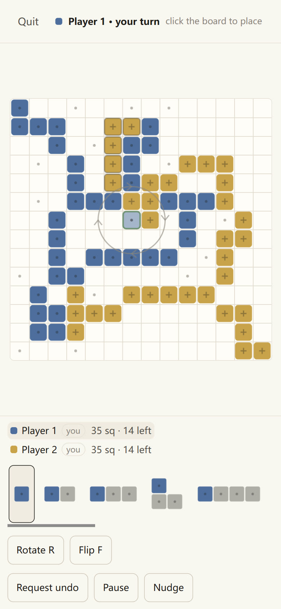
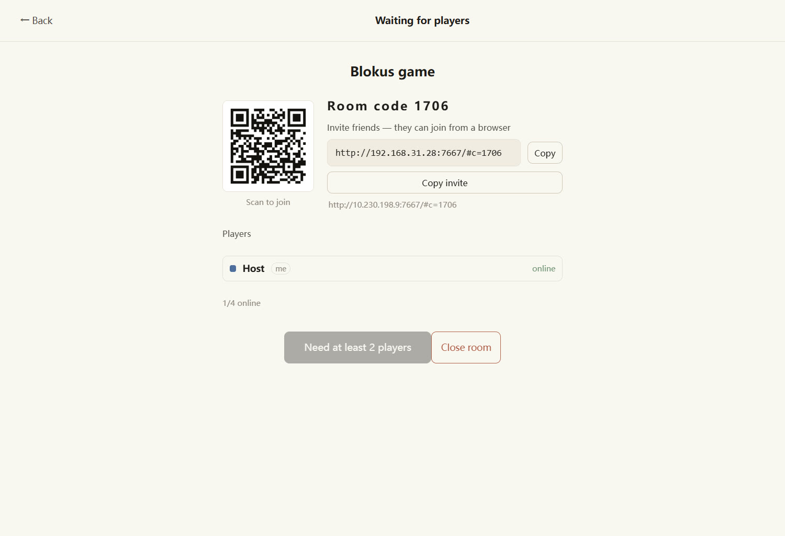
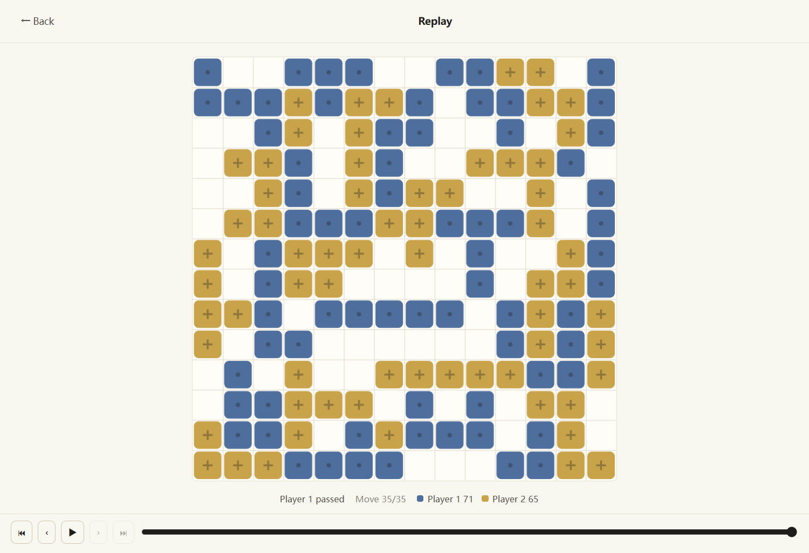
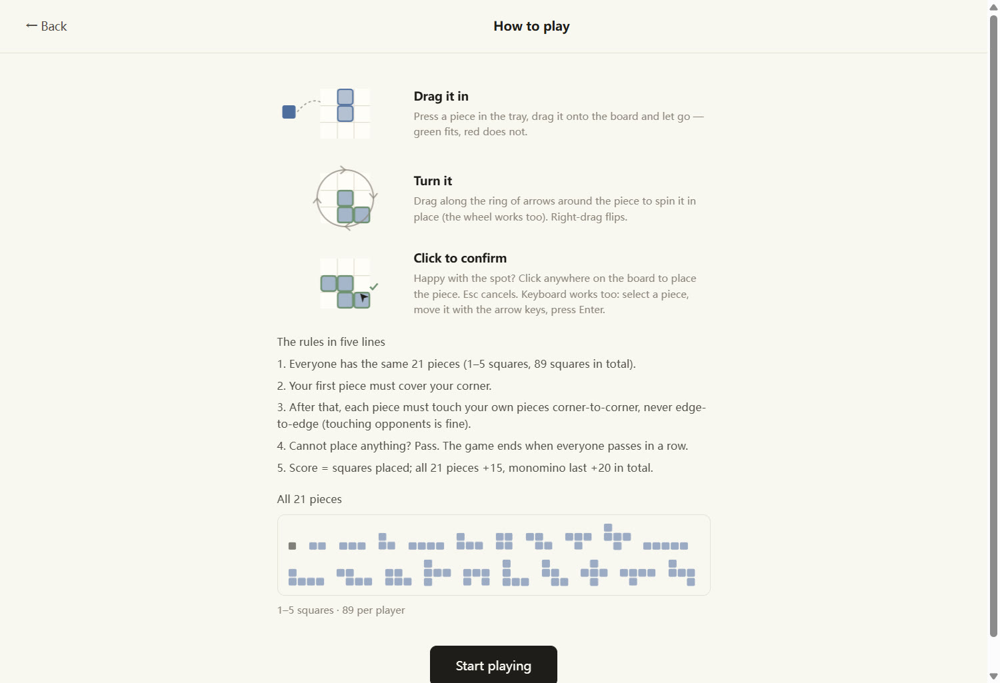

**English** · [简体中文](README.zh-CN.md)

# Blokus

A small, fast, offline desktop **Blokus** for family game night: solo practice against three AI levels, hot-seat for 2–4 players, and LAN play where everyone else joins from a plain browser — nothing to install on their side.

The whole app is one 3.7 MB executable. Installer is about 1.4 MB.



[](docs/promo/blokus-promo-en.mp4)

*45 seconds · 1920×1080 · 60 fps · [中文版](docs/promo/blokus-promo-zh.mp4) · [video.json](video.json)*

## Three ways to play

### Solo practice



Play the AI at three levels: **Beginner** plays loosely and makes obvious mistakes, **Intermediate** expands and blocks with a plan, **Expert** anticipates your replies. Stuck? **Hint** highlights a recommended placement and tells you why in plain words ("keeps your expansion routes open"). Changed your mind? **Undo** takes you back to your previous decision. You can also train on the faster 14×14 Duo board.

### Hot-seat

2–4 players sharing one screen. Every player gets a colour *and* a matching mark in each square (dot / plus / ring / slash), so the board stays readable for colour-blind players.

### On your phone



The browser version is a first-class client, so the people around the table can play on whatever is in their pocket. The board fills the screen, the piece tray becomes a swipeable strip, pieces are picked up with a short pull, and the rotation ring works with a finger. Nothing to install.

### LAN night



One machine hosts; everyone else joins in seconds:

- **Phones: scan the QR code** on the host's screen. The invite link already carries the room code, so the phone lands on the join screen with the address *and* the code filled in — one tap and they are in. Click the code to enlarge it if the phone is across the table.
- **Other desktops with the app: open LAN play.** The nearby-room list is filled by UDP broadcasts and, when a firewall or access point swallows those, by a **TCP scan of your subnet** (the same port the game itself uses, so if you can play, you can find it). A room that is already playing shows up as **Watch** — spectators are welcome.
- **Anything else: send them the invite.** One button copies a ready-to-paste sentence (`Blokus night! Join here: … (room code 1234)`).

Rooms are protected by a 4-digit code, so only the people you told can join. If someone has to leave the table for a moment, their seat is kept for reconnection, and after ~12 seconds the host's AI caretaker plays on — and tells the table: *"Grandma dropped out — the AI plays for now"*, and *"Grandma is back"* once she returns. Order, scores and who is online are always visible.

The table looks after itself: **ask to undo a move** (everyone gets a small vote card, all must agree), the host can **pause** for dinner, one tap **nudges** whoever is dawdling (a gentle reminder — after 90 seconds of thinking, the table gets one too; nobody ever loses a turn to a timer), and a fifth phone can join as a **spectator** to watch the live board without touching anything.

You can keep the party going with one click: **Play again** restarts the same table.

### After the game: replay and stats, nothing lost



Every finished game is kept (the last ten, with the full move history). Step through it move by move — or hit play — to see exactly where the game turned, with the running score next to the board. The **Stats** screen on the home page keeps track of wins, win rates, best scores, current streaks and the family's favourite colour, and can **export** the whole history to the clipboard as JSON.

Unfinished games are kept too: the app saves your game after every move, so if the window is closed (or something crashes), the home screen offers **Continue last game** — and a LAN game that was cut off by a dropped connection can still be **reviewed** up to its last move.

## How to play

First time? The app opens with a short illustrated guide — drag it in, turn it, click to confirm — followed by the rules in five lines and the whole 21-piece set:



The rules, in five lines:

1. Each player has the same 21 pieces (1 to 5 squares, 89 squares total).
2. Your first piece must cover your corner.
3. After that, each new piece must touch your own pieces **corner to corner** — never edge to edge. Touching your *opponents* is fine.
4. If you cannot place anything, you pass. When everyone passes in a row, the game ends.
5. Score = squares placed. Placing all 21 pieces adds +15; ending with the single square adds +20 in total.

### Controls

| Action | How |
| --- | --- |
| Pick up / move | **Drag** a piece from the tray onto the board. Release to park it. |
| Rotate | A ring of arrows appears around a parked piece — **drag around the ring** to spin it (every 45° of dragging turns it 90°). The mouse wheel, `R` / `Q`, or the buttons work too, even mid-drag. |
| Flip | **Right-drag** in any direction (or right-click), `F`, or the button. |
| Confirm | **Click anywhere on the board**. |
| Cancel | `Esc`, or drag the piece back to the tray. |
| Pass | `P`, when you truly have no legal move. |
| Sound | `M` cycles on / low / off; the home screen has a toggle too. |
| Keyboard only | Tab to a tray piece and press `Enter`, move it with the **arrow keys**, `Enter` parks it, `Enter` again places it. `R` / `Q` rotate, `F` flips, `Esc` cancels. |

Good to know: dimmed tray pieces have no legal placement right now; the small dots on the board are where the selected piece can go; red means "not allowed yet" — and if you try anyway, the app tells you *why* ("your first piece must cover your corner", "it must touch your own pieces corner-to-corner", "it cannot share an edge…"). Taps on the rotation ring do nothing, so you can never rotate by accident. When another player (or the AI) moves, the piece briefly outlines itself with their name so you never miss a beat — even with the sound off.

## Download & install

Grab the latest installer from the **Releases** page (`Blokus_<version>_x64-setup.exe`).
The repository is private — family members get the file forwarded, one copy per machine.

- Windows 10/11 (x64). Uses the system WebView2 runtime; if a machine does not have it yet, the installer fetches Microsoft's bootstrapper once during setup.
- Installs per-user, no admin required; uninstalling leaves your settings and game history alone.
- The first time a machine hosts a LAN room, Windows Firewall will ask — **allow it** (TCP 7667, UDP 7668) or browsers and guests cannot reach the room.
- Everything runs offline, with no accounts and no telemetry.
- Source is MIT-licensed (see `LICENSE`); "Blokus" is a trademark of its owner.

## Promo

[](docs/promo/blokus-promo-en.mp4)

- [English cut](docs/promo/blokus-promo-en.mp4) · [other language](docs/promo/blokus-promo-zh.mp4)
- [SRT](docs/promo/blokus-promo-en.srt) · [video.json](video.json)
- Real app screenshots and real engine data; claims match the tests.

## Development

```bash
npm install            # frontend deps
npm run dev            # frontend only, hot reload in a browser
npm run tauri dev      # the desktop app in dev mode
npm run check          # everything: tsc + unit tests + rust tests
npm test               # engine / AI / protocol unit tests (vitest)
cargo test             # LAN server integration tests (run in src-tauri/)
npm run tauri build    # NSIS installer -> src-tauri/target/release/bundle/nsis/
npm run e2e            # drives the built app with real mouse/keyboard/touch input
npm run screenshots    # regenerates docs/screenshots/*.jpg from the real app
npm run release -- 1.7.0   # bump versions, run checks, commit, tag, push (CI publishes)
cargo clean            # frees the rust build cache (~7 GB after a few builds)
```

The LAN protocol is versioned (`PROTOCOL_VERSION` in `src/net/protocol.ts` and `src-tauri/src/net.rs`): bump it whenever the wire format changes — mismatched clients are refused with a readable message instead of misbehaving. Guests must also send the room code, and every action carries the state version it was based on, so a stale or replayed request from a reconnecting phone is rejected rather than corrupting the board.

Toolchain note (Windows): this repository pins `stable-x86_64-pc-windows-gnu` in `rust-toolchain.toml` and expects the MSYS2 UCRT64 `gcc` on `PATH`. On a standard MSVC setup, delete that file (CI does this via `RUSTUP_TOOLCHAIN=stable-x86_64-pc-windows-msvc`).

`npm run e2e` boots the packaged app, plays a full hot-seat round through the real WebView2 (drag, park, rotate with the ring, right-drag flip, keyboard placement, confirm), reloads mid-game to prove the resume flow, hosts a LAN room, reads the lobby QR code back with a real decoder, finds the room over TCP, joins it with WebSocket guests (wrong code rejected, stale state versions rejected, spectator sync, undo vote, pause, nudge, AI caretaker), and checks for console errors. `npm run screenshots` reuses the same harness to refresh the images in this README.

Rule set, data sources and the test map are documented in [`docs/rules.md`](docs/rules.md).

### Promo video

The current 45-second Family Arcade cut is at `docs/promo/blokus-promo-en.mp4` and
`docs/promo/blokus-promo-zh.mp4`, with posters, SRTs and a FACTS page. It is rendered
from the shared studio in the repository root using `apps/blokus/video.json`.

The earlier bespoke Remotion project remains in `video/` as archival source; its
storyboard and generated facts are still useful for reference.

## Architecture

```
src/
  game/      rules engine: 21 pieces (91 orientations generated at load), board,
             legality, scoring, deterministic replays — pure and unit-tested
  ai/        three difficulty levels (heuristics + a two-ply search) in a Web Worker
  net/       LAN protocol (versioned), connection, room, unanimous undo votes
  session/   one state machine driving AI / hot-seat / LAN games identically
  ui/        canvas board, piece tray, screens; no UI framework
  savegame.ts auto-saves the running game so a crash or reload can continue
  i18n.ts    Chinese + English strings; follows the system language, manual toggle
src-tauri/
  src/net.rs LAN server: embedded web assets, WebSocket relay, UDP discovery,
             room codes, origin checks, flood limits
tests/       vitest suites (engine, AI, protocol, LAN over a fake relay, geometry)
docs/        README screenshots, rules & data audit (rules.md), release notes
```

The game engine exists exactly once (TypeScript) and runs everywhere: the desktop app, the AI worker, and guests in a browser. The Rust side is a shell plus a dumb relay — it never re-implements rules, so a guest's browser and the host can never disagree about the game.

## Credits

- The piece set is the standard 21 Blokus polyominoes (89 squares, 91 distinct orientations), generated in code and verified by tests; see `docs/rules.md` for sources and the audit trail.
- Icon, colour marks, sounds: drawn in code — no third-party art or fonts.
- Source code is MIT-licensed (`LICENSE`). Blokus is a trademark of its owners; this is a private, non-commercial family project.
