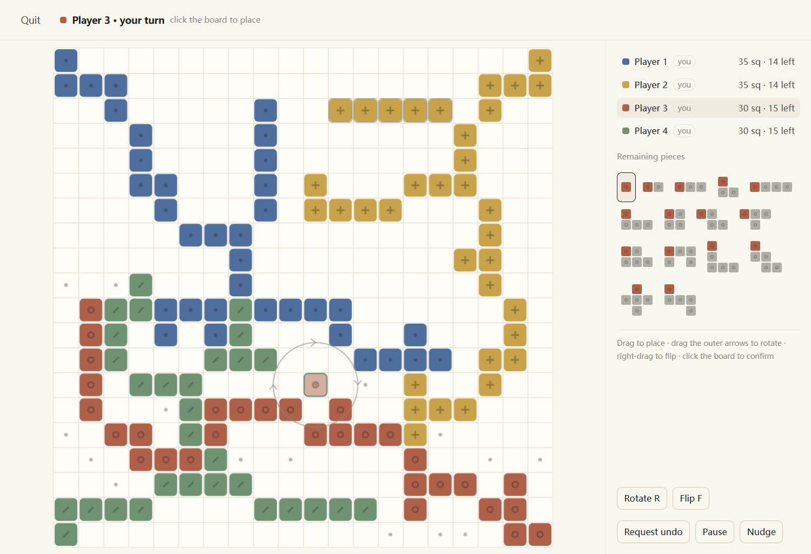
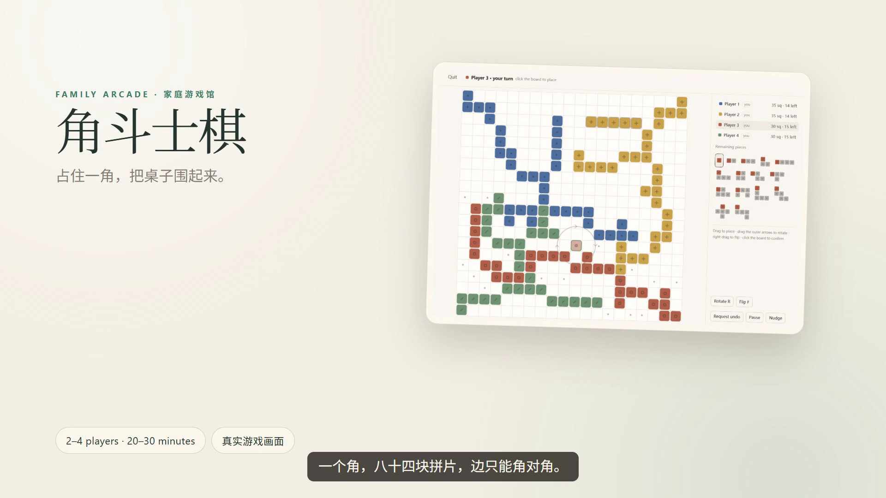
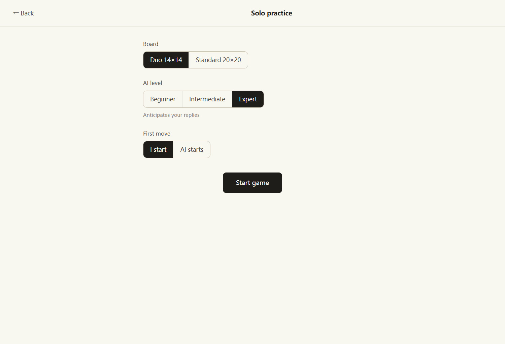
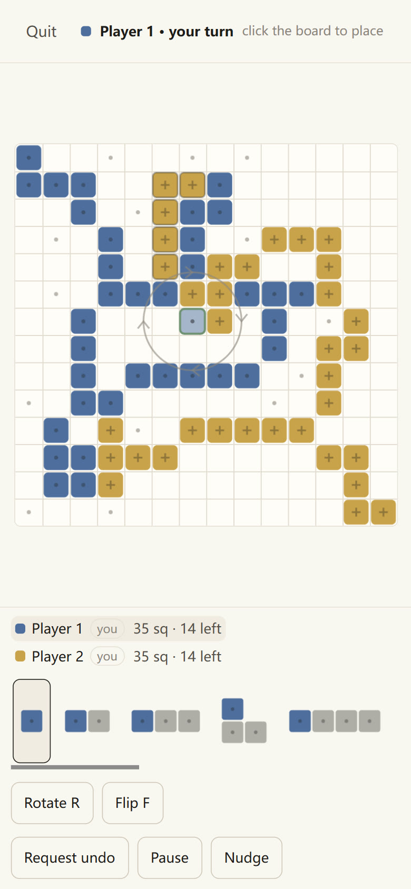
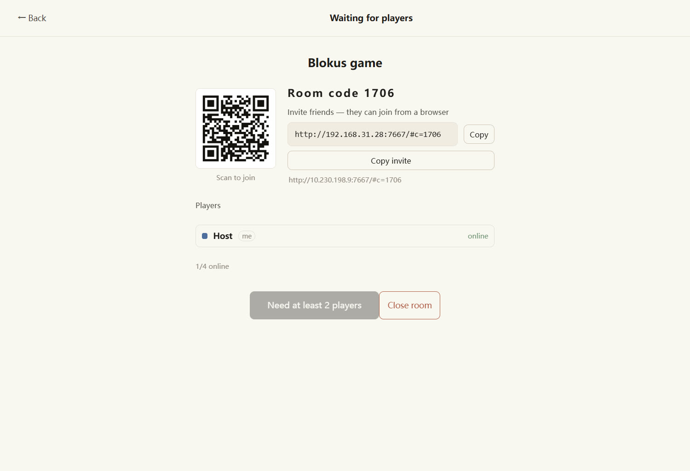
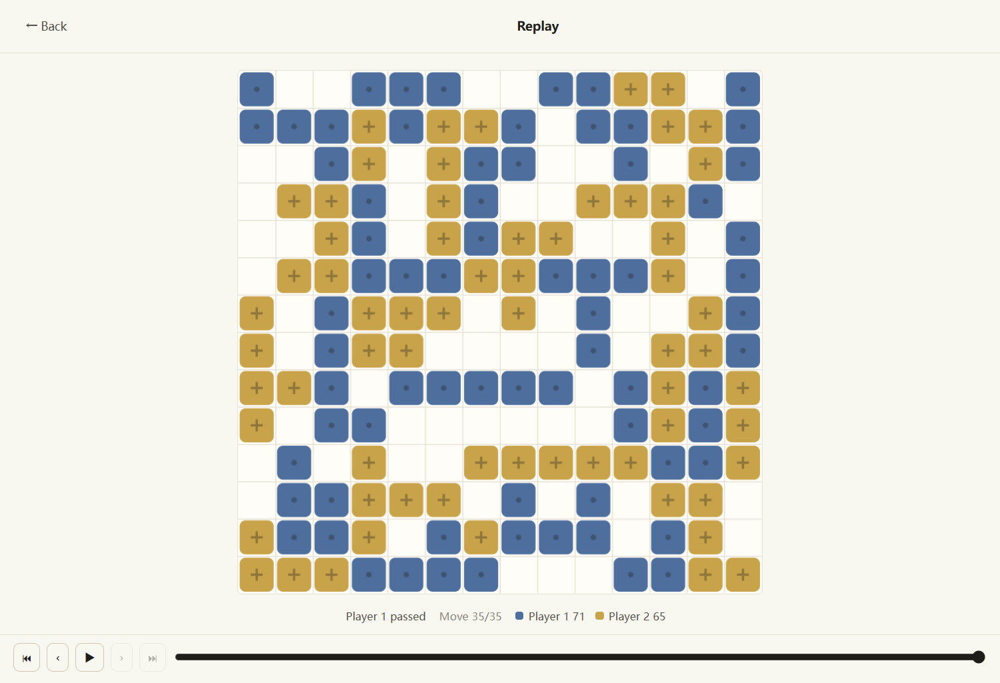
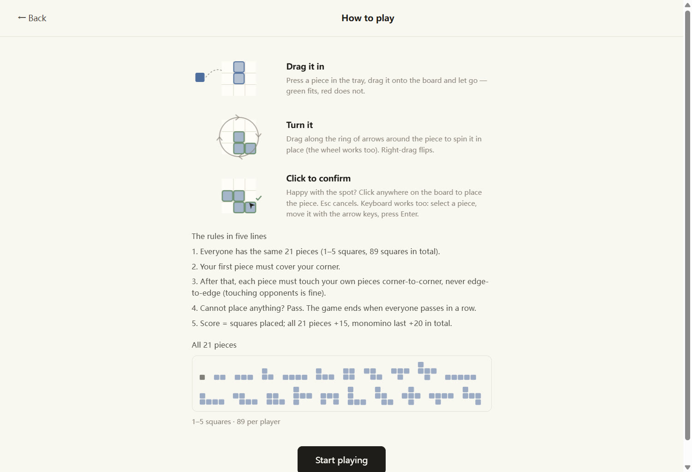

[English](README.md) · **简体中文**

# Blokus 角斗士棋

给家庭游戏夜用的小巧、离线桌面 **Blokus**：单人训练三种难度 AI、2–4 人本地热座、局域网对战（其他人用浏览器打开链接即可加入，**无需安装**）。

整个程序就是一个 3.7 MB 的可执行文件，安装包约 1.4 MB。



[](docs/promo/blokus-promo-zh.mp4)

*45 秒 · 1920×1080 · 60fps · [English cut](docs/promo/blokus-promo-en.mp4) · [video.json](video.json)*

## 三种玩法

### 单人训练



三档 AI：**入门**会打散、会犯错；**进阶**有扩张和堵截计划；**高手**会预判你的回应。卡住时按**提示**——它高亮推荐落点，并用一句话告诉你理由（例如"能保住你的扩张路线"）。下错了可以**悔棋**回到上一步决策。也可以在更快的 14×14 双人棋盘上练习。

### 本地热座

2–4 人共用一块屏幕。每位玩家除了颜色，还有对应的方块标记（点 / 十字 / 环 / 斜杠），色弱也能看清。

### 手机也能玩



浏览器版是一等客户端：棋盘铺满屏幕，棋子栏变成可滑动的横条，纵向拉一下就能拿起棋子，旋转环也支持手指拖动。什么都不用装。

### 联机之夜



一台电脑建房，其他人几秒内就能加入：

- **手机：直接扫大厅里的二维码。** 邀请链接自带房间码，手机打开后地址和房间码都已经填好——点一下"加入房间"就进去了。手机离得远就点一下二维码放大。
- **另一台装了桌面版的电脑：打开"局域网"页。** "附近的房间"来自 UDP 广播；如果被防火墙或路由器挡掉，会自动改用 **TCP 扫描本网段**兜底（用的就是联机本身的端口，能联机就一定能搜到）。已经开局中的房间会显示为"**观战**"。
- **其他情况：把邀请发出去。** 一个按钮复制现成的一句话（`来玩 Blokus：<链接>（房间码 1234）`）。

房间由 4 位房间码保护，只有你告诉过的人能进。有人暂时离席时座位会保留，约 12 秒后由房主的 **AI 代打**继续推进，并且明确告诉全桌：*"奶奶掉线了，AI 暂时代打"*，回来后提示 *"奶奶回来了"*。轮到谁、多少分、谁在线始终可见。

这张桌子会照顾自己：**请求悔棋**（全桌投票，必须全员同意）、房主可以**暂停**去吃饭、一键**催促**磨蹭的那位；如果谁思考超过 90 秒，全桌会收到一次温和的提醒——只提醒，不判负，倒计时永远不会罚人。第五台手机可以以**观战**身份加入，只能看不能动。

一键 **再来一局**，同一桌人继续。

### 对局之后：复盘、战绩，什么都不丢



每局结束都会保存（最近十局，含完整落子历史）。可以逐步回放或自动播放，棋盘旁显示实时比分，一眼看出局势在哪一步翻转。主页的**战绩**页记录胜场、胜率、最高分、当前连胜和最爱的颜色，还能把全部记录**导出**成 JSON 复制到剪贴板。

没下完的对局也不会丢：每一步都会自动保存，窗口被关掉（甚至崩溃）后，主页会出现"**继续上局**"；被断网打断的联机局，也能**复盘**到最后一手。

## 怎么玩

第一次打开会看到一个简短的图解引导——拖进去、转一下、点一下确认——后面跟着五条规则和完整的 21 块棋子：



规则五句话：

1. 每人一套相同的 21 块棋子（1–5 格，共 89 格）。
2. 你的第一块必须盖住自己的角落。
3. 之后每块都要和**自己的棋子对角相接**，不能边贴边；和**对手**贴在一起是允许的。
4. 无处可下就跳过；所有人连续跳过时对局结束。
5. 得分 = 已落格子数；放完 21 块 +15，最后一块是单格块则共 +20。

### 操作

| 操作 | 方式 |
| --- | --- |
| 拿起 / 移动 | 从棋子栏**拖**到棋盘，松手即停住。 |
| 旋转 | 停住后棋子周围出现箭头环——**沿环拖动**旋转（拖过 45° 转 90°）。滚轮、`R` / `Q`、按钮同样可用，拖动过程中也行。 |
| 翻转 | **右键拖动**（任意方向）、`F` 或按钮。 |
| 落子 | **点棋盘任意位置**确认。 |
| 取消 | `Esc`，或把棋子拖回棋子栏。 |
| 跳过 | 真的无处可下时按 `P`。 |
| 音效 | `M` 在开 / 低 / 关之间切换；主页也有开关。 |
| 纯键盘 | `Tab` 选到棋子后 `Enter` 选中，**方向键**移动，`Enter` 停住，再 `Enter` 落子；`R`/`Q` 旋转、`F` 翻转、`Esc` 取消。 |

小贴士：变灰的棋子表示现在无处可放；棋盘上的小圆点是当前棋子可以落的位置；红色表示"还不能放"——如果你偏要试，程序会告诉你**为什么**（"第一块必须盖住自己的角落""必须和自己的棋子对角相接""不能和自己的棋子边贴边"）。点旋转环不会误转。别人（或 AI）落子时，那枚棋子会短暂带名字高亮——不开声音也不会错过。

## 下载与安装

在 **Releases** 页面下载最新的安装包（`Blokus_<版本号>_x64-setup.exe`）。
仓库是私有的——家人由你转发安装包，一台机器一份。

- Windows 10/11（x64）。使用系统自带的 WebView2 运行时；如果某台机器没有装，安装程序会自动联网获取一次。
- 按用户安装，无需管理员权限；卸载不会删除你的设置和对局记录。
- 第一次建房时 Windows 防火墙会询问——请**允许**（TCP 7667、UDP 7668），否则浏览器和访客连不上。
- 全程离线运行，没有账号，没有遥测。
- 源码以 MIT 许可开放（见 `LICENSE`）；"Blokus" 是其权利人的商标。

## 宣传片

[](docs/promo/blokus-promo-zh.mp4)

- [中文成片](docs/promo/blokus-promo-zh.mp4) · [另一语言](docs/promo/blokus-promo-en.mp4)
- [字幕](docs/promo/blokus-promo-zh.srt) · [video.json](video.json)
- 画面来自真实应用与真实引擎数据；数字与测试一致。

## 开发

```bash
npm install            # 前端依赖
npm run dev            # 只跑前端，浏览器里热重载
npm run tauri dev      # 桌面应用开发模式
npm run check          # 全部检查：tsc + 单元测试 + Rust 测试
npm run e2e            # 驱动打包后的应用做真实鼠标/键盘/触摸测试
npm run screenshots    # 重新生成本文档中的截图
npm run release -- 1.7.0   # 升版本、跑检查、提交、打标签、推送（CI 自动发布）
cargo clean            # 清掉 Rust 构建缓存（几次构建后可达 ~7 GB）
```

规则集、数据来源与测试对照表见 [`docs/rules.md`](docs/rules.md)。

## 架构

```
src/
  game/      规则引擎：21 块（91 个朝向，加载时生成）、棋盘、合法性、计分、确定性回放
  ai/        三档难度（启发式 + 两层搜索），运行在 Web Worker
  net/       局域网协议（带版本）、连接、房间、全票悔棋
  session/   一个状态机统一驱动 AI / 热座 / 联机
  ui/        canvas 棋盘、棋子栏、界面；无 UI 框架
  savegame.ts 进行中对局自动保存（崩溃后可继续）
  i18n.ts    中英文案，跟随系统语言，可手动切换
src-tauri/
  src/net.rs 局域网服务：内嵌网页资源、WebSocket 中继、UDP 发现、房间码、来源校验、限流
tests/       vitest 测试（引擎、AI、协议、模拟中继联机、几何）
docs/        截图、规则与数据审计、发布说明
```

游戏引擎只有一份（TypeScript），桌面端、AI Worker 和浏览器访客共用同一套规则，因此主机和访客永远不会对规则产生分歧；Rust 只负责外壳与中继。
