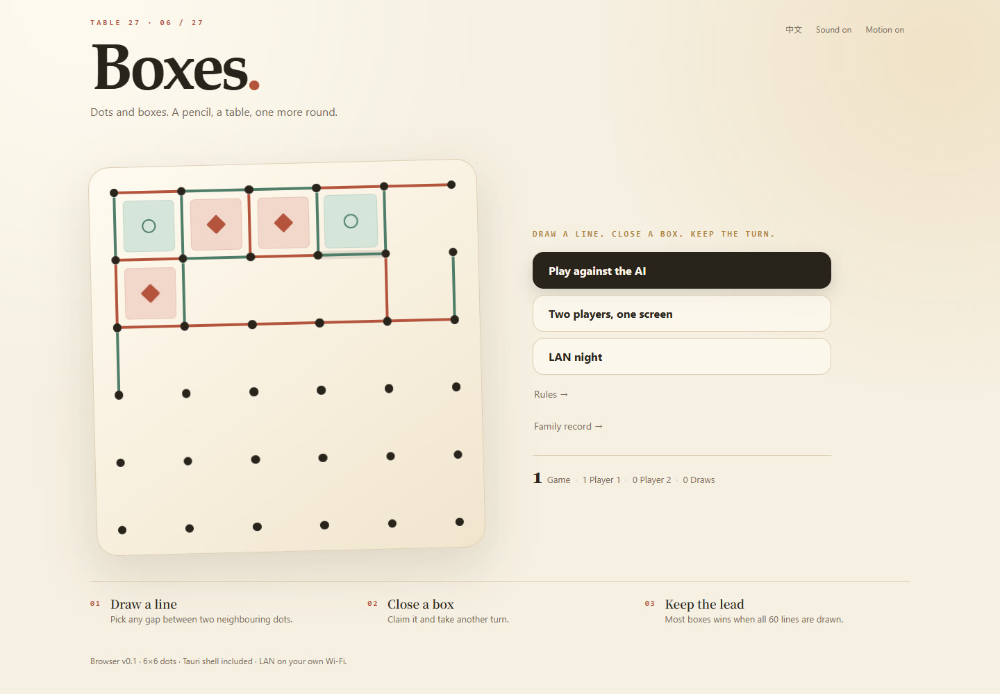
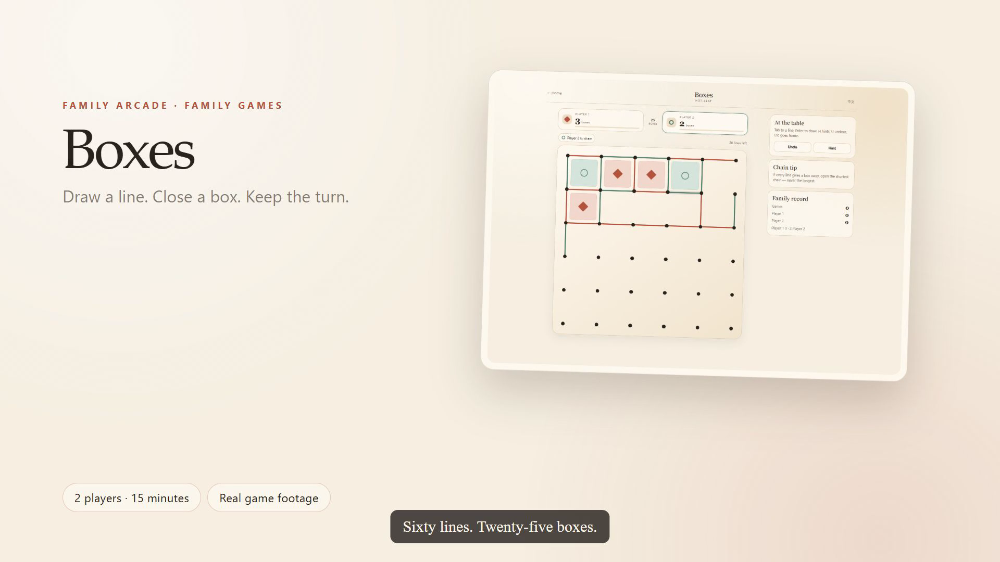
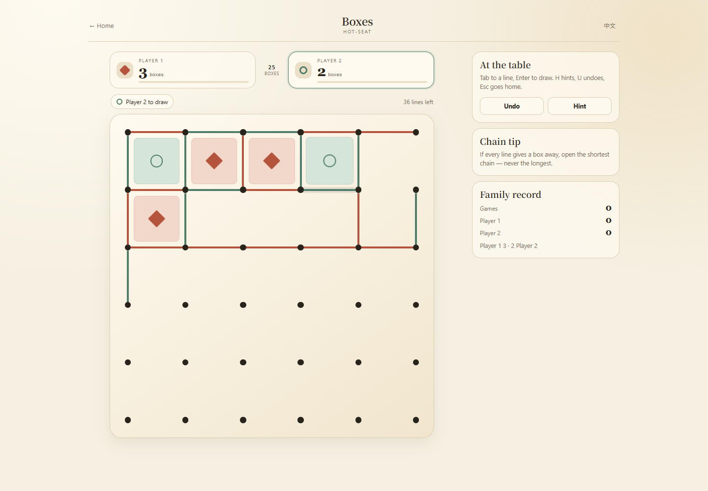
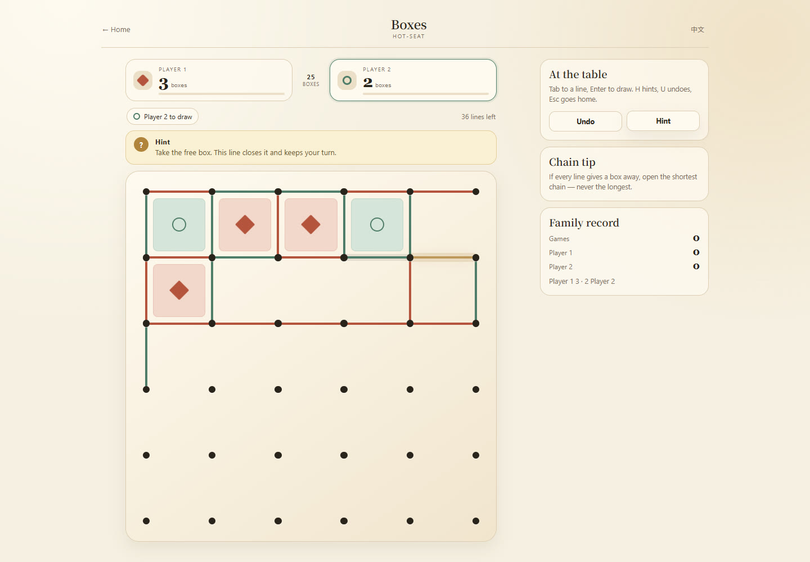
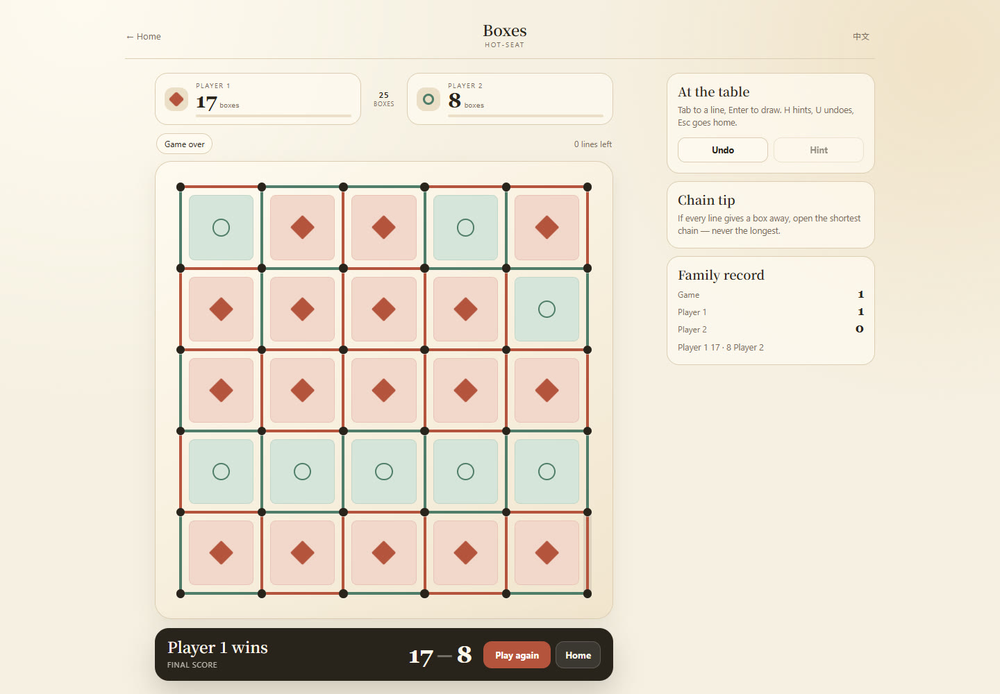
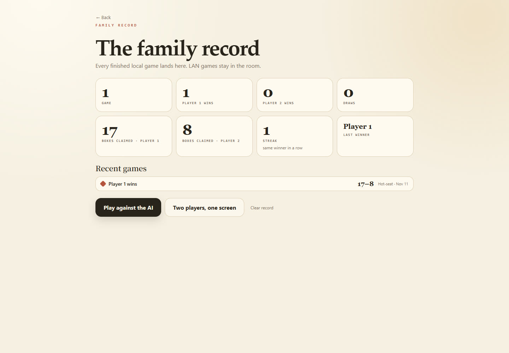
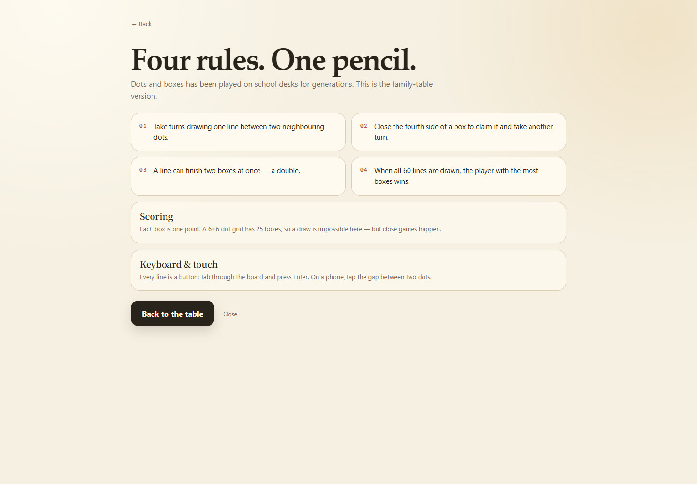
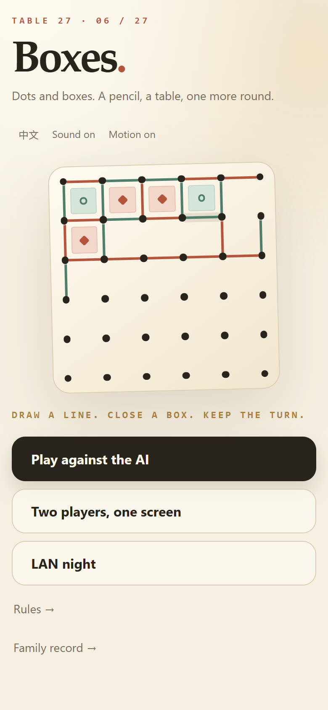
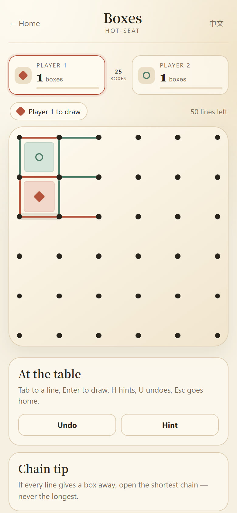

# Boxes · 点格棋

**English** · [简体中文](README.zh-CN.md)

> **Draw a line. Close a box. Keep the turn.**

The pencil game for a full family table: a 6×6 lattice of dots, 25 boxes, four AI
levels, one-screen hot-seat and LAN play from a phone. No account, no ads, no
network needed except your own Wi-Fi for LAN night.



[](docs/promo/boxes-promo-en.mp4)

*45 seconds · 1920×1080 · 60 fps · [中文版](docs/promo/boxes-promo-zh.mp4) · [video.json](video.json)*

## A turn, in five seconds

| Draw | Close | Win |
| --- | --- | --- |
| Take turns drawing one line between two neighbouring dots. | Complete the fourth side of a box to claim it and take another turn. | When all 60 lines are drawn, the player with the most boxes wins. |

A shared line can close two boxes at once — a **double**. The 6×6 dot grid has 25
boxes, so a draw is impossible here; close games are not.

## What is inside

- **A real, tested engine.** Pure TypeScript, deterministic, **33 unit tests**, no
  DOM, network, clock or randomness in `src/game/boxes.ts`. See
  [`docs/rules.md`](docs/rules.md).
- **Four AI levels.** Companion plays gently and gives away short chains; Easy is
  mostly random; Normal takes free boxes and avoids third sides; Hard counts chains,
  prices sacrifices and solves the last 12 lines exactly.
- **Three ways to play.** Solo against the AI, two players passing one device, or
  LAN host/guest with a room code and QR invite.
- **Small comforts.** Undo, a hint that explains the reason, autosave/resume, a
  local family record, sound on/off, a reduced-motion toggle, keyboard play,
  complete English/Chinese UI and a phone layout.
- **Private by default.** No accounts, telemetry, ads, remote fonts or downloaded
  art. The 60 lines are drawn in CSS; sound is synthesised WebAudio.
- **A kept Tauri shell.** The NSIS installer configuration stays with the app; the
  LAN relay is the same shared `@family-arcade/lan` wiring as the Triple reference.

## Screenshots

All screenshots come from the running app at **1440×1000**; phones are
**390×844 @2×**.

| Home | A real hot-seat game |
| --- | --- |
|  |  |

| Hint with a reason | Full-time result |
| --- | --- |
|  |  |

| Family record | Rules |
| --- | --- |
|  |  |

| Phone home | Phone game |
| --- | --- |
|  |  |

## AI levels

| Level | How it plays |
| --- | --- |
| **Companion** | Takes most free boxes but occasionally leaves one; opens only short chains when it must give a box away. |
| **Easy** | Uniformly random legal line. |
| **Normal** | Always takes the largest free box; otherwise a safe line that does not create a third side; when trapped, gives the shortest chain. |
| **Hard** | Chain-aware capture/safe/sacrifice heuristics plus an exact memoised alpha-beta search on the last 12 lines. Strong, not a perfect 60-line solver. |

All four use an injected RNG, so tests are deterministic. **Hint** always shows the
Hard move and labels it: free box, double, safe line, forced sacrifice or endgame.

## Play locally

```bash
npm install
npm run dev        # http://localhost:5185
npm run check      # tsc + 33 tests + production build
npm run e2e        # real Chrome; requires the dev server
npm run shots      # regenerate docs/screenshots/{en,zh}
```

Keyboard: **Tab** to a line and **Enter** to draw; **H** hints, **U** undoes,
**Esc** goes home. Drawn lines stay focusable with `aria-disabled` so the keyboard
path does not lose its place.

## LAN night

Browser/dev:

```bash
npm run build
npm run lan        # relay on :8080, serves dist/
# open http://localhost:5185, LAN night, host a room
# the guest opens the QR/address on a phone on the same Wi-Fi
```

If port 8080 is already busy, start the relay on another port and open the host
page with the matching query, for example:

```bash
node ../../tools/lan-server.mjs --dist dist --port 8177
# host: http://localhost:5185/?lanPort=8177
```

Desktop: the Tauri build starts the same relay internally and serves the built app
to phones. The host shows a 4-digit room code and a QR invite. Guests need no app
install — just the address on the same Wi-Fi.

In browser mode the invite uses the hostname in the host page's address bar. Open the
host page through the machine's LAN IP (or host from the Tauri build) if a phone
should be able to resolve the QR address; `localhost` only works on the host itself.

The relay is a dumb message bus. The host keeps the authoritative state and sends
only the guest's own view. Room codes, reconnect tokens and turn checks are enforced
in TypeScript; a stale or spoofed guest intent is rejected by `applySeat`.

## Build the Windows installer

```bash
npm install
npx tauri build --bundles nsis
# src-tauri/target/release/bundle/nsis/Boxes_0.1.0_x64-setup.exe
```

The installer is per-game and lightweight; WebView2 uses the standard bootstrapper.
A Windows SmartScreen warning is expected for an unsigned family build. The Tauri
shell was kept working but was not built in this agent session; the central build
produces the installers.

## Promo

The 45-second bilingual promo is rendered by the root Family Arcade studio from
[`video.json`](video.json) — eight EN/ZH narration lines, facts, accent colour and
the three screenshot names. No separate Remotion project lives in this app.

## Known limitations

- One fixed 6×6 dot board; 2 players only.
- Hard is a strong chain heuristic plus a 12-line exact endgame, not a full-game
  perfect solver.
- LAN is same-subnet IPv4, no spectators or matchmaking; the 4-digit code is a
  family filter, not security.
- Family record and autosave are local to this browser/device and only cover solo
  and hot-seat games.
- No 4K or vertical promo cut.

See [`docs/limitations.md`](docs/limitations.md) for the honest list.

## Credits

Original code, art and copy for Family Arcade. Dots and boxes is a public-domain pencil
game; this implementation is ours. MIT. See [`NOTICE.md`](NOTICE.md).

## Promo

[](docs/promo/boxes-promo-en.mp4)

- [English cut](docs/promo/boxes-promo-en.mp4) · [other language](docs/promo/boxes-promo-zh.mp4)
- [SRT](docs/promo/boxes-promo-en.srt) · [video.json](video.json)
- Real app screenshots and real engine data; claims match the tests.

