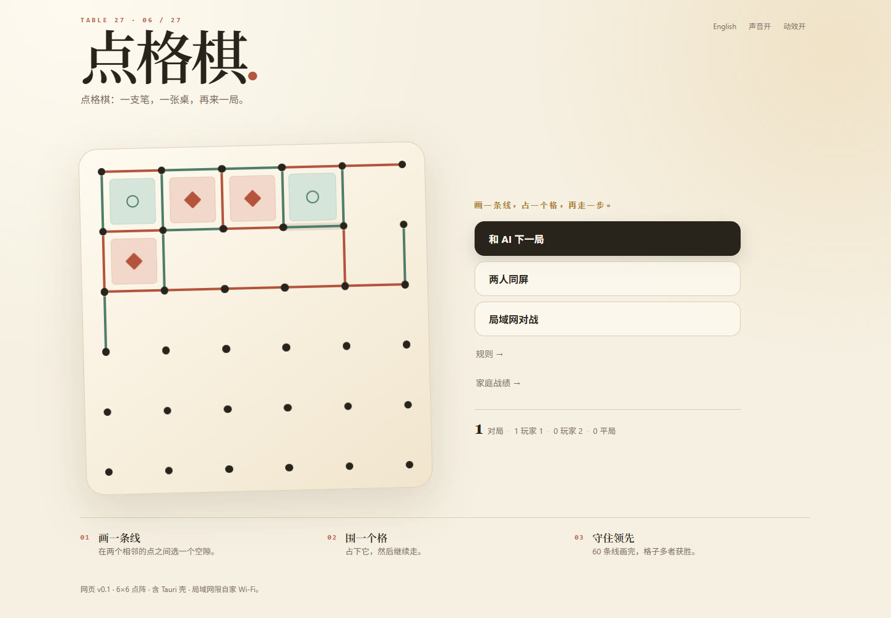
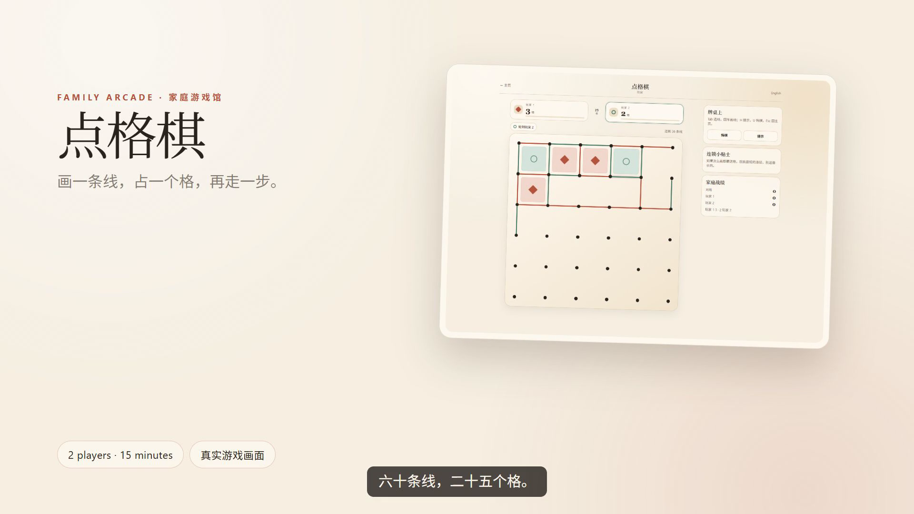
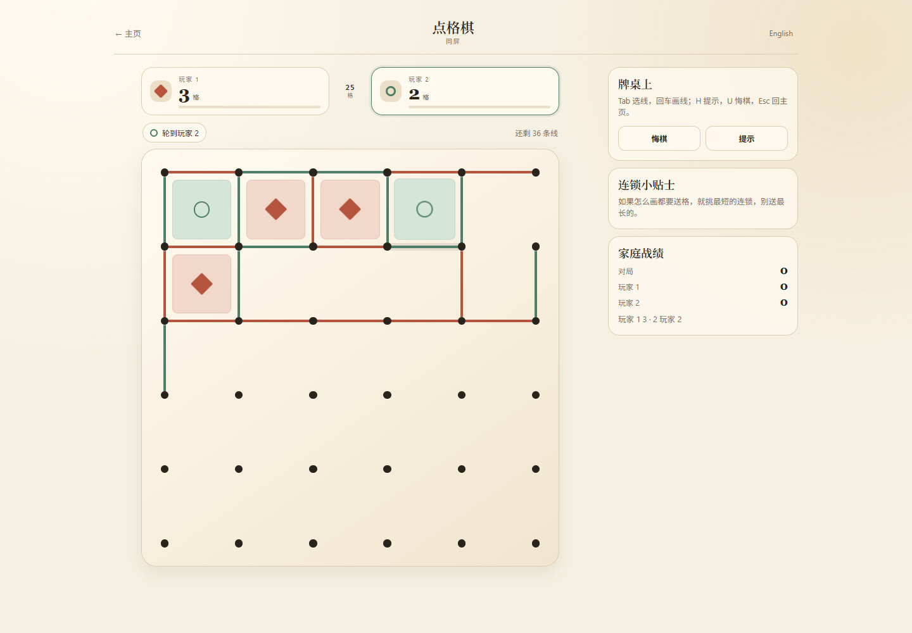
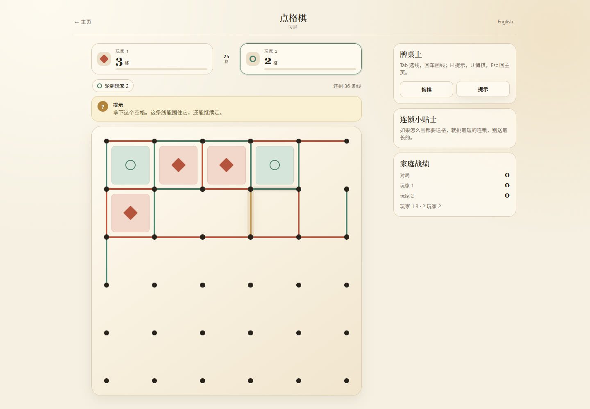
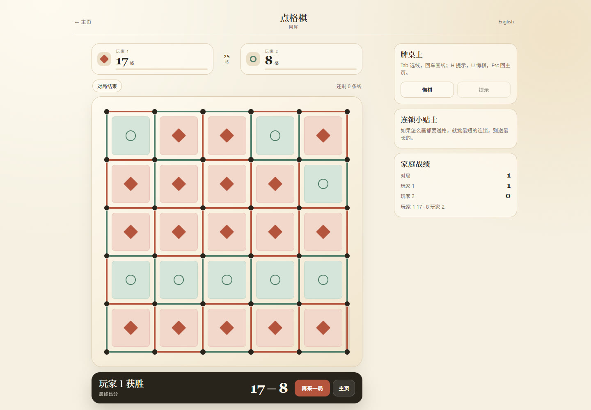
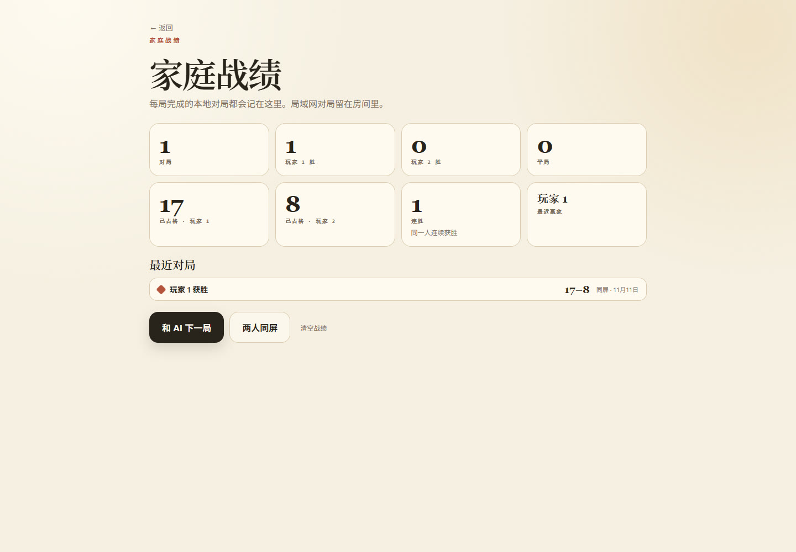
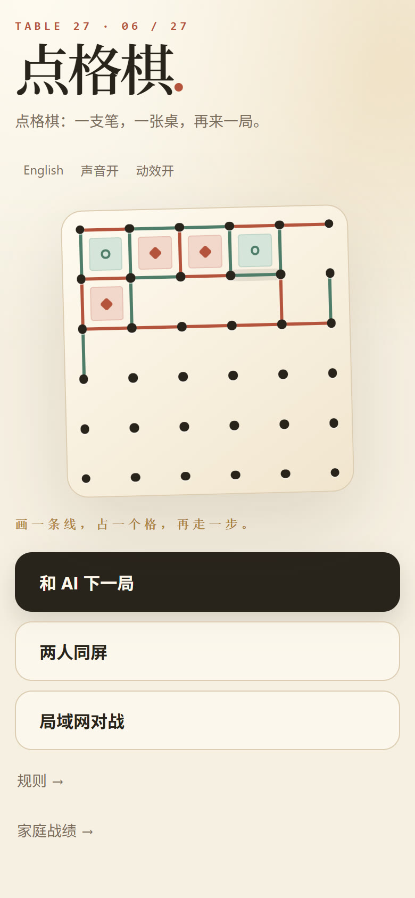
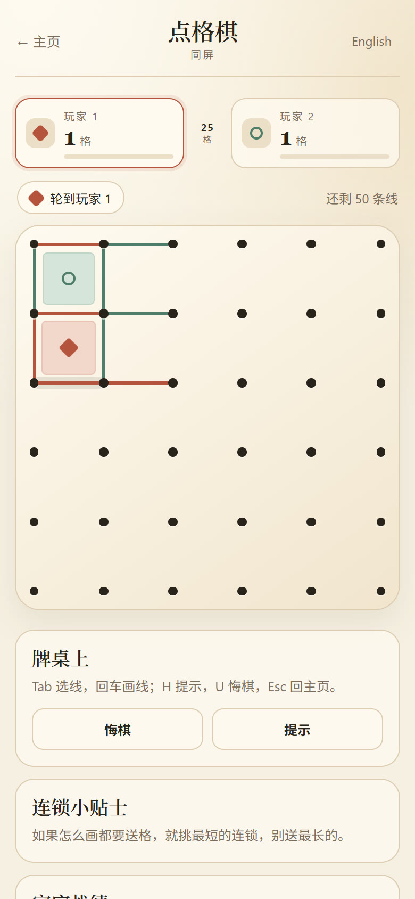

# 点格棋 · Boxes

[English](README.md) · **简体中文**

> **画一条线，占一个格，再走一步。**

给家庭牌桌的铅笔游戏：6×6 个点、25 个格、四档 AI、同屏热座，以及手机浏览器
直接加入的局域网对战。无账号、无广告；除自家 Wi-Fi 外不需要联网。



[](docs/promo/boxes-promo-zh.mp4)

*45 秒 · 1920×1080 · 60fps · [English cut](docs/promo/boxes-promo-en.mp4) · [video.json](video.json)*

## 一回合，五秒看懂

| 画线 | 占格 | 结束 |
| --- | --- | --- |
| 轮流在两个相邻的点之间画一条线。 | 围住一个格的第四边，就占下它，并继续走。 | 60 条线全部画完后，占格多者获胜。 |

一条线可以同时围住两个格——**双格**。6×6 点阵共 25 个格，所以这里不会平局；
但胶着的对局很常见。

## 里面有什么

- **真正的引擎。** 纯 TypeScript、确定性、**33 个单元测试**；`src/game/boxes.ts`
  不碰 DOM、网络、时钟或随机数。见 [`docs/rules.md`](docs/rules.md)。
- **四档 AI。** 陪玩温和，会送出小连锁；轻松基本随机；标准会占空格、避开第三边；
  挑战会算连锁、给牺牲定价，并在最后 12 条线做精确搜索。
- **三种玩法。** 单人对抗 AI、两人同屏，或房间码 + 二维码的局域网主机/访客。
- **小细节。** 悔棋、会解释理由的提示、自动保存/继续、本机家庭战绩、声音开关、
  减少动效、键盘操作、完整中英双语和手机布局。
- **默认私密。** 无账号、无遥测、无广告、无远程字体、无下载素材。60 条线全部由 CSS
  绘制，声音用 WebAudio 合成。
- **保留 Tauri 壳。** NSIS 安装包配置留在应用里；局域网继续使用和 Triple 参考相同的
  `@family-arcade/lan` 接线。

## 截图

全部来自真实运行的应用：**1440×1000**；手机 **390×844 @2×**。

| 主页 | 真实同屏对局 |
| --- | --- |
|  |  |

| 带理由的提示 | 终局比分 |
| --- | --- |
|  |  |

| 家庭战绩 | 规则 |
| --- | --- |
|  |  |

| 手机主页 | 手机对局 |
| --- | --- |
|  |  |

## AI 难度

| 难度 | 下法 |
| --- | --- |
| **陪玩** | 通常会拿空格，但偶尔留一个；必须送格时只开短连锁。 |
| **轻松** | 在合法线里均匀随机。 |
| **标准** | 先拿最大的空格；否则挑不会制造第三边的安全线；被逼时送最短的连锁。 |
| **挑战** | 连锁感知的拿格/安全/牺牲启发式，加上最后 12 条线的记忆化 alpha-beta 精确搜索。很强，但不是 60 条线的完美解。 |

四档都使用注入的 RNG，测试可复现。**提示**永远给出挑战档的走法，并标明理由：
拿空格、双格、安全线、被迫牺牲或终局搜索。

## 本地运行

```bash
npm install
npm run dev        # http://localhost:5185
npm run check      # tsc + 33 个测试 + 生产构建
npm run e2e        # 真实 Chrome，需先运行 dev
npm run shots      # 重新生成 docs/screenshots/{en,zh}
```

键盘：**Tab** 选线，**Enter** 画线；**H** 提示，**U** 悔棋，**Esc** 回主页。
已画的线保留焦点并标为 `aria-disabled`，键盘操作不会丢失位置。

## 局域网

浏览器/开发版：

```bash
npm run build
npm run lan        # :8080 中继，同时托管 dist/
# 打开 http://localhost:5185，选“局域网对战”，开房间
# 访客在同一 Wi-Fi 的手机上打开二维码/地址
```

如果 8080 已被占用，可以把中继换到别的端口，并在主机页面加上对应参数：

```bash
node ../../tools/lan-server.mjs --dist dist --port 8177
# 主机：http://localhost:5185/?lanPort=8177
```

桌面版：Tauri 安装包启动同一个内置中继，并把构建产物托管给手机。主机显示 4 位
房间码和二维码；访客无需安装，只要在同一 Wi-Fi 打开地址。

浏览器模式下，邀请地址使用主机页面地址栏中的主机名。若希望手机能解析二维码地址，
请通过本机的局域网 IP 打开主机页面（或直接用 Tauri 版主持）；`localhost` 只在主机
本机有效。

中继只负责转发消息；主机保存权威状态，只发送访客自己的视图。房间码、重连令牌和
回合校验都在 TypeScript 中完成；过期或伪造的访客意图会被 `applySeat` 拒绝。

## 构建 Windows 安装包

```bash
npm install
npx tauri build --bundles nsis
# src-tauri/target/release/bundle/nsis/Boxes_0.1.0_x64-setup.exe
```

每款游戏单独打包，安装包保持轻量；WebView2 使用标准引导程序。未签名的家庭构建会触发
Windows SmartScreen 提示。Tauri 壳保持可用，但本次子任务没有运行安装包构建；安装包由
主构建统一生成。

## 宣传片

45 秒双语宣传片由根目录的 Family Arcade studio 根据 [`video.json`](video.json) 渲染：
八句中英旁白、事实、强调色和三个截图名。应用内不再单独维护 Remotion 工程。

## 已知限制

- 固定 6×6 点阵；仅 2 人。
- 挑战档是连锁启发式 + 最后 12 条线的精确终局，不是全局完美解。
- 局域网仅同子网 IPv4；无观战、无匹配；4 位房间码是家庭过滤，不是安全边界。
- 家庭战绩和自动保存只在本浏览器/设备，且只记录单人和同屏对局。
- 暂无 4K 或竖屏宣传片。

完整清单见 [`docs/limitations.md`](docs/limitations.md)。

## 许可

Family Arcade 原创代码、美术与文案。点格棋是公有领域的铅笔游戏；本实现归我们所有。MIT。
见 [`NOTICE.md`](NOTICE.md)。

## 宣传片

[](docs/promo/boxes-promo-zh.mp4)

- [中文成片](docs/promo/boxes-promo-zh.mp4) · [另一语言](docs/promo/boxes-promo-en.mp4)
- [字幕](docs/promo/boxes-promo-zh.srt) · [video.json](video.json)
- 画面来自真实应用与真实引擎数据；数字与测试一致。

