# Chess · 国际象棋

**English** · [简体中文](README.zh-CN.md)

> **Every rule. One table.**

Full FIDE chess for the family table: **2 players**, an 8×8 board, four computer
levels, one-screen hot-seat, and LAN play from a phone. The engine implements
castling, en passant, promotion, check, checkmate, stalemate, the fifty-move rule,
threefold repetition and insufficient material. No account, no ads, no cloud.

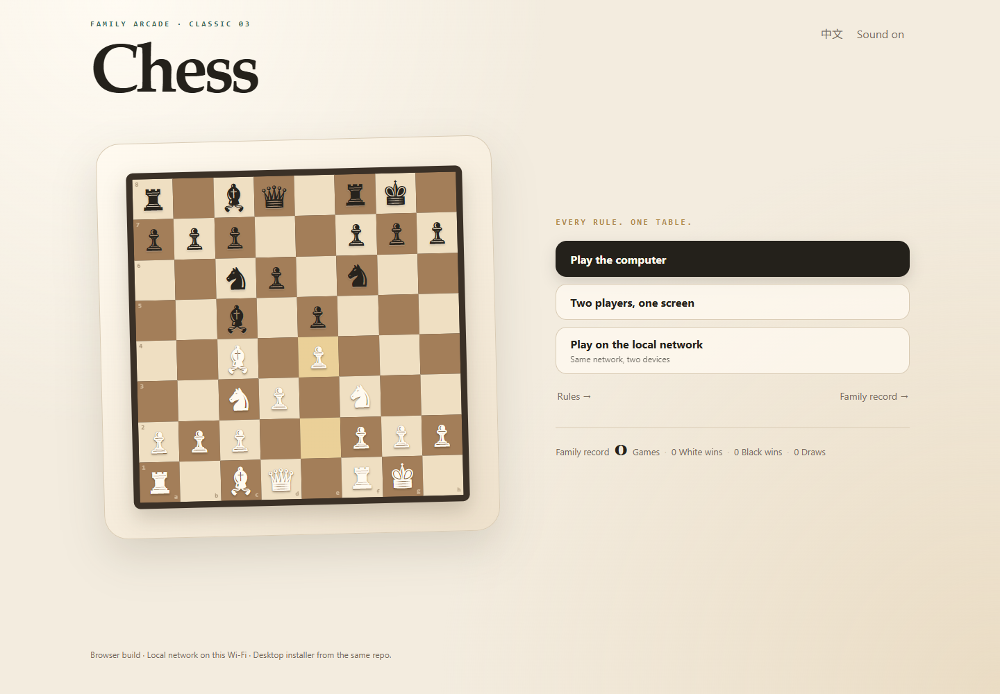

## A turn, in five seconds

| Move | Special rules | Finish |
| --- | --- | --- |
| White moves first. Every piece follows FIDE movement. | Castle, capture en passant, promote on the last rank. | Checkmate wins. Stalemate, fifty moves, threefold repetition and insufficient material are draws. |

## What is inside

- **A real, tested engine.** Pure TypeScript, deterministic, **37 unit tests**,
  perft-checked against Kiwipete, no DOM, network, clock or randomness in the
  rules. See [`docs/rules.md`](docs/rules.md).
- **Four computer levels.** Companion is gentle, Easy makes mistakes, Normal sees
  replies and takes free material, Hard uses alpha-beta search with quiescence.
- **Three ways to play.** Solo against the computer, two players sharing one
  device, or a phone joining the host over the local network.
- **LAN that handles real life.** The host keeps the authoritative board and sends
  the guest a per-seat view; the guest sends only a move intent. A guest can reload
  and reconnect; only the host can start the next game.
- **A proper family record.** Totals, White/Black/draw shares, mode split, current
  and best runs, and the eight most recent games. LAN results are recorded on the
  host device.
- **Small comforts.** Undo, a hint that explains *why*, autosave/resume, sound,
  arrow-key board navigation, reduced-motion support, complete Chinese/English UI,
  and a mobile layout designed as a first-class way to play.
- **Private by default.** No accounts, telemetry, ads, remote fonts or third-party
  art. Every mark is CSS, Unicode or SVG in this repository.

## Screenshots

| Home | Computer level |
| --- | --- |
|  | 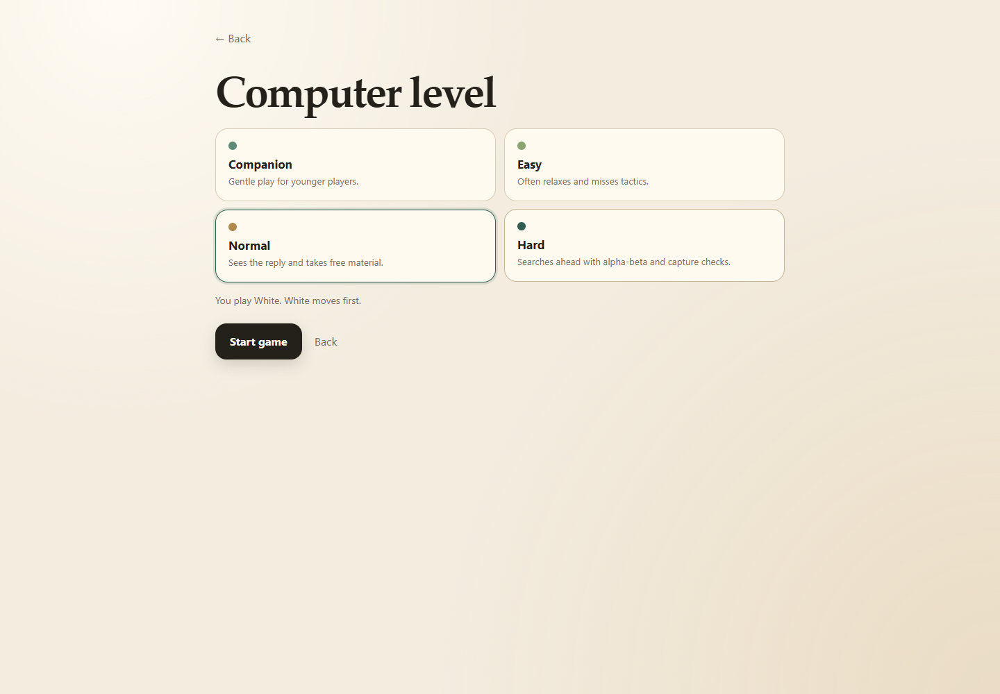 |

| Real game | Hint with a reason |
| --- | --- |
| 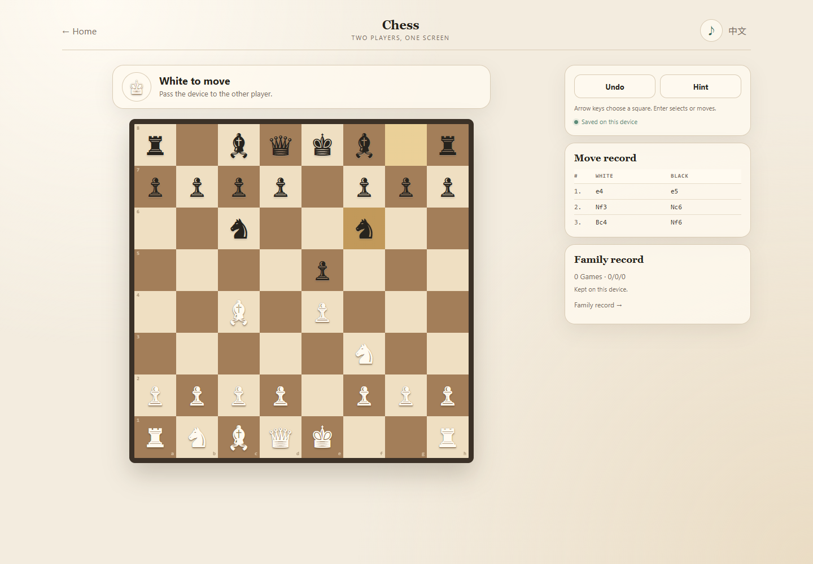 | 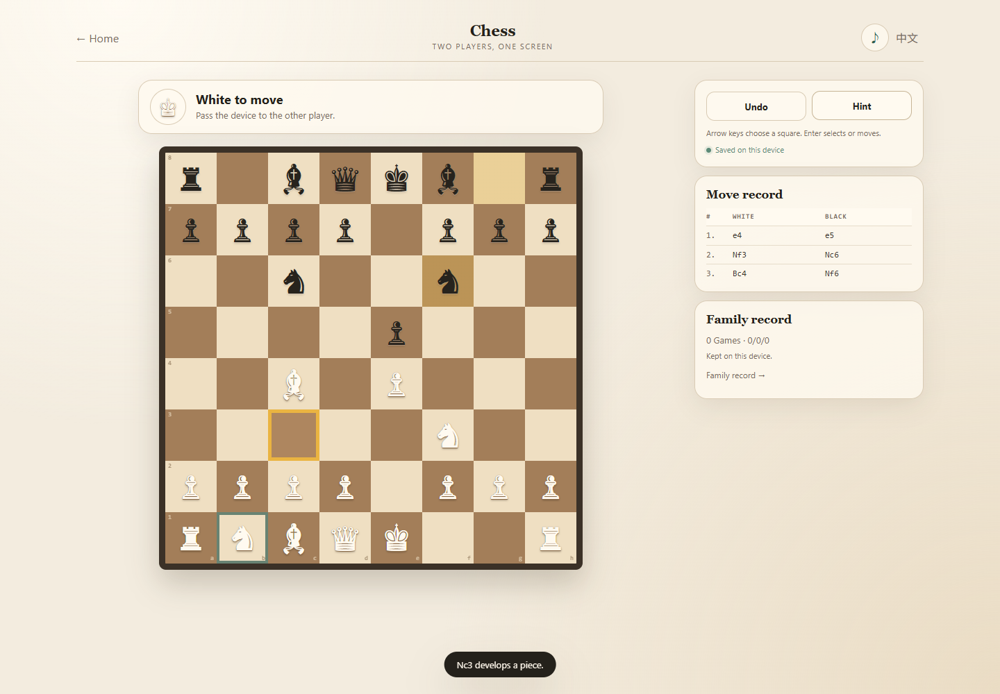 |

| Checkmate | Family record |
| --- | --- |
| 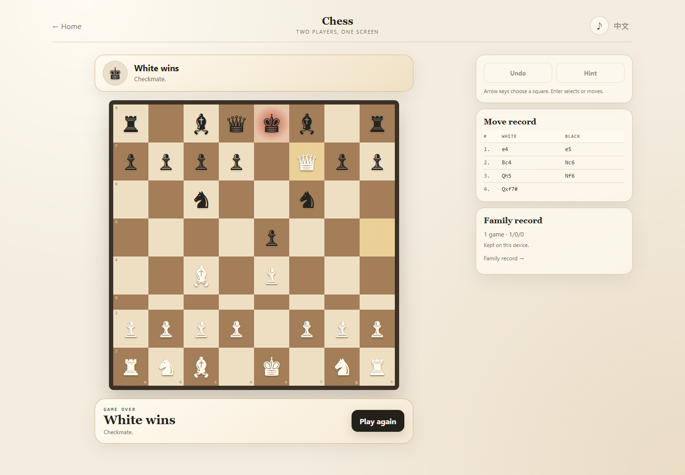 | 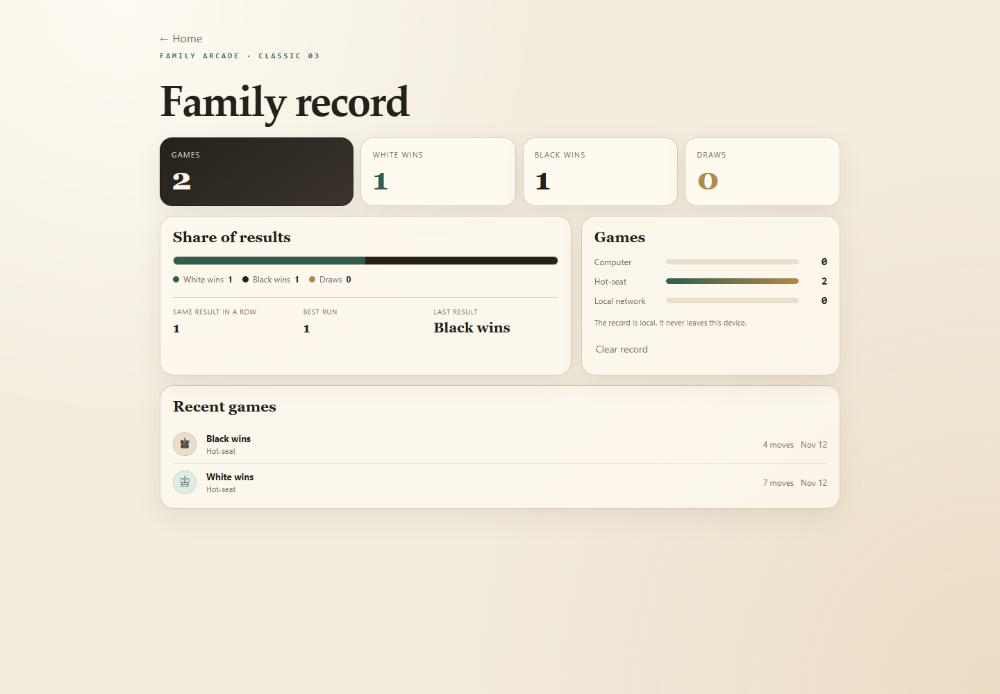 |

| Rules | Local network |
| --- | --- |
| 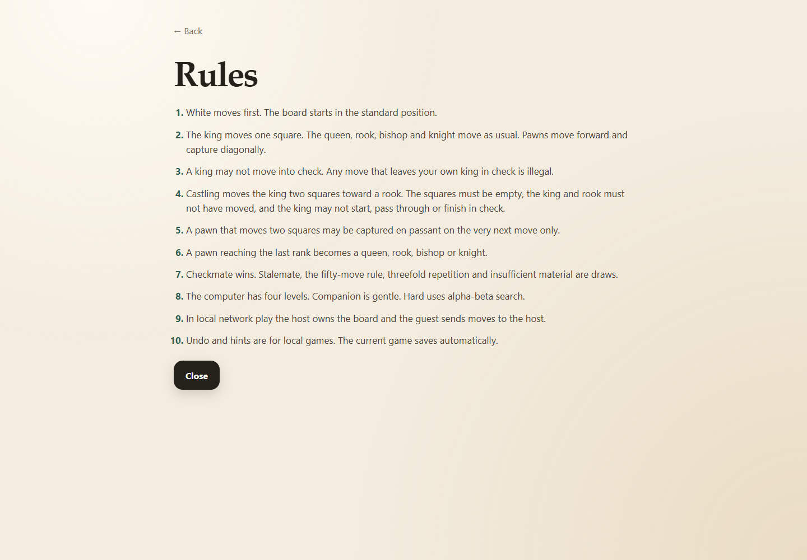 | 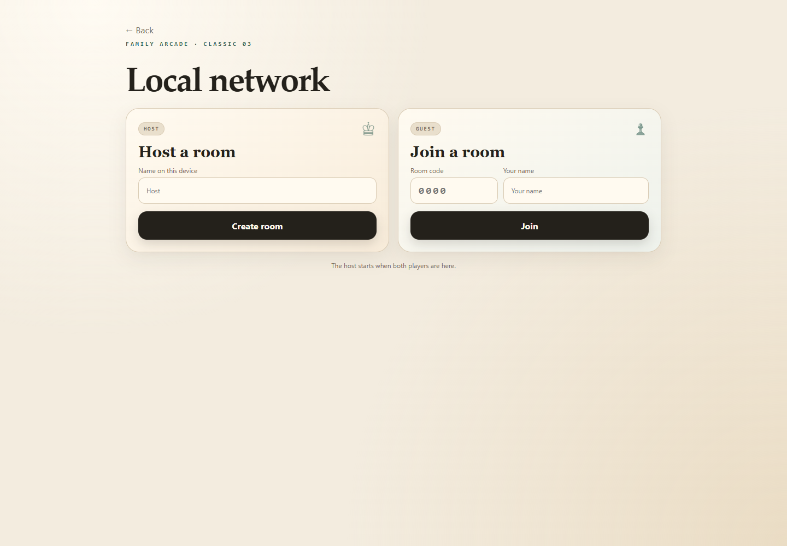 |

| LAN host | LAN guest |
| --- | --- |
| 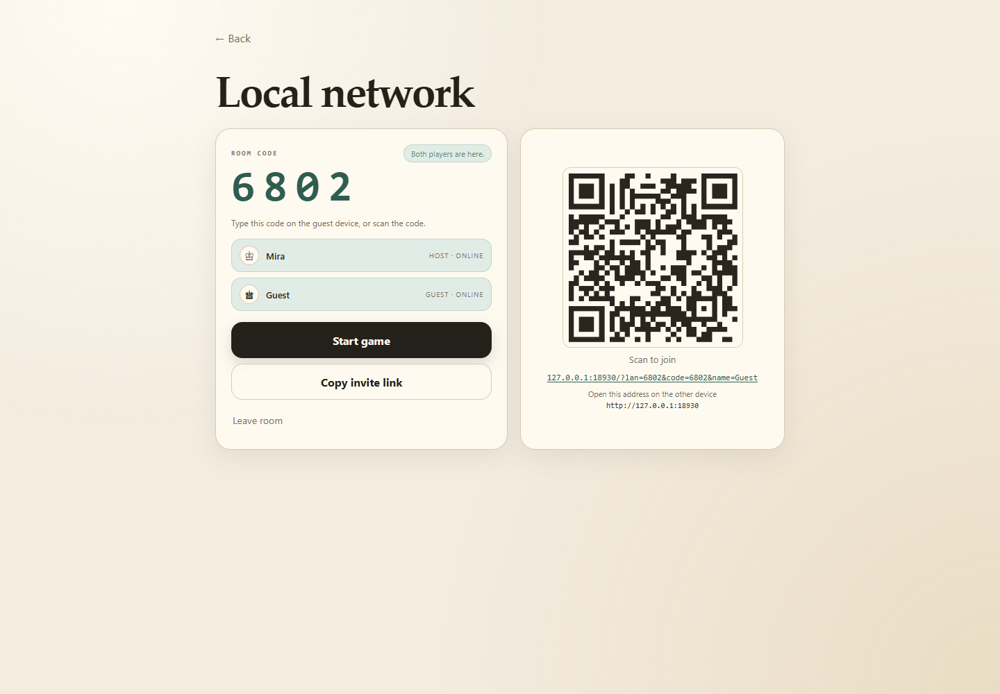 | 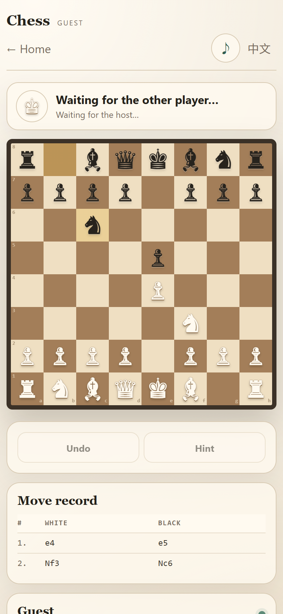 |

| Phone home | Phone game |
| --- | --- |
| 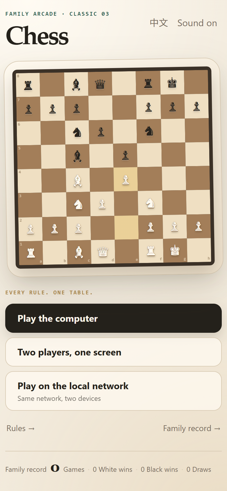 | 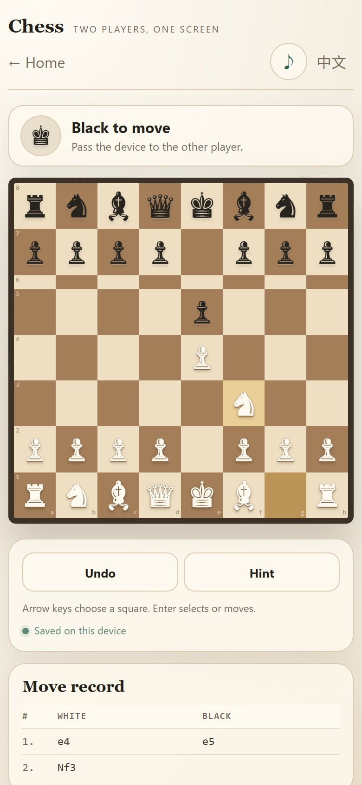 |

All screenshots come from the running app at 1440×1000 (phone 390×844 @2×).

## Play locally

```bash
npm install
npm run dev        # http://localhost:5203
npm run check      # tsc + 37 tests + production build
npm run e2e        # real Chrome, dev server required
npm run build && npm run lan:e2e   # full host/guest LAN flow on :18929
npm run shots      # regenerate EN/ZH screenshots, dev server required
npm run build && npm run lan:shots # live LAN host and guest screenshots
```

## Local network

Browser build:

```bash
npm run build
npm run lan        # relay on :8080, serves dist/
# open http://localhost:8080, choose Local network, create a room
# guest: scan the QR, open the invite, or type the four-digit room code
```

To develop the UI while using the relay, run `npm run dev` in one terminal and
`npm run lan` in another; the dev page talks to the relay on :8080.

Desktop: the Tauri build starts the same relay internally and serves the built app
to phones. The host shows a four-digit room code and a QR invite. Guests open the
address on the same network; no app install is needed on their side.

The relay is a message bus. The host validates every intent with `applySeat`, then
sends the guest a fresh view. Wrong turns, stale move counts and illegal moves are
rejected on the host. The host plays White; the guest plays Black.

## Build the Windows installer

```bash
npm install
npx tauri build --bundles nsis
# src-tauri/target/release/bundle/nsis/Chess_0.1.0_x64-setup.exe
```

The installer is per-game and lightweight; WebView2 uses the standard bootstrapper.
A Windows SmartScreen warning is expected for an unsigned family build.

## Known limitations

- Two players only; no chess clocks, draw offers, resignation, spectators or
  online matchmaking.
- The fifty-move rule and threefold repetition are claimed automatically by the
  engine rather than offered as a claim button.
- LAN is IPv4 on the same subnet; guest phones need the host firewall to allow
  the app. The four-digit room code is a family convenience, not a security
  boundary.
- Stats are local to each device. A LAN game is recorded on the host, not
  duplicated on the guest.
- The AI is a family opponent: material, piece-square tables, alpha-beta and
  quiescence, but no opening book, endgame tablebase or long search.
- Autosave stores the current position; reloading restores the game but not the
  undo history from before the reload.
- No 4K or vertical promo cut. The root studio renders the 45-second promo from
  `video.json`.

See [`docs/limitations.md`](docs/limitations.md) for the full honest list.

## Credits

Original code, copy and CSS/Unicode artwork for Family Arcade. MIT. See
[`NOTICE.md`](NOTICE.md) and [`LICENSE`](LICENSE).
