# 国际象棋 · Chess

[English](README.md) · **简体中文**

> **所有规则，一桌下完。**

给家庭牌桌的完整国际象棋：**2 人**、8×8 棋盘、四档电脑难度、同屏热座，以及手机
浏览器直接加入的局域网对战。引擎实现王车易位、吃过路兵、升变、将军、将死、逼和、
五十步规则、三次重复局面和子力不足。无账号、无广告、无云端。

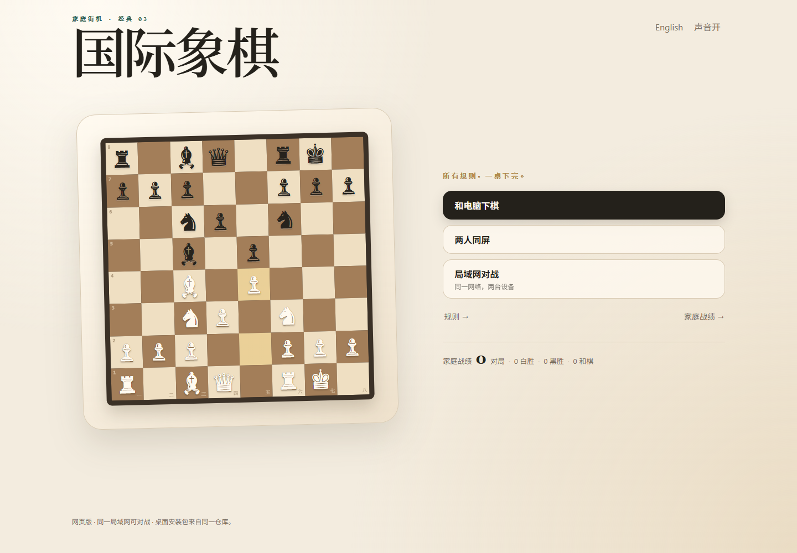

## 一回合，五秒看懂

| 行棋 | 特殊规则 | 结束 |
| --- | --- | --- |
| 白方先行。所有棋子按国际棋联规则移动。 | 王车易位、吃过路兵、底线升变。 | 将死获胜。逼和、五十步、三次重复局面和子力不足都是和棋。 |

## 里面有什么

- **真正的引擎。** 纯 TypeScript、确定性、**37 个单元测试**，并用 Kiwipete 局面
  做过 perft 校验；规则层不碰 DOM、网络、时钟或随机数。见
  [`docs/rules.md`](docs/rules.md)。
- **四档电脑难度。** 陪玩温和，轻松会犯错，标准会看回应并收下白送的子，挑战使用
  alpha-beta 搜索和静态吃子搜索。
- **三种玩法。** 单人对抗电脑、两人共用一台设备，或手机加入主机的局域网房间。
- **能应付真实牌桌的局域网。** 主机保存权威棋盘，只给访客发送自己的视图；访客只发
  着法意图。访客可以刷新重连；只有主机能开始下一局。
- **完整的家庭战绩。** 总对局、白胜/黑胜/和棋占比、各模式分布、当前与最佳连续、
  最近八局。局域网结果记在主机设备。
- **小细节。** 悔棋、会解释原因的提示、自动保存/继续、声音开关、方向键选格、
  减少动效、完整中英双语，以及按手机优先设计、而不是缩小的桌面版。
- **默认私密。** 无账号、无遥测、无广告、无远程字体、无第三方美术。棋盘、棋子和
  图标都来自本仓库的 CSS、Unicode 或 SVG。

## 截图

| 主页 | 电脑难度 |
| --- | --- |
|  | 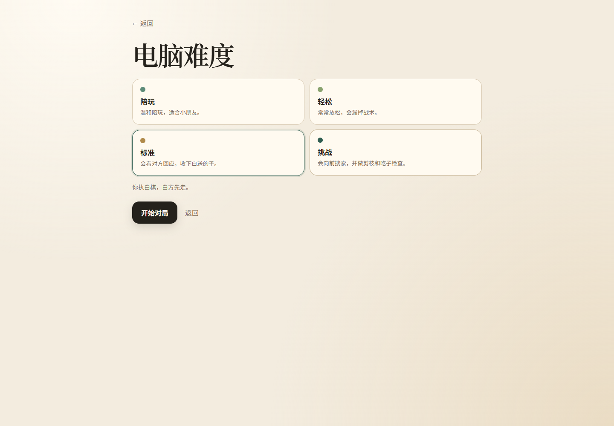 |

| 真实对局 | 带原因的提示 |
| --- | --- |
| 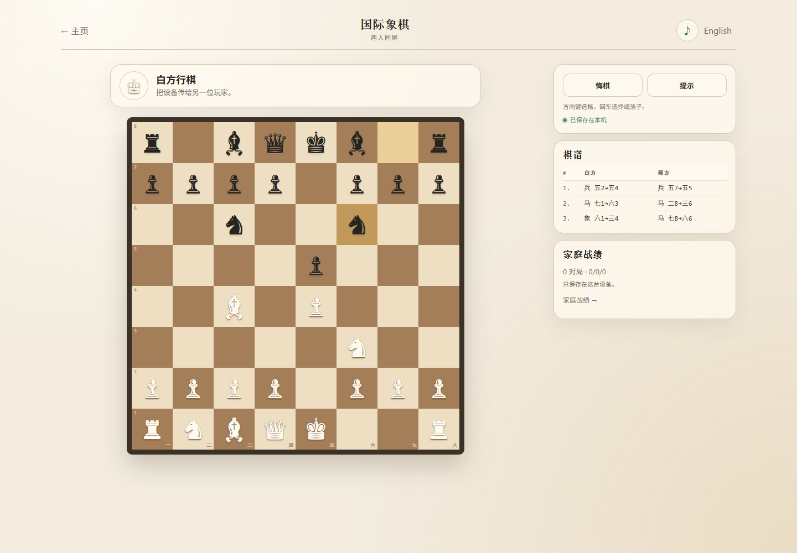 | 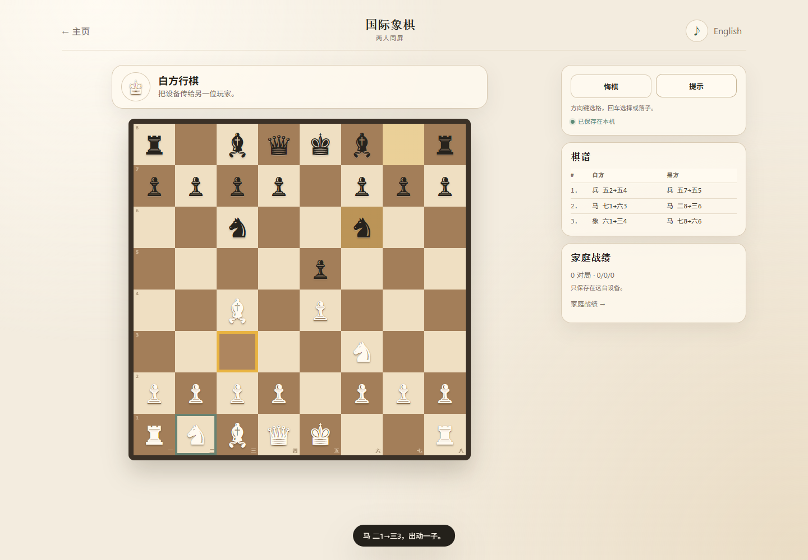 |

| 将死 | 家庭战绩 |
| --- | --- |
| 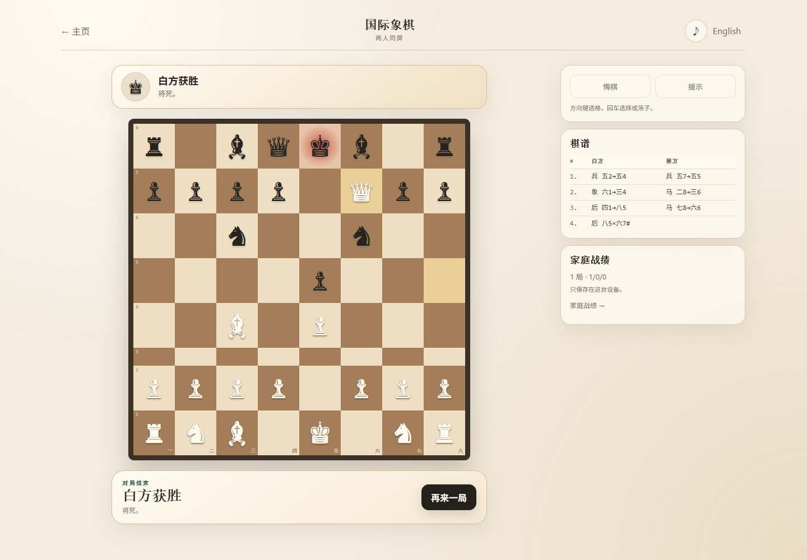 | 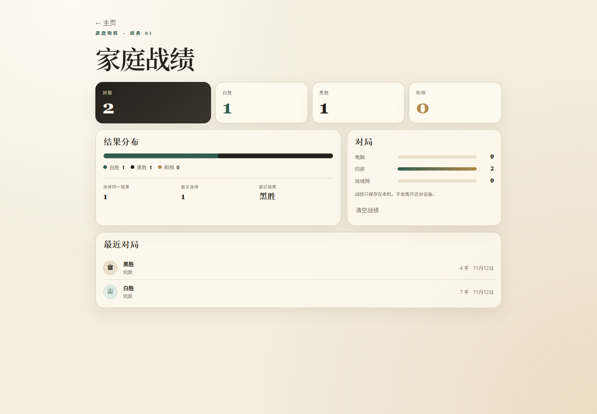 |

| 规则 | 局域网 |
| --- | --- |
| 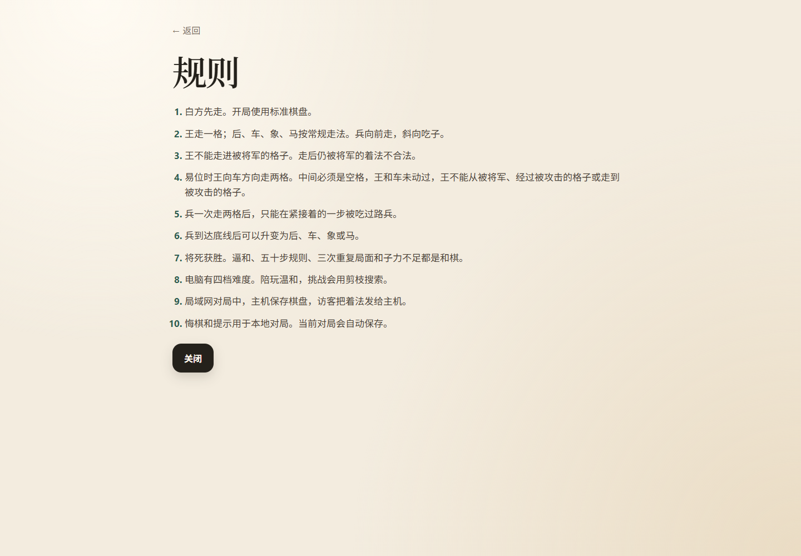 | 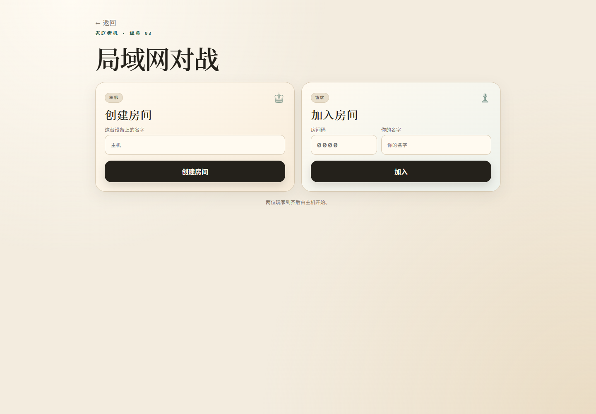 |

| 局域网主机 | 局域网访客 |
| --- | --- |
|  | 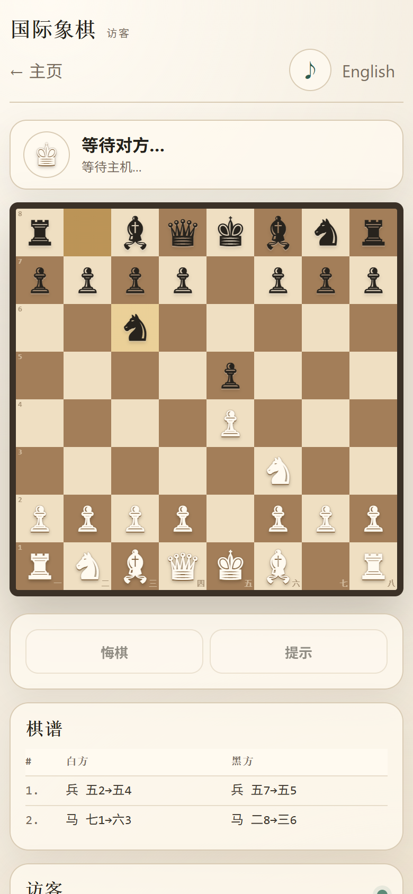 |

| 手机主页 | 手机对局 |
| --- | --- |
| 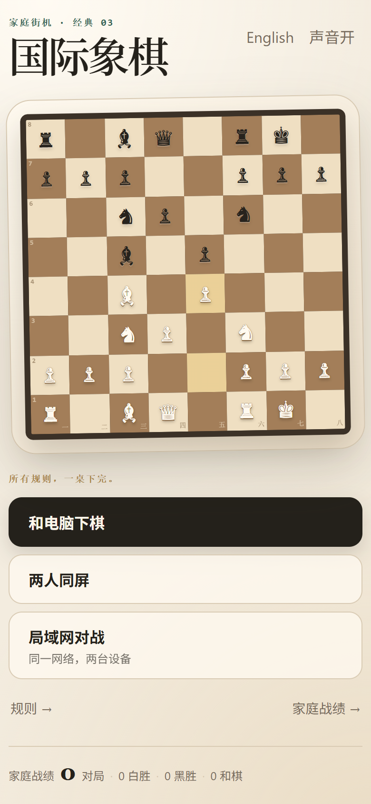 | 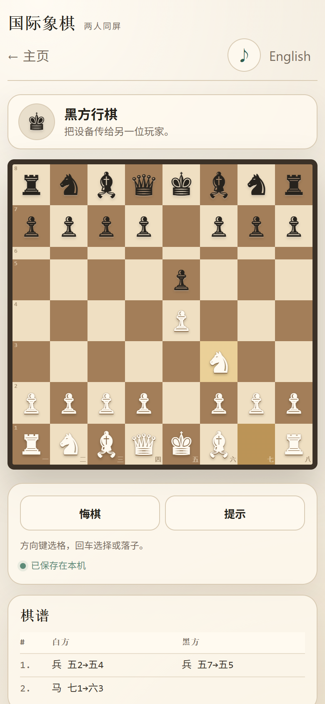 |

全部来自真实运行的应用：1440×1000，手机 390×844 @2×。

## 本地运行

```bash
npm install
npm run dev        # http://localhost:5203
npm run check      # tsc + 37 个测试 + 生产构建
npm run e2e        # 真实 Chrome，需先运行 dev
npm run build && npm run lan:e2e   # 在 :18929 跑完整主机/访客局域网流程
npm run shots      # 重新生成中英截图，需先运行 dev
npm run build && npm run lan:shots # 抓取真实局域网主机与访客截图
```

## 局域网

浏览器版：

```bash
npm run build
npm run lan        # :8080 中继，同时托管 dist/
# 打开 http://localhost:8080，选“局域网对战”→“创建房间”
# 访客：扫码、打开邀请链接，或输入四位房间码
```

如果一边改界面一边测试局域网，可在一个终端运行 `npm run dev`，另一个终端运行
`npm run lan`；开发页面会连到 :8080 的中继。

桌面版：Tauri 安装包启动同一个内置中继，并把构建产物托管给手机。主机显示四位房间码
和二维码；访客在同一网络打开地址即可，无需安装。主机执白，访客执黑。

中继只负责转发消息。主机用 `applySeat` 校验每一个意图，然后给访客发送新的视图。
错误回合、过期步数和非法着法都会在主机被拒绝。

## 构建 Windows 安装包

```bash
npm install
npx tauri build --bundles nsis
# src-tauri/target/release/bundle/nsis/Chess_0.1.0_x64-setup.exe
```

每款游戏单独打包，安装包保持轻量；WebView2 使用标准引导程序。未签名的家庭构建会触发
Windows SmartScreen 提示。

## 已知限制

- 仅两人；没有棋钟、提和、认输、观战或在线匹配。
- 五十步规则和三次重复局面由引擎自动判和，没有“提和”按钮。
- 局域网仅支持同一子网的 IPv4；手机访客需要主机防火墙放行。四位房间码是家庭便利，
  不是安全边界。
- 战绩按设备保存。局域网对局记在主机，不会在访客设备重复记录。
- 电脑对手使用子力、棋子位置表、alpha-beta 和静态吃子搜索；没有开局库、残局表或
  长时限搜索。
- 自动保存保存当前局面；刷新后能继续，但刷新前的悔棋历史不会恢复。
- 暂无 4K/竖屏宣传片。根目录工作室会根据 `video.json` 渲染 45 秒宣传片。

完整清单见 [`docs/limitations.md`](docs/limitations.md)。

## 许可

Family Arcade 原创代码、文案与 CSS/Unicode 美术，MIT。见
[`NOTICE.md`](NOTICE.md) 与 [`LICENSE`](LICENSE)。
