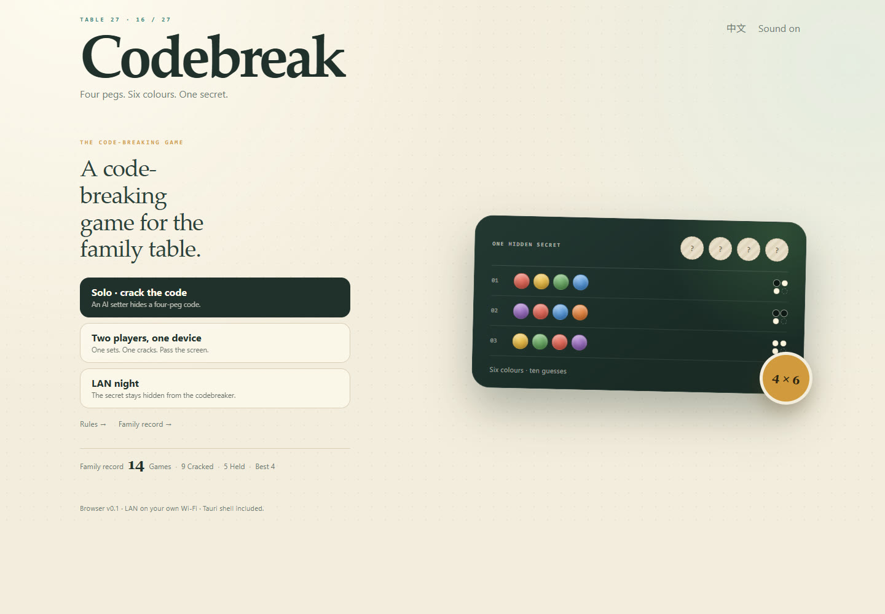
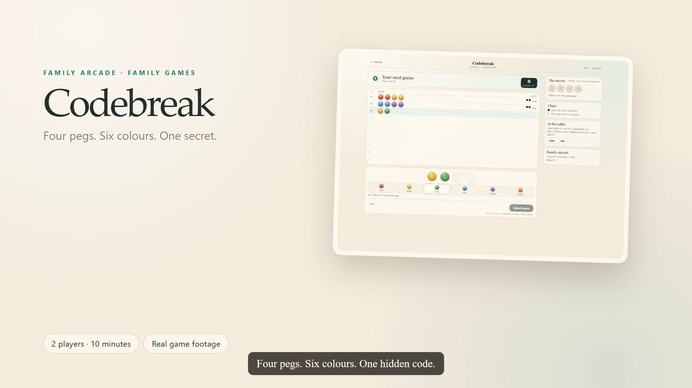
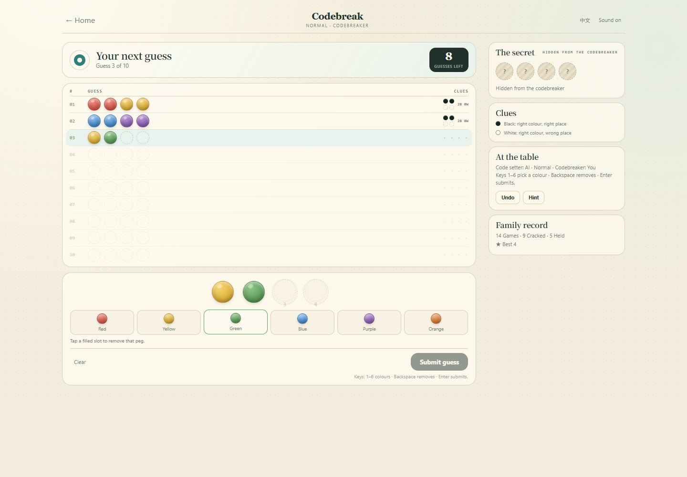
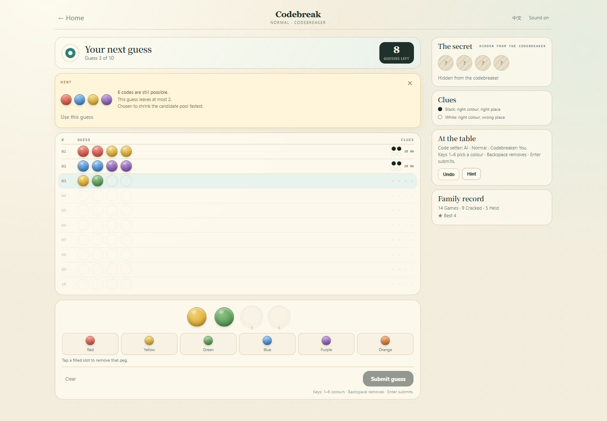
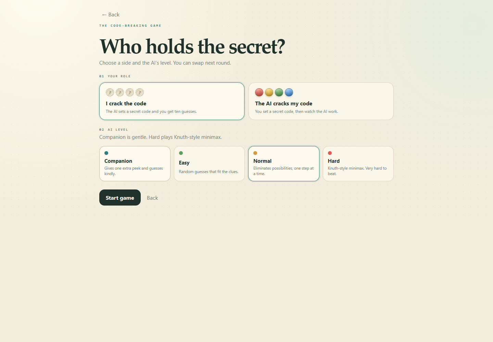
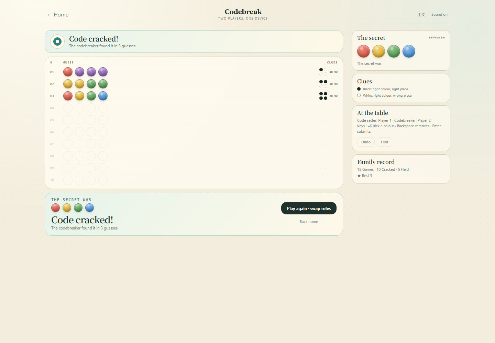
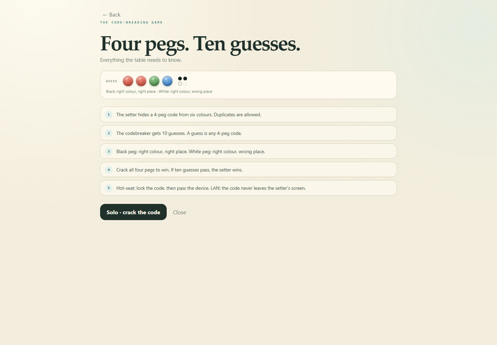
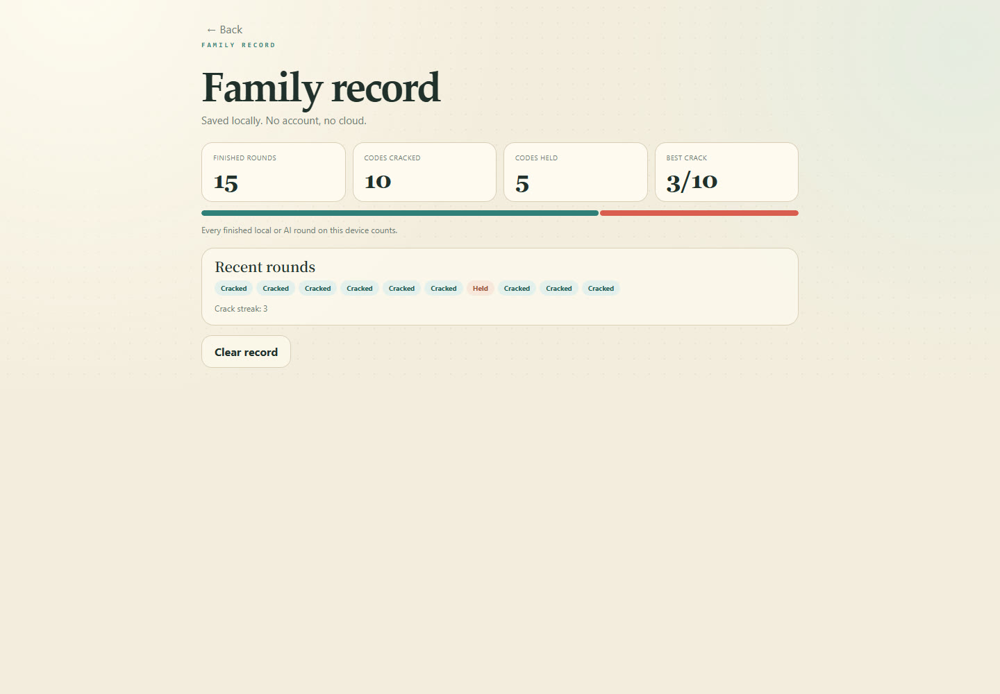
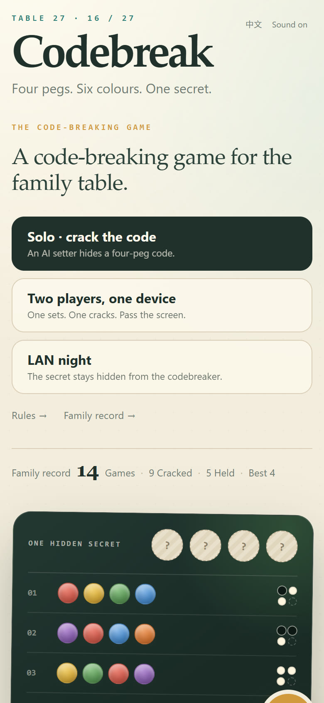
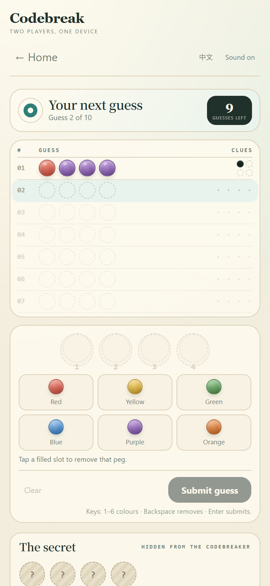

# Codebreak · 猜色

**English** · [简体中文](README.zh-CN.md)

> **Four pegs. Six colours. One secret.**

A two-player, offline-first code-breaking game for the family table. One player
hides a four-peg code; the other has ten guesses to crack it. Built for Family Arcade
with a pure TypeScript engine, four AI levels, hot-seat play with a real privacy
hand-off, and LAN play where the code stays hidden on the breaker’s screen.



[](docs/promo/codebreak-promo-en.mp4)

*45 seconds · 1920×1080 · 60 fps · [中文版](docs/promo/codebreak-promo-zh.mp4) · [video.json](video.json)*

## A turn, in five seconds

| Set | Guess | Read the clues |
| --- | --- | --- |
| The setter hides four pegs from six colours. Duplicates are allowed. | The breaker submits any four-peg code and gets ten tries. | **Black** = right colour and place. **White** = right colour, wrong place. Four black pegs cracks the code. |

If the code survives ten guesses, the setter wins the round. There is no score
count: the family record counts cracked codes, held codes and the best crack.

## What is inside

- **A real, tested engine.** Pure TypeScript in `src/game/codebreak.ts`, no DOM,
  network, clock or `Math.random`. **43 unit tests** cover duplicates, feedback,
  the ten-guess limit, hidden seat views, hints, candidate elimination and every
  AI level.
- **Four deterministic AI levels.** Companion plays kindly and grants one extra
  secret-peg peek when it is the setter. Easy guesses randomly from the codes
  that still fit. Normal eliminates candidates one step at a time. Hard runs a
  Knuth-style minimax search over all 1,296 codes. All take an injected RNG.
- **Solo, both roles.** Crack an AI secret, or hide a code and watch the AI
  break it. The AI only ever receives public guesses and clues.
- **Hot-seat with a hidden code.** The setter locks the code, then the app shows
  a hand-off screen before the breaker gets the device. The secret is not drawn
  while the breaker is guessing.
- **LAN night.** Host a room, show the QR invite, and a phone joins on the same
  Wi-Fi. The host is authoritative and sends the guest a per-seat view. The
  breaker’s view never contains the secret.
- **Small comforts.** Hint with a reason and a legal suggested guess, Companion
  peek, undo, autosave/resume, local family record, sound toggle, keyboard
  play, reduced-motion support, complete Chinese/English UI and a phone layout.
- **Private by default.** No accounts, telemetry, ads, remote fonts or CDN.

## Screenshots

All screenshots are taken from the running app at **1440×1000**; the phone shots
are **390×844 at 2×** (780×1688).

| A real guess | Hint with a reason |
| --- | --- |
|  |  |

| Choose a side | A cracked code |
| --- | --- |
|  |  |

| Rules | Family record |
| --- | --- |
|  |  |

| Phone home | Phone game |
| --- | --- |
|  |  |

The Chinese screenshots live in `docs/screenshots/zh/`.

## Play locally

```bash
npm install
npm run dev        # http://localhost:5195
npm run check      # tsc + 43 tests + production build
npm run e2e        # real Chrome; dev server must be running
npm run shots      # regenerate docs/screenshots/{en,zh}
```

Keyboard: **1–6** pick a colour, **Backspace** removes a peg, **Enter** locks or
submits, **Esc** returns home (the current solo/hot-seat game stays saved).

## LAN night

Browser development:

```bash
npm run build
npm run lan        # relay + built app on :8080
npm run dev        # host UI on :5195
# open http://localhost:5195, choose LAN night, pick who sets the code
```

The host shows a 4-digit room code and a QR invite. A phone on the same Wi-Fi
opens the invite at `http://<host>:8080/?lan=...`; no guest install is needed.
In the packaged desktop app the shared Tauri relay is started by the app when
you host.

For a phone invite from the browser dev flow, open the host page through the
machine’s LAN IP (`npm run dev -- --host`) rather than `localhost`; the QR uses
the page’s hostname. The packaged desktop build does this for you.

An optional two-browser smoke test is included (dev server and relay running):

```bash
npm run lan-check
```

The host chooses **I set the code** or **Guest sets the code** before starting.
The setter enters the secret on their own screen. The breaker receives only
guesses and clues during play, and the secret is revealed to both at the end.
Guest intents are re-checked by the host against the seat, phase and ten-guess
limit.

## Build the Windows installer

```bash
npm install
npx tauri build --bundles nsis
# src-tauri/target/release/bundle/nsis/Codebreak_0.1.0_x64-setup.exe
```

The installer is per-game and lightweight; WebView2 uses the standard
bootstrapper. An unsigned family build will trigger a SmartScreen warning.

## Known limitations

- Two seats only; no 3–4 player variant.
- LAN is local-subnet IPv4, with no matchmaking, spectators or reconnect.
- The host owns the authoritative state. In a guest-sets round the secret is
  transmitted to the host so guesses can be validated; it is never rendered on
  the host’s breaker UI, but it is not cryptographically sealed against someone
  inspecting developer tools. LAN is for the family table, not hostile networks.
- LAN rounds are not added to the local family record and cannot be undone or
  autosaved. The host can start a rematch and swap roles.
- Hard is a real minimax opponent, not a teaching mode.
- Colour-blind players get named palette buttons and screen-reader labels, but
  placed pegs rely on colour; there are no per-colour symbols on the board.
- The promo video is rendered centrally from `video.json`; no video file is
  shipped inside the app.

See [`docs/limitations.md`](docs/limitations.md) for the full list.

## Rules audit

Every rule has code, a test and an edge case in
[`docs/rules.md`](docs/rules.md). The engine is deterministic; the UI injects
`Math.random` at its edges, while tests use a seeded generator.

## Credits

Original engine, copy and visual design for Family Arcade. The public-domain
code-breaking peg mechanic is not affiliated with any commercial Mastermind
product. MIT — see [`LICENSE`](LICENSE) and [`NOTICE.md`](NOTICE.md).

## Promo

[](docs/promo/codebreak-promo-en.mp4)

- [English cut](docs/promo/codebreak-promo-en.mp4) · [other language](docs/promo/codebreak-promo-zh.mp4)
- [SRT](docs/promo/codebreak-promo-en.srt) · [video.json](video.json)
- Real app screenshots and real engine data; claims match the tests.

