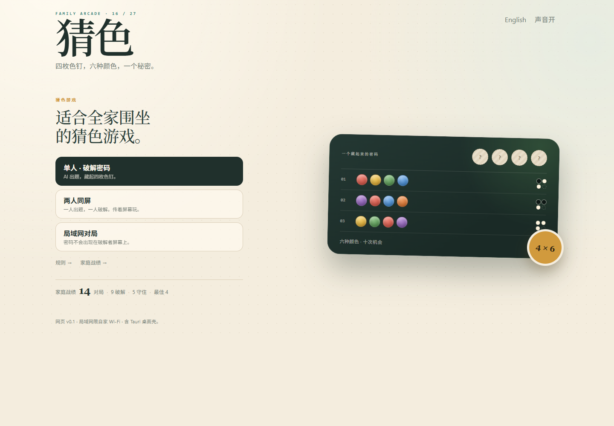
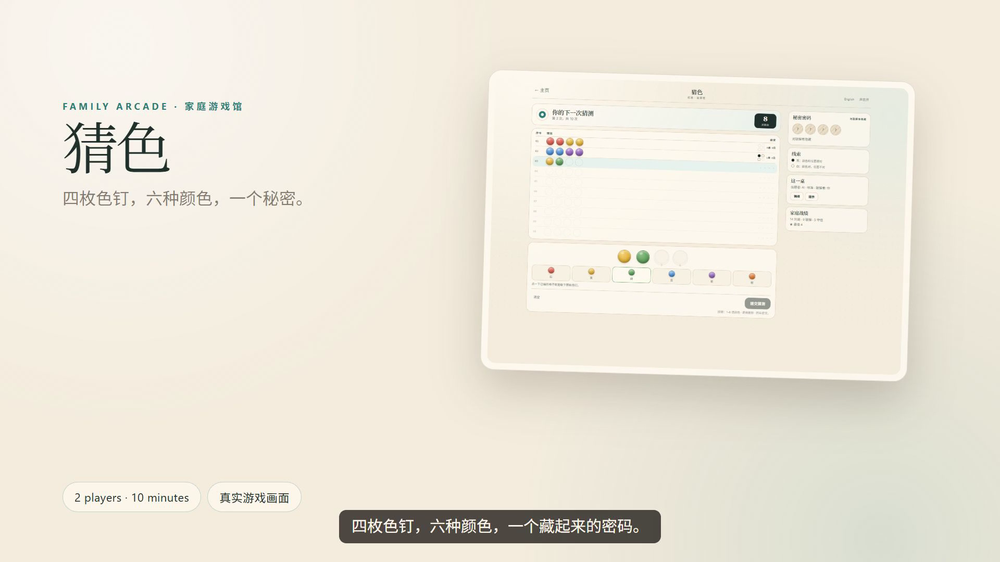
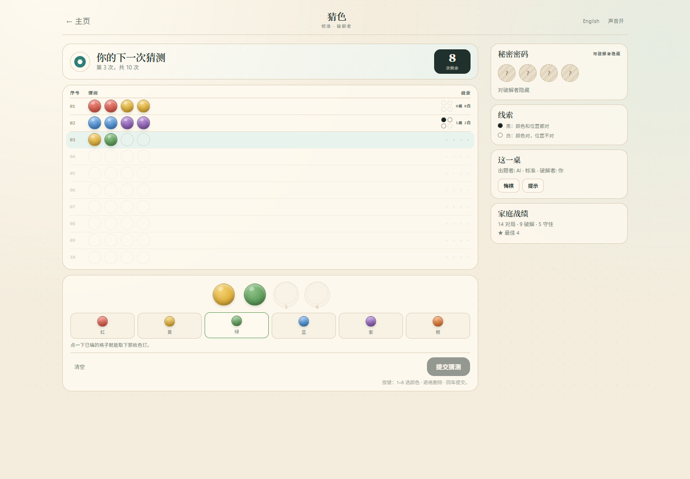
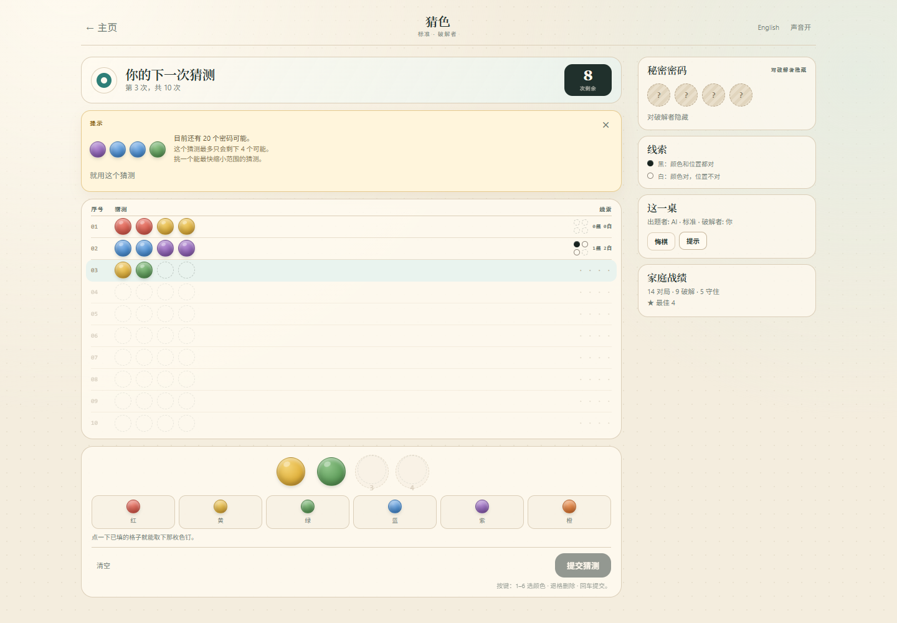
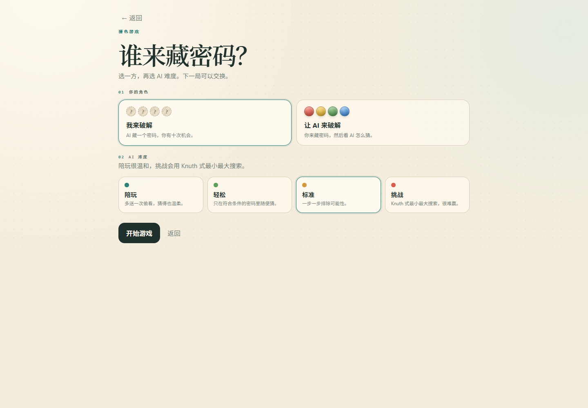
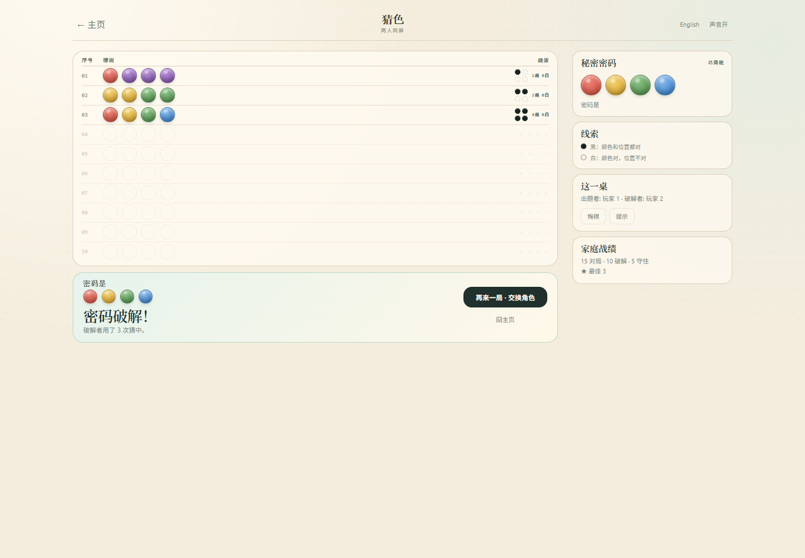
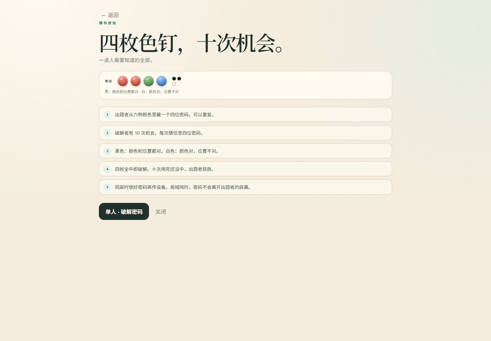
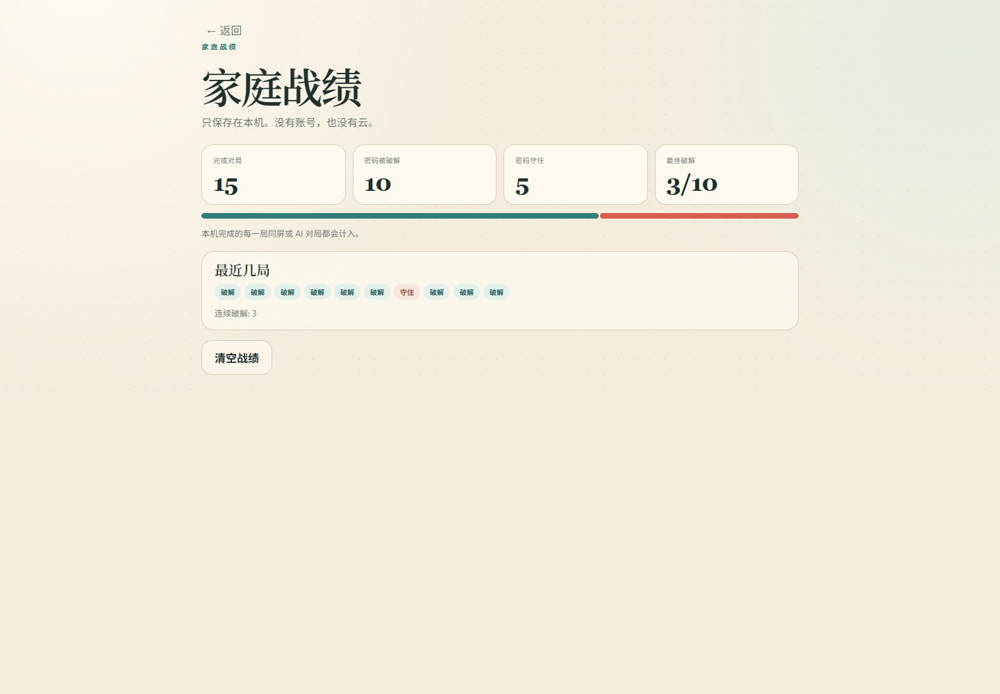
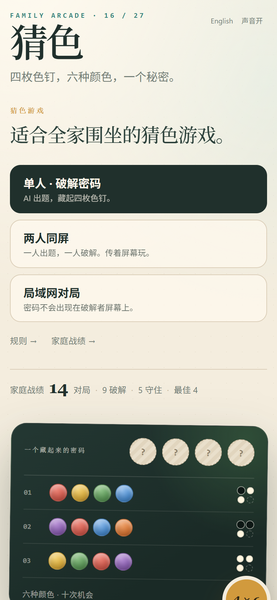
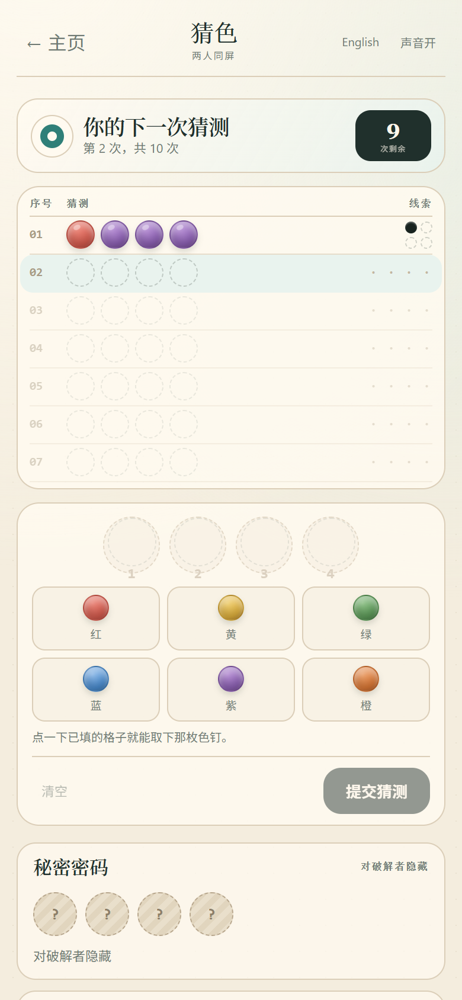

# 猜色 · Codebreak

[English](README.md) · **简体中文**

> **四枚色钉，六种颜色，一个秘密。**

给家庭牌桌的两人猜色游戏。一人藏一个四位密码，另一人有十次机会破解。
纯 TypeScript 引擎、四档 AI、带真正隐私交接的同屏热座，以及破解者屏幕上
看不到密码的局域网对局。



[](docs/promo/codebreak-promo-zh.mp4)

*45 秒 · 1920×1080 · 60fps · [English cut](docs/promo/codebreak-promo-en.mp4) · [video.json](video.json)*

## 五秒看懂一回合

| 出题 | 破解 | 读线索 |
| --- | --- | --- |
| 出题者从六种颜色里藏四枚色钉，可以重复。 | 破解者每次猜任意四位密码，一共十次。 | **黑钉**：颜色和位置都对。**白钉**：颜色对、位置不对。四枚全黑就破解。 |

十次都没猜中，这一局出题者赢。游戏不累计分数；家庭战绩记录破解次数、
守住次数和最少用了几次猜中。

## 内容

- **真正测试过的引擎。** `src/game/codebreak.ts` 是纯 TypeScript，不碰 DOM、
  网络、时钟或 `Math.random`。**43 个单元测试**覆盖重复色钉、黑白线索、
  十次上限、隐藏座位视图、提示、候选排除和全部 AI 难度。
- **四档确定性 AI。** 陪玩会温柔地猜，并在它出题时多送一次偷看；轻松只在
  仍符合条件的密码里随机猜；标准一步一步排除；挑战用 Knuth 式最小最大
  搜索遍历全部 1,296 个密码。四档都接收注入的 RNG。
- **两种单人角色。** 可以破解 AI 藏的密码，也可以自己藏密码看 AI 怎么猜。
  AI 只拿到公开的猜测和线索，不会拿到密码。
- **同屏热座，密码真的藏起来。** 出题者锁好密码后，应用会先显示“把设备传
  下去”的交接页；破解者猜的时候，界面上不会画出密码。
- **局域网对局。** 开房、出示二维码，手机连同一 Wi-Fi 加入。房主是权威状态，
  只给客人发送自己座位的视图；破解者的视图里没有密码。
- **小贴心功能。** 带理由的提示和合法建议猜测、陪玩偷看、悔棋、自动保存/
  继续、家庭战绩、声音开关、键盘操作、减少动态效果、完整中英文界面和手机布局。
- **默认私密。** 没有账号、遥测、广告、远程字体或 CDN。

## 截图

全部来自运行中的应用。桌面 **1440×1000**；手机 **390×844 @2×**（780×1688）。

| 真实对局 | 带理由的提示 |
| --- | --- |
|  |  |

| 选择角色 | 破解成功 |
| --- | --- |
|  |  |

| 规则 | 家庭战绩 |
| --- | --- |
|  |  |

| 手机主页 | 手机对局 |
| --- | --- |
|  |  |

英文截图在 `docs/screenshots/en/`。

## 本机运行

```bash
npm install
npm run dev        # http://localhost:5195
npm run check      # tsc + 43 个测试 + 生产构建
npm run e2e        # 真实 Chrome；需要先开 dev server
npm run shots      # 重新生成 docs/screenshots/{en,zh}
```

键盘：**1–6** 选颜色，**退格**取下色钉，**回车**锁定或提交，**Esc** 回主页
（单人/同屏对局会继续保存）。

## 局域网对局

浏览器开发方式：

```bash
npm run build
npm run lan        # 中继 + 构建产物，端口 8080
npm run dev        # 房主界面在 5195
# 打开 http://localhost:5195，选“局域网对局”，再选谁出题
```

房主会看到四位房间码和二维码。同一 Wi-Fi 下的手机打开
`http://<房主>:8080/?lan=...` 即可加入，客人不用安装。打包后的桌面版会在
开房时启动同一个 Tauri 中继。

浏览器开发时若要让手机扫码，请用本机局域网 IP 打开房主页
（`npm run dev -- --host`），不要用 `localhost`；二维码使用当前页面的主机名。
桌面安装包会自动处理这一点。

另附一个可选的浏览器双页 LAN 冒烟测试（需已开 dev server 和中继）：

```bash
npm run lan-check
```

开局前房主选择“我来出题”或“客人出题”。出题者在自己的屏幕上输入密码；
破解者在游戏过程中只收到猜测和线索，结束后双方才看到密码。客人的操作会由
房主重新检查座位、阶段和十次上限。

## 构建 Windows 安装包

```bash
npm install
npx tauri build --bundles nsis
# src-tauri/target/release/bundle/nsis/Codebreak_0.1.0_x64-setup.exe
```

每个游戏一个轻量安装包；WebView2 使用标准 bootstrapper。未签名的家庭版会
出现 SmartScreen 提示，这是预期行为。

## 已知限制

- 只有两个座位，没有 3–4 人变体。
- 局域网限同一子网的 IPv4；没有匹配、观战或断线重连。
- 房主持有权威状态。客人出题时，密码会传到房主设备上用于校验猜测；它不会
  出现在房主作为破解者的界面上，但没有针对开发者工具检查的加密保护。局域网
  是给自家牌桌用的，不是对抗性网络。
- 局域网对局不计入本机家庭战绩，也不支持悔棋或自动保存；房主可以再来一局
  并交换角色。
- 挑战难度是真正的搜索型对手，不是教学模式。
- 色盲玩家可以使用带名字的调色按钮和读屏标签，但棋盘上的色钉仍以颜色区分，
  没有给每种颜色加形状符号。
- 宣传片由 `video.json` 在中央工作室渲染，应用内不附带视频文件。

完整列表见 [`docs/limitations.md`](docs/limitations.md)。

## 规则审计

每条规则都有代码、测试和边界情况，见 [`docs/rules.md`](docs/rules.md)。
引擎是确定性的；界面在边界注入 `Math.random`，测试使用固定种子的生成器。

## 版权

引擎、文案和视觉为 Family Arcade 原创。公共领域的猜色钉玩法与任何商业
Mastermind 产品无关。MIT，见 [`LICENSE`](LICENSE) 和 [`NOTICE.md`](NOTICE.md)。

## 宣传片

[](docs/promo/codebreak-promo-zh.mp4)

- [中文成片](docs/promo/codebreak-promo-zh.mp4) · [另一语言](docs/promo/codebreak-promo-en.mp4)
- [字幕](docs/promo/codebreak-promo-zh.srt) · [video.json](video.json)
- 画面来自真实应用与真实引擎数据；数字与测试一致。

