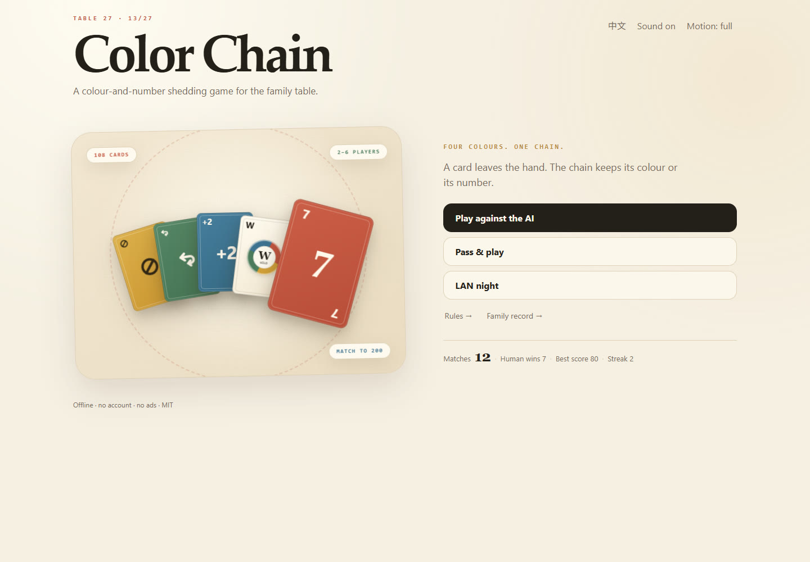
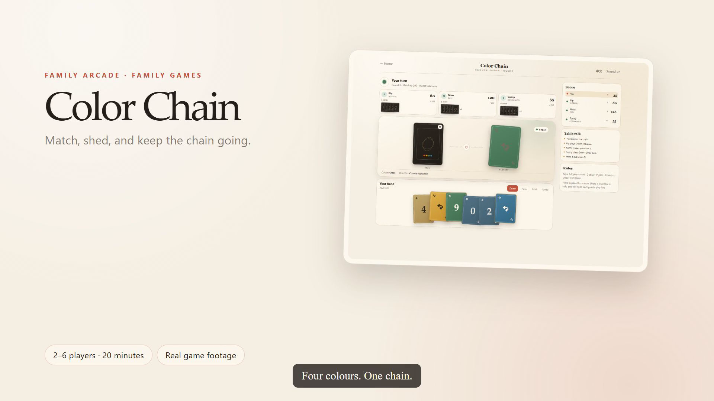
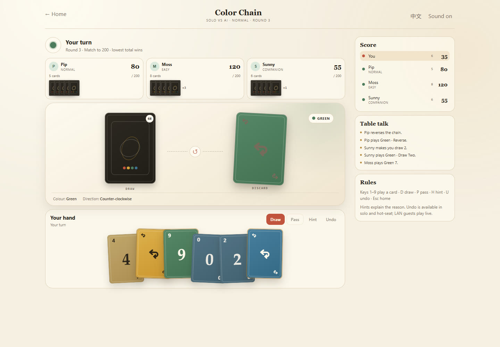
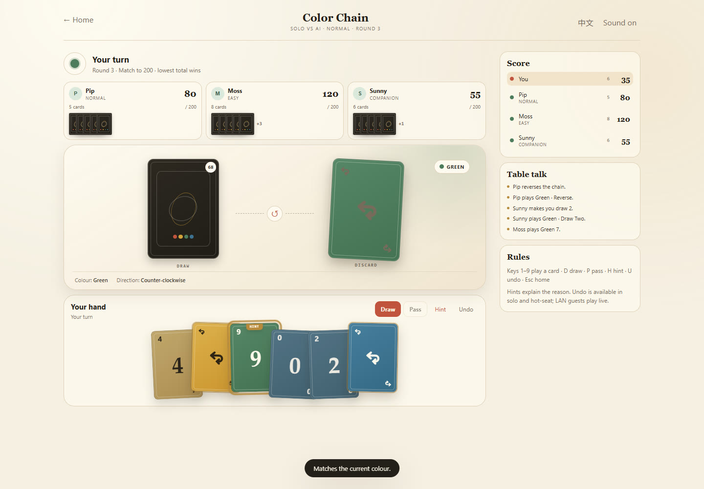
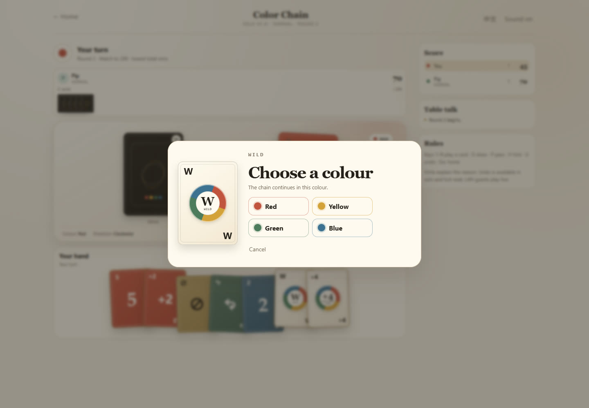
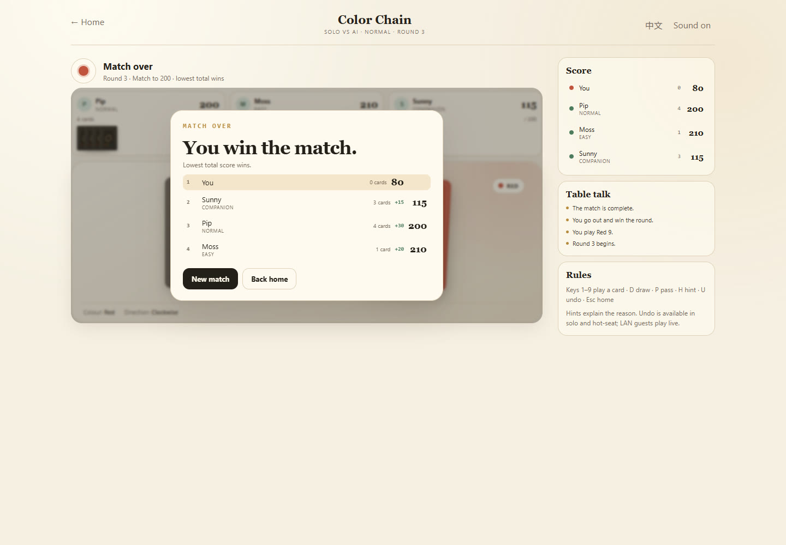
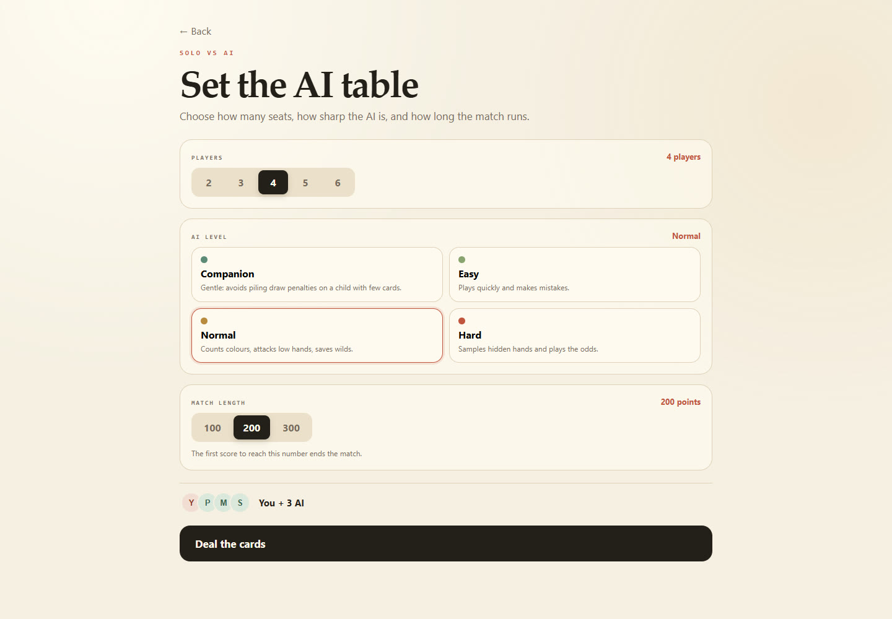
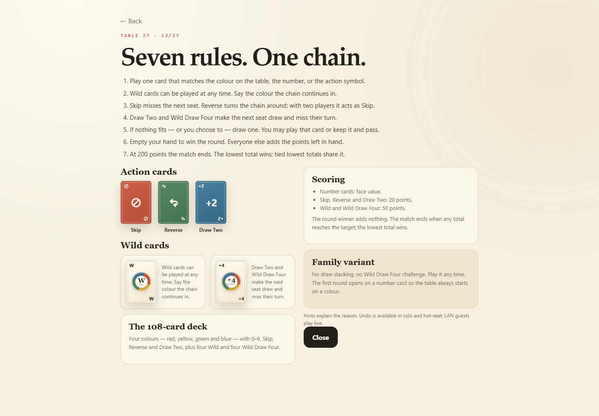
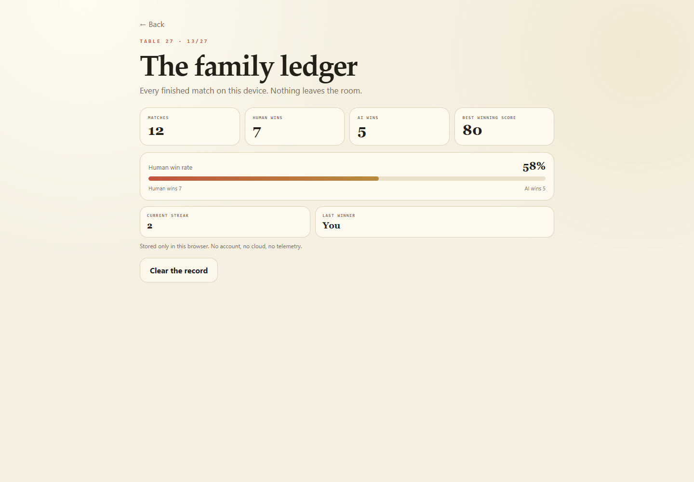
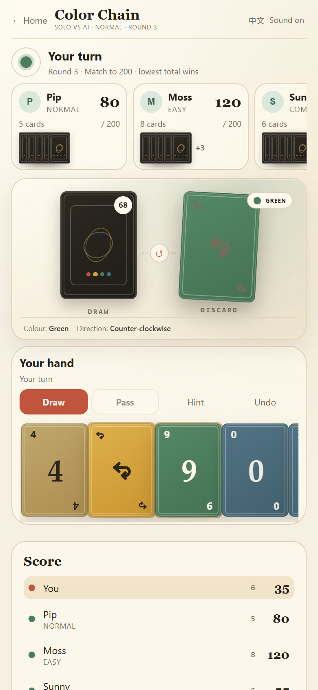

# Color Chain · 颜色接龙

**English** · [简体中文](README.zh-CN.md)

> **Match, shed, and keep the chain going.**

An original colour-and-number shedding game for **2–6 players**: a 108-card deck, four
AI levels, one-screen hot-seat, and a phone joining over Wi-Fi. Offline by default, no
account, no ads, no remote assets.



[](docs/promo/color-chain-promo-en.mp4)

*45 seconds · 1920×1080 · 60 fps · [中文版](docs/promo/color-chain-promo-zh.mp4) · [video.json](video.json)*

*Part of [Family Arcade](../..), game 13/27. Browser v0.1 + a Tauri shell; screenshots come
from the running app.*

## A turn, in five seconds

| Match | Act | Win |
| --- | --- | --- |
| Play a card that fits the colour, number or action symbol. Wilds fit anywhere. You may draw at any time; after drawing only that card may be played. | Skip, Reverse, Draw Two, Wild or Wild Draw Four. The next seat may lose a turn or draw. | Empty your hand to win the round. At 200 points the match ends; the **lowest total** wins. |

## What is inside

- **A real, tested engine.** Pure TypeScript in `src/game/`, no DOM, clock, network or
  `Math.random`; every shuffle takes an injected RNG. **39 unit tests** cover deck
  composition, matching, all four actions, drawing and recycling, scoring, match end,
  ties, views, LAN intent validation and AI safety.
- **A complete 108-card deck.** Four colours, 0–9, Skip, Reverse, Draw Two, Wild and Wild
  Draw Four. Number cards score face value; actions 20; wilds 50.
- **Four AI levels.** Companion is gentle with a child holding few cards; Easy makes
  mistakes; Normal counts colours and attacks low hands; Hard samples hidden hands and
  plays the odds. All are deterministic with an injected RNG.
- **Three ways to play.** Solo against 1–5 AIs, 2–6 players passing one device, or a LAN
  room with up to five phones. The active hot-seat player sees their own hand; LAN guests
  receive only their own private view.
- **Small comforts.** Hint with a reason, undo in solo/hot-seat, autosave/resume, a local
  family record, sound toggle, reduced-motion toggle, keyboard path (`1–9`, `D`, `P`, `H`,
  `U`, `Esc`), complete Chinese/English UI and a phone layout.
- **Private by default.** No accounts, telemetry, ads, CDN, remote fonts or downloaded
  art. Every card, icon and pattern is CSS/SVG; sound is synthesised in the browser.

## Screenshots

| Mid-game | Hint with a reason |
| --- | --- |
|  |  |

| Choose a wild colour | Match end |
| --- | --- |
|  |  |

| AI table setup | Rules |
| --- | --- |
|  |  |

| Family record | Phone game |
| --- | --- |
|  |  |

All captures are real: 1440×1000 desktop and 390×844 @2× phone. The Chinese set lives in
[`docs/screenshots/zh`](docs/screenshots/zh).

## Play locally

```bash
npm install
npm run dev        # http://localhost:5192
npm run check      # tsc + 39 tests + production build
npm run e2e        # real Chrome; requires npm run dev
npm run lan:e2e    # optional host+guest smoke test; requires dev + relay (:8080)
npm run shots      # regenerate docs/screenshots/{en,zh}
```

`npm run e2e` drives a real solo game, draw/pass, hint, undo, autosave/resume, hot-seat,
the final table, the wild picker and the phone layout. It prints `E2E OK`.

## LAN night

Browser/development:

```bash
npm run build
npm run lan        # relay on :8080, also serves dist/
# host: open http://localhost:5192, choose LAN night, open a room
# guest: open the invite URL served from :8080
```

Host flow: **LAN night → table size → Open a room → share the 4-digit code or QR → Start
the match**. Empty seats become Normal AI; a guest joining before the deal takes a human
seat. In a started match, a late guest can take over an AI seat. A disconnected guest seat
is played by Normal AI until they return.

Desktop: the Tauri build starts the same relay internally and serves the built app to
phones. The host shows a room code and QR invite; guests need no install. The host keeps
the authoritative state and sends one private view per seat. Guests may only send a card
id, draw or pass intent; the host re-validates every move. Hints are computed by the host
and sent privately. Guests cannot undo or start the next round.

The relay is a dumb message bus. Room codes, reconnect tokens, seats and turn checks are
enforced in TypeScript. LAN is IPv4 on the same subnet; the host firewall must allow the
relay port. See [`docs/limitations.md`](docs/limitations.md).

## Build the Windows installer

```bash
npm install
npx tauri build --bundles nsis
# src-tauri/target/release/bundle/nsis/Color Chain_0.1.0_x64-setup.exe
```

The installer is per-game and lightweight; WebView2 uses the standard bootstrapper. The
Tauri shell is kept in the repo, but installers are built centrally by Family Arcade. A Windows
SmartScreen warning is expected for an unsigned family build.

## Rules and design

- [`docs/rules.md`](docs/rules.md) — full rule audit, deck table, scoring, LAN model and
  AI notes.
- [`docs/limitations.md`](docs/limitations.md) — honest v0.1 limits.
- Family variant: no draw stacking, no Wild Draw Four challenge, no last-card penalty.
  The opening discard is always a number card. These are deliberate.

The match ends when any total reaches the target (100/200/300). **Lowest total wins**;
tied lowest totals share the match. The family record stores finished matches, human/AI
wins, best winning score and the current streak in `localStorage`.

## Credits

Original code, card design, copy and sound for Family Arcade. MIT. See [`NOTICE.md`](NOTICE.md)
and [`LICENSE`](LICENSE). UNO is a trademark of Mattel; Color Chain is not affiliated with
Mattel and uses no UNO artwork or trade dress.

## Promo

[](docs/promo/color-chain-promo-en.mp4)

- [English cut](docs/promo/color-chain-promo-en.mp4) · [other language](docs/promo/color-chain-promo-zh.mp4)
- [SRT](docs/promo/color-chain-promo-en.srt) · [video.json](video.json)
- Real app screenshots and real engine data; claims match the tests.

