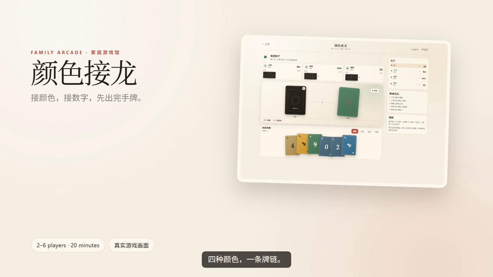
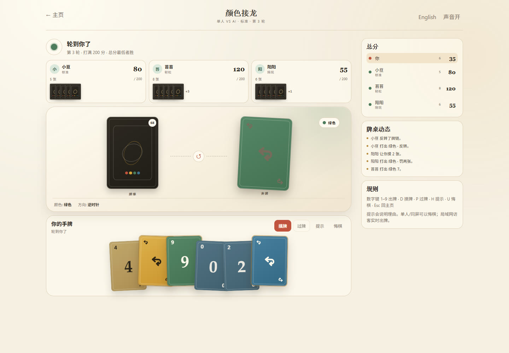
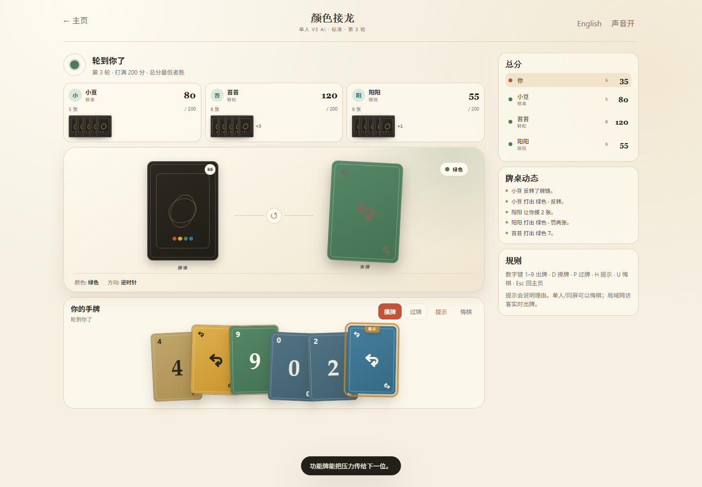
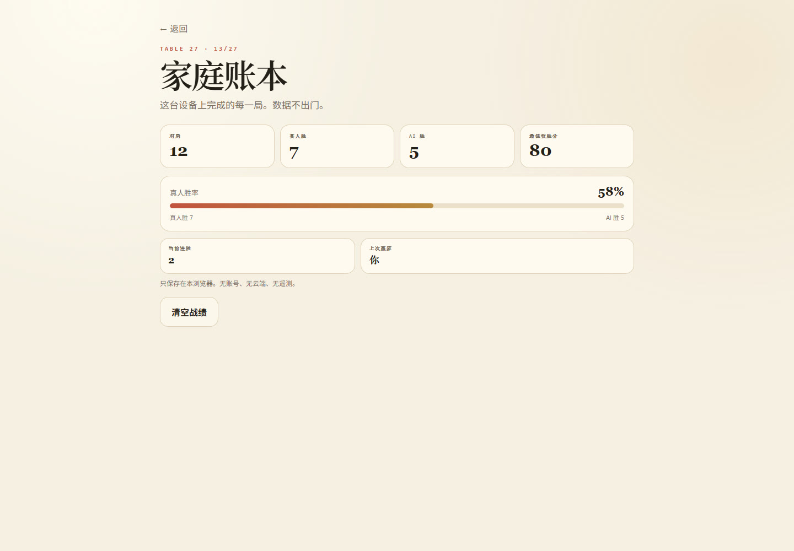
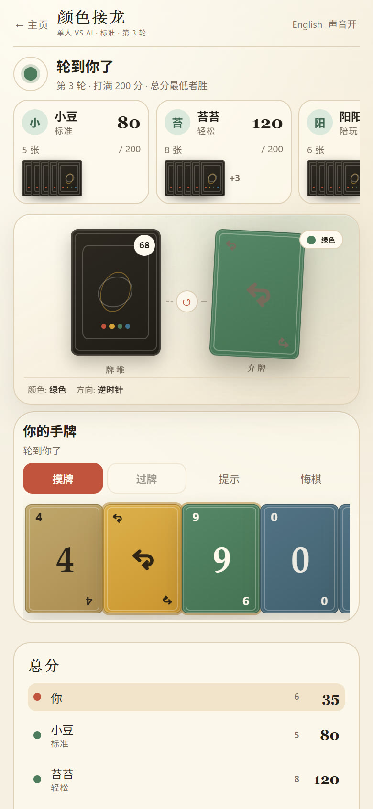

# 颜色接龙 · Color Chain

[English](README.md) · **简体中文**

> **接颜色，接数字，先出完手牌。**

给家庭牌桌的原创颜色数字出牌游戏：**2–6 人**、108 张牌、四档 AI、一台设备同屏轮流，
以及手机连同一 Wi-Fi 直接加入。默认离线，无账号、无广告、无远程素材。


[](docs/promo/color-chain-promo-zh.mp4)

*45 秒 · 1920×1080 · 60fps · [English cut](docs/promo/color-chain-promo-en.mp4) · [video.json](video.json)*

*[Family Arcade](../..) 第 13/27 款。网页 v0.1 + Tauri 外壳；截图全部来自真实运行的应用。*

## 一回合，五秒看懂

| 接牌 | 行动 | 结束 |
| --- | --- | --- |
| 打出颜色、数字或功能图案相同的牌；万能牌随时可出。也可以随时摸牌；摸牌后只能出摸到的那张。 | 跳过、反转、罚两张、万能、万能罚四。下一位可能失去回合或摸牌。 | 先出完手牌赢下本轮。总分到 200 时整局结束，**总分最低者获胜**。 |

## 里面有什么

- **真正的引擎。** `src/game/` 是纯 TypeScript，不碰 DOM、时钟、网络或 `Math.random`；
  每次洗牌都由外部注入 RNG。**39 个单元测试**覆盖牌组构成、接牌、四种功能牌、摸牌与
  洗回、计分、终局、并列、座位视图、局域网意图校验和 AI 安全性。
- **完整的 108 张牌。** 四色 0–9、跳过、反转、罚两张、万能、万能罚四。数字牌按点数计分，
  功能牌 20 分，万能牌 50 分。
- **四档 AI。** 陪玩对子手牌的小朋友温和；轻松会犯错；标准会数颜色、压手牌少的玩家；
  挑战会抽样猜测暗牌、按胜率出牌。四档都使用注入 RNG，可复现。
- **三种玩法。** 单人对抗 1–5 个 AI、2–6 人同屏轮流，或最多五个手机加入的局域网牌桌。
  同屏时只显示当前行动玩家的手牌；局域网访客只收到自己的私有视图。
- **小细节。** 带理由的提示、单人/同屏悔棋、自动保存/继续、本机家庭战绩、声音开关、
  减少动效开关、键盘路径（`1–9`、`D`、`P`、`H`、`U`、`Esc`）、完整中英双语和手机布局。
- **默认私密。** 无账号、无遥测、无广告、无 CDN、无远程字体、无下载美术。所有牌面、
  图标和纹理都由 CSS/SVG 绘制；音效在浏览器里合成。

## 截图

| 真实对局 | 带理由的提示 |
| --- | --- |
|  |  |

| 万能牌选色 | 终局 |
| --- | --- |
|  |  |

| AI 牌桌设置 | 规则 |
| --- | --- |
|  |  |

| 家庭战绩 | 手机对局 |
| --- | --- |
|  |  |

全部为真实截图：桌面 1440×1000，手机 390×844 @2×。英文截图在
[`docs/screenshots/en`](docs/screenshots/en)。

## 本地运行

```bash
npm install
npm run dev        # http://localhost:5192
npm run check      # tsc + 39 个测试 + 生产构建
npm run e2e        # 真实 Chrome，需先运行 npm run dev
npm run lan:e2e    # 可选的 host+guest 冒烟测试，需 dev + 中继（:8080）
npm run shots      # 重新生成 docs/screenshots/{en,zh}
```

`npm run e2e` 会走一遍单人局、摸牌/过牌、提示、悔棋、自动保存/继续、同屏、终局、
万能牌选色和手机布局，并输出 `E2E OK`。

## 局域网之夜

浏览器/开发版：

```bash
npm run build
npm run lan        # :8080 中继，同时托管 dist/
# 主机：打开 http://localhost:5192，选“局域网之夜”，开房间
# 访客：打开 :8080 提供的邀请链接
```

主机流程：**局域网之夜 → 选人数 → 开房间 → 分享 4 位房间码或二维码 → 开始发牌**。
空座位由标准 AI 补上；发牌前加入的访客占真人座位。已经开局后加入的访客可以接管 AI 座位；
访客掉线时，标准 AI 会接管该座位直到重连。

桌面版：Tauri 安装包会启动同一个内置中继，并把构建产物托管给手机。主机显示房间码和
二维码，访客无需安装。主机保存权威状态，为每个座位单独发送视图；访客只能发送出牌、
摸牌或过牌意图，主机逐步校验。提示由主机计算并私下发送。访客不能悔棋，也不能控制下一轮。

中继只负责转发消息；房间码、重连令牌、座位和回合校验都在 TypeScript 中完成。局域网仅支持
同一子网的 IPv4；主机防火墙需要放行中继端口。见 [`docs/limitations.md`](docs/limitations.md)。

## 构建 Windows 安装包

```bash
npm install
npx tauri build --bundles nsis
# src-tauri/target/release/bundle/nsis/Color Chain_0.1.0_x64-setup.exe
```

每款游戏单独打包，安装包保持轻量；WebView2 使用标准引导程序。Tauri 外壳保留在仓库中，
安装包由 Family Arcade 主流程统一构建。未签名的家庭构建会触发 Windows SmartScreen 提示。

## 规则与设计

- [`docs/rules.md`](docs/rules.md) — 完整规则审计、牌组表、计分、局域网模型和 AI 说明。
- [`docs/limitations.md`](docs/limitations.md) — 如实的 v0.1 限制。

家庭变体：不叠罚牌，不挑战万能罚四，不罚“最后一张”忘报。第一轮起始弃牌一定是数字牌。
这些都是有意选择。

任一总分达到目标（100/200/300）后整局结束，**总分最低者获胜**；并列最低则共享胜利。
家庭战绩保存在 `localStorage`：完成对局、真人/AI 胜场、最佳获胜分和当前连胜。

## 许可

Family Arcade 原创代码、牌面设计、文案与音效，MIT。见 [`NOTICE.md`](NOTICE.md) 和
[`LICENSE`](LICENSE)。UNO 是 Mattel 的商标；颜色接龙与 Mattel 无关，不使用 UNO 的美术或
商业外观。

## 宣传片

[](docs/promo/color-chain-promo-zh.mp4)

- [中文成片](docs/promo/color-chain-promo-zh.mp4) · [另一语言](docs/promo/color-chain-promo-en.mp4)
- [字幕](docs/promo/color-chain-promo-zh.srt) · [video.json](video.json)
- 画面来自真实应用与真实引擎数据；数字与测试一致。

