# Cribbage · 克里比奇

**English** · [简体中文](README.zh-CN.md)

> **Thirty-one, and a little luck.**

A warm, offline-first cribbage table for **2–4 players**: the full six-card two-player
game, a cut-throat five-card game for three or four, four computer levels, one-screen
hot-seat with private handoffs, and LAN play from a phone. First to **121** wins.

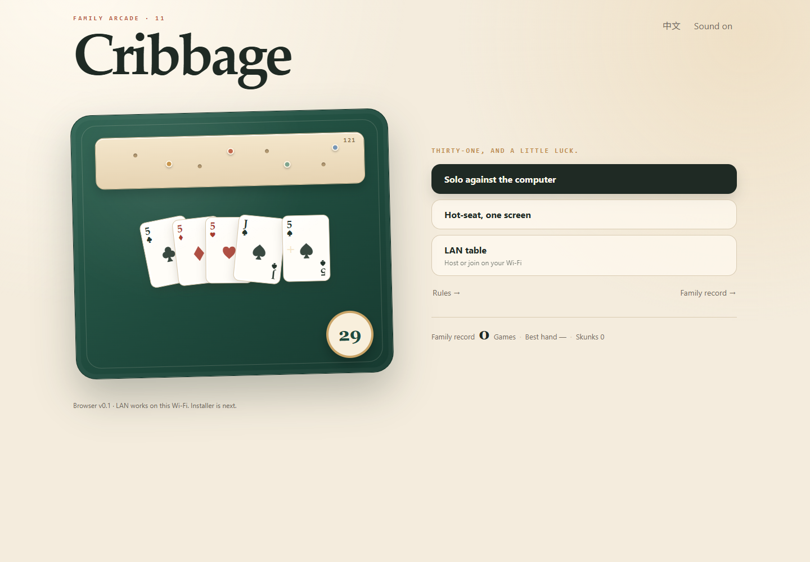

## A hand in five seconds

| Deal | Discard | Cut |
| --- | --- | --- |
| 2 players: 6 cards each. 3–4 players: 5 each. | Give 2 (or 1) face down to the dealer’s crib. | The pone cuts the starter; a Jack pays the dealer 2. |

| Peg | Show | Win |
| --- | --- | --- |
| Alternate cards. Score 15, 31, pairs and runs. | Count hands with the starter, then the dealer’s crib. | First to 121 wins at once; a skunk is below 91. |

## What is inside

- **A real, tested engine.** Pure TypeScript, deterministic from an injected deal seed,
  **37 unit tests**, and no DOM, network, clock or `Math.random` in the rules. See
  [`docs/rules.md`](docs/rules.md).
- **The whole scorecard.** Fifteens, pairs, triplets, quadruplets, runs, double runs,
  hand and crib flushes, his nobs, his heels, go/last card, 121 and skunks.
- **Four AI levels.** Companion plays kindly, Easy misses points, Normal counts the crib
  and pegs, Hard evaluates hand EV and pegging risk. AI decisions are deterministic from
  the deal seed and never read the other hands.
- **Three ways to play.** Solo against one to three computers, 2–4 people passing one
  device, or a LAN room with up to four seats.
- **Privacy that is real.** The engine exposes a per-seat view. LAN guests receive only
  their own hand, public pegging cards and scores; the stock order, other hands, the crib
  and the deal seed never leave the host. Hot-seat hides the hand behind a “pass the
  device” card between every private turn.
- **Small comforts.** Undo in solo/hot-seat, a hint that explains *why*, autosave and
  resume, a family record, sound toggle, reduced-motion support, a keyboard path (1–6,
  Enter, H, U, Esc) and a mobile layout built as a first-class way to play.
- **Private by default.** No accounts, cloud, ads, telemetry or remote assets.

## Screenshots

| A real game | Hint with a reason |
| --- | --- |
| 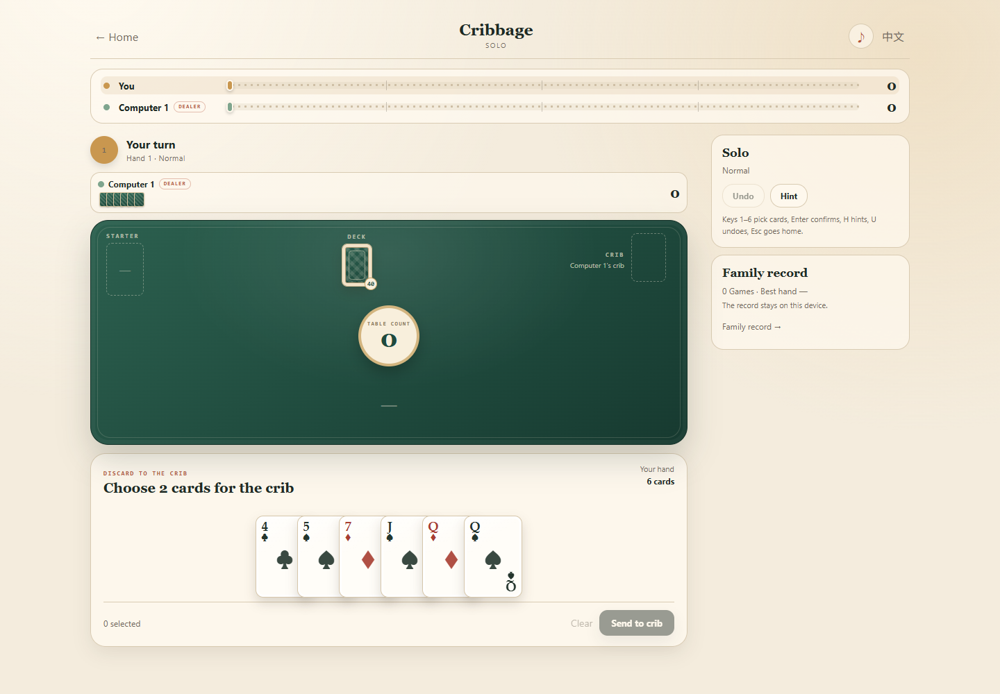 | 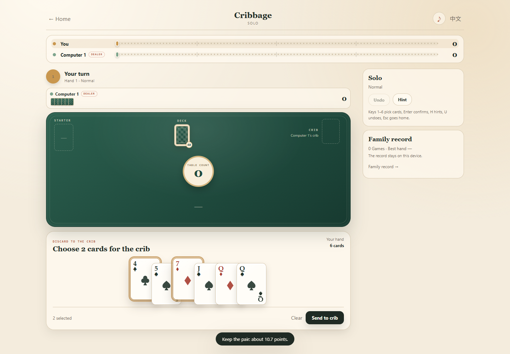 |

| Cut for the starter | Pegging |
| --- | --- |
| 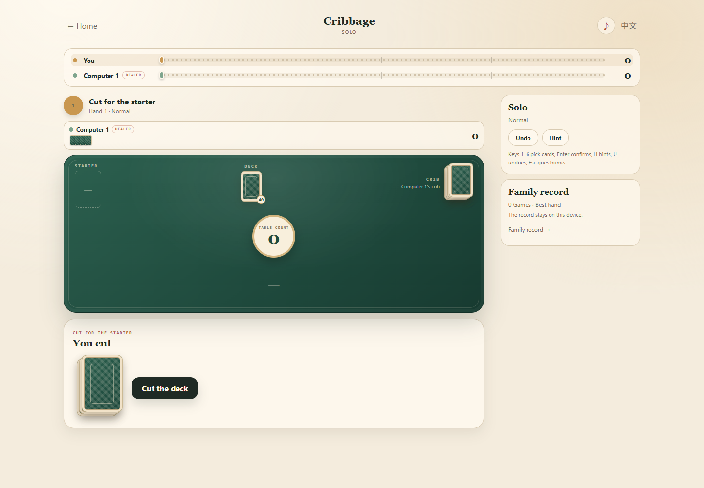 | 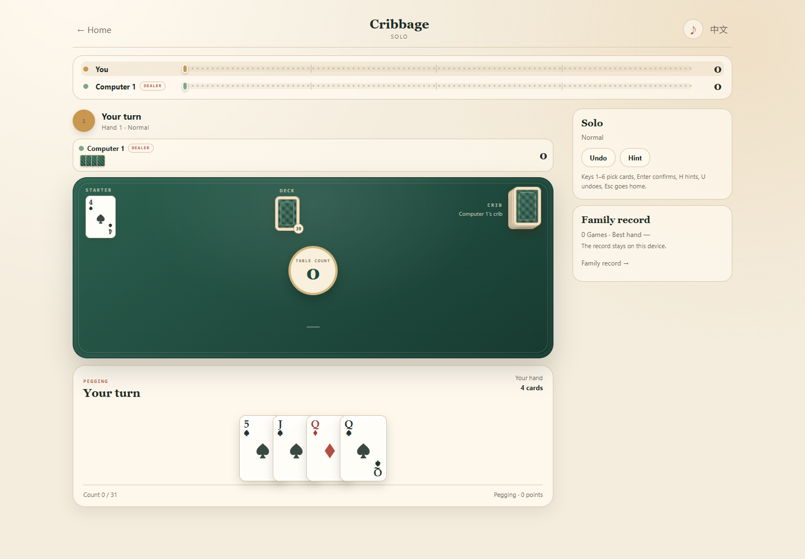 |

| The show | Result |
| --- | --- |
| 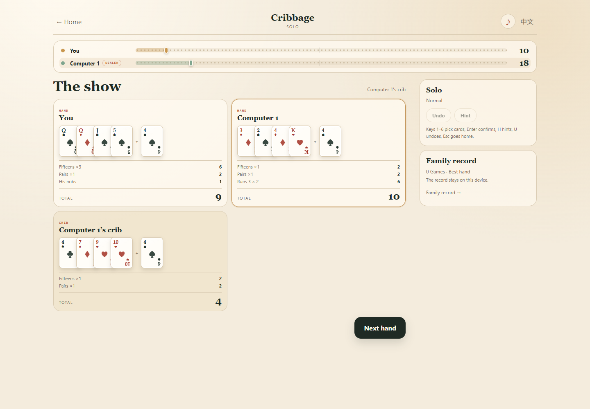 | 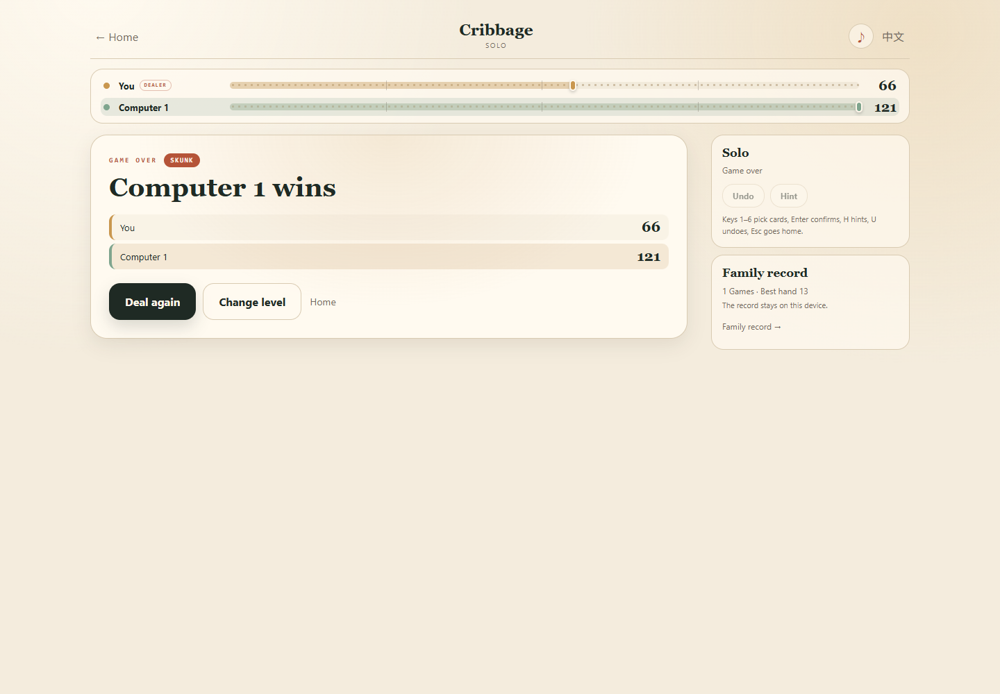 |

| Family record | Rules |
| --- | --- |
| 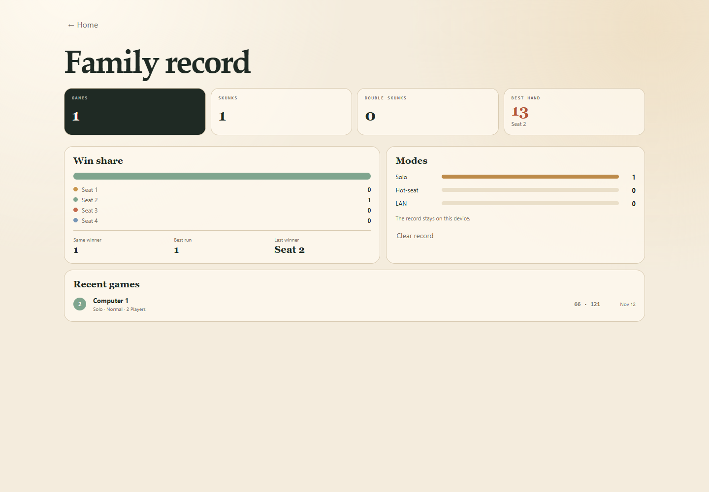 | 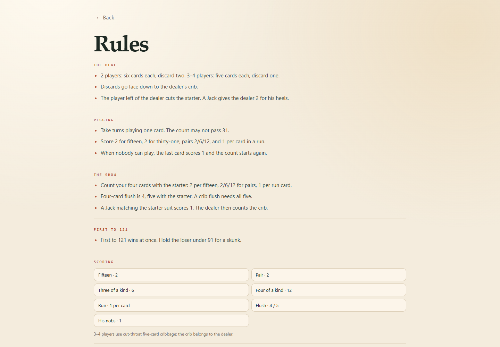 |

| LAN table | Phone game |
| --- | --- |
| 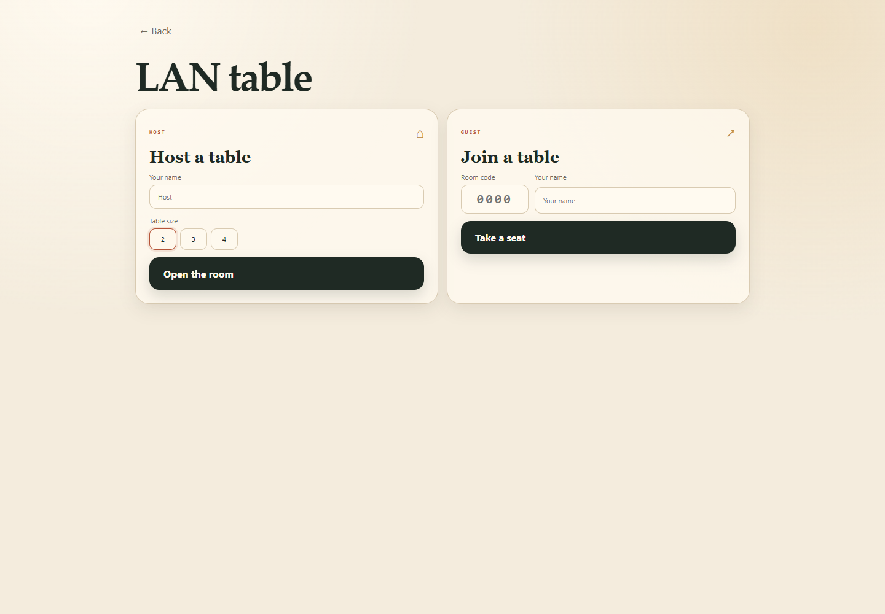 | 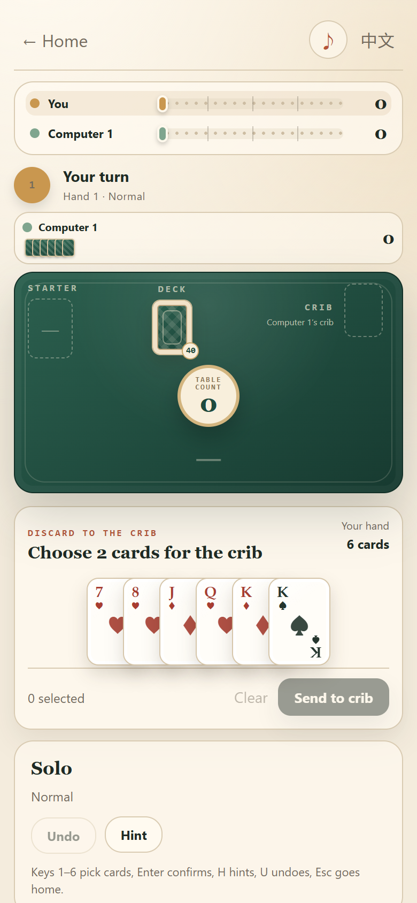 |

All screenshots are from the running app at 1440×1000 (phone 390×844 @2×), not mockups.

## Play locally

```bash
npm install
npm run dev        # http://localhost:5211
npm run check      # tsc + 37 tests + production build
npm run e2e        # real Chrome, dev server required
npm run lan:e2e    # starts its own relay on :8080 after a build; dev server required
npm run shots      # regenerate the EN/ZH screenshots (dev server required)
```

## LAN night

Browser/dev:

```bash
npm run build
npm run lan        # relay on :8080, serves dist/
# open http://localhost:5211, LAN table, Open the room
# guest: scan the QR, open the invite, or type the four-digit code
```

The room supports 2–4 seats. The host waits for every guest before dealing. The relay is a
dumb message bus: the host owns the authoritative state, sends each guest only
`view(state, seat)`, and rechecks every intent. A guest can reload and rejoin the same seat
because the reconnect token is kept in local storage. The result, the crib, the stock and
the deal seed stay on the host device.

Desktop: the Tauri build starts the same relay internally and serves the built app to
phones. Guests need no installation; they open the LAN address on the same Wi-Fi.

## Build the Windows installer

```bash
npm install
npx tauri build --bundles nsis
# src-tauri/target/release/bundle/nsis/Cribbage_0.1.0_x64-setup.exe
```

The installer is per-game and lightweight; WebView2 uses the standard bootstrapper. A
Windows SmartScreen warning is expected for an unsigned family build. The main build
centre runs the Tauri build; this app only keeps the shell wired.

## Rules and honest limits

The full rule audit, scoring edge cases and LAN privacy model are in
[`docs/rules.md`](docs/rules.md). Known gaps are in
[`docs/limitations.md`](docs/limitations.md).

- **2 players:** standard six-card cribbage, two discards each.
- **3–4 players:** cut-throat five-card cribbage, one discard each; every player keeps
  their own score and the crib belongs to the dealer. The four-player partnership game is
  not included.
- **No muggins:** the app counts every point; nobody can steal a missed point.
- **LAN** is IPv4 on one subnet and needs the host firewall to allow the app. A browser
  QR may contain `localhost`; use the desktop build or the host’s LAN IP for phones.
- **Stats** stay on each device. A LAN game is recorded on the host, never duplicated on a
  guest. The record mixes modes, so its seat labels are intentionally generic.
- **Promo:** the 45-second bilingual promo is rendered centrally by the root studio from
  [`video.json`](video.json); this app ships the manifest and real screenshots.

## Credits

Original code, CSS card art and copy for Family Arcade. Cribbage is a public-domain
traditional game. MIT. See [`NOTICE.md`](NOTICE.md).
