# 克里比奇

[English](README.md) · **简体中文**

> **凑到三十一，也碰一点运气。**

给家庭牌桌的离线克里比奇：**2–4 人**，完整的两人六张牌玩法，三至四人的五人制
各自计分玩法，四档电脑，同屏热座带私密传牌，以及手机浏览器直接加入的局域网牌桌。
先到 **121** 分者获胜。

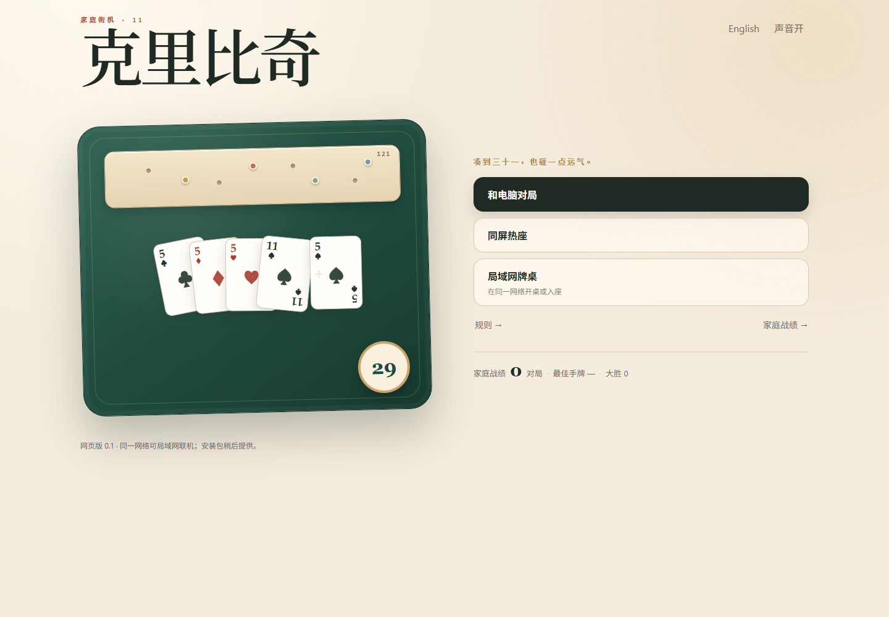

## 一手牌，五秒看懂

| 发牌 | 弃牌 | 切牌 |
| --- | --- | --- |
| 两人各 6 张；三至四人各 5 张。 | 两人弃 2 张，三至四人弃 1 张，面朝下进庄家弃牌堆。 | 庄家左手边切起始牌；切到 11 时庄家得 2 分。 |

| 出牌 | 摊牌 | 获胜 |
| --- | --- | --- |
| 轮流出牌，抢十五、三十一、对子和顺子。 | 手牌加起始牌计数，庄家最后数弃牌堆。 | 先到 121 分立即获胜；让对手低于 91 分是大胜。 |

## 里面有什么

- **真正的引擎。** 纯 TypeScript、由注入的发牌种子决定、**37 个单元测试**；规则层
  不碰 DOM、网络、时钟或随机数。见 [`docs/rules.md`](docs/rules.md)。
- **完整的计分。** 十五、对子、三张、四张、顺子、双顺、手牌与弃牌堆同花、配花、
  切到 11、过牌与最后一牌、121 分和大胜。
- **四档电脑。** 陪玩温和，轻松会漏分，标准会算弃牌堆也会抢分，挑战会算手牌期望与
  出牌风险。电脑的决定由发牌种子确定，也不会偷看别家的手牌。
- **三种玩法。** 单人对抗一至三个电脑、2–4 人同屏传递设备，或 2–4 个座位的局域网
  牌桌。
- **真正的隐私。** 引擎只提供每个座位自己的视图。局域网访客只会收到自己的手牌、
  公开的出牌和分数；牌堆顺序、别家手牌、弃牌堆和发牌种子都留在主机。热座模式在
  每个私密回合之间都会盖上“请传递设备”的挡板。
- **小细节。** 单人和热座可悔牌，提示会解释原因，自动保存/继续，家庭战绩，声音开关，
  减少动效，键盘路径（1–6、回车、提示、悔牌、返回），以及按手机优先设计的布局。
- **默认私密。** 无账号、无云、无广告、无遥测、无远程素材。

## 截图

| 真实对局 | 带原因的提示 |
| --- | --- |
| 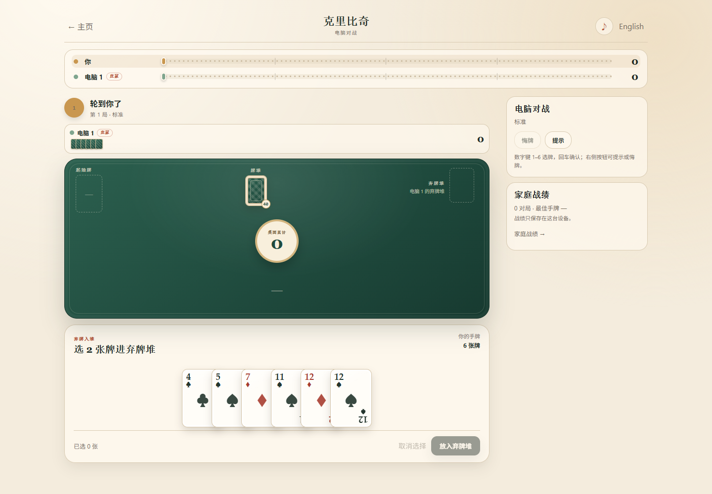 | 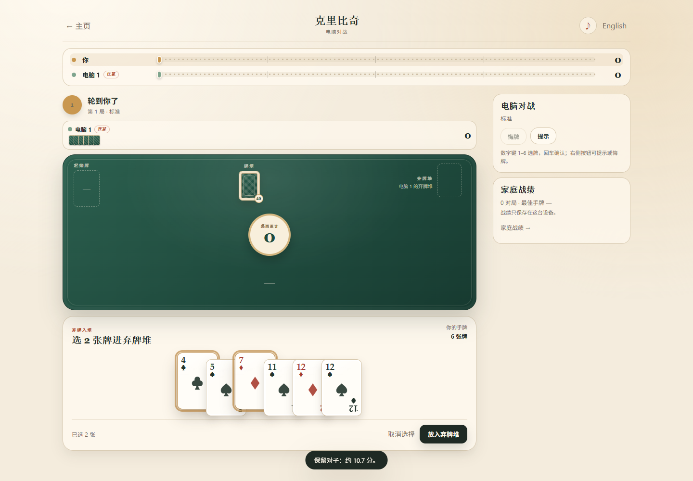 |

| 切起始牌 | 出牌计分 |
| --- | --- |
| 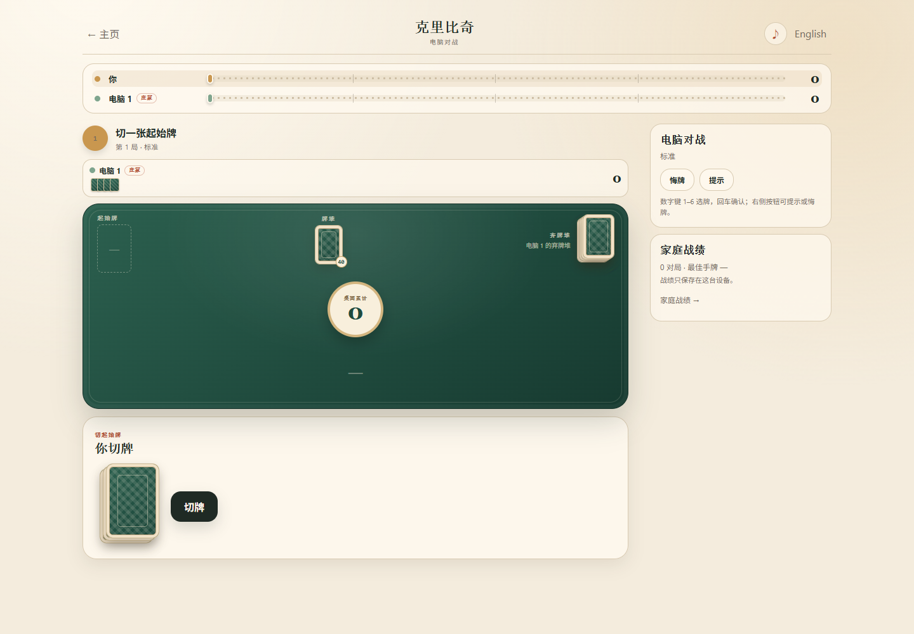 | 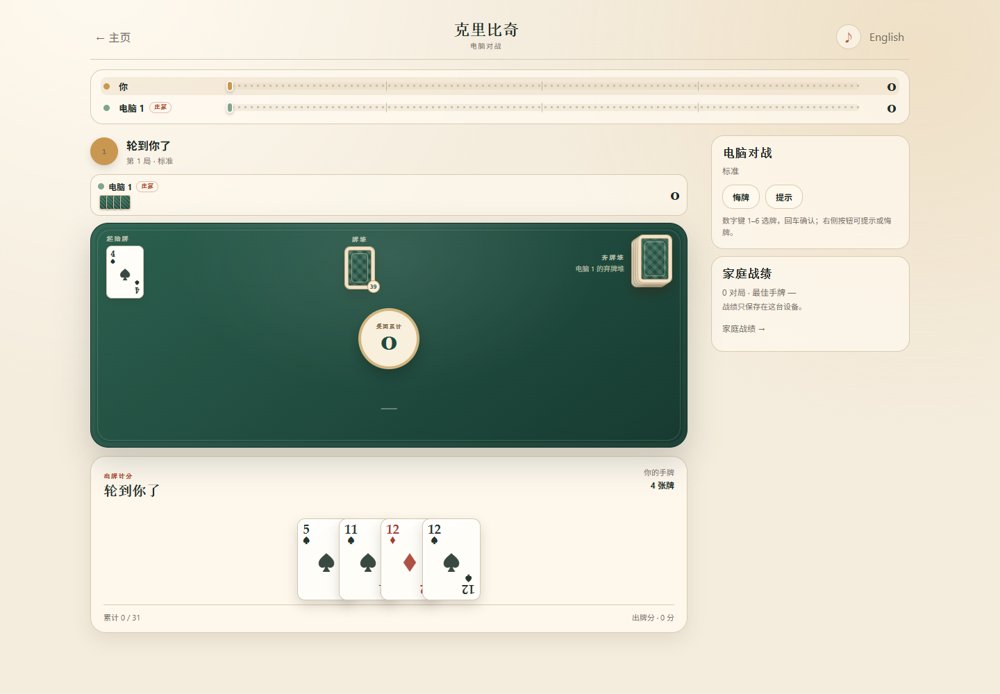 |

| 摊牌计数 | 牌局结束 |
| --- | --- |
| 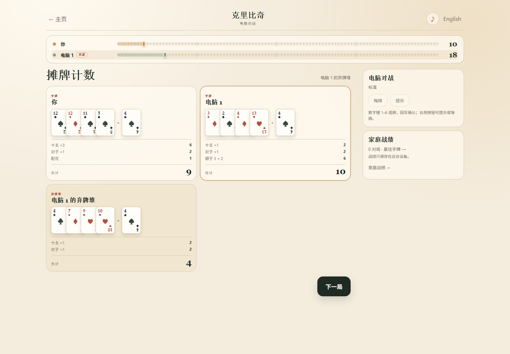 | 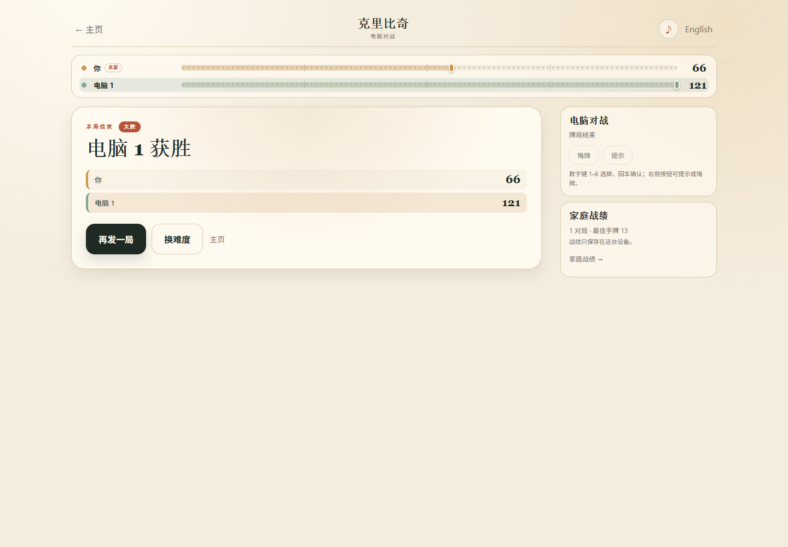 |

| 家庭战绩 | 规则 |
| --- | --- |
| 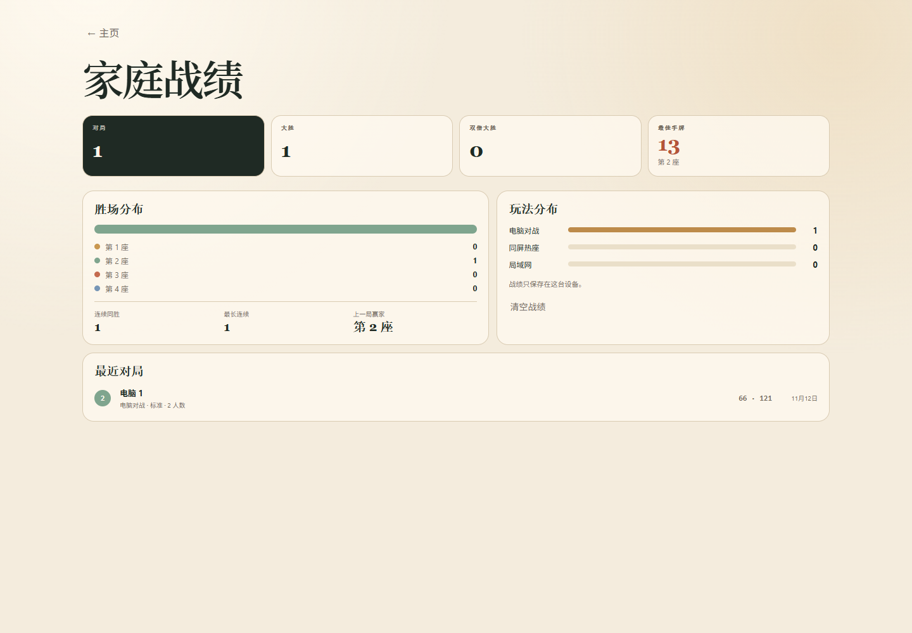 | 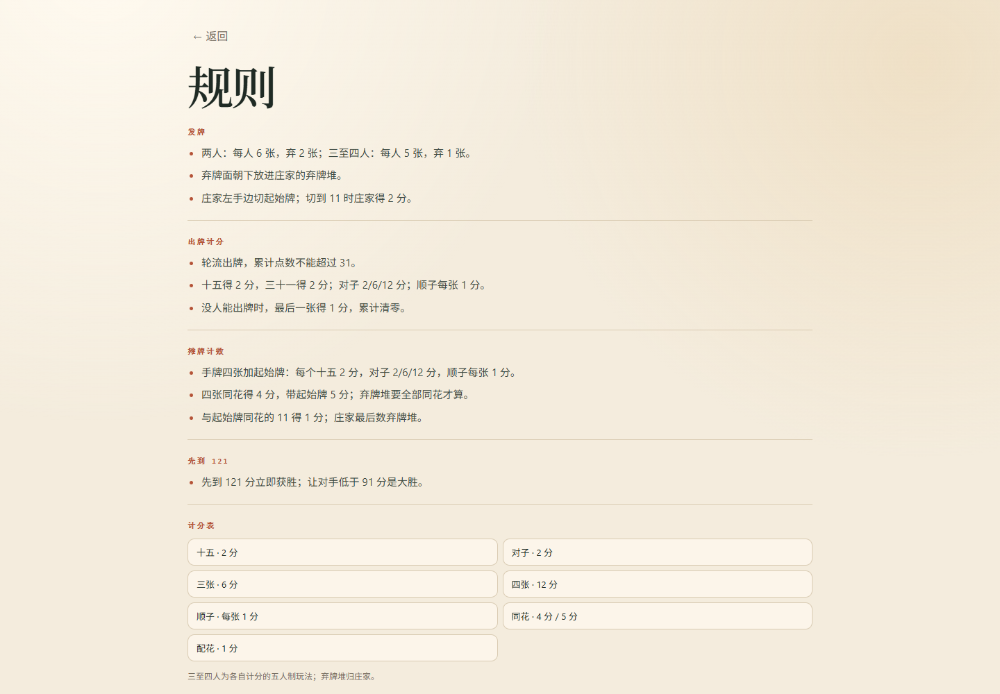 |

| 局域网牌桌 | 手机对局 |
| --- | --- |
| 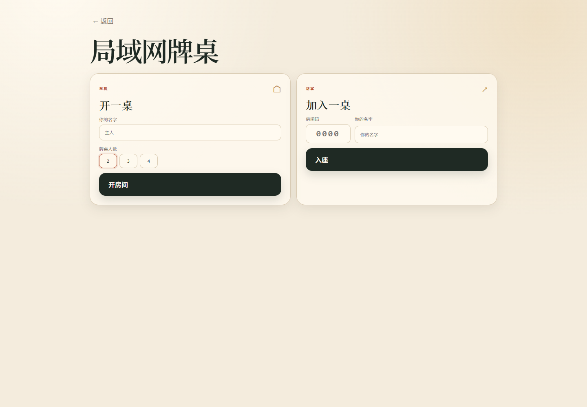 | 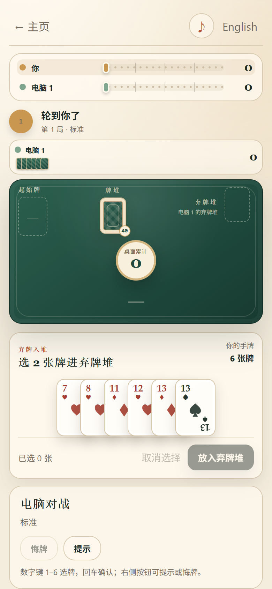 |

全部来自真实运行的应用：1440×1000，手机 390×844 @2×，不是效果图。

## 本地运行

```bash
npm install
npm run dev        # http://localhost:5211
npm run check      # tsc + 37 个测试 + 生产构建
npm run e2e        # 真实 Chrome，需先运行 dev
npm run lan:e2e    # 构建后自动在 :8080 启动中继并跑局域网流程，需先运行 dev
npm run shots      # 重新生成中英截图，需先运行 dev
```

## 局域网

浏览器/开发版：

```bash
npm run build
npm run lan        # :8080 中继，同时托管 dist/
# 打开 http://localhost:5211，选“局域网牌桌”→“开房间”
# 访客：扫码、打开邀请，或直接输入四位房间码
```

房间支持 2–4 个座位。主机等所有座位到齐后再发牌。中继只负责转发消息；主机保存权威
状态，只给每位访客发送 `view(state, seat)`，并重新校验每一条意图。访客刷新后会凭
本地保存的重连令牌回到原座位，主机会补发当前视图。牌局结果、弃牌堆、牌堆和发牌种子
都不会离开主机。

桌面版：Tauri 安装包启动同一个内置中继，并把构建产物托管给手机。访客无需安装，在
同一网络打开主机地址即可。

## 构建 Windows 安装包

```bash
npm install
npx tauri build --bundles nsis
# src-tauri/target/release/bundle/nsis/Cribbage_0.1.0_x64-setup.exe
```

每款游戏单独打包，安装包保持轻量；WebView2 使用标准引导程序。未签名的家庭构建会
触发 Windows SmartScreen 提示。安装包由主构建中心统一生成；本应用只保留 Tauri 壳。

## 规则与已知限制

完整规则审计、计分边界和局域网隐私模型见 [`docs/rules.md`](docs/rules.md)，已知缺口见
[`docs/limitations.md`](docs/limitations.md)。

- **两人：** 标准六张牌克里比奇，各弃 2 张。
- **三至四人：** 五人制各自计分玩法，各弃 1 张；每人记自己的分，弃牌堆归庄家。
  四人伙伴制不在本版内。
- **没有“抓漏分”：** 应用会自动数清所有分数，不能抢别人漏掉的分数。
- **局域网**限同一子网的 IPv4，手机访客需要主机防火墙放行。浏览器开房生成的二维码
  可能带 `localhost`；手机加入请用桌面版或主机局域网地址。
- **战绩**按设备保存。局域网对局记在主机，不会在访客设备重复记录。战绩跨玩法保存，
  所以座位标签保持通用。
- **宣传片：** 45 秒中英宣传片由根目录工作室根据 [`video.json`](video.json) 统一渲染；
  本应用提供清单和真实截图。

## 许可

Family Arcade 原创代码、CSS 纸牌美术与文案。克里比奇是公有领域传统游戏。MIT。
见 [`NOTICE.md`](NOTICE.md)。
