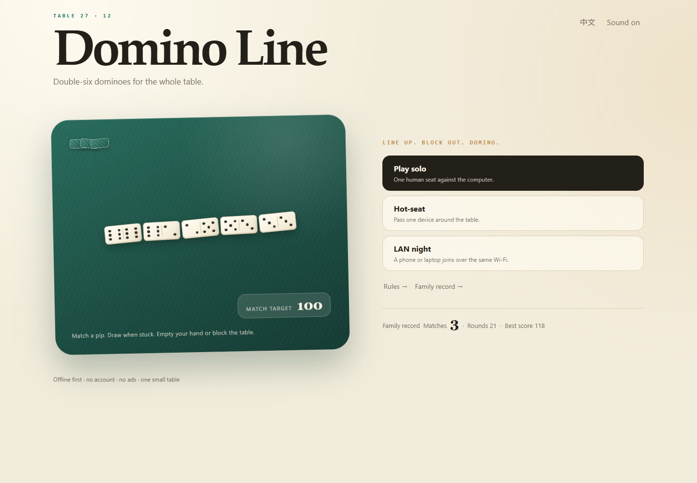
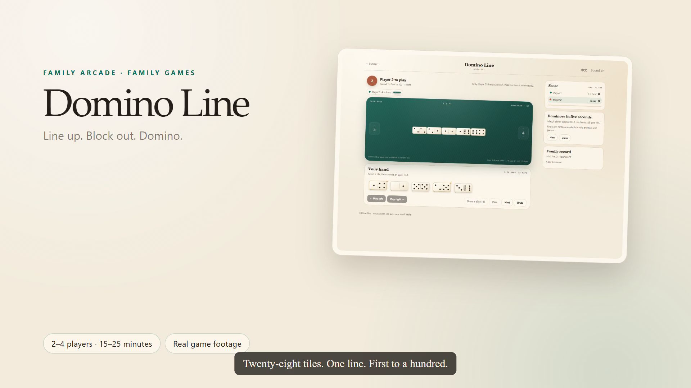
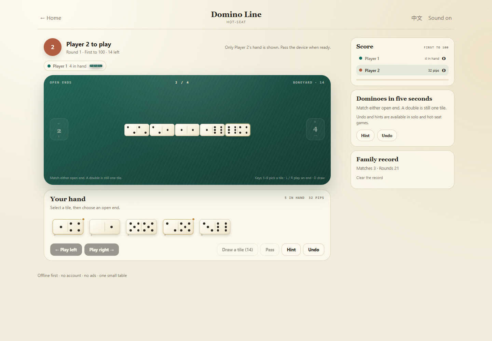
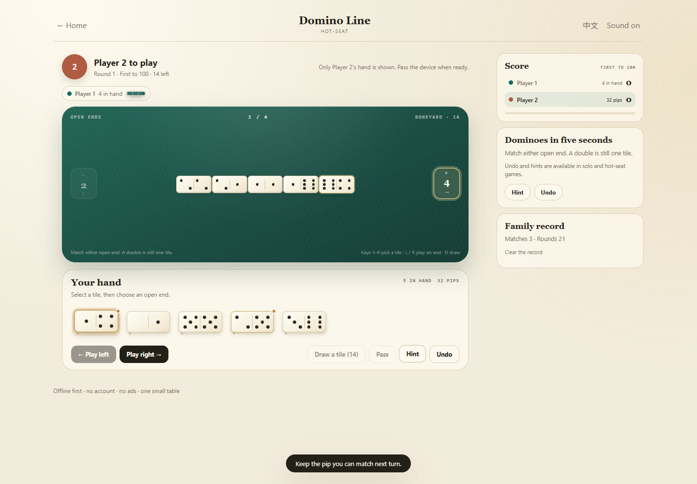
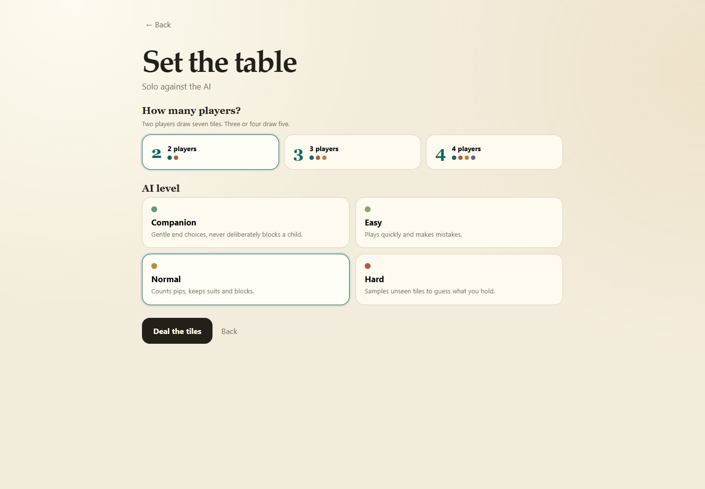
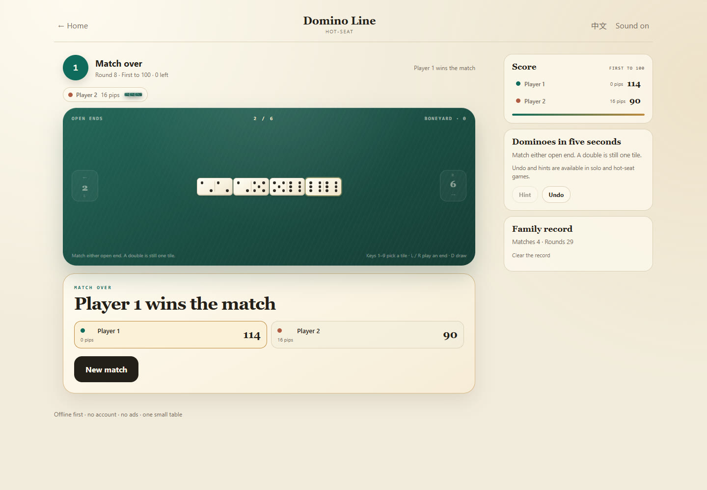
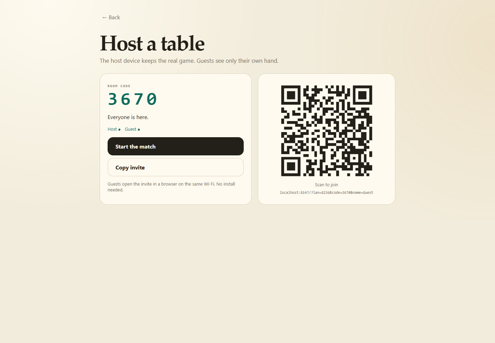
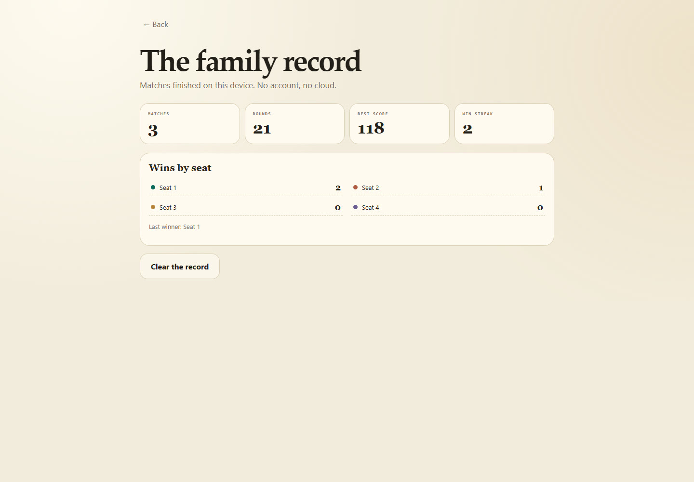
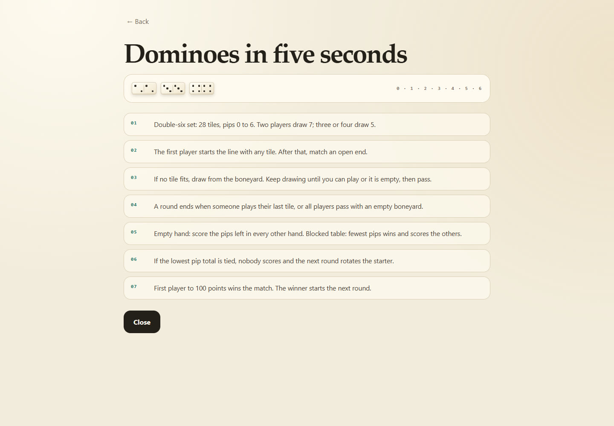
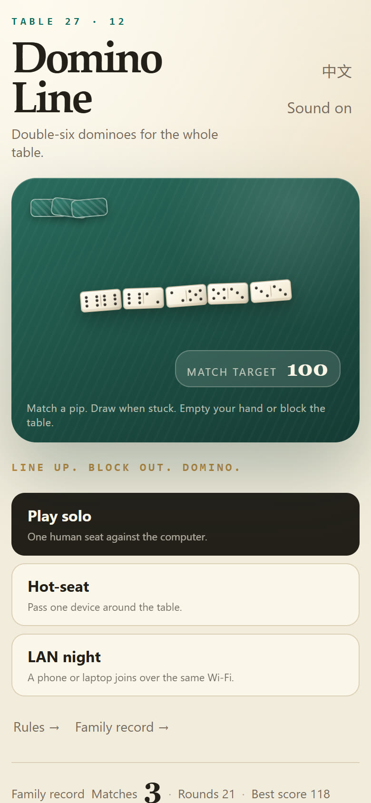

# Domino Line · 多米诺

**English** · [简体中文](README.zh-CN.md)

> **Line up. Block out. Domino.**

Block dominoes for **2–4 players**: a double-six set, a 100-point match, four AI
levels, hot-seat around one device, and LAN night from a phone. Offline first, no
account, no ads, no remote fonts.



[](docs/promo/domino-line-promo-en.mp4)

*45 seconds · 1920×1080 · 60 fps · [中文版](docs/promo/domino-line-promo-zh.mp4) · [video.json](video.json)*

## A turn, in five seconds

| Match | Draw | Score |
| --- | --- | --- |
| The first player starts the line with any tile. After that, match either open end. | No tile fits? Draw from the boneyard until you can play or it is empty, then pass. | Empty your hand and score every other hand’s pips. A blocked table goes to the fewest pips. First to 100 wins the match. |

Doubles are ordinary tiles on the line. Two players draw seven; three or four draw
five. If the lowest pip total is tied on a blocked table, nobody scores and the
starter rotates.

## What is inside

- **A real, tested engine.** Pure TypeScript in `src/game/domino.ts`, with no DOM,
  network, clock or `Math.random`. **43 unit tests** cover the 28-tile deck, dealing,
  legal ends, doubles, drawing, passing, empty-hand and blocked scoring, the
  100-point boundary, seat views, round rotation and every AI level.
- **Four deterministic AI levels.** **Companion** leaves friendly ends and avoids
  deliberately blocking a child. **Easy** plays fast and makes mistakes. **Normal**
  counts pips, keeps matching suits and blocks. **Hard** samples the unseen tiles to
  estimate opponent replies. All take an injected RNG.
- **Three ways to play.** Solo with 1 human and 1–3 AI seats, hot-seat for 2–4
  humans, or LAN host/guest for 2–4 devices. Only the active player’s hand is drawn
  in hot-seat; each LAN guest gets a per-seat view.
- **LAN night.** Host a room, show the QR invite, and a phone joins from its browser
  on the same Wi-Fi. The host owns the authoritative state; guests send intents only.
- **Small comforts.** Hint with a reason, undo in solo/hot-seat, autosave/resume,
  local family record, sound toggle, keyboard play, reduced-motion support, complete
  Chinese/English UI and a phone layout.
- **Private by default.** No accounts, telemetry, ads, CDN or downloaded art/assets.

## Screenshots

All screenshots are taken from the running app at **1440×1000**; phone shots are
**390×844 at 2×** (780×1688).

| A real line | Hint with a reason |
| --- | --- |
|  |  |

| AI setup | Match won |
| --- | --- |
|  |  |

| LAN host | Family record |
| --- | --- |
|  |  |

| Rules | Phone |
| --- | --- |
|  |  |

The Chinese set lives in [`docs/screenshots/zh`](docs/screenshots/zh).

## Play locally

```bash
npm install
npm run dev        # http://localhost:5191
npm run check      # tsc + 43 tests + production build
npm run e2e        # real Chrome, dev server required
npm run e2e:lan    # two browser contexts through a real relay
npm run shots      # regenerate docs/screenshots/{en,zh}
```

`npm run e2e` walks a real hot-seat round, hint, undo, next round, autosave and
reload, a solo AI reply, a seeded 100-point finish and the mobile layout. See
[`docs/rules.md`](docs/rules.md) for the rule audit.

## LAN night

Browser/dev:

```bash
npm run build
npm run lan        # relay + built app on :8080
# host: npm run dev -> http://localhost:5191 -> LAN night -> Open a room
# guest: open the shown URL, or scan the QR code
```

Desktop: the Tauri shell starts the same relay internally and serves the built app
to phones. The host shows a 4-digit room code and a QR invite; guests need no
install. The host is authoritative and sends each guest only that seat’s hand.

If port 8080 is already busy during development, run the relay on another port and
tell the host page about it:

```bash
node ../../tools/lan-server.mjs --dist dist --port 8147
# host: http://localhost:5191/?lanPort=8147
```

The LAN screenshot above was taken this way at 1440×1000. `npm run e2e:lan` checks
the full host/guest path with two browser contexts (and starts a relay on 8147 if
one is not already serving this app).

## Build the Windows installer

```bash
npm install
npx tauri build --bundles nsis
# src-tauri/target/release/bundle/nsis/Domino Line_0.1.0_x64-setup.exe
```

The installer is per-game and lightweight; WebView2 uses the standard bootstrapper.
A Windows SmartScreen warning is expected for an unsigned family build. The shared
Family Arcade pipeline builds all installers centrally.

## Known limitations

- Standard block dominoes only: no spinner, muggins, all-fives or partnership
  variants. The first tile is free rather than “highest double starts”.
- No teams, spectators, cloud saves or matchmaking.
- LAN is same-subnet IPv4; the host page must stay open, and the 4-digit room code
  keeps honest family members out, not a determined attacker.
- Undo and hints are intentionally unavailable to LAN guests (hidden information
  and host authority).
- Hard is a strong sampling opponent, not a perfect solver.
- The browser build needs the relay for LAN; the Tauri shell supplies it.

See [`docs/limitations.md`](docs/limitations.md).

## Credits

Original code, CSS-drawn dominoes and copy for Family Arcade. The double-six mechanic is
public domain; this implementation, name and visual design are original. MIT. See
[`NOTICE.md`](NOTICE.md) and [`LICENSE`](LICENSE).

## Promo

[](docs/promo/domino-line-promo-en.mp4)

- [English cut](docs/promo/domino-line-promo-en.mp4) · [other language](docs/promo/domino-line-promo-zh.mp4)
- [SRT](docs/promo/domino-line-promo-en.srt) · [video.json](video.json)
- Real app screenshots and real engine data; claims match the tests.

