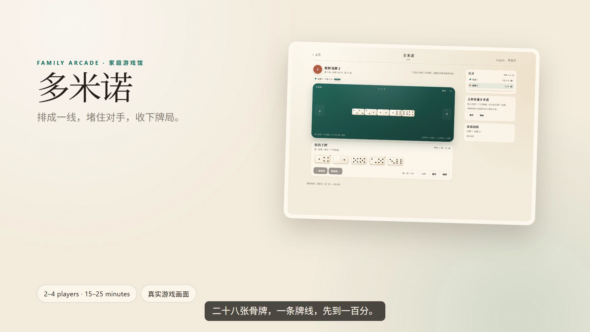
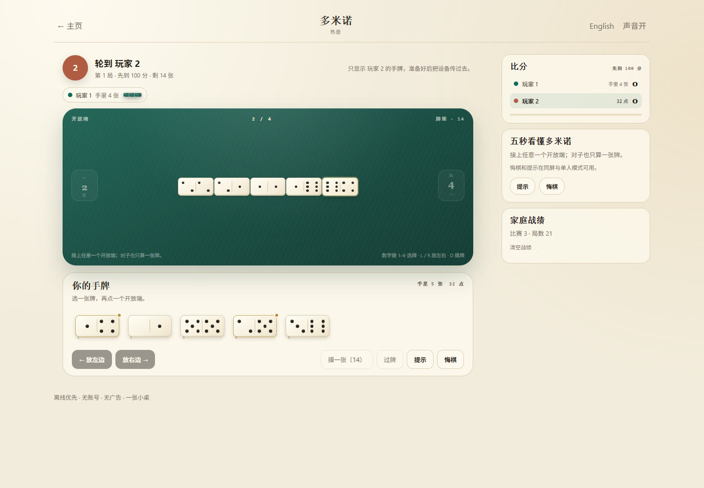
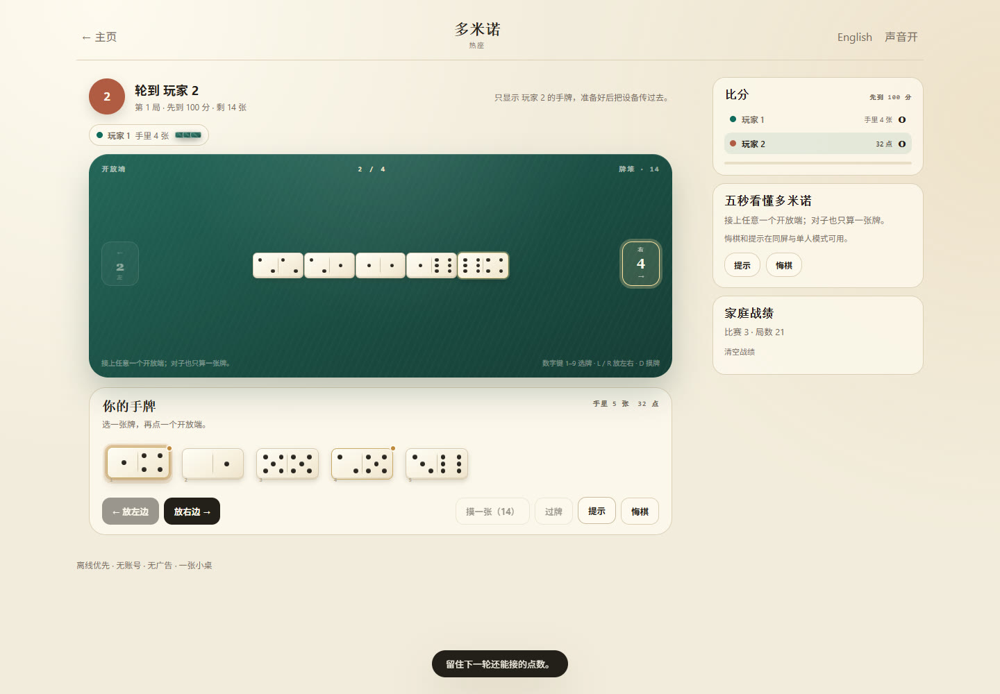
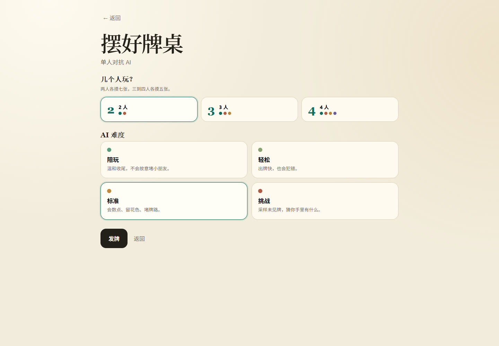
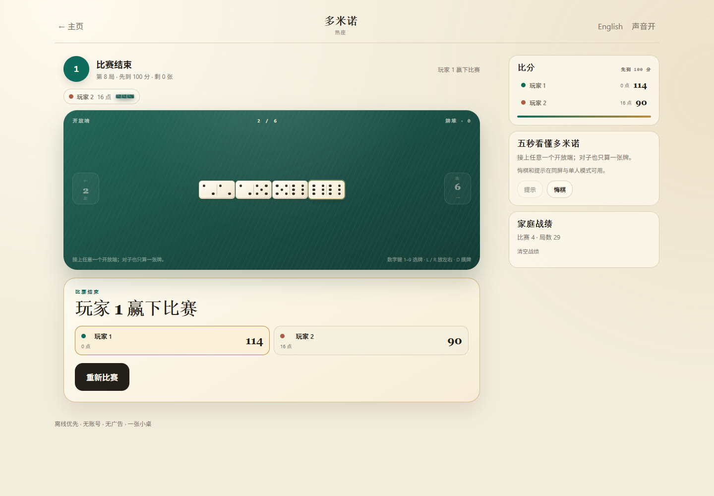
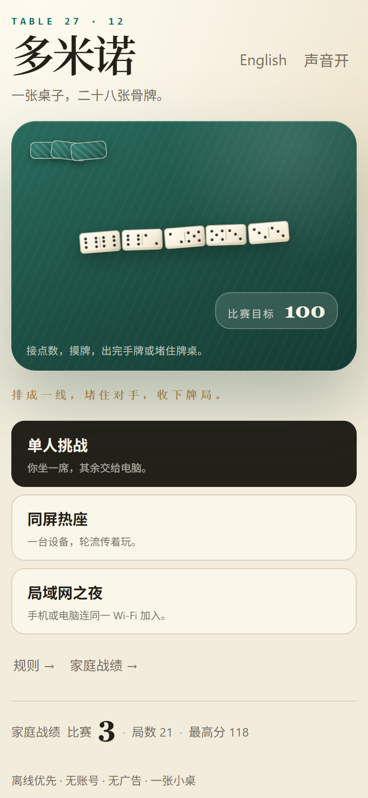

# 多米诺 · Domino Line

[English](README.md) · **简体中文**

> **排成一线，堵住对手，收下牌局。**

适合 **2–4 人**的接龙多米诺：一副双六骨牌、100 分制比赛、四档 AI、一台设备
轮流传着玩的同屏热座，以及手机浏览器直接加入的局域网之夜。离线优先，无账号、
无广告、无远程字体。


[](docs/promo/domino-line-promo-zh.mp4)

*45 秒 · 1920×1080 · 60fps · [English cut](docs/promo/domino-line-promo-en.mp4) · [video.json](video.json)*

## 一回合，五秒看懂

| 接牌 | 摸牌 | 计分 |
| --- | --- | --- |
| 首家可用任意一张牌开局，之后接在任意一个开放端上。 | 没牌能接时从牌堆摸，直到能出或牌堆空，然后过牌。 | 出完手牌，赢家得到其他所有手牌的点数。牌桌堵死时点数最少者胜。先到 100 分赢下比赛。 |

对子就是普通的一张牌。两人各摸 7 张，三到四人各摸 5 张。牌桌堵死且最低点数
打平时无人得分，下一局轮换首家。

## 里面有什么

- **真正的引擎。** `src/game/domino.ts` 纯 TypeScript，不碰 DOM、网络、时钟或
  `Math.random`。**43 个单元测试**覆盖 28 张骨牌、发牌、合法端点、对子、摸牌、
  过牌、出完手牌与堵桌计分、100 分边界、座位视图、局数轮换和四档 AI。
- **四档确定性 AI。** **陪玩**会把牌路留在小朋友容易接的一端，不故意堵人；
  **轻松**出牌快也会犯错；**标准**会数点、留花色、堵牌路；**挑战**会采样未见牌
  来估计对手的应对。全部使用注入式随机数。
- **三种玩法。** 单人（1 名人类 + 1–3 个 AI）、2–4 人同屏热座，以及 2–4 台设备
  的局域网主机/访客。热座只显示当前玩家的手牌；局域网每个访客只收到自己的座位
  视图。
- **局域网之夜。** 开房间、显示二维码，手机浏览器在同一 Wi-Fi 下直接加入。主机
  保存权威状态，访客只发操作意图。
- **小细节。** 带理由的提示、单人/热座悔棋、自动保存/继续、本机家庭战绩、声音
  开关、数字键操作、减少动效、完整中英双语、手机布局。
- **默认私密。** 无账号、无遥测、无广告、无 CDN、无下载素材。

## 截图

全部来自真实运行的应用：桌面 **1440×1000**，手机 **390×844 @2×**（780×1688）。

| 真实牌局 | 带理由的提示 |
| --- | --- |
|  |  |

| AI 设置 | 赢下比赛 |
| --- | --- |
|  |  |

| 局域网主机 | 家庭战绩 |
| --- | --- |
|  |  |

| 规则 | 手机 |
| --- | --- |
|  |  |

英文截图在 [`docs/screenshots/en`](docs/screenshots/en)。

## 本地运行

```bash
npm install
npm run dev        # http://localhost:5191
npm run check      # tsc + 43 个测试 + 生产构建
npm run e2e        # 真实 Chrome，需先运行 dev
npm run e2e:lan    # 两个浏览器上下文走真实中继
npm run shots      # 重新生成 docs/screenshots/{en,zh}
```

`npm run e2e` 会走一遍真实热座对局：提示、悔棋、完整一局、下一局、自动保存与
刷新继续、单人 AI 应对、种子化的 100 分终局，以及手机布局。规则审计见
[`docs/rules.md`](docs/rules.md)。

## 局域网

浏览器/开发版：

```bash
npm run build
npm run lan        # 中继 + 构建产物，端口 :8080
# 主机：npm run dev -> http://localhost:5191 -> 局域网之夜 -> 开房间
# 访客：打开显示的地址，或直接扫码
```

桌面版：Tauri 安装包启动同一个内置中继，并把构建产物托管给手机。主机显示 4 位
房间码和二维码；访客无需安装。主机权威，只把每个访客自己的手牌发过去。

如果开发时 8080 已被占用，可以换一个端口并告诉主机页面：

```bash
node ../../tools/lan-server.mjs --dist dist --port 8147
# 主机打开：http://localhost:5191/?lanPort=8147
```

上面的局域网截图就是这样在 1440×1000 下拍的。`npm run e2e:lan` 会用两个浏览器
上下文走完整的开房/加入/出牌流程（若 8147 没有中继会自动启动一个）。

## 构建 Windows 安装包

```bash
npm install
npx tauri build --bundles nsis
# src-tauri/target/release/bundle/nsis/Domino Line_0.1.0_x64-setup.exe
```

每款游戏单独打包，安装包保持轻量；WebView2 使用标准引导程序。未签名的家庭构建会
触发 Windows SmartScreen 提示。Family Arcade 的共享流水线会集中构建全部安装包。

## 已知限制

- 只实现标准堵桌多米诺：没有 spinner、muggins、all-fives 或组队变体。首家自由
  开局，而不是“最大对子先手”。
- 没有组队、观战、云存档或匹配。
- 局域网仅支持同一子网的 IPv4；主机页面必须保持打开；4 位房间码只能挡住诚实的
  家人，挡不住同网段的攻击者。
- 局域网访客刻意不能悔棋或使用提示（隐藏信息 + 主机权威）。
- 挑战档是强力的采样 AI，不是完美解算器。
- 浏览器版局域网需要中继；Tauri 壳内置中继。

见 [`docs/limitations.md`](docs/limitations.md)。

## 许可

Family Arcade 原创代码、CSS 绘制的骨牌与文案。双六机制属于公共领域；本实现、名称与
视觉设计为原创。MIT。见 [`NOTICE.md`](NOTICE.md) 与 [`LICENSE`](LICENSE)。

## 宣传片

[](docs/promo/domino-line-promo-zh.mp4)

- [中文成片](docs/promo/domino-line-promo-zh.mp4) · [另一语言](docs/promo/domino-line-promo-en.mp4)
- [字幕](docs/promo/domino-line-promo-zh.srt) · [video.json](video.json)
- 画面来自真实应用与真实引擎数据；数字与测试一致。

