# Dou Dizhu

**English** · [简体中文](README.zh-CN.md)

> **One landlord. Two farmers. Fifty-four cards.**

Three-player Dou Dizhu for the family table: a real 54-card engine, the full
combination ladder, 1/2/3 bidding, bombs, rockets and spring, four AI levels,
three-player hot-seat with privacy covers, and a per-seat LAN table. No accounts,
ads, telemetry or remote assets.

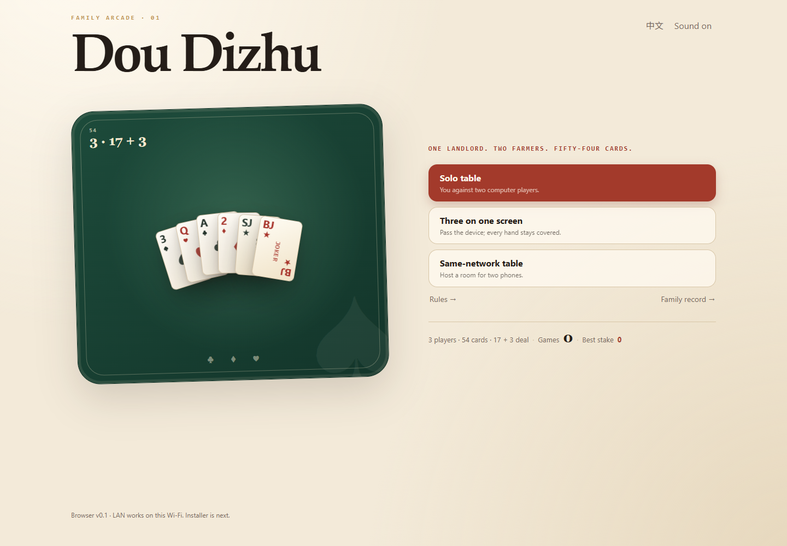

## A turn in five seconds

| Deal | Bid | Play | Score |
| --- | --- | --- | --- |
| 54 cards: 17 each and three bottom cards face down. | Call 1, 2, 3 or pass. The highest bid takes the bottom cards and becomes landlord. | Beat the last combination with the same type and length, a bomb, or a rocket. Two passes reset the lead. | Landlord wins by emptying; either farmer wins for the farmer side. Base bid × bombs × spring. |

## What is inside

- **A real, tested engine.** Pure TypeScript in `src/game/doudizhu.ts`, with 47
  unit tests covering the deck, deal, bidding, every standard combination,
  comparison, passing, spring, scoring, views and AI legality. The engine has no
  DOM, network, clock or `Math.random`; every deal and redeal takes an injected RNG.
- **Every standard combination.** Single, pair, triple, triple + single, triple +
  pair, straights of five or more (3–A), consecutive pairs (three or more),
  airplanes with optional single or pair wings, four + two singles or two pairs,
  bombs and the rocket. Suits never compare.
- **A complete bid round.** One turn around the table with 1/2/3/pass. Every raise
  must be higher. Three passes redeal and the first bidder rotates.
- **Honest scoring.** Stake = base bid × 2^(bombs + rockets) × spring. The landlord
  wins or loses two stakes; each farmer wins or loses one. A landlord spring means
  no farmer played; a farmer spring means the landlord played only once.
- **Four AI levels with farmer cooperation.** Companion is gentle and keeps the
  bombs; Easy misplays; Normal counts the shape and covers a partner; Hard
  decomposes the hand, preserves bombs and times them when an opponent is close to
  out. No AI level sees another hand.
- **Three ways to play.** Solo against two computer players, three-player hot-seat
  passing one device, or a LAN room for a host and two guests. LAN guests can
  reconnect to their own seat; a disconnected seat is played by AI until it returns.
- **Privacy as a rule.** Hot-seat covers every hand between turns. LAN sends each
  device only that seat's hand, bids, bottom cards after the bid, last play and
  public table state. There is no spectator view.
- **Small comforts.** Undo in solo/hot-seat, a hint with a reason, autosave/resume,
  a local family record, sound toggle, reduced-motion support, keyboard path
  (1–9 select, Enter play, P pass, H hint, U undo, Esc home; 1–3 bid in bidding),
  complete Chinese/English screens and a mobile layout.
- **Private by default.** No cloud, accounts, ads, tracking or remote fonts. Card
  art is drawn in CSS; the few sounds are synthesised in the browser.

## Screenshots

| Home | Table settings |
| --- | --- |
|  | 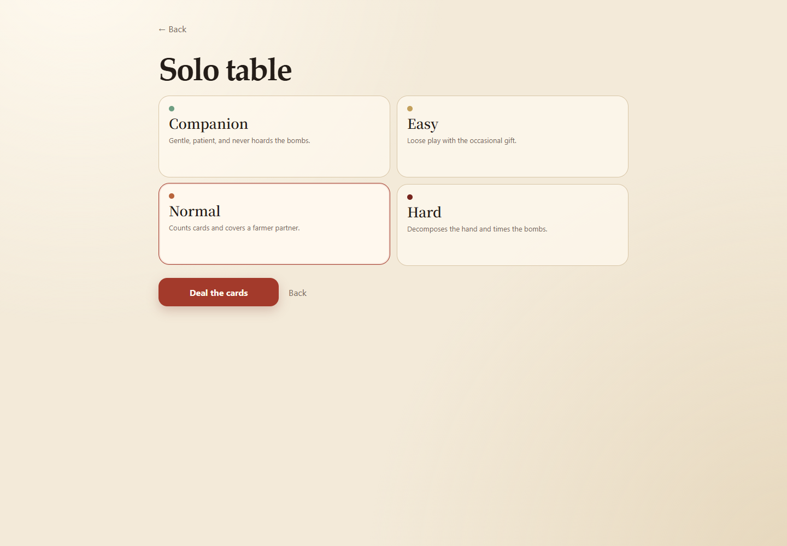 |

| Bidding | Playing |
| --- | --- |
| 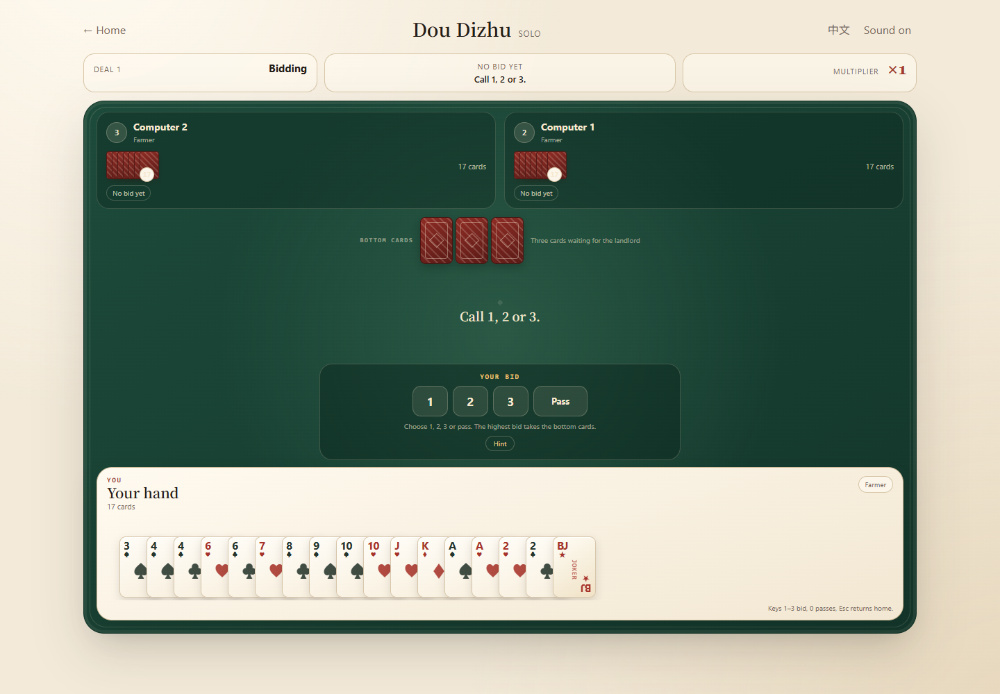 | 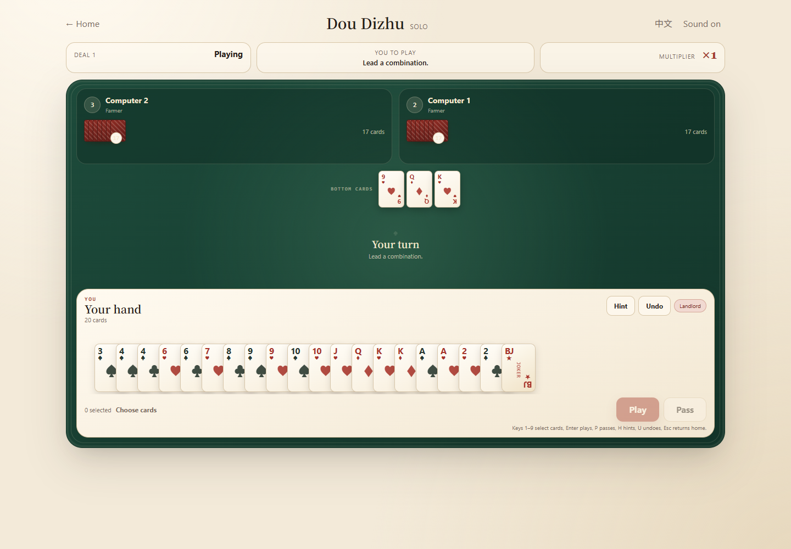 |

| Hint with a reason | Round result |
| --- | --- |
|  | 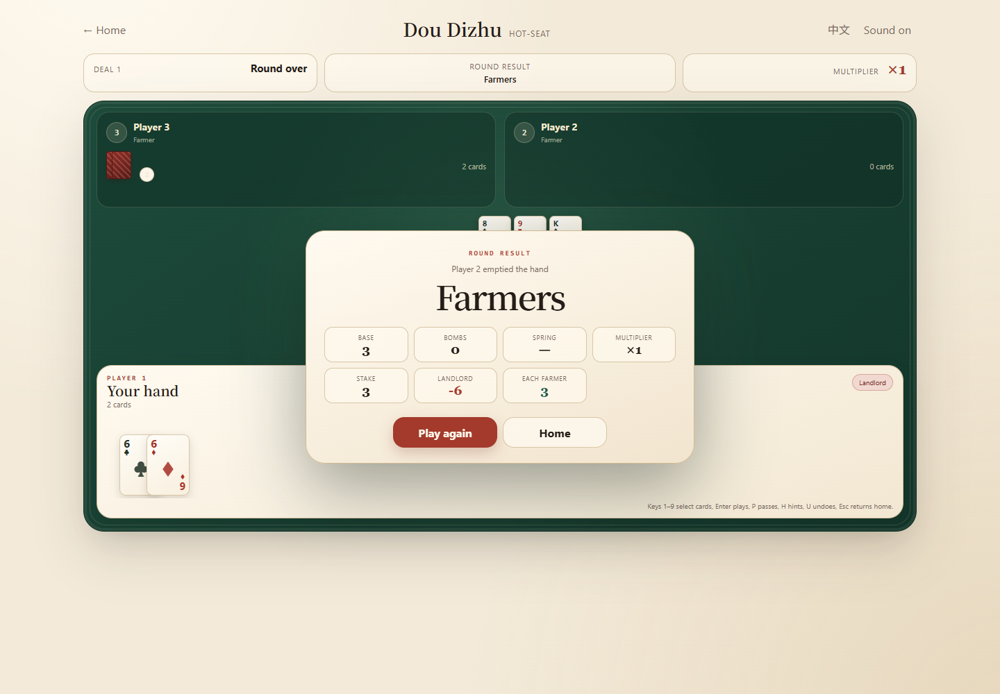 |

| Privacy cover | Family record |
| --- | --- |
| 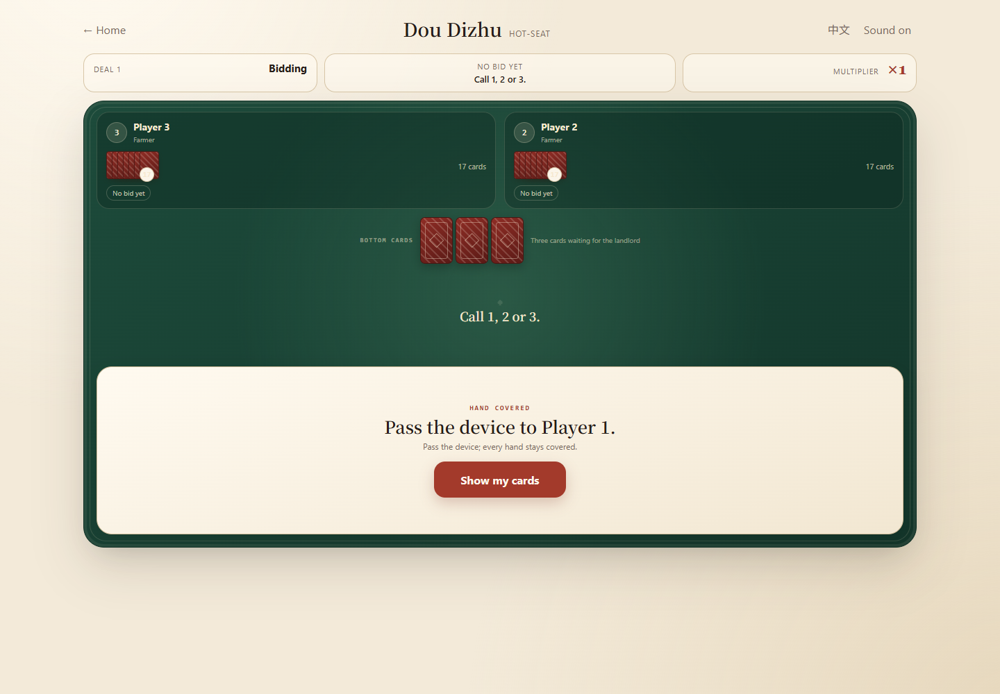 | 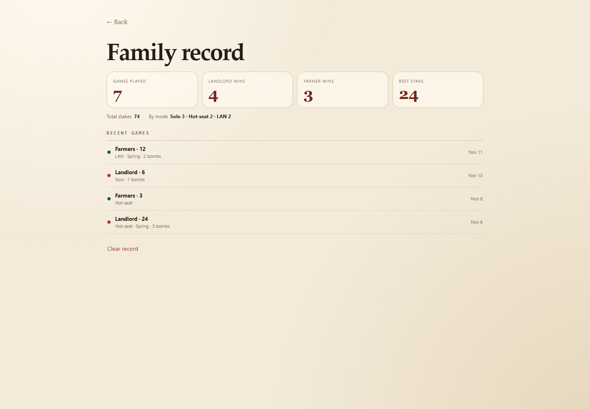 |

| Rules | LAN hub |
| --- | --- |
| 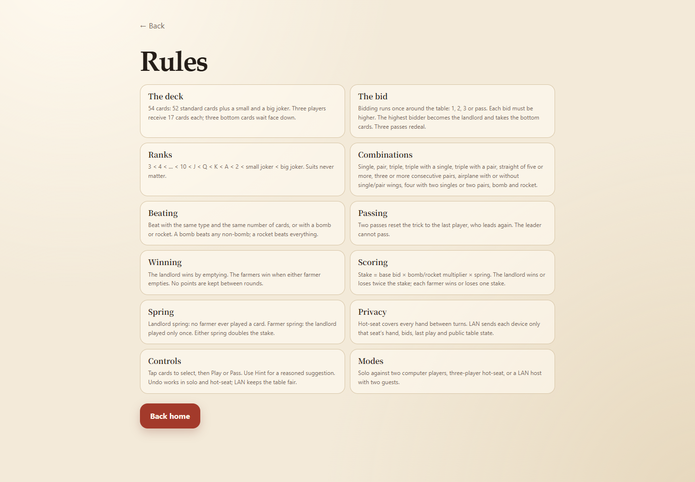 | 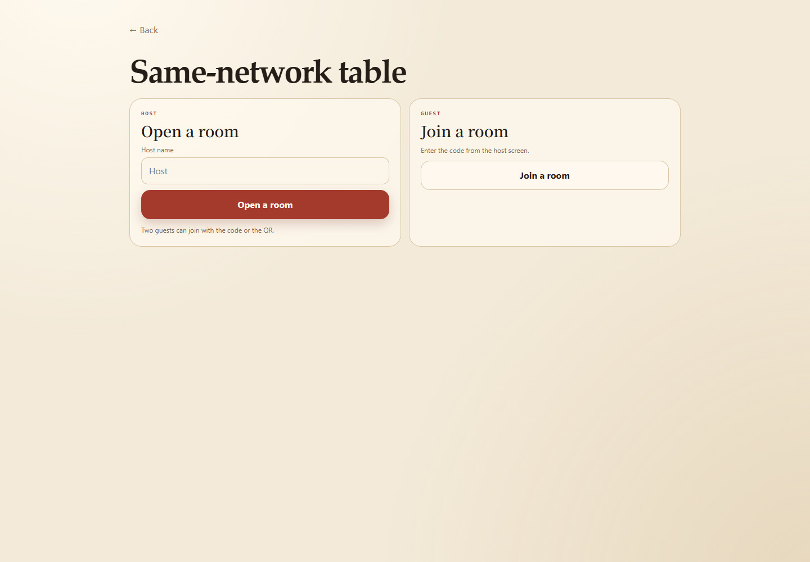 |

| Phone home | Phone table |
| --- | --- |
| 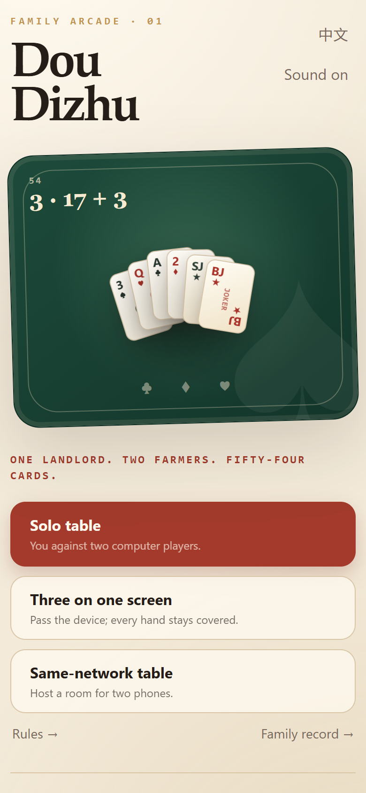 | 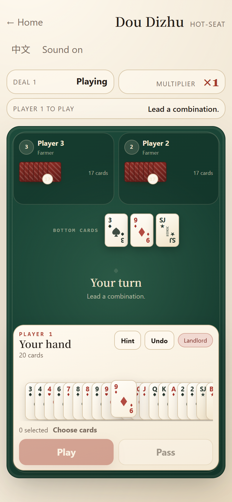 |

All screenshots are rendered from the running app at 1440×1000 (phone 390×844
@2×). The round-result screen is a valid engine fixture; live play is covered by
the browser and LAN tests.

## Play locally

```bash
npm install
npm run dev        # http://localhost:5216
npm run check      # tsc + 47 tests + production build
node scripts/e2e.mjs
node scripts/shots.mjs
LAN_PORT=19016 npm run lan:e2e
```

On Windows PowerShell:

```powershell
$env:LAN_PORT='19016'; npm run lan:e2e
```

## LAN night

```bash
npm run build
npm run lan        # relay on :8080, serves dist/
# open the host page, then Same-network table -> Open a room
# guests scan the QR or open the invite URL on the same network
```

The host owns the authoritative round. Guests receive one seat view per device and
can send only `bid`, `pass` or `play` intents for their own seat. The host re-checks
the turn, card ownership, the combination and whether it beats the last play. Undo
and hints pause in network play so nobody gains an information advantage.

The browser build uses `npm run lan`; the desktop build starts the same relay
internally. A QR opened on `localhost` will not reach a phone, so use the host
machine's network address or the desktop app.

The LAN E2E uses an explicit port and stops its relay afterwards:

```bash
LAN_PORT=19016 npm run lan:e2e
```

## Build the Windows installer

```bash
npm install
npx tauri build --bundles nsis
# src-tauri/target/release/bundle/nsis/Dou Dizhu_0.1.0_x64-setup.exe
```

The installer is per-game and lightweight; WebView2 uses the standard bootstrapper.
An unsigned family build may show a Windows SmartScreen warning. The shared LAN
bridge keeps the `family_arcade_lan_host` crate name.

## Known limitations

- LAN is same-subnet IPv4 only. There is no online matchmaking, spectator view or
  cloud record. Two guests must be connected before the first deal; a dropped guest
  becomes an AI seat until the same device rejoins.
- Bidding is a single round of 1/2/3/pass. Rob-landlord, call-landlord, double,
  insurance and other regional variants are not offered.
- The AI is honest but heuristic. Hard decomposes and counts the table; it is not a
  tournament solver and will sometimes misplay.
- LAN results are recorded on the host device only. A guest device keeps no LAN
  result row.
- Browser QR invites can say `localhost`; use the desktop build or the host LAN
  address for a phone.
- The result screenshot uses a valid deterministic engine fixture; live play is
  verified by the E2E and LAN tests.

See [`docs/limitations.md`](docs/limitations.md) and the full rule audit in
[`docs/rules.md`](docs/rules.md).

## Credits

Original code, CSS card art, copy and synthesised sound for Family Arcade. Dou Dizhu
is a public-domain folk card game; this implementation and its visual design are
original. MIT. See [`NOTICE.md`](NOTICE.md).
