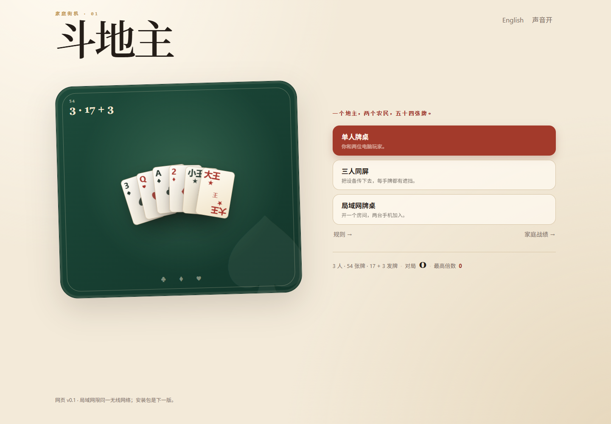
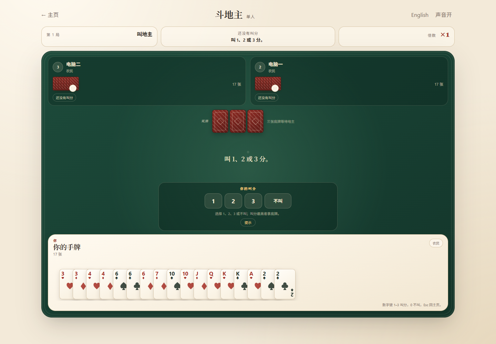
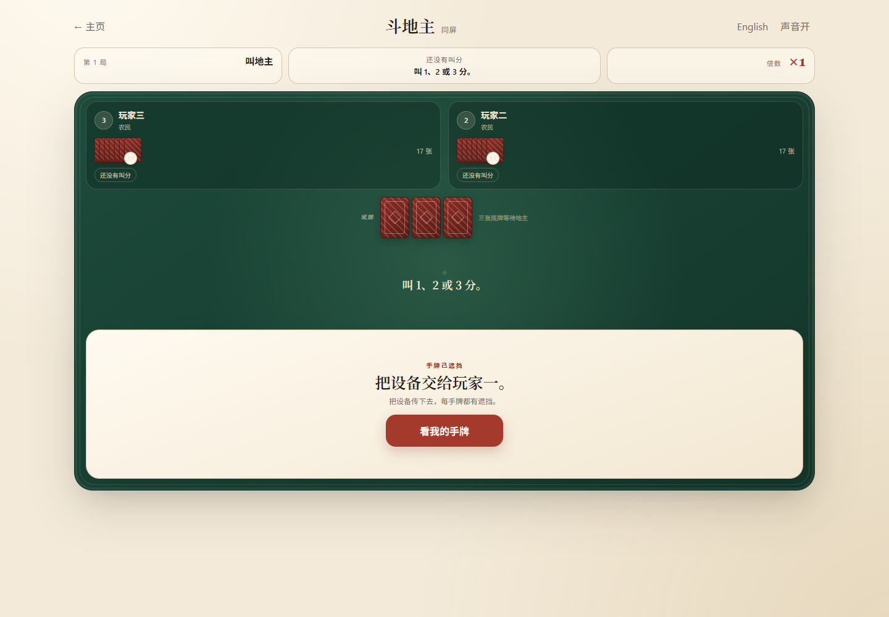
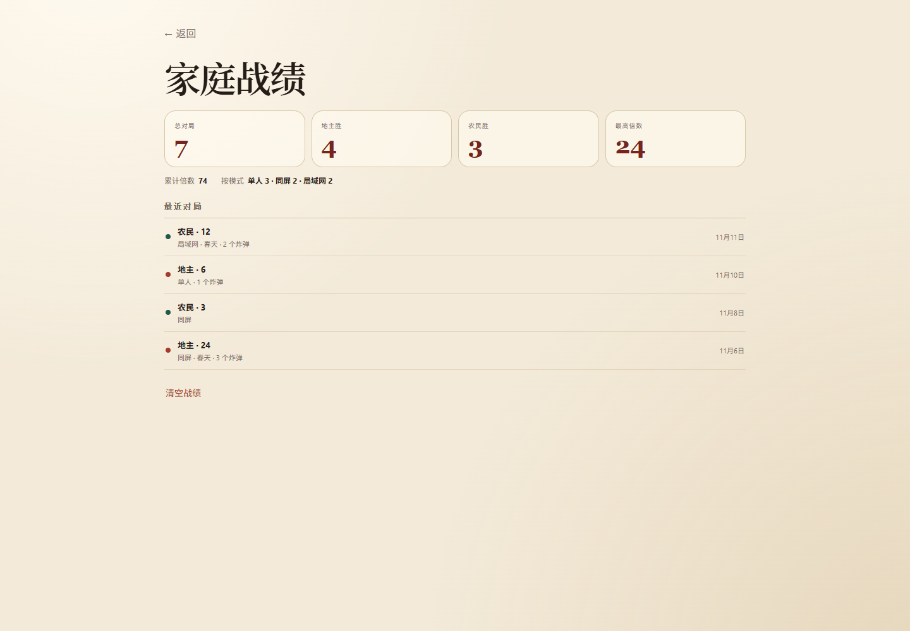
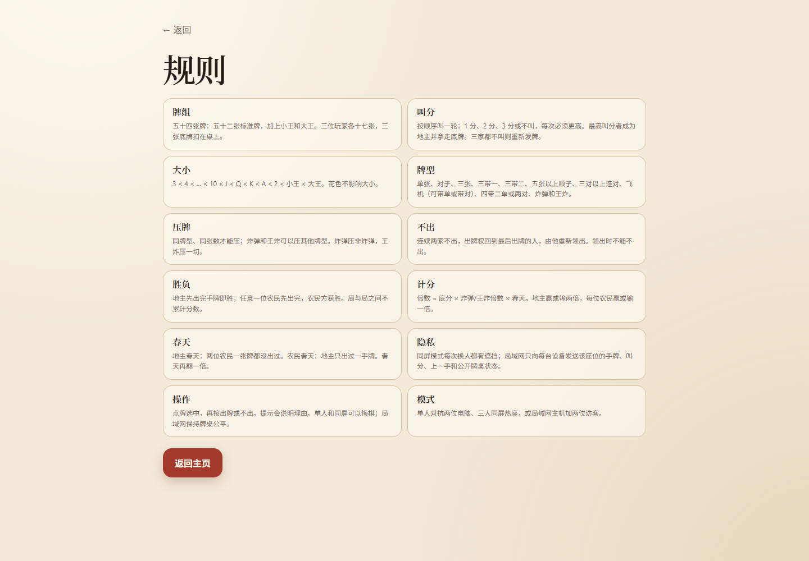
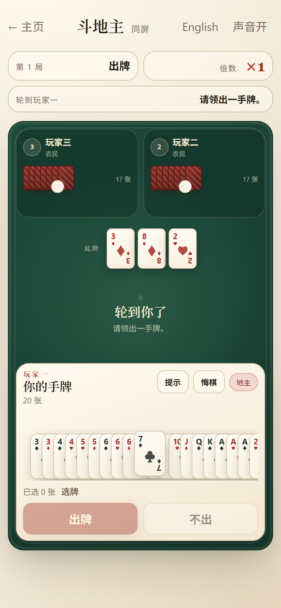

# 斗地主

[English](README.md) · **简体中文**

> **一个地主。两个农民。五十四张牌。**

给一家人玩的三人斗地主：真实的五十四张牌引擎、完整牌型、1/2/3 叫分、炸弹、王炸和春天，四档电脑，三人同屏隐私遮挡，以及每人一座的局域网牌桌。无账号、无广告、无遥测、无远程素材。



## 五秒钟看懂一局

| 发牌 | 叫分 | 出牌 | 结算 |
| --- | --- | --- | --- |
| 五十四张牌：三家各十七张，三张底牌扣下。 | 叫 1、2、3 分或不叫；最高叫分者拿底牌成为地主。 | 用同牌型、同张数压过上一手，或用炸弹、王炸。连续两家不出，出牌权回到最后出牌者。 | 地主先出完即胜；任意一位农民先出完，农民方获胜。底分 × 炸弹倍数 × 春天。 |

## 内容

- **真正可测的引擎。** 纯 TypeScript，位于 `src/game/doudizhu.ts`，含 47 个单元测试，覆盖牌组、发牌、叫分、全部标准牌型、大小比较、不出、春天、计分、座位视图和电脑合法性。引擎不依赖 DOM、网络、时钟或 `Math.random`；每次发牌和重发都使用注入的随机数。
- **完整标准牌型。** 单张、对子、三张、三带一、三带二、五张以上顺子（3–A）、三对以上连对、飞机（可带单或带对）、四带二单或两对、炸弹和王炸。花色不参与比较。
- **完整叫分流程。** 按顺序叫一轮：1/2/3 或不叫，每次必须更高。三家都不叫则重新发牌，首个叫分者轮换。
- **清楚的计分。** 倍数 = 底分 × 2^(炸弹与王炸数) × 春天。地主赢或输两倍，每位农民赢或输一倍。地主春天：两位农民一张牌都没出过；农民春天：地主只出过一手牌。
- **四档电脑，会配合农民搭档。** 陪玩温和、留着炸弹；轻松会犯错；标准会数牌型、替搭档兜底；挑战会拆牌、保留炸弹，并在对手快出完时用炸弹。任何难度都看不到别人的手牌。
- **三种玩法。** 单人对抗两位电脑、三人同屏传递设备，或局域网主机加两位访客。访客可用同一台设备重连自己的座位；断线的座位由电脑暂时代打。
- **隐私是规则。** 同屏模式每次换人都有手牌遮挡；局域网只向每台设备发送该座位的手牌、叫分、叫分后的底牌、上一手和公开牌桌状态。没有观战视角。
- **小贴心。** 单人和同屏可悔棋、提示会说明理由、自动保存/继续、本地家庭战绩、声音开关、减少动态效果、键盘路径（1–9 选牌，回车出牌，P 不出，H 提示，U 悔棋，Esc 回主页；叫分时 1–3 叫分）、完整中英文界面和手机布局。
- **默认私密。** 无云端、无账号、无广告、无跟踪、无远程字体。牌面由 CSS 绘制，声音由浏览器合成。

## 截图

| 主页 | 牌桌设置 |
| --- | --- |
|  |  |

| 叫分 | 出牌 |
| --- | --- |
|  |  |

| 带理由的提示 | 本局结算 |
| --- | --- |
|  |  |

| 隐私遮挡 | 家庭战绩 |
| --- | --- |
|  |  |

| 规则 | 局域网 |
| --- | --- |
|  |  |

| 手机主页 | 手机牌桌 |
| --- | --- |
|  |  |

所有截图都由运行中的界面生成：桌面 1440×1000，手机 390×844 @2×。结算截图使用合法的确定性引擎对局；实时流程由浏览器和局域网测试覆盖。

## 本地运行

```bash
npm install
npm run dev        # http://localhost:5216
npm run check      # tsc + 47 个测试 + 生产构建
node scripts/e2e.mjs
node scripts/shots.mjs
LAN_PORT=19016 npm run lan:e2e
```

Windows PowerShell：

```powershell
$env:LAN_PORT='19016'; npm run lan:e2e
```

## 局域网牌桌

```bash
npm run build
npm run lan        # 中继在 :8080，同时提供 dist/
# 打开主机页面，进入“局域网牌桌” -> “开房间”
# 访客扫二维码，或在同一网络打开邀请链接
```

主机持有权威牌局。每台访客设备只会收到自己的座位视图，只能发送自己座位的 `bid`、`pass` 或 `play` 意图。主机会重新检查轮次、牌是否属于该座位、牌型是否合法、是否能压过上一手。局域网中暂停悔棋和提示，避免信息优势。

浏览器版使用 `npm run lan`；桌面版会在内部启动同样的中继。手机扫到 `localhost` 的二维码无法连接，请使用主机在局域网中的地址或桌面版。

局域网 E2E 使用指定端口，结束后会关闭中继：

```bash
LAN_PORT=19016 npm run lan:e2e
```

## 构建 Windows 安装包

```bash
npm install
npx tauri build --bundles nsis
# src-tauri/target/release/bundle/nsis/Dou Dizhu_0.1.0_x64-setup.exe
```

每个游戏的安装包都很轻；WebView2 使用标准引导程序。未签名的家庭构建可能触发 Windows SmartScreen 提示。共享局域网桥保持 `family_arcade_lan_host` crate 名称。

## 已知限制

- 局域网仅限同一子网 IPv4。没有在线匹配、观战或云端战绩。发第一手牌前需要两位访客都到齐；掉线访客会暂时由电脑代打，直到同一台设备重连。
- 叫分只有一轮 1/2/3/不叫。没有抢地主、叫地主、加倍、保险等地区变体。
- 电脑诚实但仍是启发式。挑战难度会拆牌和数牌，但不是比赛级求解器，也会失误。
- 局域网成绩只记在主机设备上；访客设备不保存局域网战绩行。
- 浏览器二维码可能显示 `localhost`；手机请使用桌面版或主机局域网地址。
- 结算截图使用合法的确定性引擎对局；实时流程由 E2E 和局域网测试验证。

完整规则审计见 [`docs/rules.md`](docs/rules.md)，限制见 [`docs/limitations.md`](docs/limitations.md)。

## 版权

Family Arcade 原创代码、CSS 牌面、文案和合成音效。斗地主是公有领域民间纸牌游戏；本实现和视觉设计为原创。MIT，详见 [`NOTICE.md`](NOTICE.md)。
