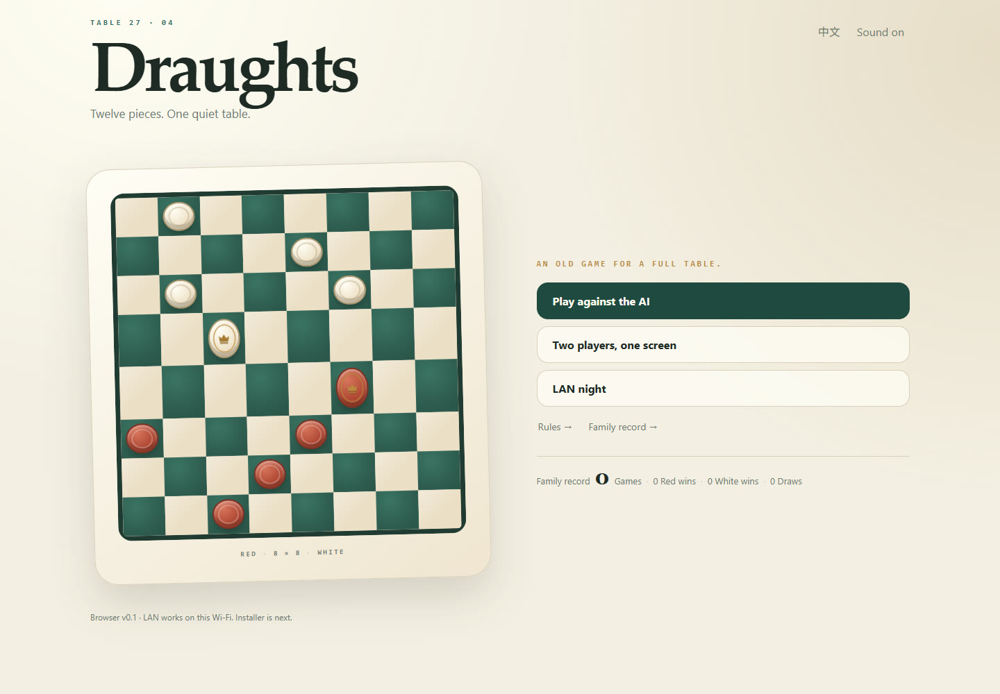
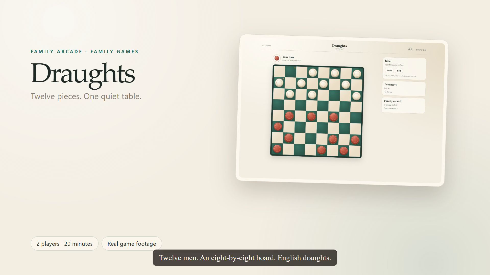
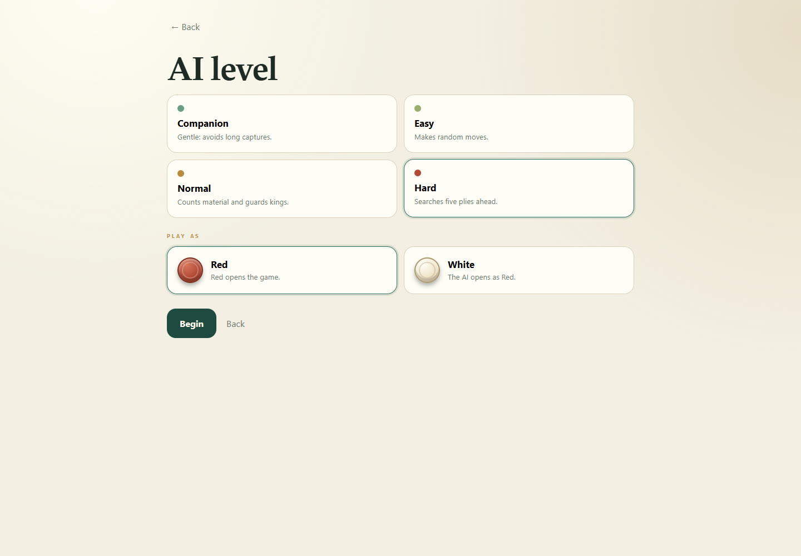
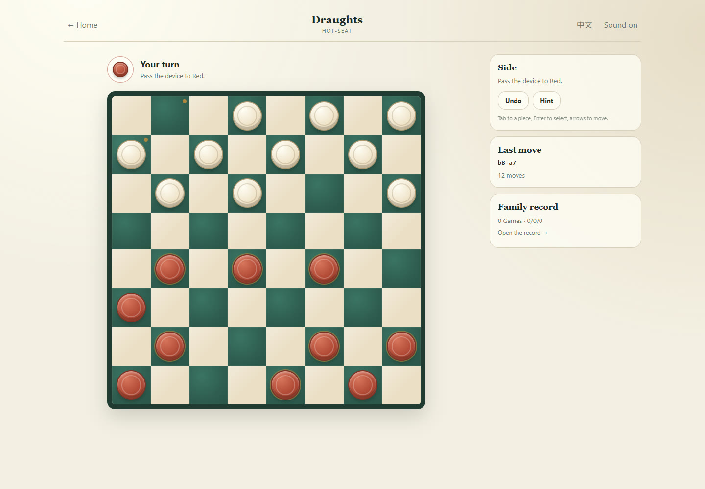
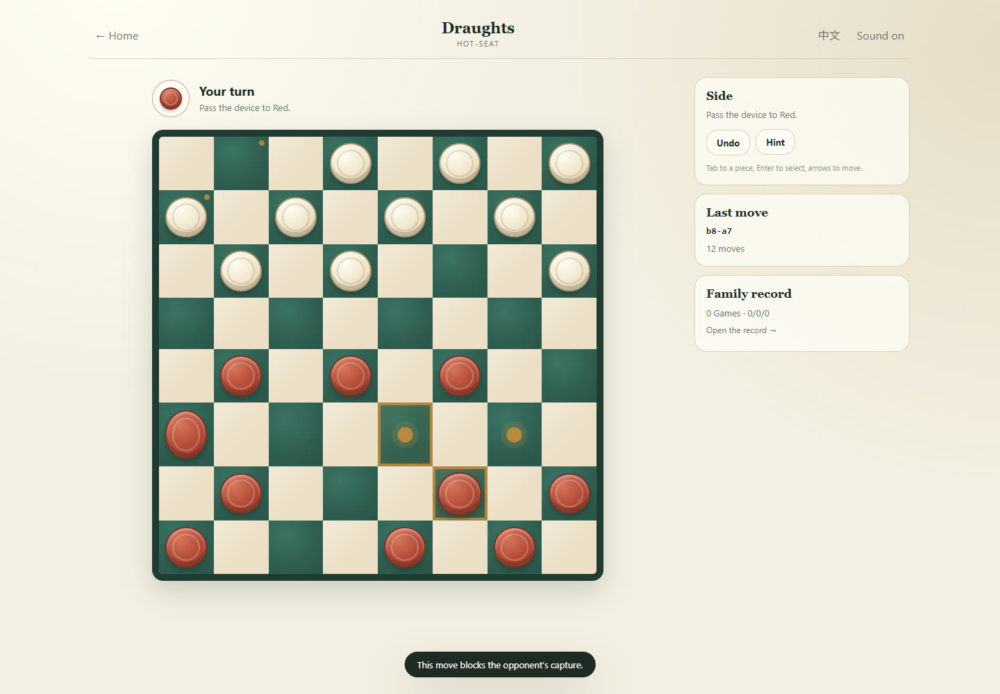
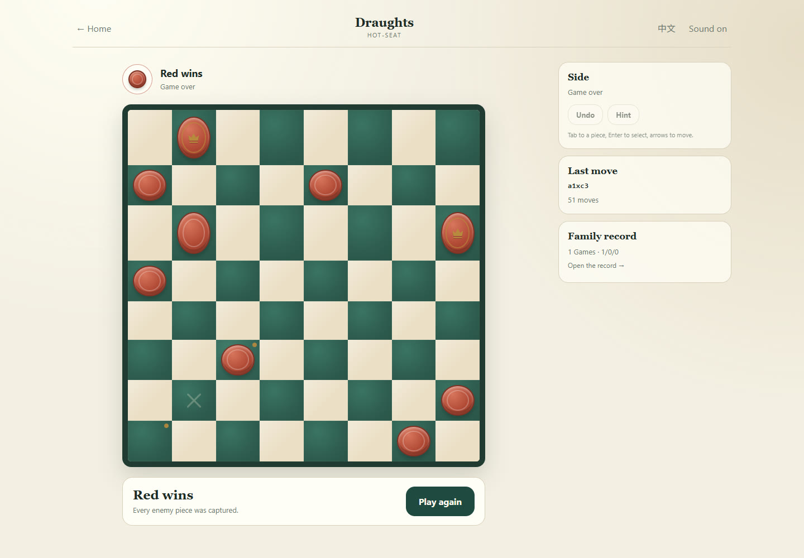
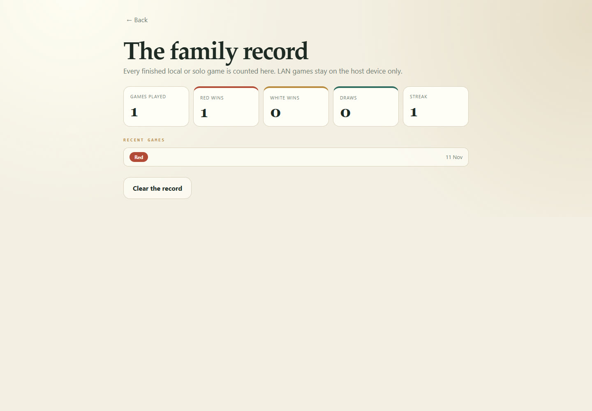
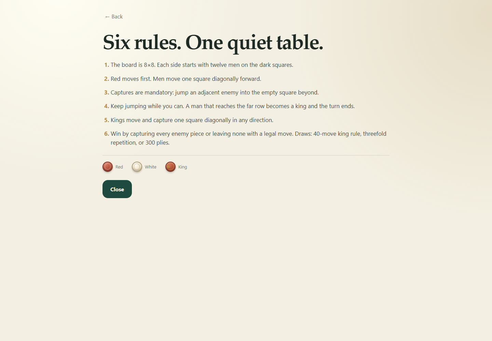
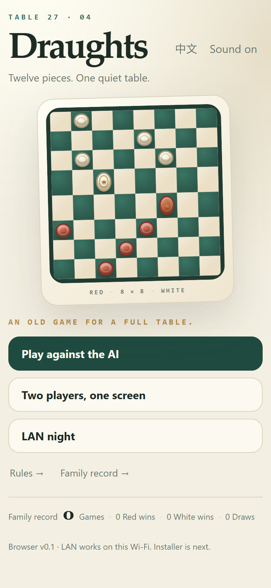
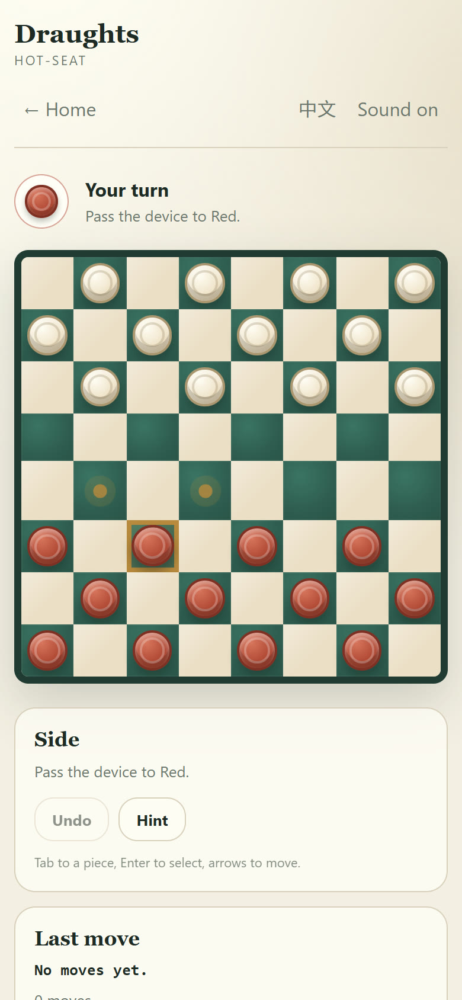

# Draughts · 国际跳棋

**English** · [简体中文](README.zh-CN.md)

> **English draughts on an 8×8 board**

Game 4 of 42 at the Family Arcade family table. Twelve men each, diagonal moves,
mandatory captures, kings that walk backwards, four AI levels, one-screen
hot-seat and a LAN room that a phone can join from its browser. No account, no
ads, no remote assets.



[](docs/promo/draughts-promo-en.mp4)

*45 seconds · 1920×1080 · 60 fps · [中文版](docs/promo/draughts-promo-zh.mp4) · [video.json](video.json)*

## A turn, in five seconds

| Move | Capture | Win |
| --- | --- | --- |
| Red moves first. Men step one dark square diagonally forward; kings step in any diagonal direction. | If a jump is available, you must take it. Keep jumping with the same piece while you can. | Capture every enemy piece, or leave the opponent with no legal move. A man that reaches the far row becomes a king. |

Draws use the 40-move king rule, threefold repetition, or a 300-ply safety
limit. The full rule audit is in [`docs/rules.md`](docs/rules.md).

## What is inside

- **A real, tested engine.** Pure TypeScript in `src/game/draughts.ts`, no DOM,
  clock, network or `Math.random`. **30 unit tests** cover setup, mandatory
  captures, multi-jumps, crowning, backward king captures, blocked wins, three
  draw rules, seat views and AI legality.
- **Four AI levels.** Companion deliberately avoids multi-captures; Easy is
  random; Normal is a 2-ply material/king-safety player; Hard is 5-ply
  alpha-beta with capture quiescence. All take an injected RNG.
- **Three ways to play.** Solo vs AI (choose Red or White), two players on one
  device, and LAN host/guest.
- **Small comforts.** Undo, a hint with a translated reason, autosave/resume,
  local family record, sound toggle, reduced-motion CSS, keyboard board
  navigation, complete Chinese/English UI and a mobile layout.
- **Private by default.** No accounts, telemetry, ads, CDNs or remote fonts.

## Screenshots

All images come from the running app. Desktop 1440×1000, phone 390×844 @2×
(780×1688).

| Home | AI setup |
| --- | --- |
|  |  |

| A real game | Hint with a reason |
| --- | --- |
|  |  |

| Result | Family record |
| --- | --- |
|  |  |

| Rules | Phone home | Phone game |
| --- | --- | --- |
|  |  |  |

Chinese screenshots live in [`docs/screenshots/zh`](docs/screenshots/zh).

## Play locally

```bash
npm install
npm run dev        # http://localhost:5183
npm run check      # tsc + 30 tests + production build
npm run e2e        # real Chrome; start npm run dev first
npm run shots      # regenerate docs/screenshots/{en,zh}
```

## LAN night

Browser/development build:

```bash
npm run build
npm run lan        # relay on :8080, also serves dist/
# open http://localhost:5183, choose LAN night, host a room
```

Desktop build: the Tauri shell starts the same relay internally and serves the
built app to phones. The host shows a 4-digit room code and a QR invite. Guests
open the address on the same Wi-Fi and need no install.

The relay is a dumb message bus. The host owns the authoritative state and sends
the guest only its own seat view. A guest may send only
`{type:'move', move}`; the host re-checks the turn and re-validates the move
against its legal move list before applying it.

In browser/development mode the invite is built from the host page's hostname.
Open the host page via the machine's LAN IP (not `localhost`) when a phone needs
to join; the Tauri build discovers LAN URLs from the shared Rust relay.

## Build the Windows installer

```bash
npm install
npx tauri build --bundles nsis
# src-tauri/target/release/bundle/nsis/Draughts_0.1.0_x64-setup.exe
```

The installer is per-game and lightweight; WebView2 uses the standard
bootstrapper. A Windows SmartScreen warning is expected for an unsigned family
build. The central Family Arcade build agent builds the installers; this app was
verified with `npx tsc --noEmit` and `vite build` only.

## Known limitations

- **English draughts, not international draughts.** 8×8, 12 men, one-step kings,
  men capture forward only, no maximum-capture requirement.
- **Red moves first.** Traditional English draughts gives Black the first move;
  the family build maps Black to the red pieces.
- **LAN is local-subnet IPv4.** A host firewall may need to allow the relay.
  There is no spectator, reconnect lobby or online matchmaking.
- **Hard is 5-ply, not perfect.** It is a strong family opponent, not a
  tournament engine.
- **No installer was built in this workspace.** The Tauri shell and `Cargo.toml`
  are kept intact for the central build.
- **No 4K or vertical promo cut.** `video.json` is the source for the root
  studio's 45-second EN/ZH promo.

See [`docs/limitations.md`](docs/limitations.md) for the honest long version.

## Credits

Original code, CSS/SVG pieces, copy and screenshots for Family Arcade. MIT. See
[`NOTICE.md`](NOTICE.md) and [`LICENSE`](LICENSE).

## Promo

[](docs/promo/draughts-promo-en.mp4)

- [English cut](docs/promo/draughts-promo-en.mp4) · [other language](docs/promo/draughts-promo-zh.mp4)
- [SRT](docs/promo/draughts-promo-en.srt) · [video.json](video.json)
- Real app screenshots and real engine data; claims match the tests.

