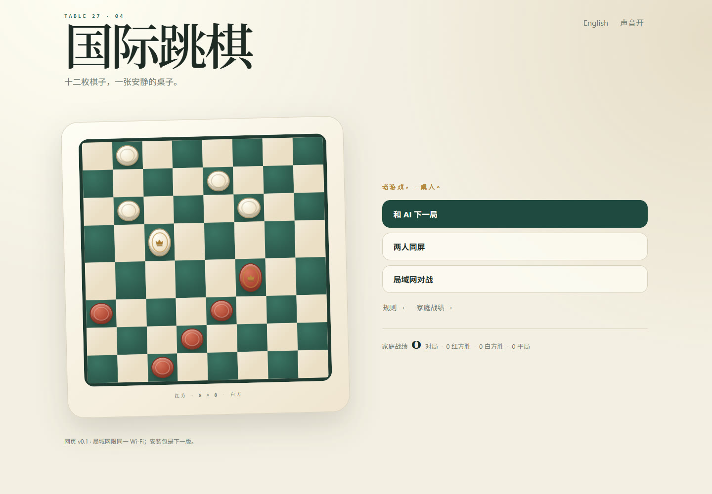
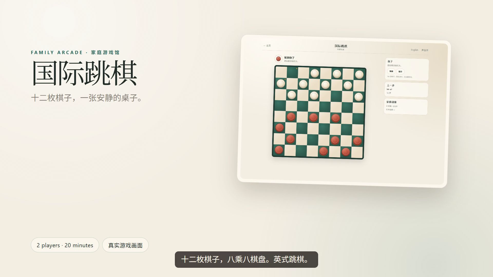
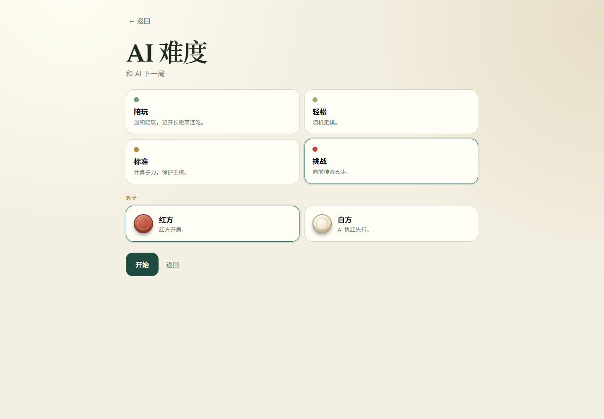
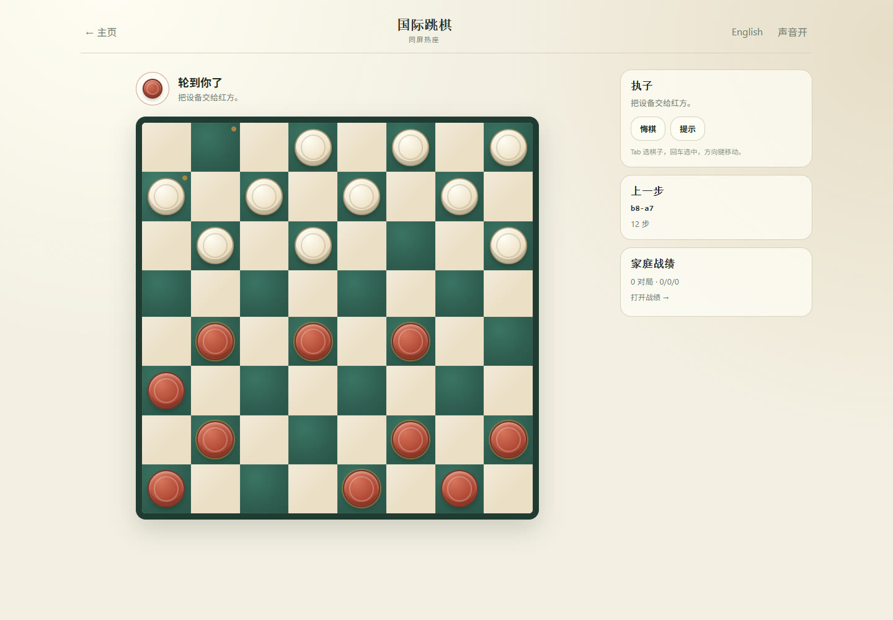
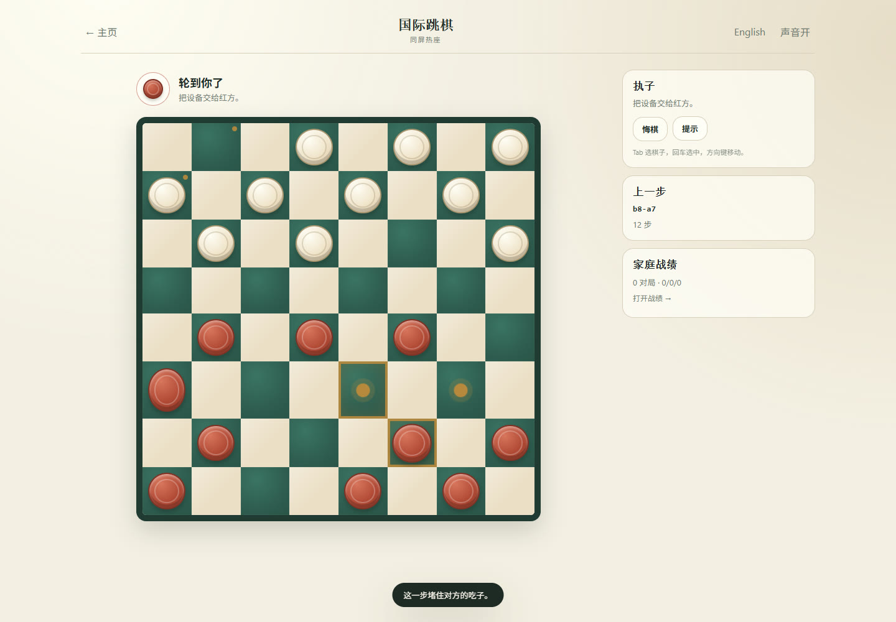
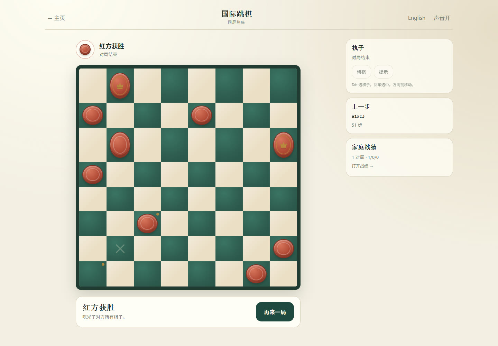
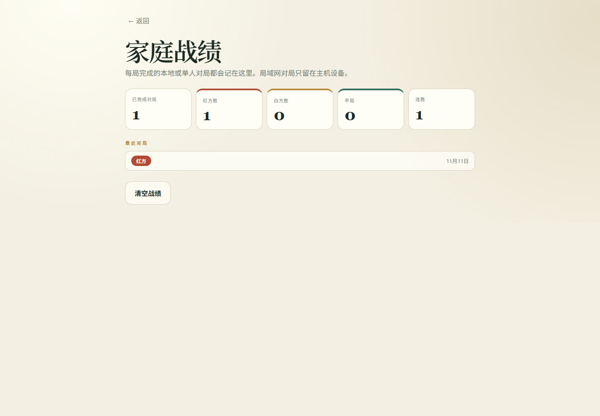
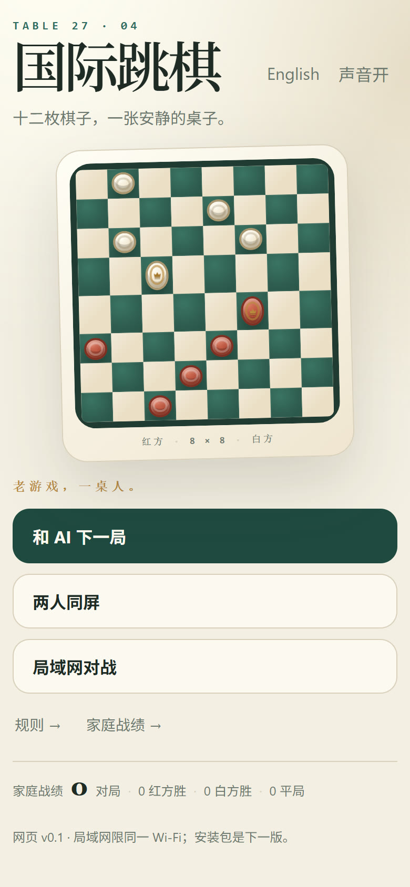
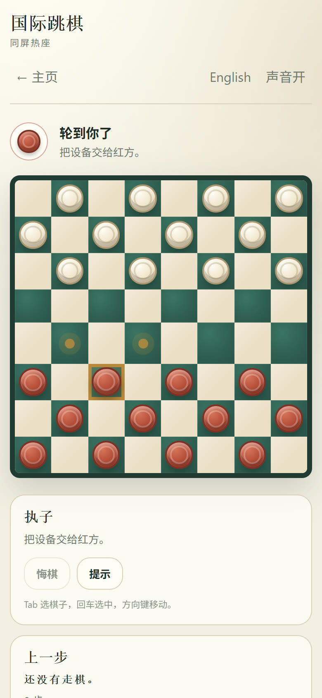

# 国际跳棋 · Draughts

[English](README.md) · **简体中文**

> **8×8 棋盘上的英式跳棋**

Family Arcade 家庭牌桌的第 4 款游戏。双方各十二枚棋子，斜向走子，吃子必须走，
王棋可以后退；四档 AI、同屏热座，以及手机浏览器直接加入的局域网房间。
无账号、无广告、无远程素材。



[](docs/promo/draughts-promo-zh.mp4)

*45 秒 · 1920×1080 · 60fps · [English cut](docs/promo/draughts-promo-en.mp4) · [video.json](video.json)*

## 一回合，五秒看懂

| 走子 | 吃子 | 结束 |
| --- | --- | --- |
| 红方先走。兵向前斜走一格；王棋可以向四个斜方向走一格。 | 能吃就必须吃；同一枚棋子能继续跳就必须继续。 | 吃光对方棋子，或让对方无棋可走即获胜。兵到达底线升为王棋。 |

平局采用四十步王棋规则、三次重复局面，或 300 步安全上限。完整规则审计见
[`docs/rules.md`](docs/rules.md)。

## 里面有什么

- **真正的引擎。** `src/game/draughts.ts` 是纯 TypeScript，不碰 DOM、时钟、
  网络或 `Math.random`。**30 个单元测试**覆盖开局、强制吃子、连吃、升变、
  王棋后退吃子、堵死获胜、三种平局、座位视图和 AI 合法性。
- **四档 AI。** 陪玩会刻意避开长距离连吃；轻松随机；标准两层子力/王棋安全；
  挑战是五层 alpha-beta，并带吃子静默搜索。所有档位都接受注入的随机数发生器。
- **三种玩法。** 单人对抗 AI（可选红方或白方）、两人同屏、局域网主机/访客。
- **小细节。** 悔棋、带中文理由的提示、自动保存/继续、本机家庭战绩、声音开关、
  减少动效、键盘走棋、完整中英界面和手机布局。
- **默认私密。** 无账号、无遥测、无广告、无 CDN、无远程字体。

## 截图

全部来自真实运行的应用。桌面 1440×1000，手机 390×844 @2×（780×1688）。

| 主页 | AI 设置 |
| --- | --- |
|  |  |

| 真实对局 | 带理由的提示 |
| --- | --- |
|  |  |

| 终局 | 家庭战绩 |
| --- | --- |
|  |  |

| 规则 | 手机主页 | 手机对局 |
| --- | --- | --- |
|  |  |  |

英文截图在 [`docs/screenshots/en`](docs/screenshots/en)。

## 本地运行

```bash
npm install
npm run dev        # http://localhost:5183
npm run check      # tsc + 30 个测试 + 生产构建
npm run e2e        # 真实 Chrome，需先运行 npm run dev
npm run shots      # 重新生成 docs/screenshots/{en,zh}
```

## 局域网

浏览器/开发版：

```bash
npm run build
npm run lan        # :8080 中继，同时托管 dist/
# 打开 http://localhost:5183，选“局域网对战”，开一个房间
```

桌面版：Tauri 壳启动同一个内置中继，并把构建产物托管给手机。主机显示 4 位
房间码和二维码邀请；访客在同一 Wi-Fi 打开地址即可，无需安装。

中继只负责转发消息。主机保存权威状态，只发送访客自己的座位视图。访客只能发送
`{type:'move', move}`；主机会重新检查回合，并用合法走法列表重新验证这一步。

浏览器/开发模式下，邀请地址由主机页面的 hostname 生成。要让手机加入，请用本机
局域网 IP 打开主机页（不要用 `localhost`）；Tauri 版会从共享 Rust 中继取得局域网
地址。

## 构建 Windows 安装包

```bash
npm install
npx tauri build --bundles nsis
# src-tauri/target/release/bundle/nsis/Draughts_0.1.0_x64-setup.exe
```

每款游戏单独打包，安装包保持轻量；WebView2 使用标准引导程序。未签名的家庭构建
会触发 Windows SmartScreen 提示。安装包由 Family Arcade 中央构建代理统一生成；本应用
只用 `npx tsc --noEmit` 与 `vite build` 做了验证。

## 已知限制

- **英式跳棋，不是国际跳棋（10×10）。** 8×8、十二枚兵、王棋只走一格、兵只向前
  吃子，不要求“最多吃子”。
- **红方先走。** 传统英式跳棋由黑方先走；家庭版把黑方映射为红色棋子。
- **局域网仅同一子网 IPv4。** 主机防火墙可能需要放行中继。浏览器开发模式请用
  本机局域网 IP 打开主机页；用 `localhost` 时二维码只在这台机器上有效。没有观战、
  断线重连大厅或在线匹配。
- **挑战档是五层搜索，不是完美引擎。** 它是家庭强手，不是比赛引擎。
- **本工作区没有构建安装包。** Tauri 壳和 `Cargo.toml` 保持可用，交给中央构建。
- **没有 4K 或竖屏宣传片。** `video.json` 是根目录工作室生成 45 秒中英宣传片的
  唯一来源。

完整说明见 [`docs/limitations.md`](docs/limitations.md)。

## 许可

Family Arcade 原创代码、CSS/SVG 棋子、文案与截图，MIT。见
[`NOTICE.md`](NOTICE.md) 和 [`LICENSE`](LICENSE)。

## 宣传片

[](docs/promo/draughts-promo-zh.mp4)

- [中文成片](docs/promo/draughts-promo-zh.mp4) · [另一语言](docs/promo/draughts-promo-en.mp4)
- [字幕](docs/promo/draughts-promo-zh.srt) · [video.json](video.json)
- 画面来自真实应用与真实引擎数据；数字与测试一致。

