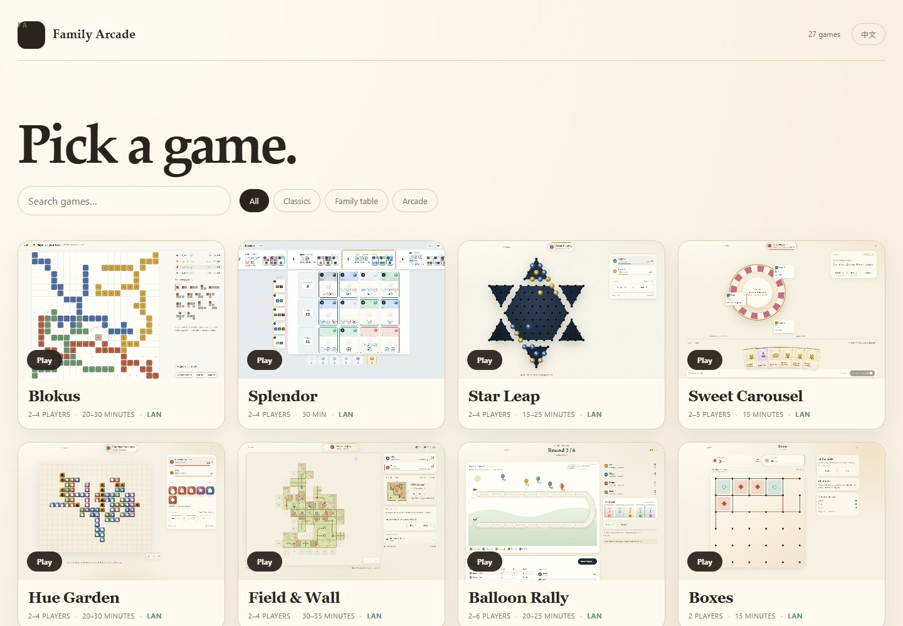

English · [简体中文](README.zh-CN.md)

# Family Arcade

**One launcher. 53 games. One table.**

Family Arcade is the front door for the collection: 53 offline family games with AI,
hot-seat and LAN play. Install the offline or slim launcher for everything, or use Lite
to download only the games you want.



**Runtime:** the **offline** installer embeds the WebView2 runtime; the **slim** installer uses Tauri's small bootstrapper instead; **Lite** downloads only the games you choose. Every portable game ships `WebView2Loader.dll`. See [`RUNTIME.md`](RUNTIME.md) and [`LITE.md`](LITE.md).

## What it does

- **One grid, every game.** Search, filter by Classics / Family / Arcade, and launch.
- **Portable game folders.** Each bundled game runs as its own signed-family Tauri
  executable with its own LAN relay and saves. No separate installs needed.
- **Three ways to install.** Offline with WebView2, slim without it, or Lite with
  download-on-demand games.
- **Small comforts.** Recent games, keyboard focus, reduced motion, bilingual labels.
- **Private.** No account, no telemetry, no ads, no network.

## Build

```bash
npm install
npm run dev            # browser preview of the launcher
npm run check
npm run shots          # screenshots (dev server required)
npx tauri build --bundles nsis
```

The all-in-one installer includes `games/<slug>/game.exe` + `dist` for every game.
Those portable folders are assembled by `node tools/prepare-hub.mjs` from the shared
build output.

## Known limits

- The Windows bundle is large because it contains 53 portable games.
- Games open in their own windows; the hub itself does not embed them.
- Installers are unsigned; SmartScreen will ask once.

See the root [README](../../README.md) for the full collection and the three launcher
builds.
