**English** · [简体中文](README.zh-CN.md)

# Field & Wall · 筑野

**One field. One wall. One town.** An original 2–4 player tile-laying game for family
night: 54 tiles, 7 wooden meeples each, four AI levels, hot-seat, LAN, hints, undo,
autosave and replay — offline, no account, no ads.

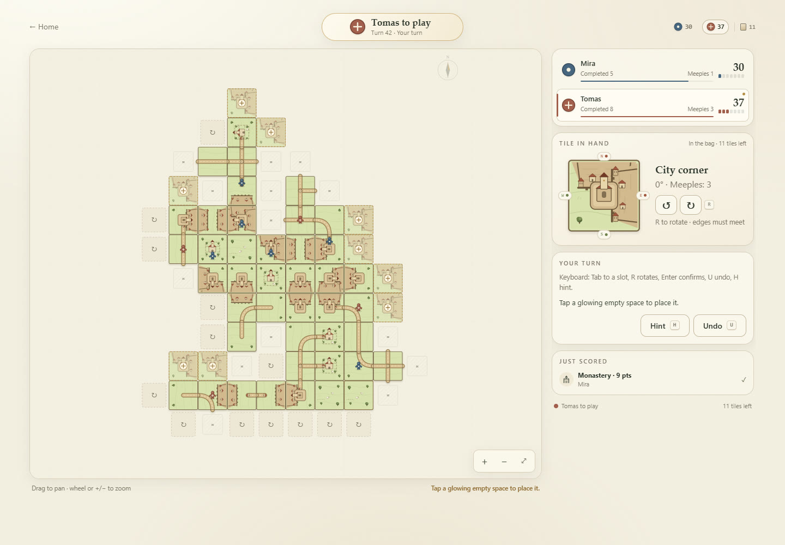

[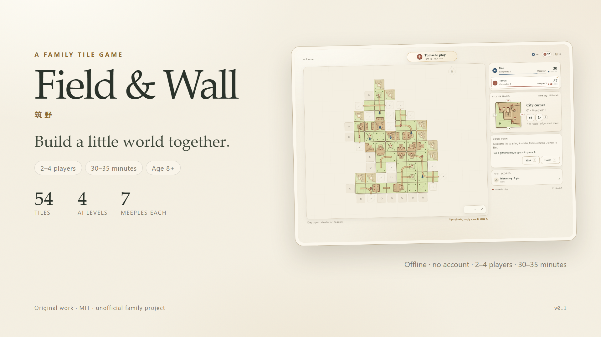](docs/promo/field-and-wall-promo-en.mp4)

*48 seconds · 1920×1080 · 60 fps · Chinese and English cuts · voiceover · [promo manifest](video.json)*

## A turn, in five seconds

| Build | Score | Finish |
| --- | --- | --- |
| Rotate a tile and attach it edge-to-edge; then place one meeple on a city, road or monastery. | Close a city for 2 / tile, a road for 1 / tile, or a monastery for 9. Unfinished features score 1 / tile at the end. | The bag is empty → final scoring. The most points wins; ties compare completed features. |

## What's inside

- **Rules, checked** — 54 tiles from 15 original types, 4 rotations, 7 meeples per
  player; city, road and monastery scoring, meeple majority and return are covered by
  `tests/engine.test.ts` and the audit table in [`docs/rules.md`](docs/rules.md).
- **Four AI levels** — **Companion** avoids stealing a child's key city, **Easy** makes
  mistakes, **Normal** has a plan, **Hard** adds opponent-risk sampling. AI runs in a Web
  Worker and only sees the public view; the bag order is never exposed. A 200-game
  per-pairing self-play table is generated by `npm run calibrate`
  ([`src/ai/`](src/ai/), [`docs/ai-calibration.md`](docs/ai-calibration.md)).
- **A table that reads** — every player colour also carries a shape (dot / plus / ring /
  slash); keyboard play, reduced motion, visible legal slots and a full game with sound
  off. The board pans and zooms, and works in a phone browser.
- **A memory** — autosave after every move, **Continue last game**, replay the last ten
  games, family stats, and JSON export. Everything stays in this browser.
- **Three tables** — solo with four AI levels, 2–4 player hot-seat, and host-authoritative
  **LAN rooms** with a 4-digit code, QR, seat status and guest reconnect. The Tauri shell
  is in `src-tauri`; the central release build produces the installer.
- **Small and private** — offline by default, no account, no telemetry. LAN uses only the
  same Wi-Fi and the bundled relay.

## Screenshots

| A real game | New game |
| --- | --- |
|  | 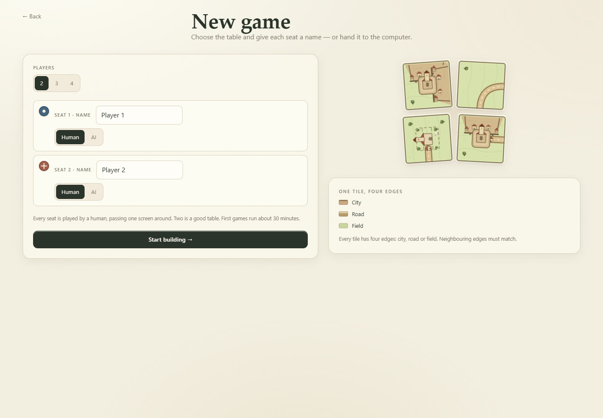 |

| Choose a spot and claim a feature | Game over |
| --- | --- |
| 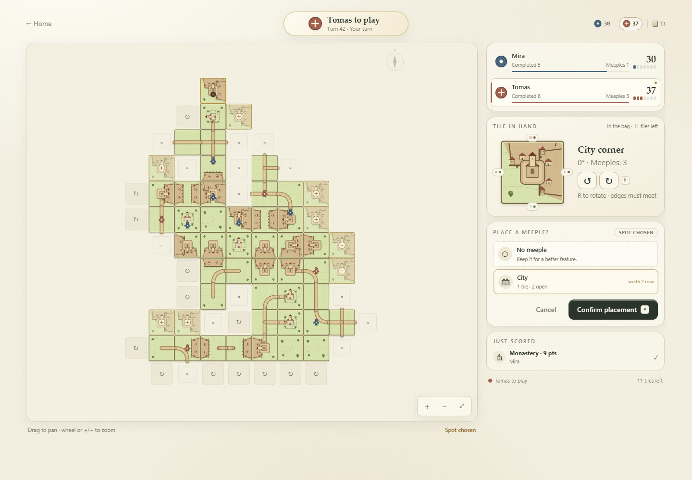 | 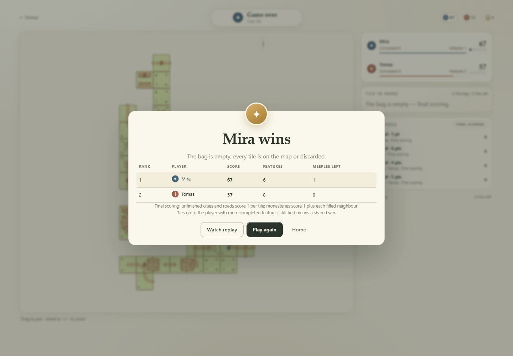 |

| Family stats | On a phone |
| --- | --- |
| 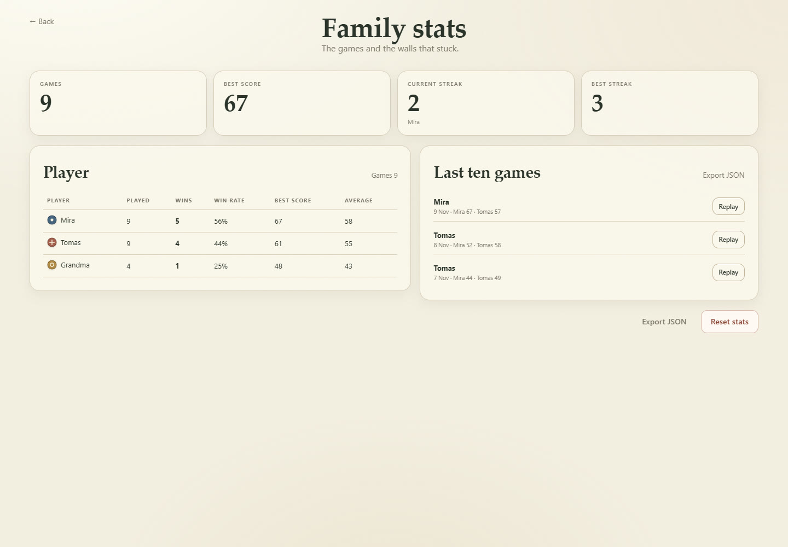 | 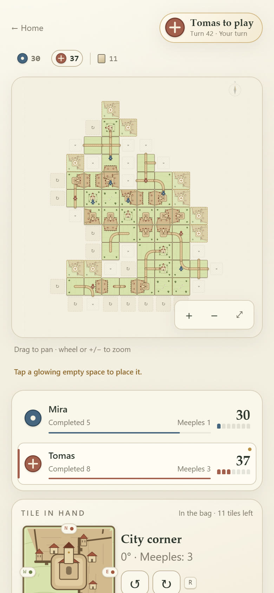 |

| How to play | Settings |
| --- | --- |
| 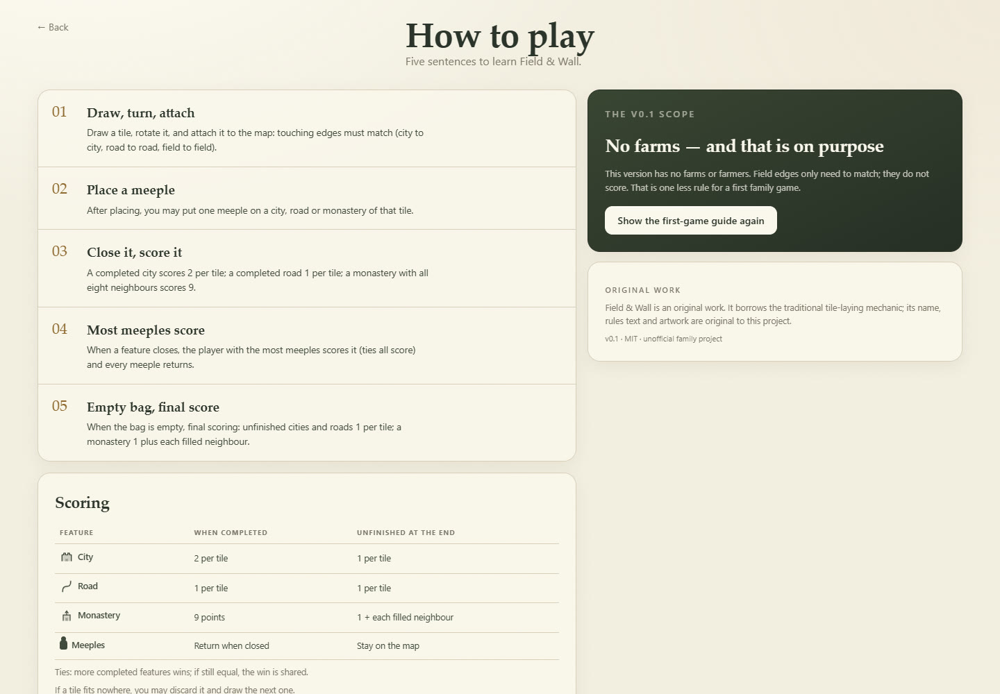 | 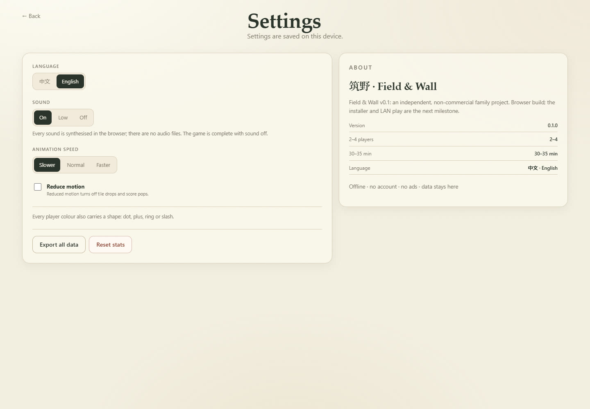 |

| Host a LAN table | Guest seat |
| --- | --- |
| 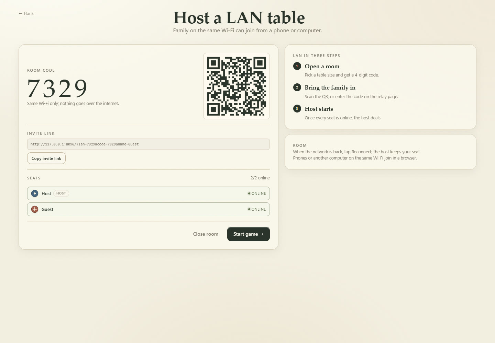 | 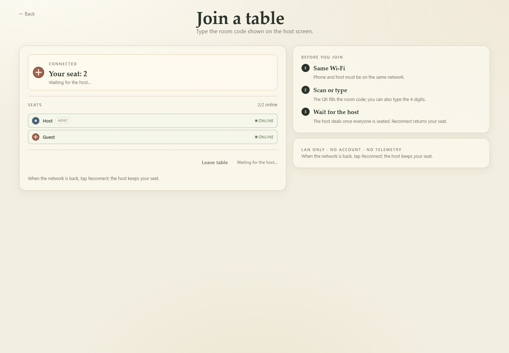 |

| A real LAN game | |
| --- | --- |
| 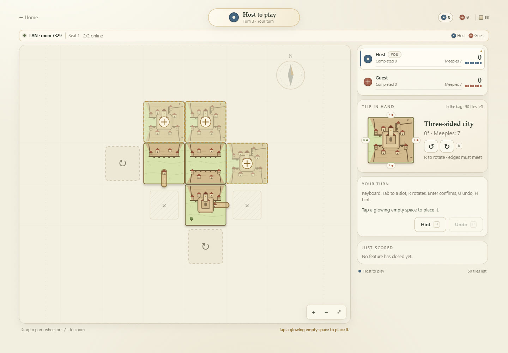 | The same room seen from the host: code, seats and online status stay visible. |

All screenshots are captured from the real app with Playwright and system Chrome at
1440×1000 (phone 390×844 @2x). See [`docs/screenshots/README.md`](docs/screenshots/README.md).

## Play it

You need Node.js 22+. The browser build is the primary v0.1; the Tauri shell is included
for the central installer build.

```bash
npm install
npm run dev        # http://localhost:5176
```

Production build:

```bash
npm run build
npm run preview
```

### LAN night

```bash
npm run build
npm run lan        # serves the built app + relay on port 8080
```

1. On the host computer, open `http://<host-LAN-IP>:8080` (for example
   `http://192.168.1.20:8080`) and choose **LAN play**. `localhost` works for the host,
   but a QR made from `localhost` is not reachable from a phone.
2. Choose 2, 3 or 4 seats, create the room, and show the QR/code.
3. Guests on the same Wi-Fi scan the QR or open the same relay address and enter the
   4-digit code.
4. The host starts once every seat is online. The host keeps authority; guests send tile
   and meeple intents, never state changes.
5. If a phone drops, reopen the same invite and join again — the host keeps the seat.
   Closing or reloading the host page ends the room. LAN undo, spectate and pause are not
   in this pass.

If port 8080 is already taken, run
`node ../../tools/lan-server.mjs --dist dist --port 8096` and open the host with
`?lanPort=8096`; the QR and invite then use 8096. The default remains 8080.

For desktop development:

```bash
npm run tauri dev
```

The shared Tauri shell is wired to start the Rust relay automatically. The installer is
built by the central Family Arcade release job (`npm run build` then `npm run tauri build`);
this app does not ship a prebuilt `.exe`, and this pass did not run a Tauri build.

## How to play

1. Draw a tile, rotate it, and attach it to the map: touching edges must match (city to
   city, road to road, field to field).
2. After placing, you may put one meeple on a city, road or monastery of that tile.
3. A city with no open city edge is complete (2 / tile); a road with no open road end is
   complete (1 / tile); a monastery with all eight neighbours is complete (9).
4. When a feature closes, the player with the most meeples on it scores it — ties all
   score — and every meeple on it returns.
5. When the bag is empty, final scoring: unfinished cities and roads 1 / tile; a
   monastery 1 + each filled neighbour. Most points wins.

If a tile fits nowhere, discard it and draw the next one. If scores tie, compare completed
features; if still equal, the win is shared.

### Scoring at a glance

| Feature | Completed | Unfinished at the end |
| --- | --- | --- |
| City | 2 per tile | 1 per tile |
| Road | 1 per tile | 1 per tile |
| Monastery | 9 points | 1 + each filled neighbour |
| Meeples | Return when closed | Stay on the map |

### Controls

| Action | Mouse / touch | Keyboard |
| --- | --- | --- |
| Pick a slot | Tap a glowing empty space | `Tab`, `Enter` |
| Rotate | Rotate buttons or tap the tile | `R` |
| Choose a meeple | Tap a feature chip or a meeple spot | `Tab`, `Enter` |
| Confirm | **Confirm placement** | `Enter` |
| Cancel | **Cancel** | `Esc` |
| Hint / undo | Buttons | `H` / `U` |
| Sound | Header / settings | `M` cycles on / low / off |

**Why can't I place here?** The edge badges show why: an edge must meet the same type.
A muted `×` cell is impossible in every rotation; a `↻` cell needs another rotation. The
game never silently swallows a tap — the toast names the rule.

**v0.1 limitation:** there are **no farms or farmers**. Field edges only need to match;
they do not score. This is a deliberate simplification for a first family game, documented
in [`docs/limitations.md`](docs/limitations.md).

## After the game

- **Autosave** after every move; the home screen offers **Continue last game** after a
  reload or crash.
- **Replay** the last ten games move by move, with scores at each step.
- **Stats** by player name: games, wins, win rate, best score, current and best streak.
- **Export JSON** of settings and stats; data stays local.

## The promo

The Family Arcade studio renders the promo from [`video.json`](video.json): eight bilingual
lines, facts, accent colour and the three screenshots. Existing cuts and posters from the
previous pass remain under `docs/promo/`. This app does **not** keep a separate Remotion
project.

[](docs/promo/field-and-wall-promo-en.mp4)

- [Chinese MP4](docs/promo/field-and-wall-promo-zh.mp4) · [Chinese SRT](docs/promo/field-and-wall-promo-zh.srt)
- [English MP4](docs/promo/field-and-wall-promo-en.mp4) · [English SRT](docs/promo/field-and-wall-promo-en.srt)
- Existing masters measure −14.4 / −14.1 LUFS and −1.47 / −1.49 dBTP.

## Development

```bash
npm install
npm run dev          # Vite dev server (5176)
npx tsc --noEmit     # typecheck
npx vitest run       # 62 tests: engine, data, AI, errors, hero board
npm run build        # typecheck + production build
npm run data:verify  # counts, copies, edge balance, every type fits beside the start
node scripts/e2e.mjs # real Chrome: solo, hot-seat, undo, resume, end, replay, stats, mobile
node scripts/lan-e2e.mjs # host + guest + move sync + reconnect (needs npm run build)
npm run shots        # regenerate screenshots, including LAN, from the real app
npm run demo         # regenerate curated demo / end saves from real games
npm run calibrate    # 200-game-per-pairing AI self-play table
```

Promo manifest: `video.json` (root studio).

### Architecture

```
src/game/      pure rules: tiles, rotations, union-find features, scoring, replay
src/ai/        four levels + Web Worker; public view only; Companion restraint
src/net.ts     Tauri or browser relay detection; invite URL + QR base
src/ui/        SVG tiles/board, screens, LAN lobby, dialogs; no rules in events
src/i18n.ts    complete Chinese + English strings
src/storage.ts autosave, stats, history, export
src-tauri/     shared LAN relay shell; central release builds the installer
tests/         engine, data, AI, errors, simulation, hero-board validity
data/          54-tile set + verify script
docs/          rules audit, limitations, screenshots, promo outputs
video.json     root-studio promo manifest (8 bilingual lines + facts + screens)
```

The engine exists exactly once (TypeScript), has no DOM, network, clock or bare
`Math.random`, and is shared by the app, the AI worker and replay. A seeded RNG drives
the bag.

## Status & roadmap

- **v0.1** — hot-seat + solo, four AI levels, hints/undo, autosave/resume, replay, stats,
  bilingual UI, responsive phone layout, real screenshots, host-authoritative LAN with
  QR/code/reconnect, and the Tauri shell.
- **v0.2** — LAN polish (spectate, pause, undo vote, AI caretaker), installer validation
  by the central release job, and AI tuning from the 200-game calibration.
- **v0.3** — family playtests and optional 5th-player variant (not promised).

## Known limitations

- No farms/farmers; fields are alignment-only. No expansions.
- The Tauri shell is configured but this pass did not run `cargo`/`tauri build`; the
  installer is produced by the central release job.
- LAN needs the same Wi-Fi and the relay; the host page must stay open. Host refresh ends
  the room; guests can reconnect from the same invite. No LAN undo, spectate or pause yet.
- AI calibration is now 200 games per pairing: Companion 20% vs Easy, Easy 34% vs
  Normal, Normal 52% vs Hard. Normal and Hard are still too close to separate at this
  sample size; see `docs/ai-calibration.md`.
- “30–35 minutes” and “Age 8+” are design targets, not benchmarks.
- Mobile pan/zoom uses drag and buttons, not pinch gestures.

## Credits & licence

- Game design, rules text, tile art, UI and promo: original work for this project.
- Built with React 19, TypeScript, Vite, Vitest and the shared Family Arcade LAN/Tauri shell.
- Promo is rendered by the root Family Arcade studio (Remotion) from `video.json`; sound is
  synthesised, with no third-party samples.
- Code: [MIT](LICENSE). Docs, screenshots and promo: CC BY 4.0 unless noted.
- **Field & Wall is an independent, non-commercial family project.** It is not affiliated
  with, endorsed by, or derived from *Carcassonne* or any publisher. The tile-laying
  mechanic is borrowed from the public tradition of tile games; all names, rules text,
  art and tile designs here are original. See [NOTICE.md](NOTICE.md).
