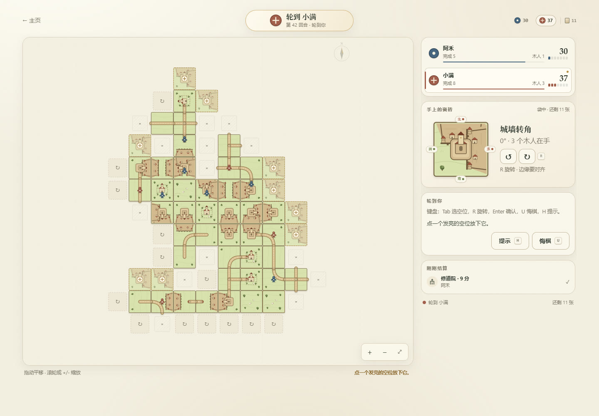
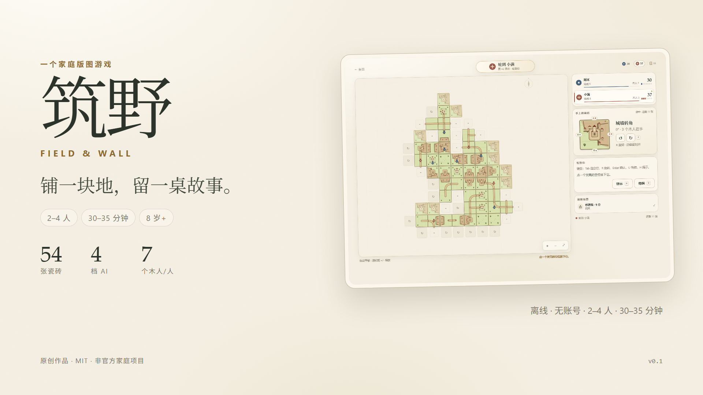
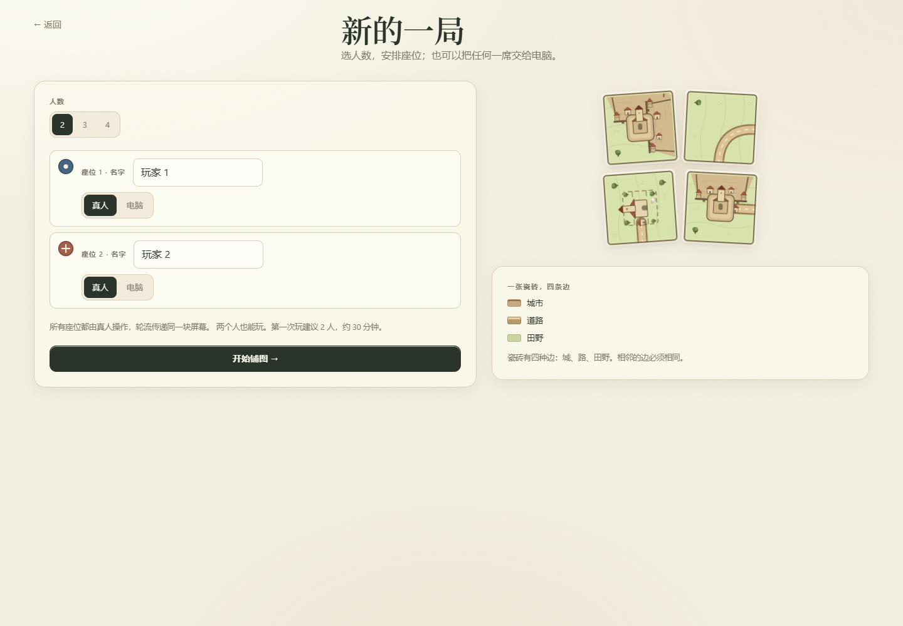
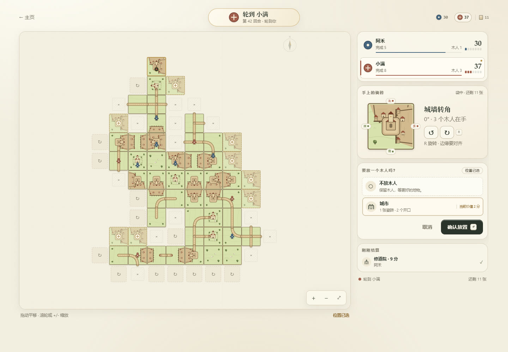
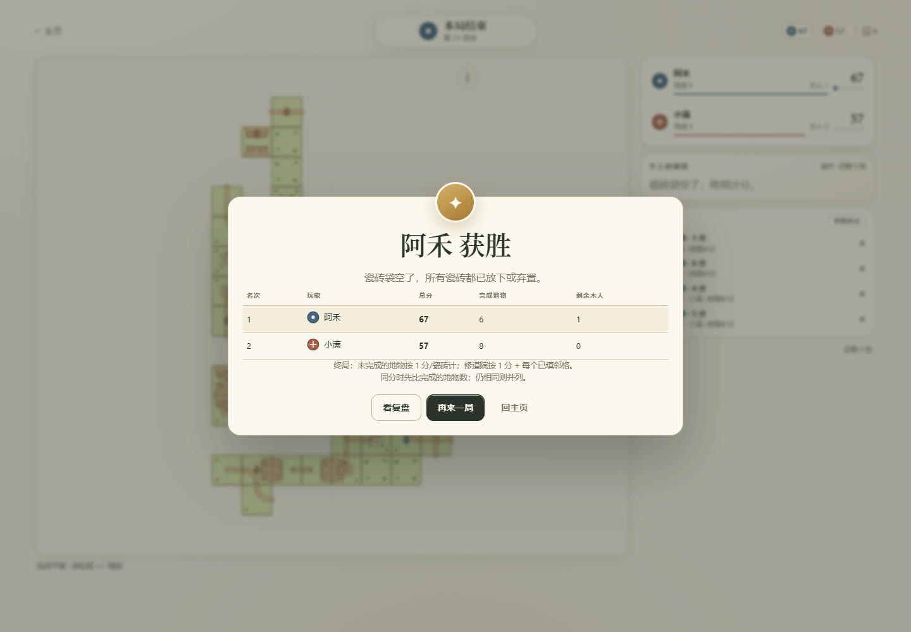
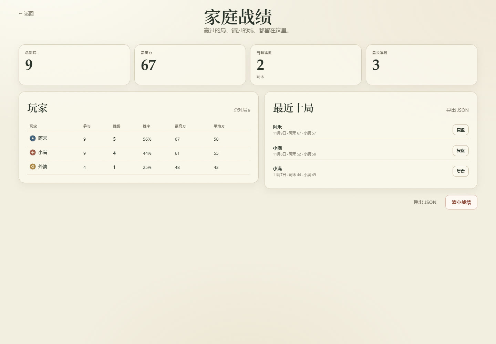
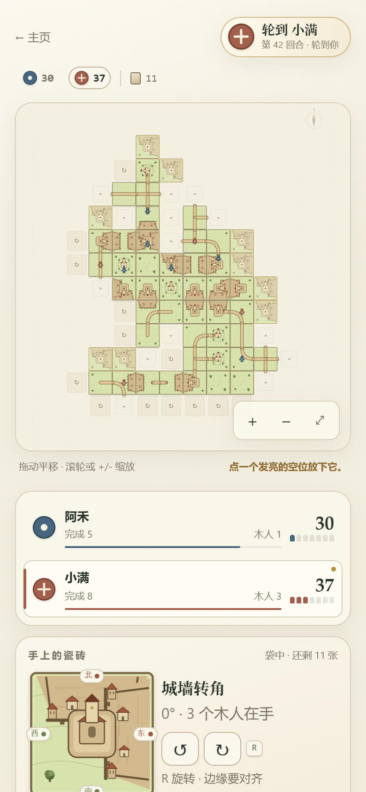
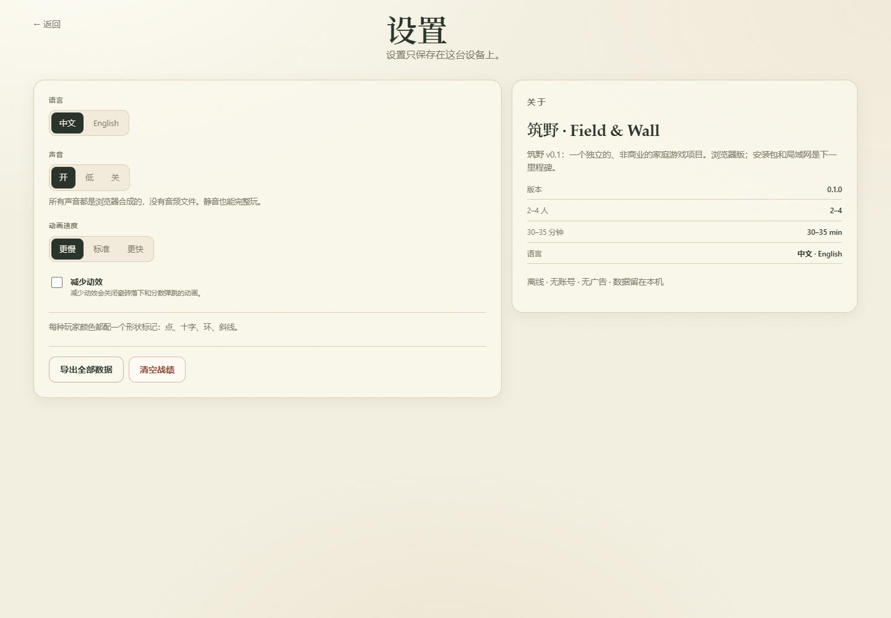
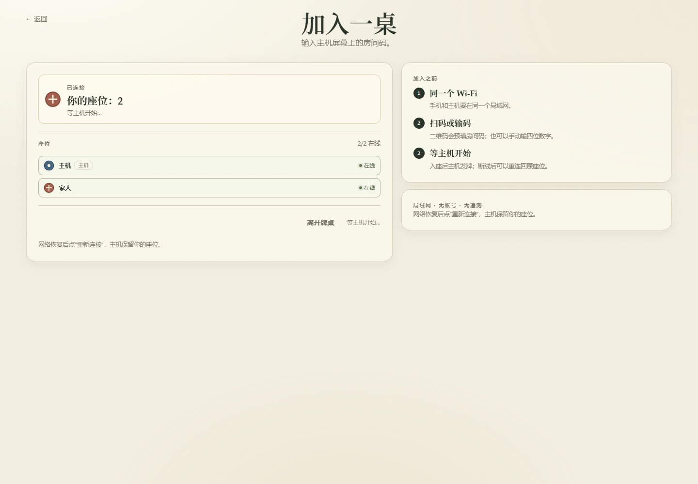
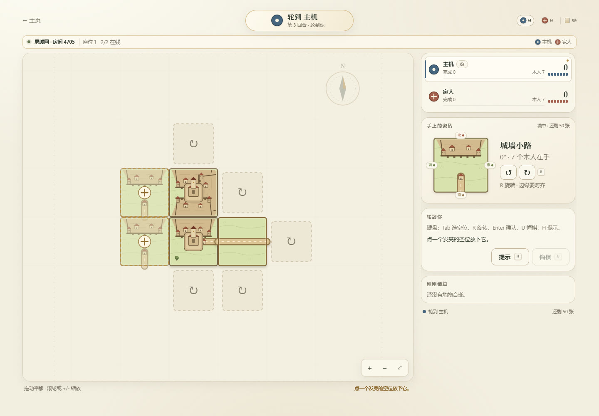

[English](README.md) · **简体中文**

# 筑野 · Field & Wall

**一块地，一座城。** 一款 2–4 人的原创家庭版图游戏：54 张瓷砖、每人 7 个木人、四档 AI、同屏热座、局域网、提示、悔棋、自动保存和复盘——离线、无账号、无广告。



[](docs/promo/field-and-wall-promo-zh.mp4)

*48 秒 · 1920×1080 · 60 fps · 中英两版 · [宣传片清单](video.json)*

## 一回合，五秒看懂

| 铺 | 算分 | 结束 |
| --- | --- | --- |
| 转一张瓷砖，边对边接上地图；再在这张瓷砖的城市、道路或修道院上放一个木人。 | 城市合拢 2 分/瓷砖，道路 1 分/瓷砖，修道院 9 分；终局未完成按 1 分/瓷砖。 | 袋子空了 → 终局计分。分高者胜；同分先比完成的地物数。 |

## 里面有什么

- **规则，逐条核对** — 54 张瓷砖、15 种原创类型、4 个方向、每人 7 个木人；城市/道路/修道院计分、木人多数与回手都有测试（[`tests/engine.test.ts`](tests/engine.test.ts)）和审计表（[`docs/rules.md`](docs/rules.md)）。
- **四档 AI** — **陪玩**不抢小朋友的关键城，**轻松**会犯错，**正常**有基本计划，**挑战**会估算下一张牌的风险。AI 跑在 Web Worker，只读取公开视图，永远看不到牌袋顺序；`npm run calibrate` 生成每对 200 局的自对弈表（[`src/ai/`](src/ai/)、[`docs/ai-calibration.md`](docs/ai-calibration.md)）。
- **看得懂的桌子** — 每种颜色都有形状标记（点 / 十字 / 环 / 斜线）；键盘可玩、减少动效、合法空位可见，静音也能完整玩；大版图可拖动缩放，手机浏览器可玩。
- **一局之后的记忆** — 每步自动保存、**继续上局**、最近十局复盘、家庭战绩、JSON 导出。数据只留在这个浏览器里。
- **三种桌子** — 单人四档 AI、2–4 人同屏热座，以及**主机权威的局域网房间**：四位房间码、二维码、座位状态和访客重连。`src-tauri` 里是共享 Tauri 壳；安装包由中央发布流程构建。
- **小而私密** — 默认离线、无账号、无遥测。局域网只走同一个 Wi-Fi 和随包中继。

## 截图

| 一局真实的版图 | 新的一局 |
| --- | --- |
|  |  |

| 选空位、占一个地物 | 终局排名 |
| --- | --- |
|  |  |

| 家庭战绩 | 手机上 |
| --- | --- |
|  |  |

| 怎么玩 | 设置 |
| --- | --- |
|  |  |

| 开一桌局域网 | 访客座位 |
| --- | --- |
|  |  |

| 一局真实的局域网对局 | |
| --- | --- |
|  | 主机视角：房间码、座位和在线状态一直可见。 |

所有截图都由 Playwright + 系统 Chrome 从真实应用抓取：桌面 1440×1000，手机 390×844 @2x。说明见 [`docs/screenshots/README.md`](docs/screenshots/README.md)。

## 开始玩

需要 Node.js 22+。浏览器版是 v0.1 的主形态；Tauri 壳已包含，供中央发布流程构建安装包。

```bash
npm install
npm run dev        # http://localhost:5176
```

生产构建：

```bash
npm run build
npm run preview
```

### 局域网之夜

```bash
npm run build
npm run lan        # 在 8080 端口同时提供构建产物和中继
```

1. 主机电脑打开 `http://<主机局域网 IP>:8080`（例如 `http://192.168.1.20:8080`），选 **局域网**。`localhost` 在主机上能玩，但用 `localhost` 生成的二维码手机扫不到。
2. 选 2、3 或 4 个座位，创建房间，展示二维码和房间码。
3. 同一 Wi-Fi 的家人扫码，或在手机打开同一中继地址并输入四位房间码。
4. 所有座位在线后由主机开始。主机保留权威；访客只发送瓷砖和木人意图，不直接改状态。
5. 手机掉线后重新打开同一邀请链接即可回到原座位；主机关闭或刷新页面会结束房间。本版没有局域网悔棋、观战或暂停。

如果 8080 已被占用，运行 `node ../../tools/lan-server.mjs --dist dist --port 8096`，并用 `?lanPort=8096` 打开主机页面；二维码和邀请会跟着使用 8096。默认仍是 8080。

桌面开发：

```bash
npm run tauri dev
```

共享 Tauri 壳已接好，设计为自动启动 Rust 中继。安装包由中央 Family Arcade 发布流程构建（`npm run build` 后 `npm run tauri build`）；本仓库不附带预构建 `.exe`，本轮也没有运行 Tauri 构建。

## 怎么玩

1. 抽一张瓷砖，旋转，接到已有地图旁：相邻的边必须相同（城对城、路对路、田野对田野）。
2. 放好后，可以把一个木人放在这张瓷砖的城市、道路或修道院上。
3. 城市没有开口就合拢（2 分/瓷砖）；道路没有开口就合拢（1 分/瓷砖）；修道院周围八格填满就合拢（9 分）。
4. 合拢时，木人最多的玩家得分（并列都得分），所有木人回手。
5. 瓷砖袋空了，终局：未完成城市/道路 1 分/瓷砖；修道院 1 分 + 每个已填邻格。总分最高者胜。

如果一张瓷砖哪里都放不下，弃置并抽下一张。同分先比完成的地物数；仍相同则并列获胜。

### 计分表

| 地物 | 合拢时 | 终局未完成 |
| --- | --- | --- |
| 城市 | 2 分 / 瓷砖 | 1 分 / 瓷砖 |
| 道路 | 1 分 / 瓷砖 | 1 分 / 瓷砖 |
| 修道院 | 9 分 | 1 分 + 每个已填邻格 |
| 木人 | 合拢后回手 | 留在图上 |

### 操作

| 动作 | 鼠标 / 触屏 | 键盘 |
| --- | --- | --- |
| 选空位 | 点发亮的空位 | `Tab`、`Enter` |
| 旋转 | 旋转按钮 / 点瓷砖角 | `R` |
| 选木人 | 点地物按钮或图上的木人位 | `Tab`、`Enter` |
| 确认 | **确认放置** | `Enter` |
| 取消 | **取消** | `Esc` |
| 提示 / 悔棋 | 按钮 | `H` / `U` |
| 声音 | 顶栏 / 设置 | `M` 开 / 低 / 关 |

**为什么放不下？** 边上的小标签会告诉你：边必须同类型。灰掉的 `×` 表示四个方向都不行；`↻` 表示换个方向可能行。游戏不会静默吞掉点击——提示条会说人话。

**v0.1 限制：** 这一版**不做农田和农夫**。田野边只负责对齐，不参与计分。这是为了让第一次玩的人少记一条规则，详见 [`docs/limitations.md`](docs/limitations.md)。

## 一局之后

- **自动保存**：每步后保存；刷新或崩溃后主页出现「继续上局」。
- **复盘**：最近十局，可逐步看，显示当时的比分。
- **战绩**：按玩家名聚合总对局、胜场、胜率、最高分、当前/最长连胜。
- **导出 JSON**：设置和战绩；数据只在本地。

## 宣传片

Family Arcade 根工作室从 [`video.json`](video.json) 渲染宣传片：八句中英旁白、事实、强调色和三张截图。上一阶段已渲染的 MP4/海报仍保留在 `docs/promo/`。本 app **不维护**单独的 Remotion 工程。

[](docs/promo/field-and-wall-promo-zh.mp4)

- [中文 MP4](docs/promo/field-and-wall-promo-zh.mp4) · [中文字幕](docs/promo/field-and-wall-promo-zh.srt)
- [英文 MP4](docs/promo/field-and-wall-promo-en.mp4) · [英文字幕](docs/promo/field-and-wall-promo-en.srt)
- 现有母带：−14.4 / −14.1 LUFS，−1.47 / −1.49 dBTP。

## 开发

```bash
npm install
npm run dev          # Vite（5176）
npx tsc --noEmit     # 类型检查
npx vitest run       # 62 个测试：引擎、数据、AI、错误码、主页版图
npm run build        # 类型检查 + 生产构建
npm run data:verify  # 数量、份数、边平衡、每种瓷砖都能接上起始牌
node scripts/e2e.mjs # 真 Chrome：单人、热座、悔棋、恢复、终局、复盘、战绩、手机
node scripts/lan-e2e.mjs # 主机 + 访客 + 走法同步 + 重连（先 npm run build）
npm run shots        # 重新生成截图（含 LAN）
npm run demo         # 用真实对局重新生成演示/终局存档
npm run calibrate    # 每对 200 局 AI 自对弈表
```

宣传片清单：`video.json`（根工作室）。

### 架构

```
src/game/      纯规则：瓷砖、旋转、并查集地物、计分、复盘
src/ai/        四档 + Web Worker；只读公开视图；陪玩克制
src/net.ts     Tauri / 浏览器中继检测；邀请链接与二维码基址
src/ui/        SVG 瓷砖/版图、屏幕、LAN 大厅、对话框；事件里不放规则
src/i18n.ts    完整中英文案
src/storage.ts 自动保存、战绩、历史、导出
src-tauri/     共享 LAN 中继壳；安装包由中央发布构建
tests/         引擎、数据、AI、错误码、模拟、主页版图
data/          54 张瓷砖数据 + 校验脚本
docs/          规则审计、限制、截图、宣传物料
video.json     根工作室宣传片清单（8 句中英旁白 + 事实 + 截图）
```

规则引擎只有一份（TypeScript），没有 DOM、网络、时钟或裸 `Math.random`；应用、AI Worker 和复盘共用它。发牌由注入的 seeded RNG 驱动。

## 状态与路线

- **v0.1** — 热座 + 单人、四档 AI、提示/悔棋、自动保存/继续、复盘、战绩、双语、响应式手机布局、真实截图、主机权威的局域网（二维码/房间码/重连）和 Tauri 壳。
- **v0.2** — LAN 打磨（观战、暂停、悔棋投票、AI 托管）、中央发布流程验证安装包、根据 200 局校准调 AI。
- **v0.3** — 家庭试玩、可选第 5 人变体（不承诺）。

## 已知限制

- 没有农田/农夫；田野只做对齐。没有扩展。
- Tauri 壳已配置，但本轮没有运行 `cargo`/`tauri build`；安装包由中央发布流程构建。
- 局域网需要同一 Wi-Fi 和中继；主机页面必须保持打开。主机刷新会结束房间；访客可用同一邀请重连。本版没有 LAN 悔棋、观战或暂停。
- AI 校准现在是每对 200 局：陪玩对轻松 20%，轻松对正常 34%，正常对挑战 52%。正常和挑战在这个样本量下仍难分高下，详见 `docs/ai-calibration.md`。
- 「30–35 分钟」「8 岁+」是设计目标，不是基准测试结果。
- 手机缩放用拖动 + 按钮，不做双指手势。

## 制作与许可

- 游戏设计、规则文字、瓷砖美术、界面和宣传片：本项目原创。
- 使用 React 19、TypeScript、Vite、Vitest，以及共享的 Family Arcade LAN/Tauri 壳。
- 宣传片由 Family Arcade 根工作室（Remotion）从 `video.json` 渲染；声音为合成，无第三方采样。
- 代码：[MIT](LICENSE)。文档、截图、宣传物料：CC BY 4.0（另有注明除外）。
- **筑野是独立的、非商业的家庭项目。** 与《卡卡颂》Carcassonne 或任何发行商无关，也未获其背书；机制借鉴传统版图拼放游戏，名称、规则文字、美术和瓷砖设计均为本项目原创。详见 [NOTICE.md](NOTICE.md)。
