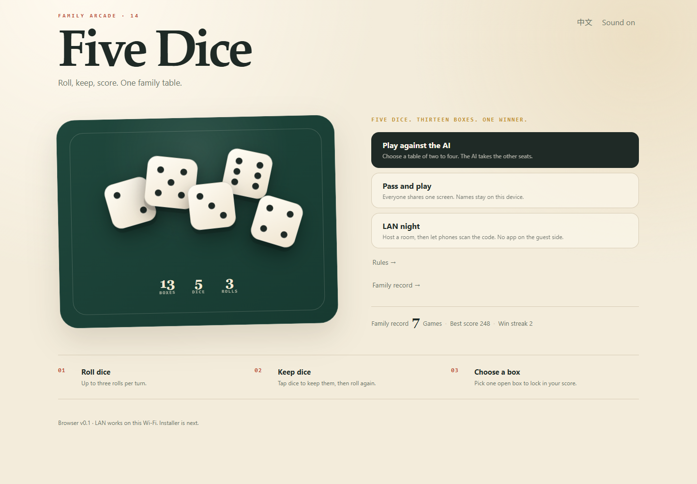
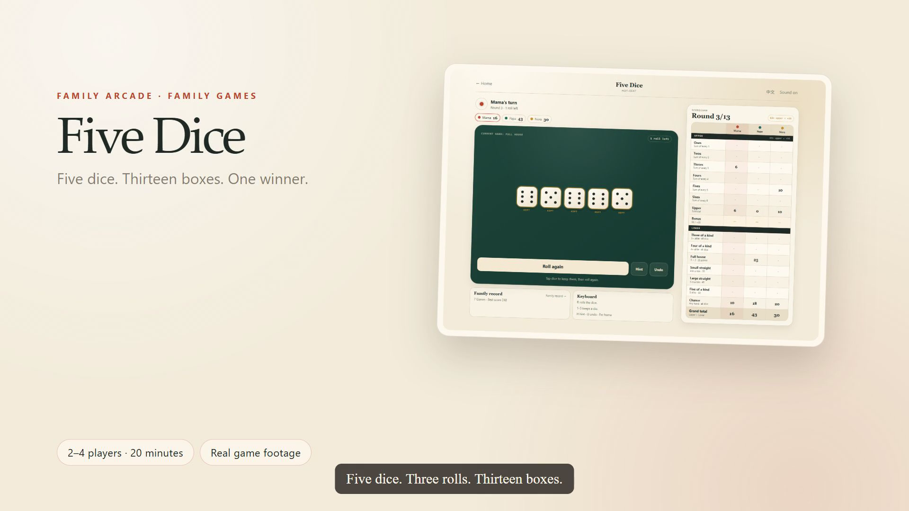
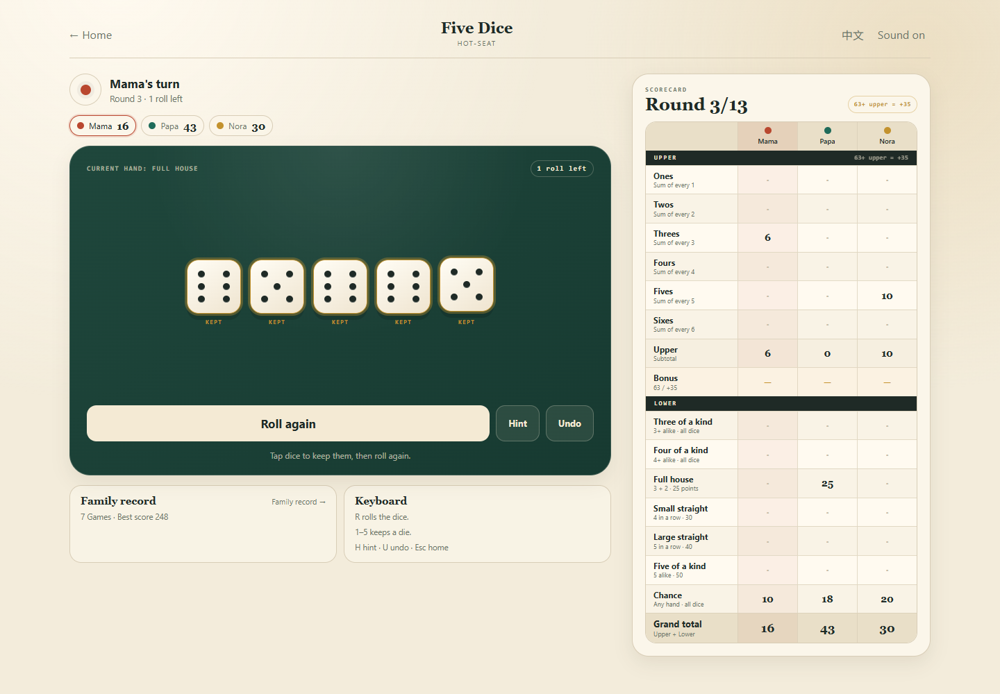
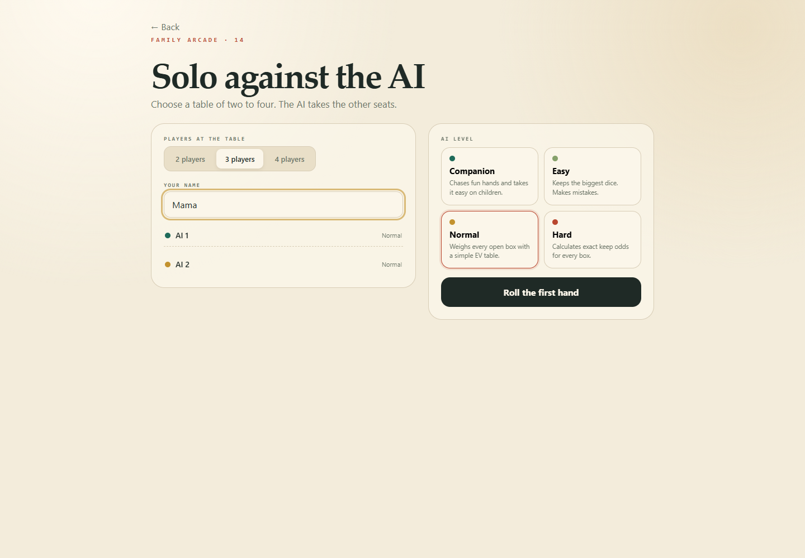
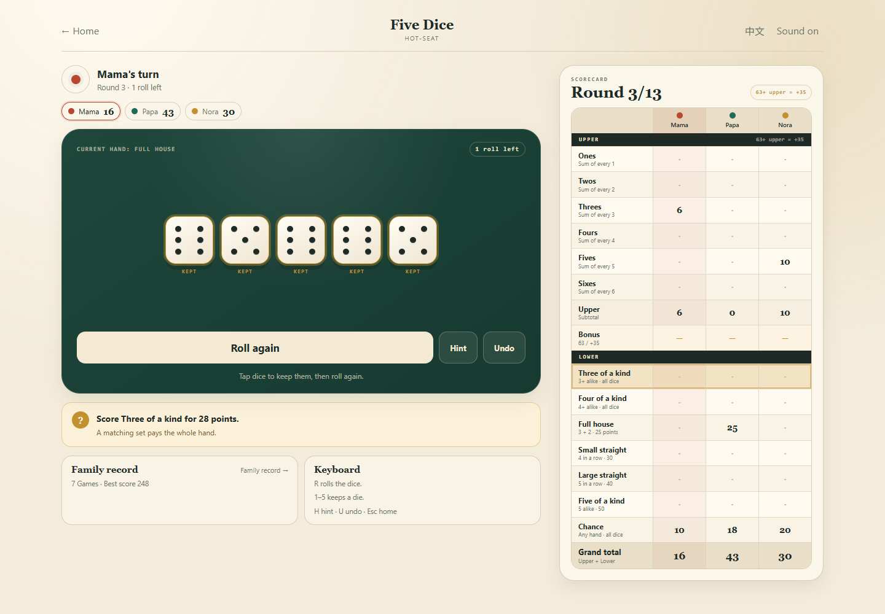
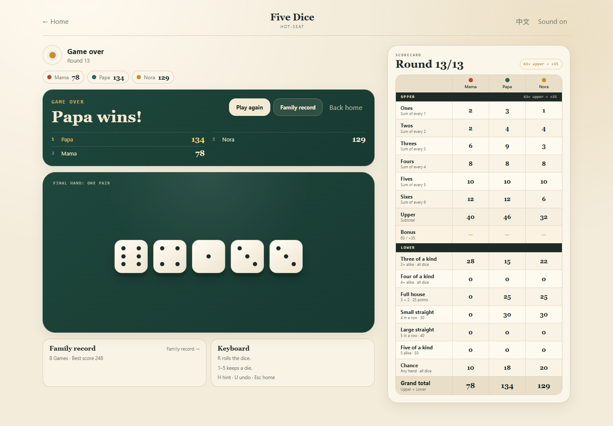
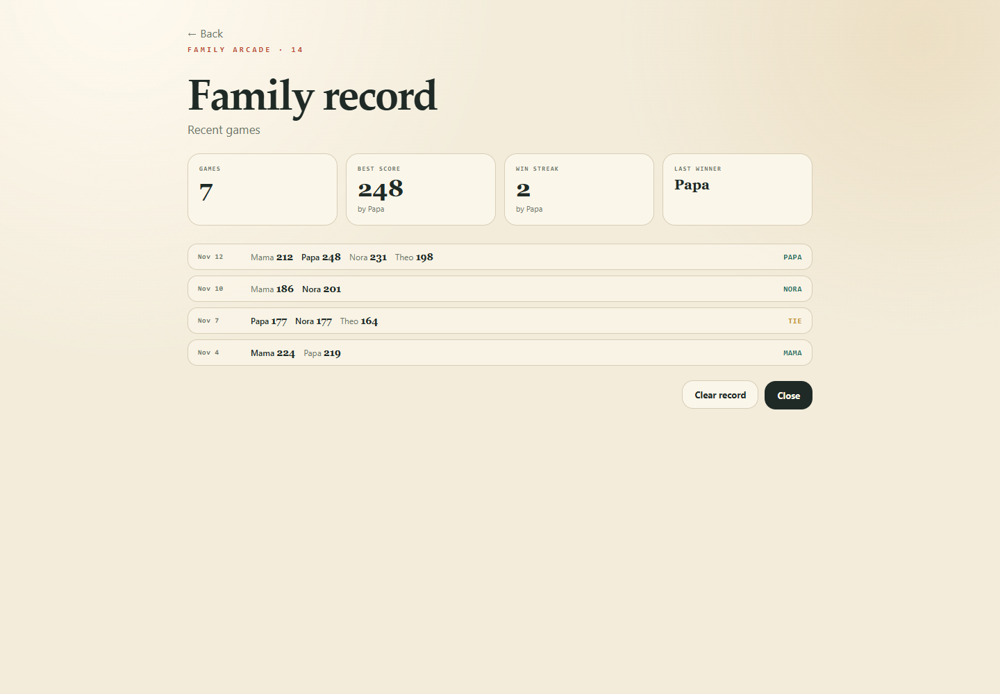
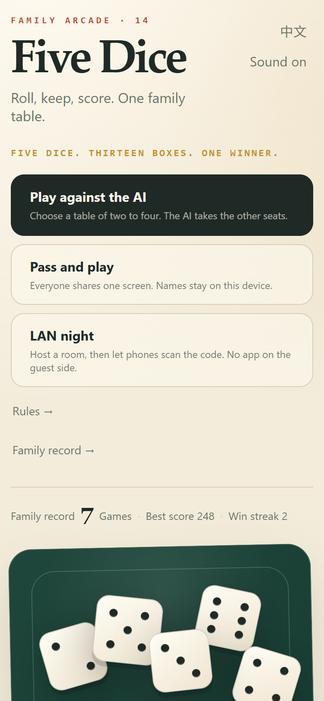

# Five Dice · 五骰

**English** · [简体中文](README.zh-CN.md)

> **Five dice. Thirteen boxes. One winner.**

A warm, offline family dice table for **2–4 players**: five dice, three rolls, thirteen
scoring boxes, four AI levels, hot-seat and LAN night from a phone. No account, no ads,
no cloud; the only network Five Dice needs is your own Wi-Fi for LAN.



[](docs/promo/five-dice-promo-en.mp4)

*45 seconds · 1920×1080 · 60 fps · [中文版](docs/promo/five-dice-promo-zh.mp4) · [video.json](video.json)*

*45-second promo: the root Family Arcade studio renders it from [`video.json`](video.json).*

## A turn, in five seconds

| Roll | Keep | Score |
| --- | --- | --- |
| Roll all five dice. | Tap any dice to keep them, then reroll the rest. Up to three rolls. | Fill one open box. Highest total after 13 rounds wins. |

The upper boxes (ones–sixes) score matching dice. Reach **63** in the upper section for
the **35-point bonus**. Full house 25, small straight 30, large straight 40, five of a
kind 50, chance = the raw sum.

## What is inside

- **A real, tested engine.** Pure TypeScript in `src/game/five-dice.ts`, deterministic,
  **36 unit tests**, no DOM, clock, network or `Math.random` in the rules. See
  [`docs/rules.md`](docs/rules.md).
- **Four AI levels.** Companion chases fun hands and takes it easy on children; Easy
  keeps the biggest dice and makes mistakes; Normal uses a simple EV table; Hard
  calculates exact one-roll keep probabilities and plays the upper bonus.
- **Three ways to play.** Solo against 1–3 AI opponents, 2–4 players passing one
  device, or 2–4 players over LAN. The host is authoritative; guests only send intents.
- **Small comforts.** Undo, a hint with a reason, autosave/Continue, a local family
  record, sound on/off, keyboard shortcuts, reduced-motion support, and a complete
  Chinese/English UI.
- **Private by default.** No accounts, telemetry, ads, remote fonts or downloaded art.
  Dice pips, tables, cards and the UI are drawn in CSS.

## Screenshots

| A real hand | AI setup |
| --- | --- |
|  |  |

| Hint with a reason | Final table |
| --- | --- |
|  |  |

| Family record | Phone |
| --- | --- |
|  |  |

All screenshots come from the running app at 1440×1000 (phone 390×844 @2×). The
screenshot script uses a fixed seed and a prepared local family record so the same real
UI can be reviewed after every change; see `scripts/shots.mjs`.

## Play locally

```bash
npm install
npm run dev        # http://localhost:5193
npm run check      # tsc + 36 tests + production build
npm run e2e        # real Chrome, dev server required
npm run shots      # regenerate docs/screenshots/{en,zh}
```

Keyboard: **R** roll, **1–5** keep a die, **H** hint, **U** undo, **Esc** home. The
scorecard buttons are normal focusable buttons, so Tab/Enter also works.

## LAN night

Browser/dev:

```bash
npm run build
npm run lan        # relay on :8080, serves dist/
# open http://localhost:5193, LAN night, host a room
```

If port 8080 is already busy, serve the relay elsewhere and give the host page the same
port:

```bash
node ../../tools/lan-server.mjs --dist dist --port 8093
# open http://localhost:5193/?relay=8093
```

The host shows a 4-digit room code and a QR invite. Guests open the address on the same
Wi-Fi, type a name, and join; no guest app is needed. For 3–4 player rooms, each guest
joins from their own phone before the host deals the dice.

For a phone guest in **browser dev**, open the host page through your computer's LAN IP
(for example `npx vite --host --port 5193`, then `http://192.168.x.x:5193`) so the
invite address is reachable from the phone. The Tauri build does this automatically.

Desktop: the Tauri build starts the shared Rust relay internally and serves the built
app to phones. The relay is a dumb message bus: the host owns the game state, applies
every intent with the seat check, and sends each guest only their own `viewFor` view.

## Build the Windows installer

```bash
npm install
npx tauri build --bundles nsis
# src-tauri/target/release/bundle/nsis/Five Dice_0.1.0_x64-setup.exe
```

The installer is per-game and lightweight; WebView2 uses the standard bootstrapper. A
Windows SmartScreen warning is expected for an unsigned family build.

## Known limitations

- Hard AI uses exact one-roll keep odds, not a full three-roll solver.
- No Yahtzee bonus or joker rules; a five-of-a-kind is not accepted as a full house.
- LAN is same-subnet IPv4. A dropped guest pauses the room; restart the room to continue.
- LAN games are not written to the local family record.
- Undo is disabled in LAN and after the final score. See
  [`docs/limitations.md`](docs/limitations.md) for the honest full list.

## Credits

Original code, art, rules implementation and copy for Family Arcade. MIT. Yahtzee is a
trademark of Hasbro; this is an original Yahtzee-like family game, not affiliated with
or endorsed by Hasbro. See [`NOTICE.md`](NOTICE.md).


## Promo

[](docs/promo/five-dice-promo-en.mp4)

- [English cut](docs/promo/five-dice-promo-en.mp4) · [other language](docs/promo/five-dice-promo-zh.mp4)
- [SRT](docs/promo/five-dice-promo-en.srt) · [video.json](video.json)
- Real app screenshots and real engine data; claims match the tests.

