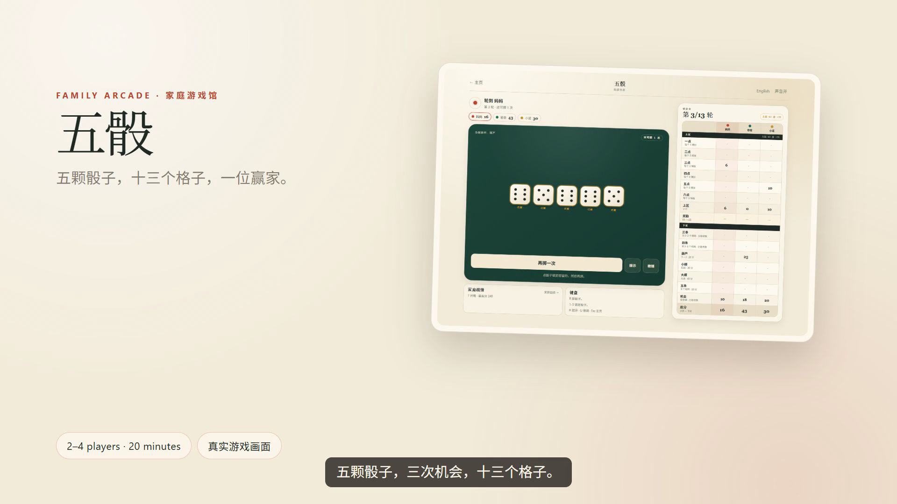
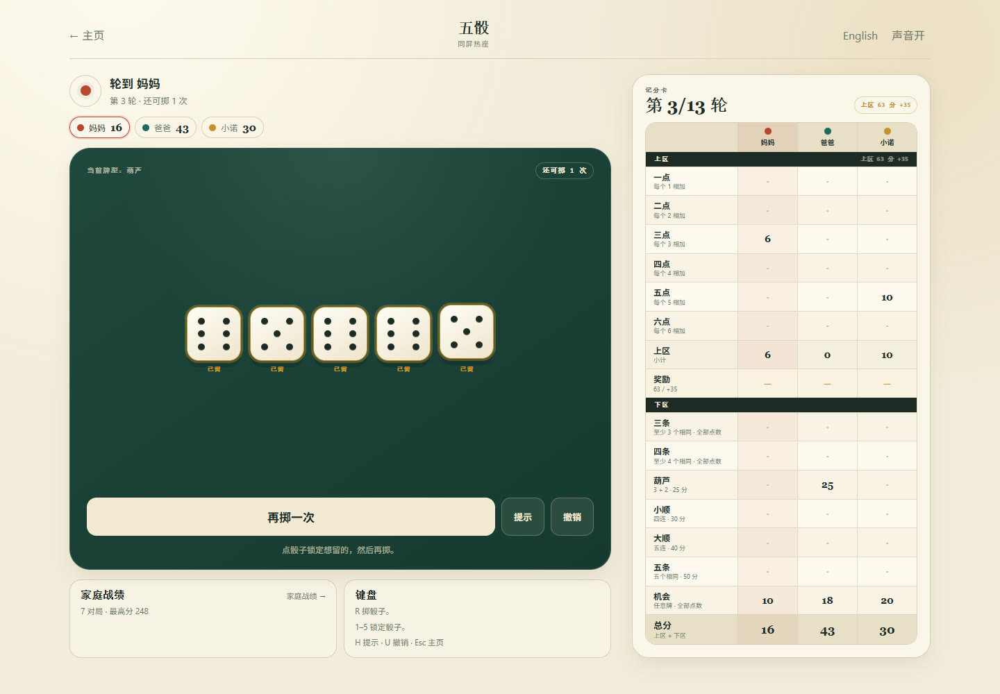
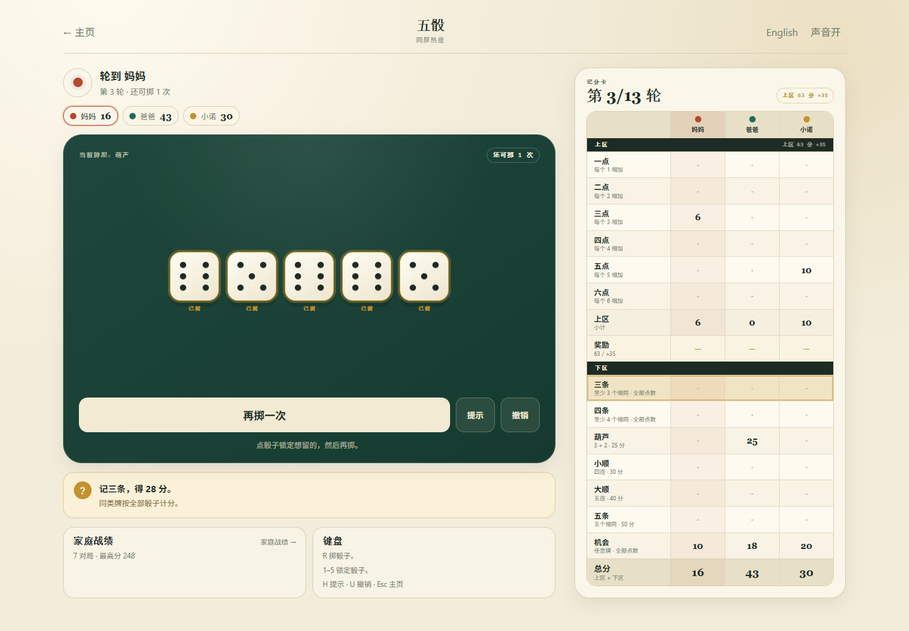
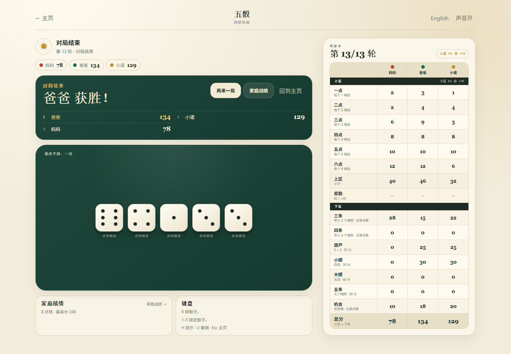
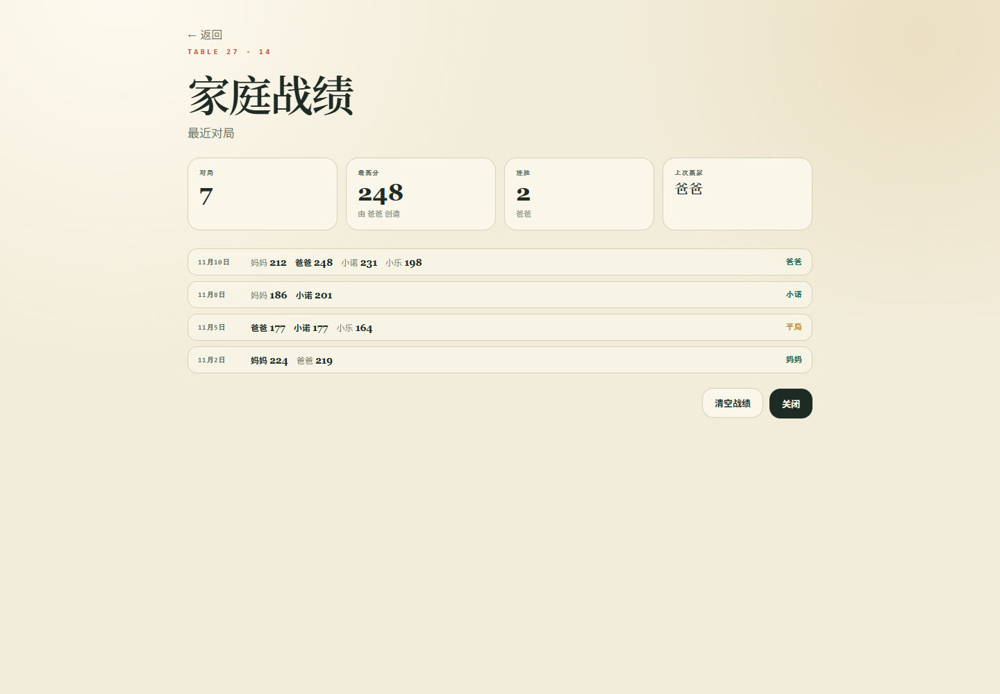
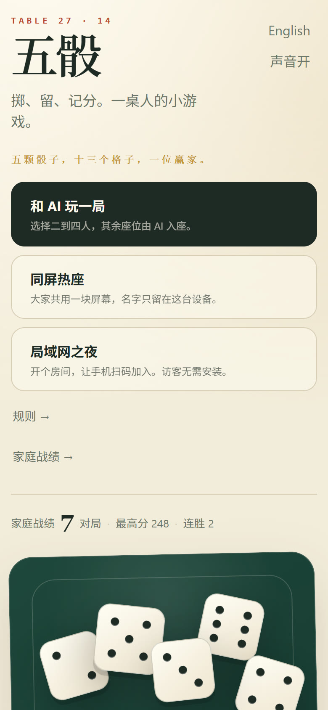

# 五骰 · Five Dice

[English](README.md) · **简体中文**

> **五颗骰子，十三个格子，一位赢家。**

给家庭牌桌的暖色骰子游戏：**2–4 人**、五颗骰子、三次掷骰、十三个记分格、四档 AI、
同屏热座，以及手机浏览器直接加入的局域网之夜。无账号、无广告、无云端；除了自家
Wi-Fi 的局域网，五骰不需要联网。


[](docs/promo/five-dice-promo-zh.mp4)

*45 秒 · 1920×1080 · 60fps · [English cut](docs/promo/five-dice-promo-en.mp4) · [video.json](video.json)*

*45 秒宣传片由根目录 Family Arcade studio 依据 [`video.json`](video.json) 渲染。*

## 一回合，五秒看懂

| 掷 | 留 | 记 |
| --- | --- | --- |
| 掷出五颗骰子。 | 点任意骰子锁定，再掷其余的，最多三次。 | 填一个空格。十三轮后总分最高者胜。 |

上区（一点到六点）只算对应点数。上区满 **63** 分奖励 **35** 分。葫芦 25 分，小顺
30 分，大顺 40 分，五条 50 分，机会格拿全部点数之和。

## 里面有什么

- **真正的引擎。** `src/game/five-dice.ts` 是纯 TypeScript、确定性、**36 个单元测试**；
  规则层不碰 DOM、时钟、网络或 `Math.random`。见 [`docs/rules.md`](docs/rules.md)。
- **四档 AI。** 陪玩追好玩的大牌，对小朋友手下留情；轻松只留最大的一组，会失手；
  标准用简单期望值表；挑战精确计算每个格子的单次留骰概率，并会为上区奖励做取舍。
- **三种玩法。** 单人对抗 1–3 个 AI、2–4 人同屏热座，或 2–4 人局域网。主机权威，
  访客只发送意图。
- **小细节。** 撤销、带理由的提示、自动保存/继续、本机家庭战绩、声音开关、键盘操作、
  减少动效，以及完整的中英双语界面。
- **默认私密。** 无账号、无遥测、无广告、无远程字体、无下载美术；骰子、牌桌、卡片和
  界面全部用 CSS 绘制。

## 截图

| 真实手牌 | AI 设置 |
| --- | --- |
|  |  |

| 带理由的提示 | 终局 |
| --- | --- |
|  |  |

| 家庭战绩 | 手机 |
| --- | --- |
|  |  |

全部来自真实运行的应用：桌面 1440×1000，手机 390×844 @2×。截图脚本使用固定随机种子
和一份预置的本机家庭战绩，方便每次改动后复核同一套真实界面；见 `scripts/shots.mjs`。

## 本地运行

```bash
npm install
npm run dev        # http://localhost:5193
npm run check      # tsc + 36 个测试 + 生产构建
npm run e2e        # 真实 Chrome，需先运行 dev
npm run shots      # 重新生成 docs/screenshots/{en,zh}
```

键盘：**R** 掷骰，**1–5** 锁定骰子，**H** 提示，**U** 撤销，**Esc** 主页。记分卡按钮
本身就是可聚焦按钮，Tab/Enter 也能操作。

## 局域网

浏览器/开发版：

```bash
npm run build
npm run lan        # :8080 中继，同时托管 dist/
# 打开 http://localhost:5193，选“局域网之夜”，开房间
```

如果 8080 已被占用，可以换一个端口启动中继，并在主机页面加上同一个端口：

```bash
node ../../tools/lan-server.mjs --dist dist --port 8093
# 打开 http://localhost:5193/?relay=8093
```

主机显示 4 位房间码和二维码邀请。访客在同一 Wi-Fi 打开地址、填写名字即可加入，无需
安装访客端。3–4 人房间请让每位访客先用自己的手机加入，再由主机开始掷骰。

如果要在**浏览器开发版**里用手机加入，请通过电脑的局域网 IP 打开主机页面（例如
`npx vite --host --port 5193`，然后打开 `http://192.168.x.x:5193`），这样邀请地址
手机才能访问。Tauri 桌面版会自动处理这一点。

桌面版：Tauri 安装包启动同一个内置 Rust 中继，并把构建产物托管给手机。中继只负责
转发消息；主机保存权威状态，用回合和座位校验每个意图，并且只给访客发送属于他的
`viewFor` 视图。

## 构建 Windows 安装包

```bash
npm install
npx tauri build --bundles nsis
# src-tauri/target/release/bundle/nsis/Five Dice_0.1.0_x64-setup.exe
```

每款游戏单独打包，安装包保持轻量；WebView2 使用标准引导程序。未签名的家庭构建会触发
Windows SmartScreen 提示。

## 已知限制

- 挑战档 AI 使用精确的单次留骰概率，不是完整的三次掷骰求解器。
- 没有 Yahtzee 奖励分和 Joker 规则；五条不能当作葫芦。
- 局域网仅支持同一子网的 IPv4。访客掉线会暂停房间，需要重新开房。
- 局域网对局不会写进本机家庭战绩。
- 局域网中和终局后不能撤销。完整清单见 [`docs/limitations.md`](docs/limitations.md)。

## 许可

Family Arcade 原创代码、美术、规则实现与文案，MIT。Yahtzee 是 Hasbro 的商标；五骰是一款
原创的 Yahtzee 式家庭游戏，与 Hasbro 无关联。见 [`NOTICE.md`](NOTICE.md)。


## 宣传片

[](docs/promo/five-dice-promo-zh.mp4)

- [中文成片](docs/promo/five-dice-promo-zh.mp4) · [另一语言](docs/promo/five-dice-promo-en.mp4)
- [字幕](docs/promo/five-dice-promo-zh.srt) · [video.json](video.json)
- 画面来自真实应用与真实引擎数据；数字与测试一致。

