# Fleet · 海战棋

**English** · [简体中文](README.zh-CN.md)

> **Ten columns. Five ships. One quiet sea.**

A hidden-fleet battleship game for the family table: **2 players**, a 10×10 chart,
five ships each, four AI captains, same-screen hot-seat and LAN play from a phone.
No account, no ads, no remote assets. LAN needs only your own Wi-Fi.

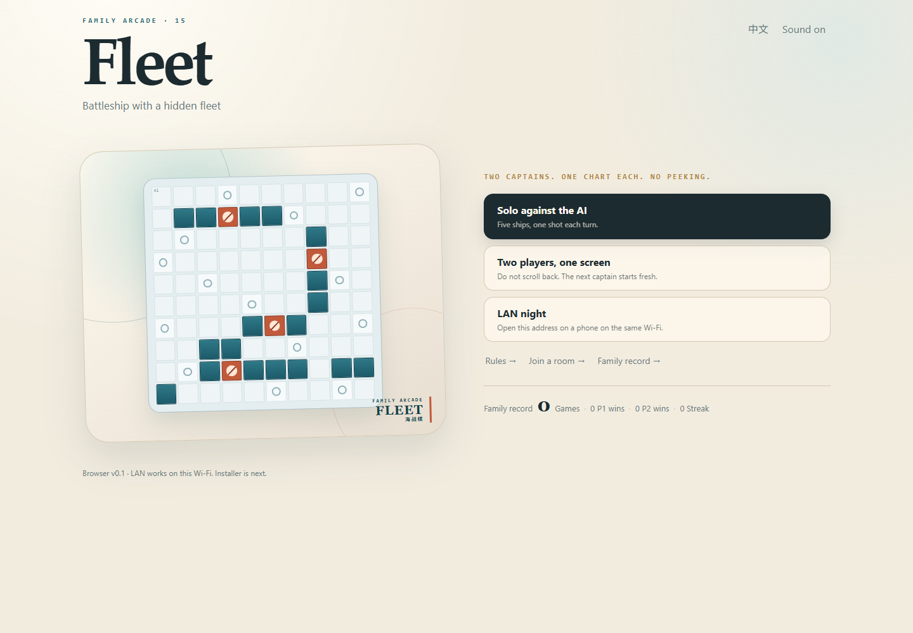

[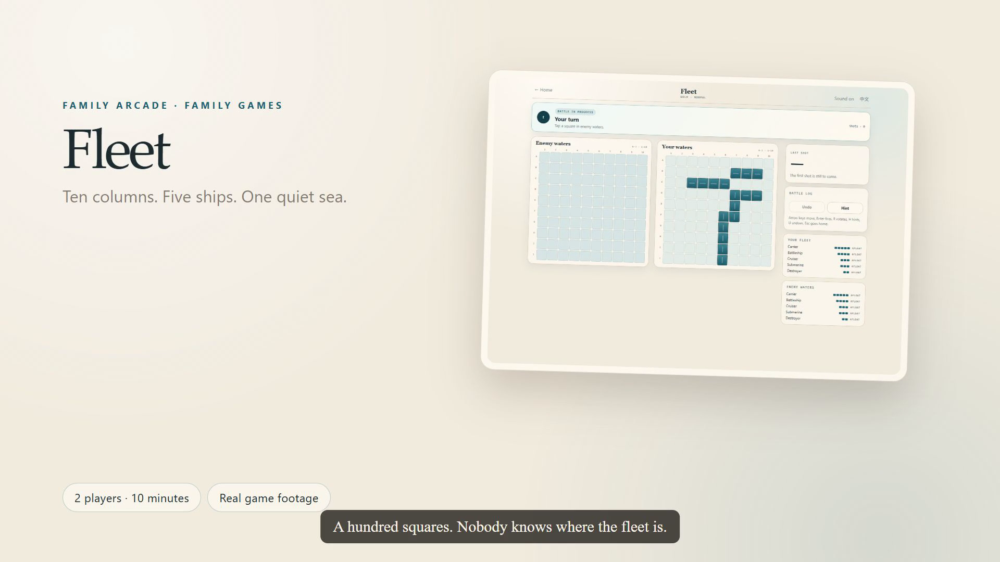](docs/promo/fleet-promo-en.mp4)

*45 seconds · 1920×1080 · 60 fps · [中文版](docs/promo/fleet-promo-zh.mp4) · [video.json](video.json)*

## A turn, in five seconds

| Hide | Fire | Sink |
| --- | --- | --- |
| Place carrier 5, battleship 4, cruiser 3, submarine 3 and destroyer 2. | Take turns firing at one square; miss, hit and sunk are marked at once. | The first captain to sink all five enemy ships wins. |

A hit does **not** earn another shot. Turns always alternate.

## What is inside

- **A real, tested engine.** Pure TypeScript in `src/game/fleet.ts`: no DOM, clock,
  network or `Math.random`. Random fleets take an injected RNG. **30 unit tests** cover
  placement, gunnery, sunk/win detection, hidden per-seat views and all four AI levels.
  See [`docs/rules.md`](docs/rules.md).
- **Four AI captains.** Companion is gentle, Easy fires almost anywhere, Normal uses
  hunt/target parity, and Hard counts hull placements with a probability density.
- **Three ways to play.** Solo against the AI, two players passing one device, or host
  and guest on the same Wi-Fi.
- **A real per-seat LAN view.** The host is authoritative. The guest receives
  `view(state, 1)` only; live enemy hulls never enter the guest payload. The host screen
  renders its own view, and every intent is re-checked for seat, turn and cell.
- **Family comforts.** Undo and reasoned hints in local games, autosave/resume, a local
  family logbook, sound on/off, keyboard play, reduced-motion support, complete English
  and Chinese UI, and a layout that works on a phone.
- **Private by default.** No accounts, telemetry, ads, CDN, remote fonts or downloaded
  art. Every mark, ship and sound is drawn or synthesised in the app.

## The four AI captains

| Level | Behaviour |
| --- | --- |
| **Companion** | Gentle. Follows a loose trail, sometimes sweeps near its own misses, and eases off when one ship remains. Good with children. |
| **Easy** | Picks a random unshot square. A kind first opponent. |
| **Normal** | Hunts on a checkerboard, then targets adjacent cells and extends a line of hits. |
| **Hard** | Enumerates every legal placement of every remaining hull and weights the cells by probability. It uses public shot results only — it never peeks at your fleet. |

All four are deterministic when given the same view and the same injected RNG. The app
passes `Math.random` for variety; tests pass seeded generators.

## Screenshots

| Home | Choose an opponent |
| --- | --- |
|  | 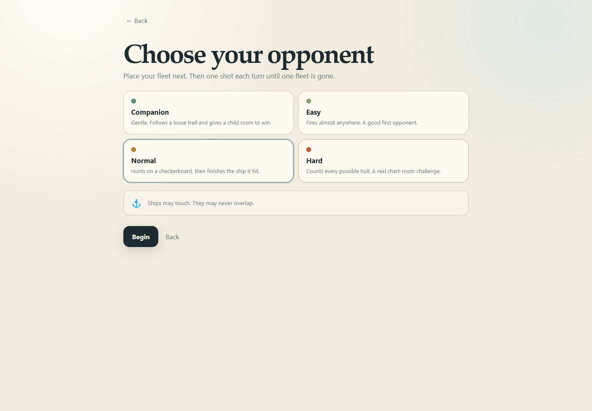 |

| Deploy the fleet | A battle |
| --- | --- |
| 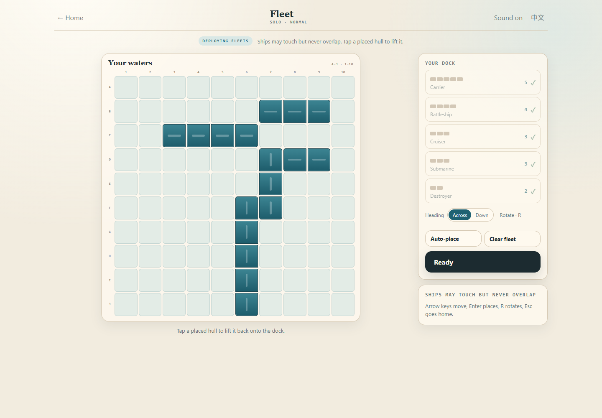 | 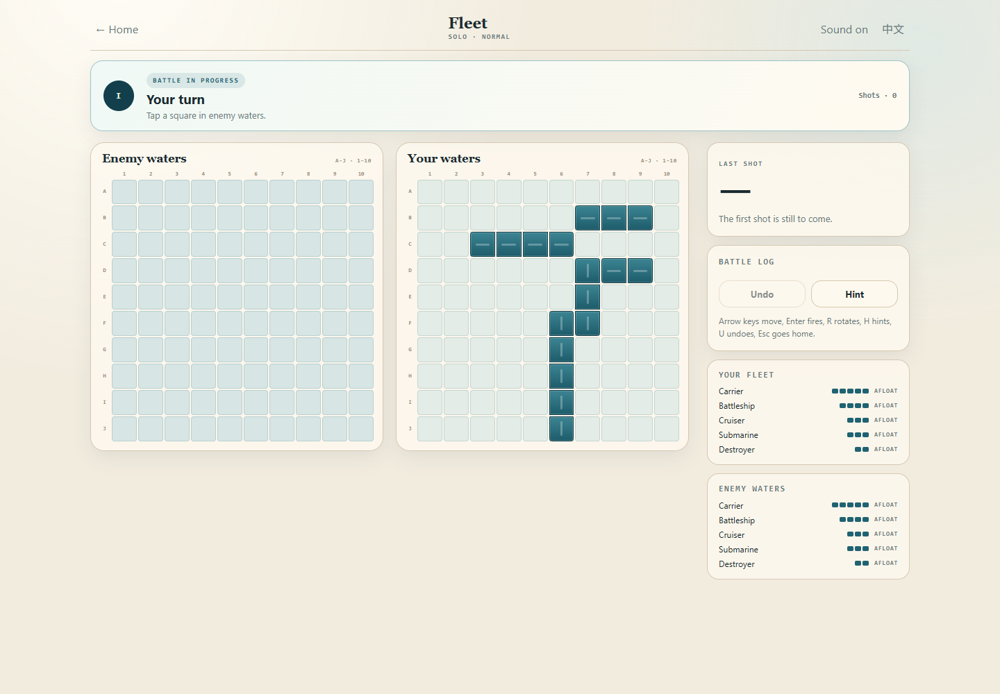 |

| Hint with a reason | Game over |
| --- | --- |
| 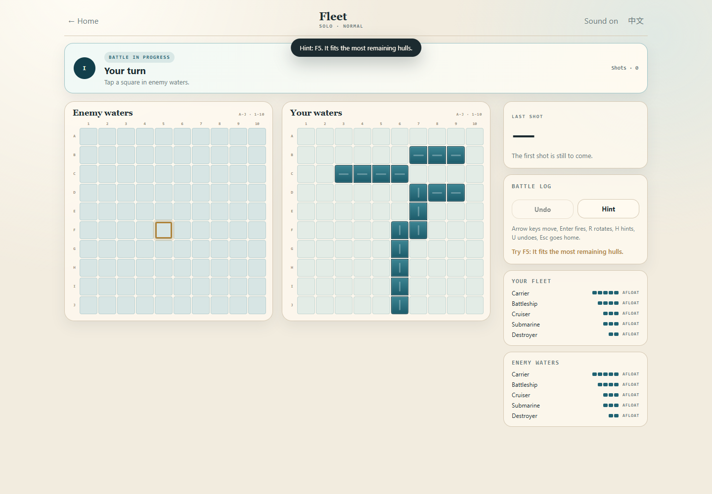 | 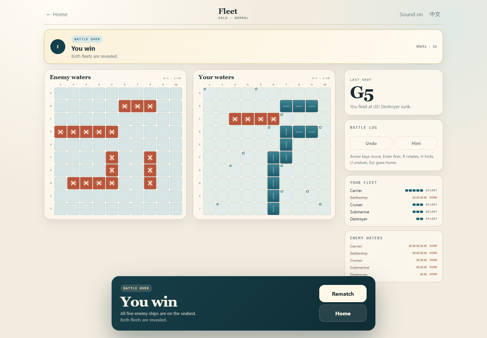 |

| Rules | Family logbook |
| --- | --- |
| 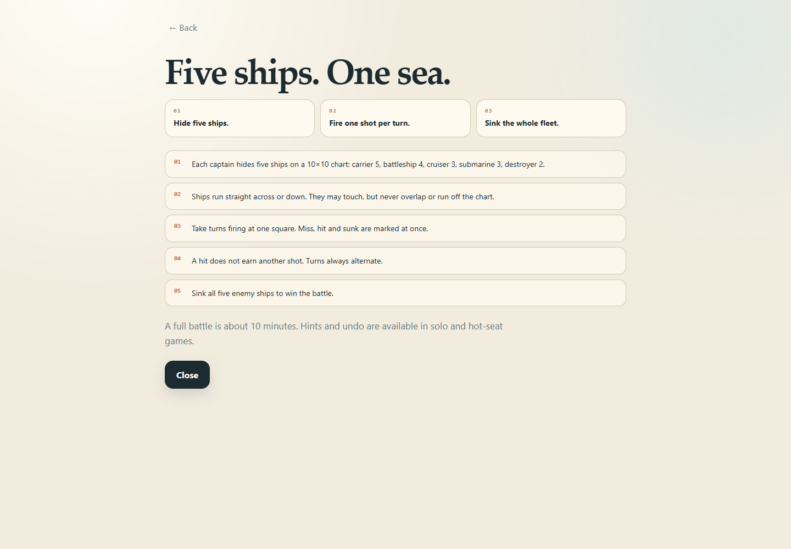 | 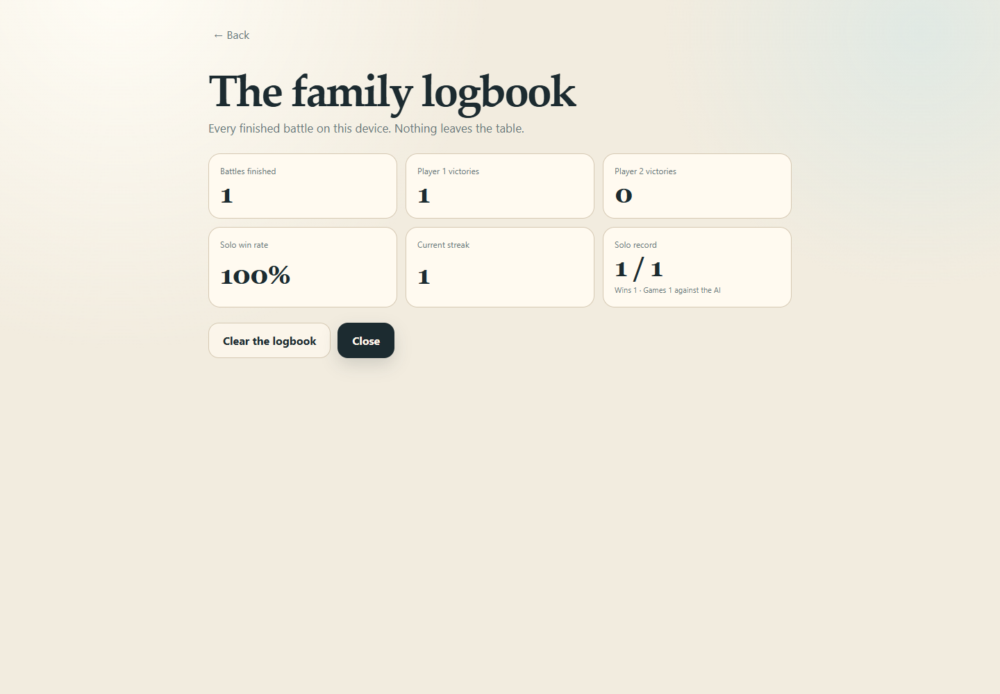 |

| Phone home | Phone battle |
| --- | --- |
| 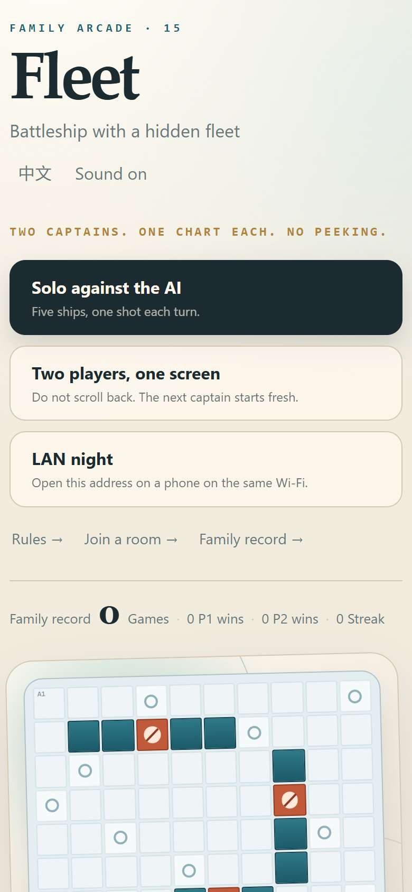 | 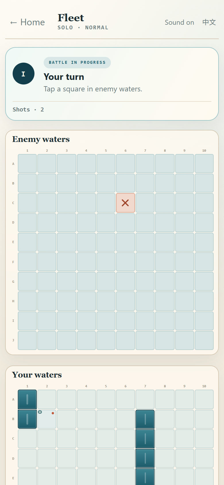 |

All screenshots come from the running app: desktop 1440×1000, phone 390×844 @2×
(780×1688 PNG). No mockups.

## Play locally

```bash
npm install
npm run dev        # http://localhost:5194
npm run check      # tsc + 30 tests + production build
node scripts/e2e.mjs   # real Chrome; run the dev server first
node scripts/shots.mjs # regenerate docs/screenshots/{en,zh}
```

Keyboard: arrow keys move around the chart, **Enter** fires (or places a hull), **R**
rotates during deployment, **H** shows a hint, **U** undoes, **Esc** returns home.

## LAN night

Browser/dev build:

```bash
npm run build
npm run lan        # relay + static server on :8080
# in another terminal:
npm run dev        # host opens http://localhost:5194
```

Open **LAN night** on the host, choose a room code, then open the shown address (or scan
the QR code) on a phone on the same Wi-Fi. Both captains place their own fleet; the host
fires first. The guest screen shows only its own fleet and its own shots.

Desktop build: the Tauri shell starts the same LAN relay internally and serves the built
app to phones. The host is authoritative; guests send intents such as `place`, `fire` and
`ready`. The relay is a dumb message bus and never sees a fleet.

Advanced: if port 8080 is already taken, start the host dev server with
`VITE_LAN_PORT=8081` and run the relay with
`node ../../tools/lan-server.mjs --dist dist --port 8081`. The default remains 8080.

## Build the Windows installer

```bash
npm install
npx tauri build --bundles nsis
# src-tauri/target/release/bundle/nsis/Fleet_0.1.0_x64-setup.exe
```

The Tauri shell is kept from the Family Arcade reference. Installers are built centrally by
the main agent; this app was verified with `tsc` and the browser build, not with
`cargo build` or `tauri build`. The build is local and unsigned, so Windows SmartScreen
may warn.

## Honest limitations

- **Two players only.** No spectators or matchmaking. The second guest gets “room full”.
- **LAN is local-subnet IPv4.** Guest phones need the host firewall to allow the app.
- **LAN state is not resumed.** If the host closes the window, the room and battle end.
- **Undo is disabled in LAN games.** The host owns the authoritative state; local solo
  and hot-seat games have undo, hints and autosave.
- **The host device holds both fleets in memory.** The guest payload is per-seat, but a
  determined host could inspect devtools. This is a family game, not an anti-cheat client.
- **Hot-seat privacy is a curtain, not encryption.** The pass screen hides the next
  captain's fleet from casual eyes, but both fleets live in the same browser state; a
  player who opens devtools could inspect them. Use separate devices for serious
  secrecy.
- **No promo files in the app bundle.** The root studio renders the 45-second bilingual
  promo from [`video.json`](video.json); no separate Remotion project or downloaded art
  is included here.
- **Hard is strong, not perfect.** It uses public information and probability; a lucky
  human can still beat it.

See [`docs/limitations.md`](docs/limitations.md).

## Credits

Original code, art, copy and synthesised sounds for Family Arcade. The battleship
hidden-fleet mechanic is a public-domain folk game. MIT — see [`NOTICE.md`](NOTICE.md).

## Promo

[](docs/promo/fleet-promo-en.mp4)

- [English cut](docs/promo/fleet-promo-en.mp4) · [other language](docs/promo/fleet-promo-zh.mp4)
- [SRT](docs/promo/fleet-promo-en.srt) · [video.json](video.json)
- Real app screenshots and real engine data; claims match the tests.

