# 海战棋 · Fleet

[English](README.md) · **简体中文**

> **十列海图，五艘战舰，一片安静的海。**

给家庭牌桌的隐藏舰队海战棋：**2 人**、10×10 海图、每人五艘船、四档 AI、
同屏热座，以及手机浏览器直接加入的局域网对战。无账号、无广告、无远程素材；
局域网只用自家 Wi-Fi。

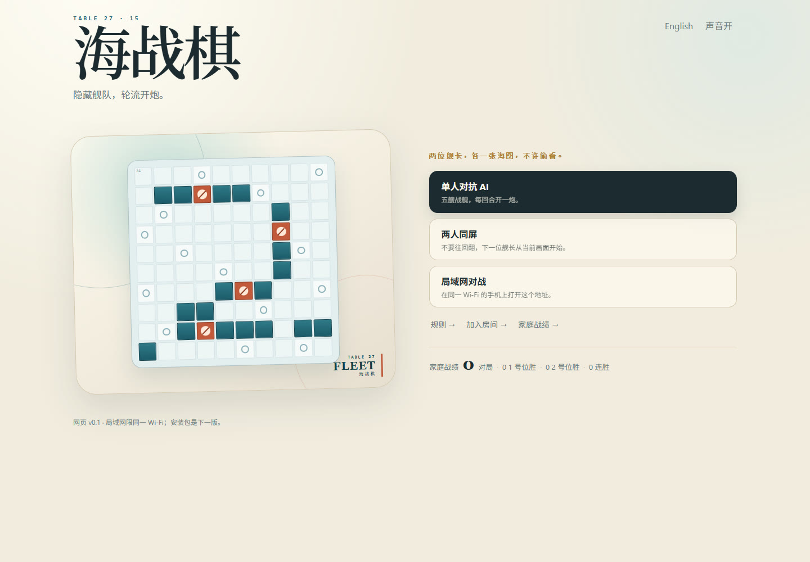

[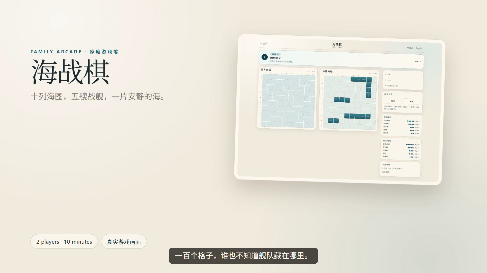](docs/promo/fleet-promo-zh.mp4)

*45 秒 · 1920×1080 · 60fps · [English cut](docs/promo/fleet-promo-en.mp4) · [video.json](video.json)*

## 一回合，五秒看懂

| 藏船 | 开炮 | 获胜 |
| --- | --- | --- |
| 放好航母 5、战列舰 4、巡洋舰 3、潜艇 3、驱逐舰 2。 | 轮流朝一个格子开炮，未中、命中、击沉立刻标出。 | 先击沉对方全部五艘船的一方获胜。 |

打中**不会**多给一炮，双方始终轮流开火。

## 里面有什么

- **真正的引擎。** `src/game/fleet.ts` 是纯 TypeScript，不碰 DOM、时钟、网络或
  `Math.random`；随机布阵使用注入的 RNG。**30 个单元测试**覆盖布阵、炮击、
  击沉/胜负、按座位隐藏视图和四档 AI。见 [`docs/rules.md`](docs/rules.md)。
- **四档 AI 舰长。** 陪玩温和，轻松几乎乱打，标准用棋盘格搜索并追击，挑战会枚举
  所有剩余船位、计算概率密度。
- **三种玩法。** 单人对抗 AI、两人同屏传设备，或同一 Wi-Fi 下的主机/访客对战。
- **真正的按座位视图。** 主机保存权威状态，访客只收到 `view(state, 1)`；未击沉的
  敌方船体不会出现在访客的消息里。主机的意图处理会重新校验座位、回合和格子。
- **家庭细节。** 本地对局支持悔棋和有理由的提示、自动保存/继续、本机家庭日志、
  声音开关、键盘操作、减少动效、完整中英双语，以及手机竖屏布局。
- **默认私密。** 无账号、无遥测、无广告、无 CDN、无远程字体、无下载美术；
  所有船、标记和声音都由应用自己绘制或合成。

## 四档 AI 舰长

| 难度 | 行为 |
| --- | --- |
| **陪玩** | 温和。沿着模糊线索走，有时扫自己未中的附近，只剩一艘船时会收着打。适合小朋友。 |
| **轻松** | 随便挑一个没打过的格子。适合第一次上桌。 |
| **标准** | 按棋盘格搜索，打中后追击相邻格，并沿着已命中的方向延长。 |
| **挑战** | 枚举每艘剩余船的所有合法位置，按概率密度选格。它只使用公开的炮击结果，不会偷看你的舰队。 |

四档 AI 在相同视图和相同注入 RNG 下都是确定性的。应用传 `Math.random` 增加变化，
测试传固定种子。

## 截图

| 主页 | 选择对手 |
| --- | --- |
|  | 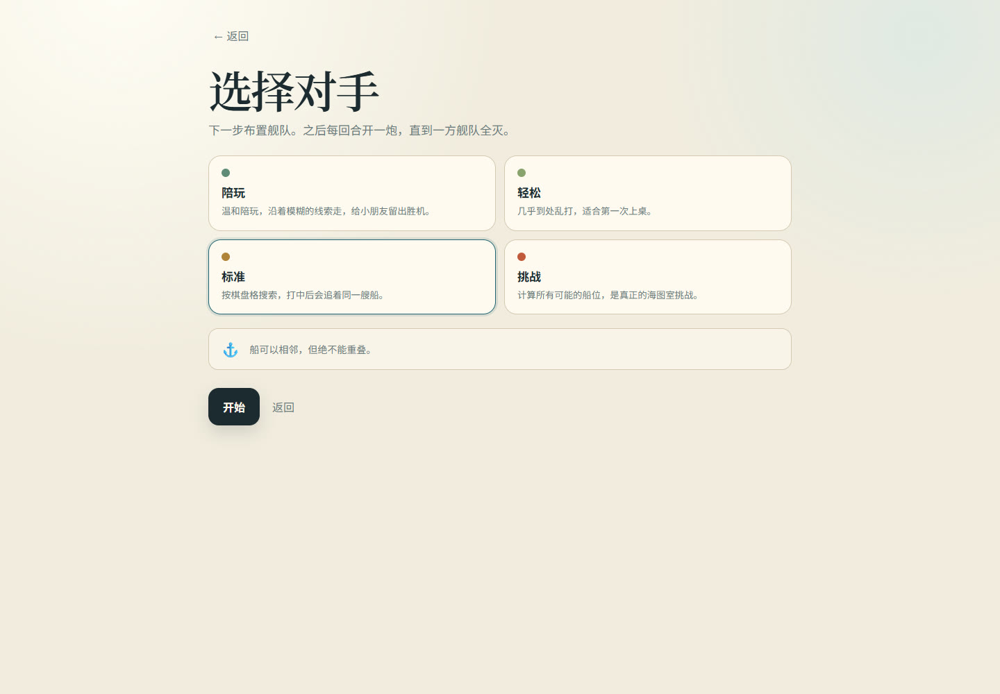 |

| 部署舰队 | 海战进行中 |
| --- | --- |
| 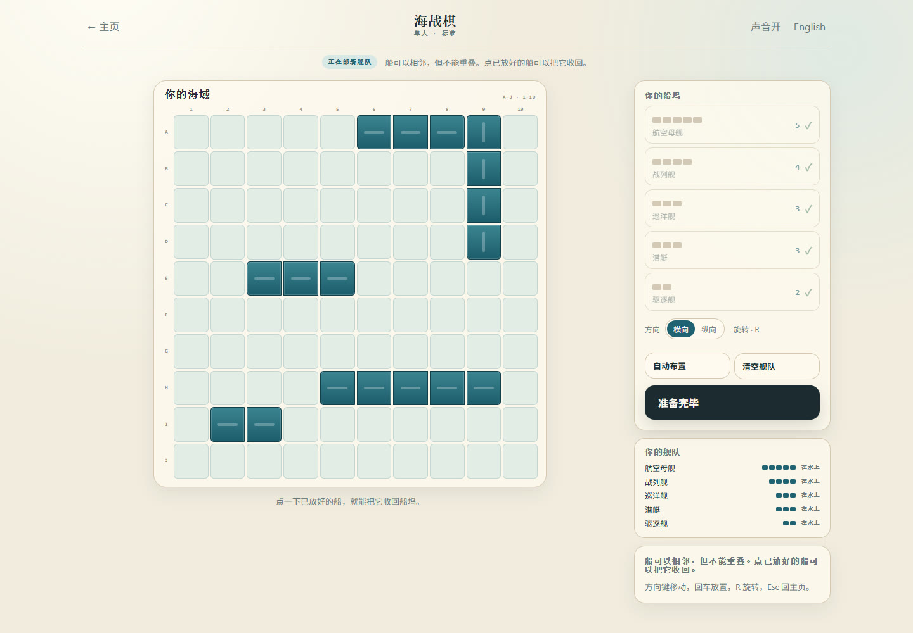 | 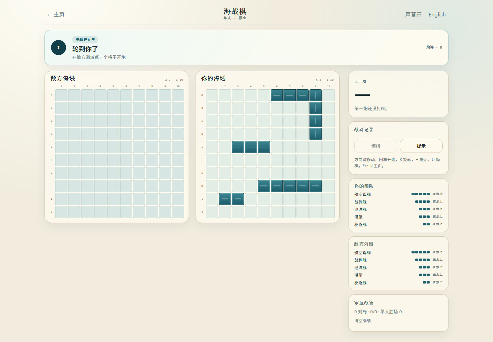 |

| 有理由的提示 | 终局 |
| --- | --- |
| 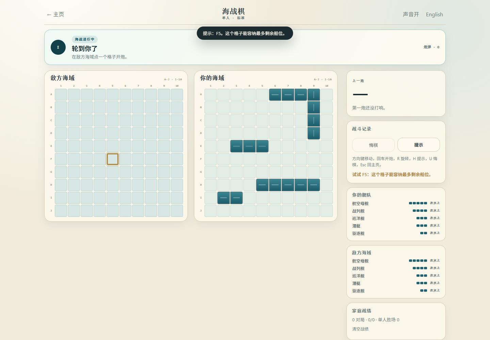 | 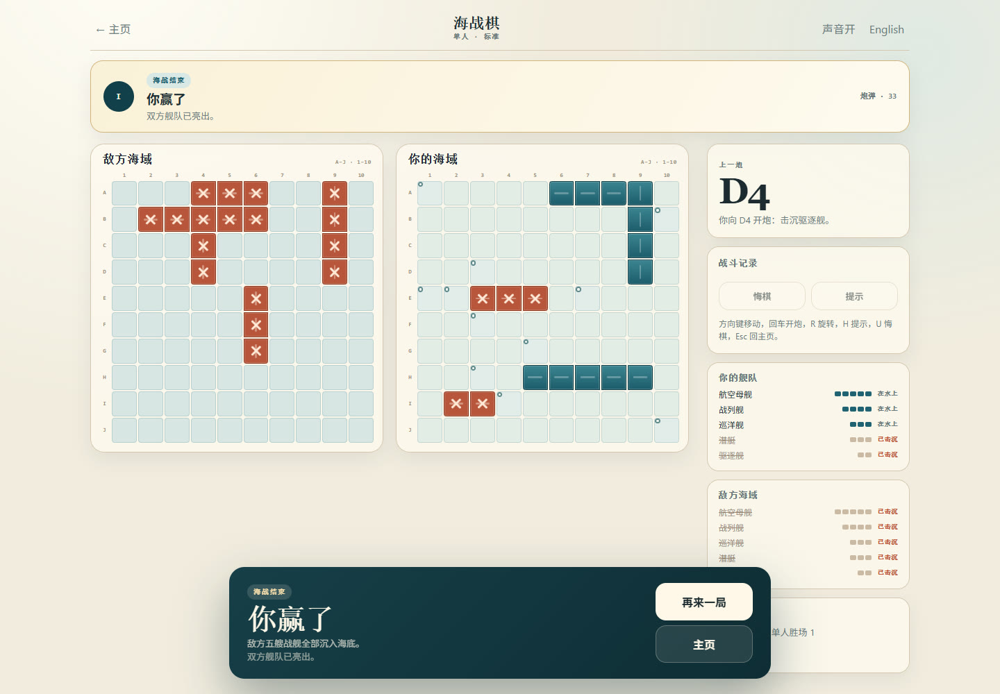 |

| 规则 | 家庭航海日志 |
| --- | --- |
| 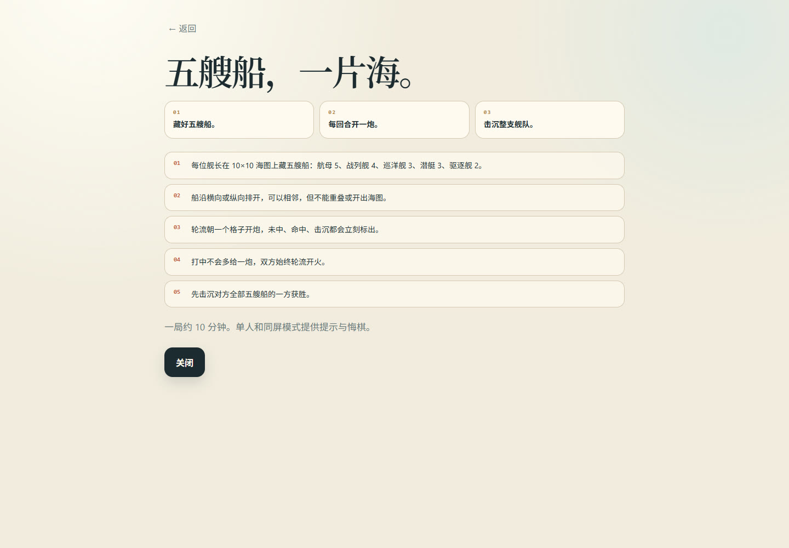 | 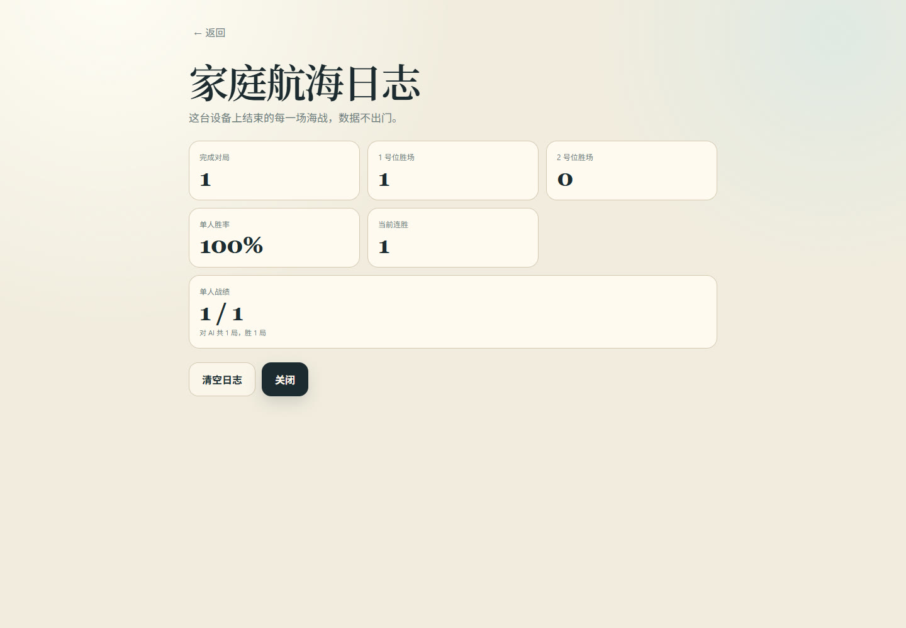 |

| 手机主页 | 手机对局 |
| --- | --- |
| 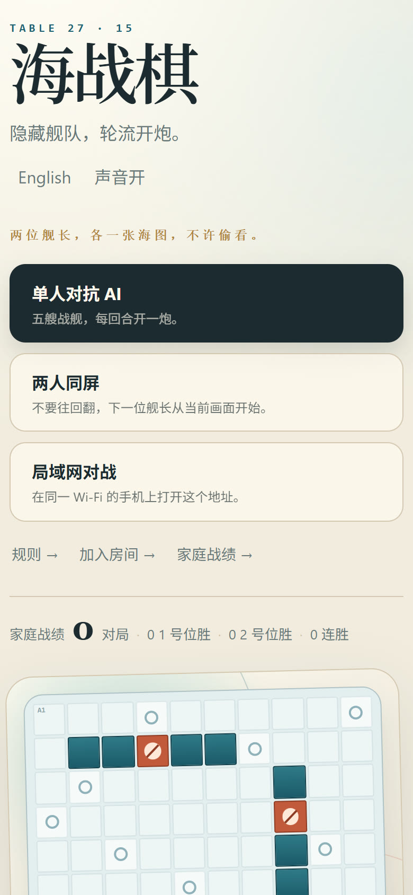 | 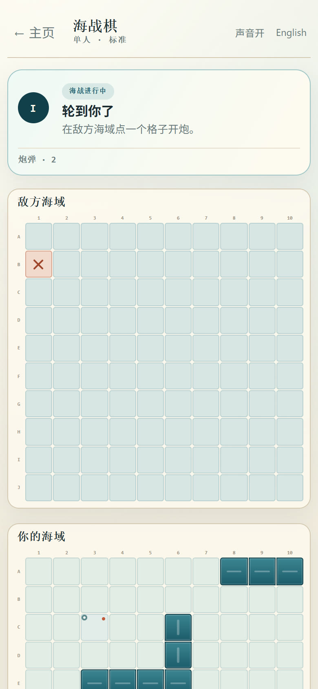 |

全部来自真实运行的应用：桌面 1440×1000，手机 390×844 @2×（PNG 为 780×1688）。
没有效果图。

## 本地运行

```bash
npm install
npm run dev        # http://localhost:5194
npm run check      # tsc + 30 个测试 + 生产构建
node scripts/e2e.mjs   # 真实 Chrome；需先运行 dev
node scripts/shots.mjs # 重新生成 docs/screenshots/{en,zh}
```

键盘：方向键移动，**回车**开炮（布阵时放置），**R** 旋转，**H** 提示，**U** 悔棋，
**Esc** 回主页。

## 局域网之夜

浏览器/开发版：

```bash
npm run build
npm run lan        # :8080 中继 + 静态服务器
# 另一个终端：
npm run dev        # 主机打开 http://localhost:5194
```

在主机点“局域网对战”，记下房间码，然后让手机在同一 Wi-Fi 打开显示的地址
（或扫码）。两位舰长各自布阵，主机先开炮。访客屏幕只显示自己的舰队和自己的炮击。

桌面版：Tauri 壳会启动同一个内置中继，并把构建产物托管给手机。主机权威；访客只发
`place`、`fire`、`ready` 等意图。中继只是消息总线，看不到舰队。

进阶：如果 8080 已被占用，可把主机开发服务器设为 `VITE_LAN_PORT=8081`，并用
`node ../../tools/lan-server.mjs --dist dist --port 8081` 启动中继。默认仍是 8080。

## 构建 Windows 安装包

```bash
npm install
npx tauri build --bundles nsis
# src-tauri/target/release/bundle/nsis/Fleet_0.1.0_x64-setup.exe
```

Tauri 壳沿用 Family Arcade 参考项目。安装包由主代理统一构建；本应用只用 `tsc` 和浏览器
构建验证，没有运行 `cargo build` 或 `tauri build`。本地未签名构建可能触发 Windows
SmartScreen 提示。

## 已知限制

- **只支持两人。** 没有观战、匹配或第三个座位；第二位访客会看到“房间已满”。
- **局域网限同一子网 IPv4。** 手机访客需要主机防火墙放行。
- **局域网状态不会续玩。** 主机关闭窗口，房间和对局就结束。
- **局域网中不能悔棋。** 主机保存权威状态；单人和同屏模式提供悔棋、提示和自动保存。
- **主机设备内存中保存双方舰队。** 发给访客的消息是按座位裁剪的，但主机若打开
  开发者工具仍可查看完整状态。这是家庭游戏，不是反作弊客户端。
- **同屏隐私是一道幕布，不是加密。** 传递设备的遮罩能挡住随意的目光，但双方舰队
  仍在同一个浏览器状态里；打开开发者工具仍可查看。想要严格保密，请用两台设备。
- **应用包内没有宣传片文件。** 根目录工作室会根据 [`video.json`](video.json) 渲染
  45 秒双语宣传片；本应用不包含独立 Remotion 工程或下载素材。
- **挑战档很强，但不是完美。** 它只用公开信息和概率，运气好的玩家仍可能赢。

详见 [`docs/limitations.md`](docs/limitations.md)。

## 许可

Family Arcade 原创代码、美术、文案与合成音效。隐藏舰队海战机制属于公共领域的民间游戏。
MIT，见 [`NOTICE.md`](NOTICE.md)。

## 宣传片

[](docs/promo/fleet-promo-zh.mp4)

- [中文成片](docs/promo/fleet-promo-zh.mp4) · [另一语言](docs/promo/fleet-promo-en.mp4)
- [字幕](docs/promo/fleet-promo-zh.srt) · [video.json](video.json)
- 画面来自真实应用与真实引擎数据；数字与测试一致。

