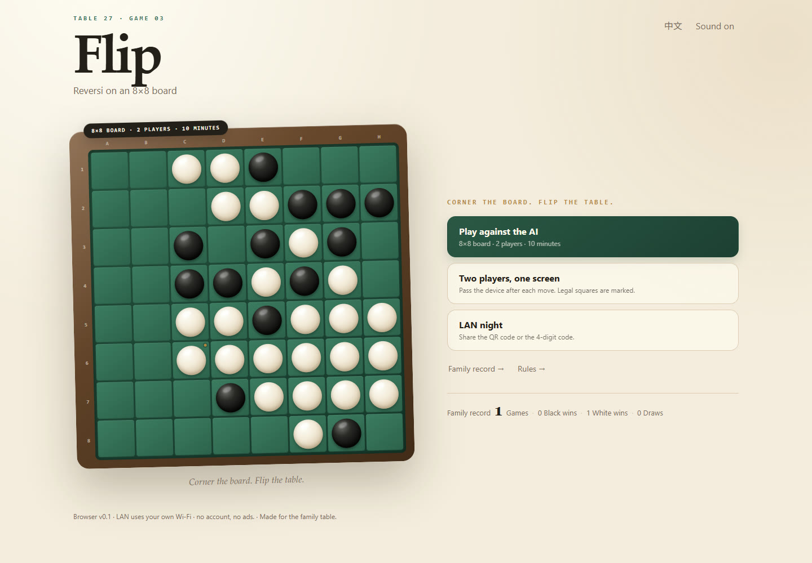
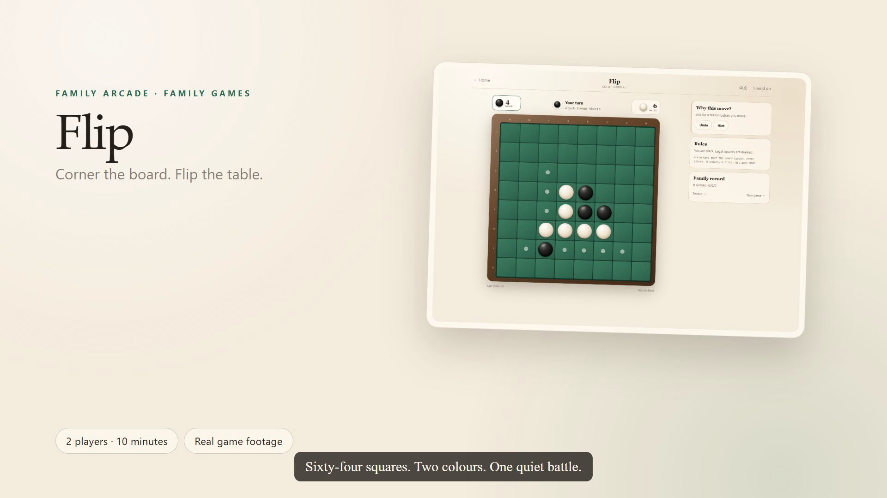
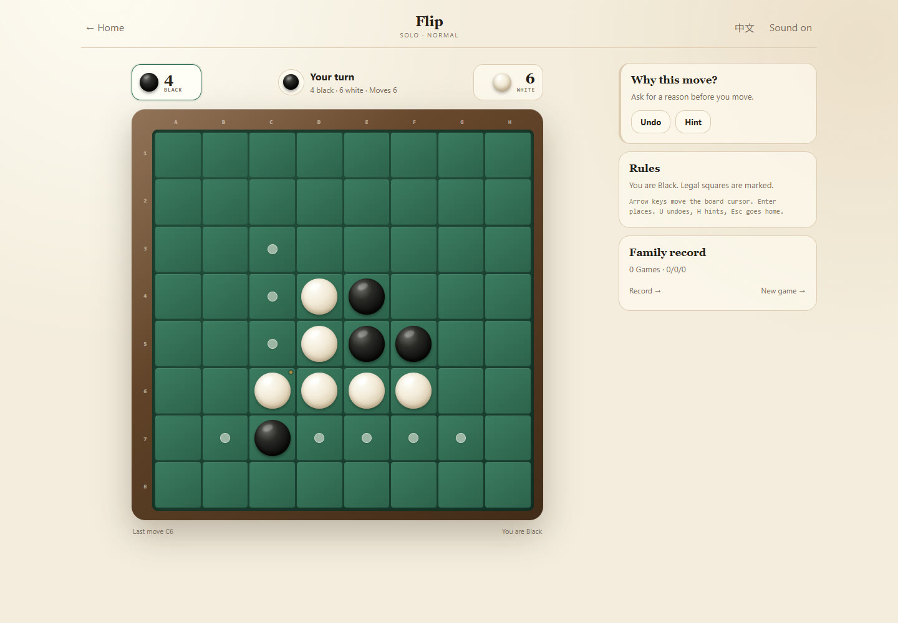
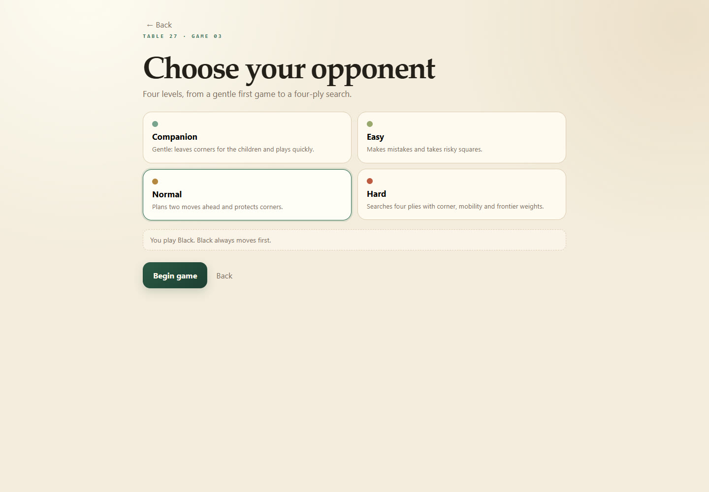
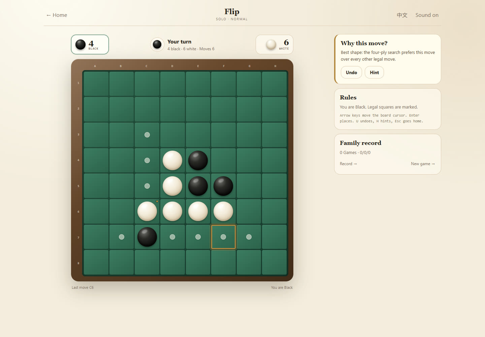
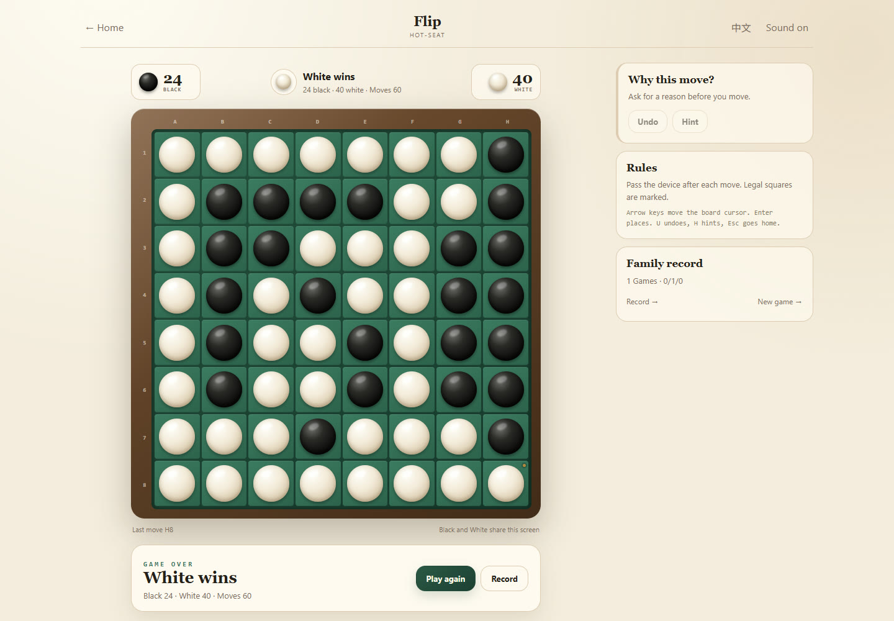
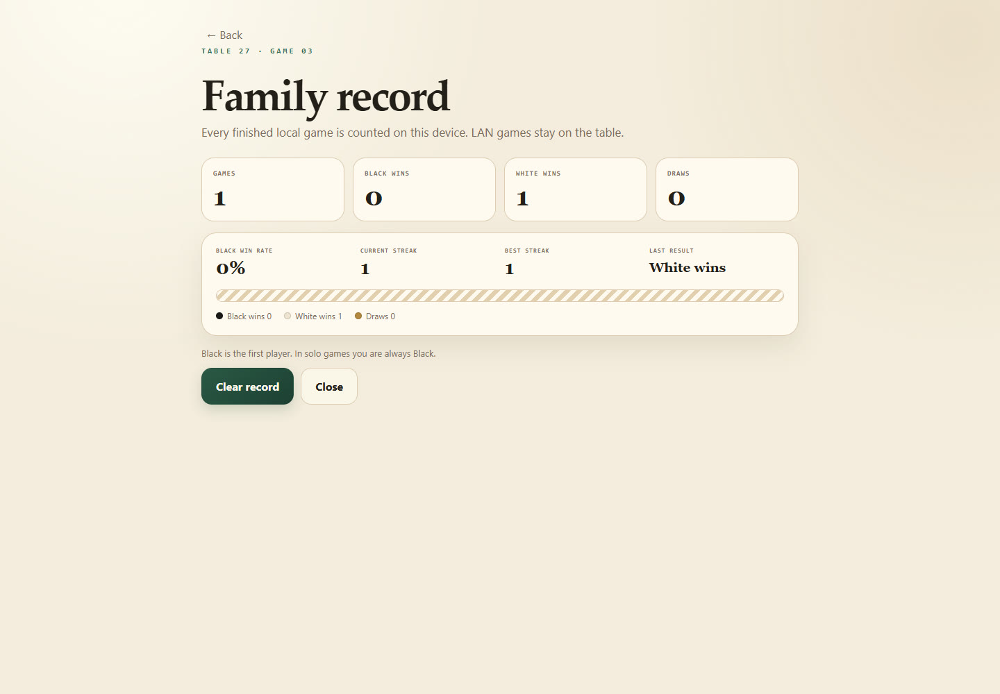
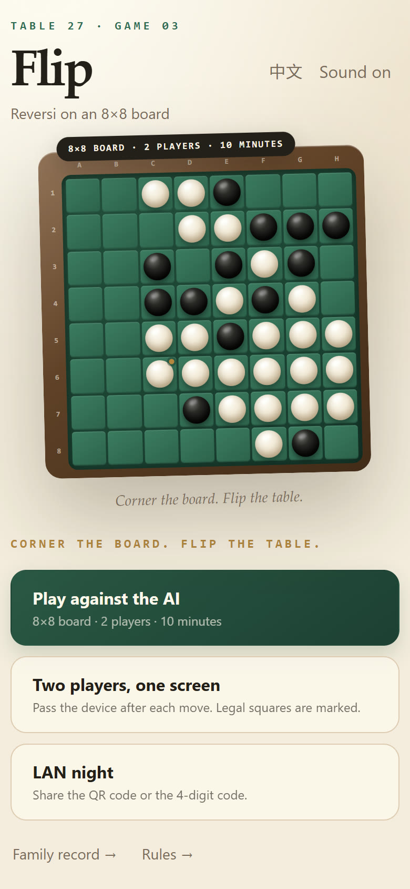

# Flip · 黑白棋

**English** · [简体中文](README.zh-CN.md)

> **Corner the board. Flip the table.**

Flip is an offline-first Reversi game for the family table: **2 players**, a full 8×8
board, four AI levels, one-screen hot-seat and LAN play from a phone. No account, no
ads, no network required except your own Wi-Fi for LAN night.



[](docs/promo/flip-promo-en.mp4)

*45 seconds · 1920×1080 · 60 fps · [中文版](docs/promo/flip-promo-zh.mp4) · [video.json](video.json)*

*The 45-second bilingual promo is rendered from [`video.json`](video.json) by the root
studio. The app itself ships no remote video or fonts.*

## A turn, in five seconds

| Bracket | Flip | Finish |
| --- | --- | --- |
| Place a disc so it traps at least one opponent disc in a straight line. | Every trapped disc flips to your colour. If you have no move, your turn passes. | When neither player can move, the most discs wins. Equal counts are a draw. |

## What is inside

- **A real, tested engine.** Pure TypeScript, deterministic and DOM-free: 28 unit tests
  cover opening brackets, eight-direction flips, passes, endings, draws, seats, views
  and four AI levels. See [`docs/rules.md`](docs/rules.md).
- **Four AI levels.** Companion plays gently and leaves extra corners for children;
  Easy makes mistakes; Normal searches two plies; Hard searches four plies with corner,
  edge, mobility and frontier weights. All take an injected RNG.
- **Three modes.** Solo against the AI, two players passing one device, or host/guest
  over the same Wi-Fi.
- **Hints with a reason.** Every hint highlights a square and explains the shape:
  corner safety, a corner risk avoided, a big flip, mobility, or the search's best
  available shape.
- **Small comforts.** Undo, autosave/resume, a local family record (Black wins, White
  wins, draws, streaks), sound on/off, keyboard navigation, reduced-motion support and
  a complete Chinese/English UI.
- **Private by default.** No accounts, no telemetry, no ads, no remote fonts or CDN.
- **A shared Tauri shell.** The lightweight desktop build keeps the same LAN relay used
  by the other Family Arcade games.

## Screenshots

| A real game | AI levels |
| --- | --- |
|  |  |

| Hint with a reason | Finished game |
| --- | --- |
|  |  |

| Family record | Phone |
| --- | --- |
|  |  |

All screenshots come from the running app at 1440×1000 (phone 390×844 @2×).

## Play locally

```bash
npm install
npm run dev        # http://localhost:5182
npm run check      # tsc + 28 tests + production build
npm run e2e        # real Chrome, dev server required
npm run shots      # regenerate docs/screenshots/{en,zh}
```

## LAN night

Browser/dev:

```bash
npm run build
npm run lan        # relay + static server on :8080
# open http://localhost:5182, choose LAN night, host a room
```

The host shows a 4-digit room code and a QR invite. Guests open the address on the same
Wi-Fi; no app install is needed on their side. The host is Black and keeps the
authoritative board. The relay only forwards messages; the guest sends intents and
receives `view(state, 1)`. Turn, square and bracket checks are repeated on the host.

Optional two-page smoke test (with the dev server and relay above running):

```bash
node scripts/lan-check.mjs
```

Desktop: the Tauri build starts the same relay internally and serves the built app to
phones.

## Build the Windows installer

```bash
npm install
npx tauri build --bundles nsis
# src-tauri/target/release/bundle/nsis/Flip_0.1.0_x64-setup.exe
```

The installer is per-game and lightweight; WebView2 uses the standard bootstrapper. A
Windows SmartScreen warning is expected for an unsigned family build. The main Family Arcade
build runs this centrally; app agents do not run `cargo build`.

## Known limitations

- Browser v0.1 plus a local Tauri shell; no cloud, accounts, matchmaking or spectators.
- LAN is IPv4 on the same subnet; guest phones need the host firewall to allow the relay.
- Hard searches four plies and is strong, but not perfect.
- Undo is disabled after a finished game and in LAN games.
- No game clock, resignation or draw offer.
- No 4K/vertical promo cut.

See [`docs/limitations.md`](docs/limitations.md) for the honest full list.

## Credits

Original code, art and copy for Family Arcade. Reversi is a traditional public-domain game;
this implementation, its name, visual design and text are original. MIT. See
[`NOTICE.md`](NOTICE.md).

## Promo

[](docs/promo/flip-promo-en.mp4)

- [English cut](docs/promo/flip-promo-en.mp4) · [other language](docs/promo/flip-promo-zh.mp4)
- [SRT](docs/promo/flip-promo-en.srt) · [video.json](video.json)
- Real app screenshots and real engine data; claims match the tests.

