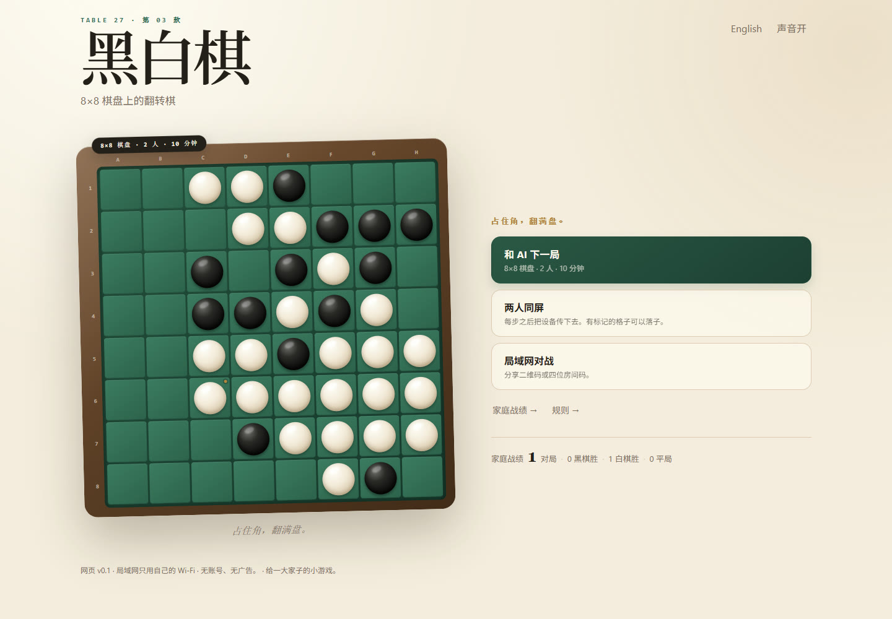
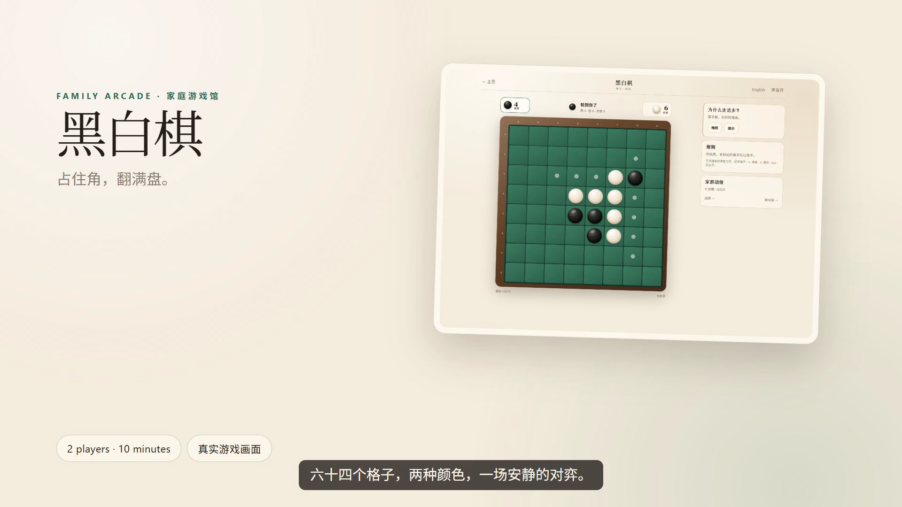
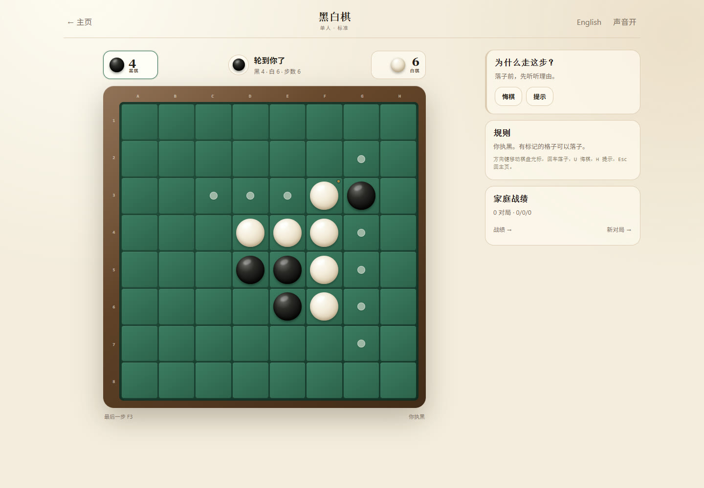
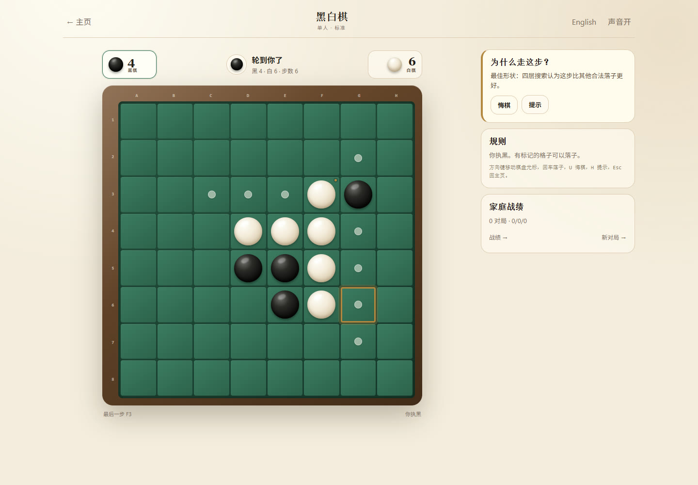

# 黑白棋 · Flip

[English](README.md) · **简体中文**

> **占住角，翻满盘。**

给家庭牌桌的离线优先黑白棋：**2 人**、完整的 8×8 棋盘、四档 AI、同屏热座，以及
手机浏览器直接加入的局域网对战。无账号、无广告；除自家 Wi-Fi 外不需要联网。



[](docs/promo/flip-promo-zh.mp4)

*45 秒 · 1920×1080 · 60fps · [English cut](docs/promo/flip-promo-en.mp4) · [video.json](video.json)*

*45 秒双语宣传片由根目录工作室根据 [`video.json`](video.json) 渲染；应用本身不含远程
视频或字体。*

## 一回合，五秒看懂

| 夹住 | 翻转 | 结束 |
| --- | --- | --- |
| 落子后，必须沿直线夹住至少一枚对方棋子。 | 被夹住的棋子全部翻成你的颜色；没有合法落点就跳过回合。 | 双方都无法落子时，棋子多者胜；数量相同为平局。 |

## 里面有什么

- **真正的引擎。** 纯 TypeScript、确定性、不碰 DOM：28 个单元测试覆盖开局四个落点、
  八个方向翻转、跳过回合、终局、平局、座位、视图和四档 AI。见
  [`docs/rules.md`](docs/rules.md)。
- **四档 AI。** 陪玩温和，会把额外的角留给小朋友；轻松会犯错；标准算两层；挑战用
  四层搜索，兼顾角、边、行动力和前沿。四档都接受注入的 RNG。
- **三种模式。** 单人对抗 AI、两人共用一台设备、同一 Wi-Fi 下的主机/访客。
- **带理由的提示。** 每次提示都会高亮一格，并解释棋形：角的安全、避开的送角、
  大翻转、行动力，或搜索认定的最佳形状。
- **小细节。** 悔棋、自动保存/继续、本机家庭战绩（黑胜、白胜、平局、连胜）、声音
  开关、键盘操作、减少动效，以及完整中英双语界面。
- **默认私密。** 无账号、无遥测、无广告、无远程字体或 CDN。
- **共享 Tauri 壳。** 轻量桌面版继续使用 Family Arcade 其他游戏共用的局域网中继。

## 截图

| 真实对局 | AI 难度 |
| --- | --- |
|  |  |

| 带理由的提示 | 终局 |
| --- | --- |
|  |  |

| 家庭战绩 | 手机 |
| --- | --- |
|  |  |

全部来自真实运行的应用：1440×1000，手机 390×844 @2×。

## 本地运行

```bash
npm install
npm run dev        # http://localhost:5182
npm run check      # tsc + 28 个测试 + 生产构建
npm run e2e        # 真实 Chrome，需先运行 dev
npm run shots      # 重新生成 docs/screenshots/{en,zh}
```

## 局域网

浏览器/开发版：

```bash
npm run build
npm run lan        # :8080 中继，同时托管 dist/
# 打开 http://localhost:5182，选“局域网对战”，开房间
```

主机显示四位房间码和二维码；访客在同一 Wi-Fi 打开地址即可，无需安装。主机执黑，
保存权威棋盘。中继只负责转发消息；访客发送意图并接收 `view(state, 1)`。回合、格子
和夹子校验都会在主机上重新执行。

可选的双页面冒烟测试（先启动上面的 dev 和中继）：

```bash
node scripts/lan-check.mjs
```

桌面版：Tauri 安装包启动同一个内置中继，并把构建产物托管给手机。

## 构建 Windows 安装包

```bash
npm install
npx tauri build --bundles nsis
# src-tauri/target/release/bundle/nsis/Flip_0.1.0_x64-setup.exe
```

每款游戏单独打包，安装包保持轻量；WebView2 使用标准引导程序。未签名的家庭构建会触发
Windows SmartScreen 提示。Family Arcade 主构建集中运行安装包构建，游戏 agent 不运行
`cargo build`。

## 已知限制

- 浏览器 v0.1 + 本地 Tauri 壳；没有云、账号、匹配或观战。
- 局域网仅支持同一子网的 IPv4；手机访客需要主机防火墙放行中继端口。
- 挑战档搜索四层，很强，但并非不会输。
- 终局后和局域网对局中不能悔棋。
- 没有计时、认输或求和。
- 暂无 4K/竖屏宣传片。

完整清单见 [`docs/limitations.md`](docs/limitations.md)。

## 许可

Family Arcade 原创代码、美术与文案。黑白棋是传统公有领域游戏；本实现、名称、视觉设计和
文案均为原创。MIT。见 [`NOTICE.md`](NOTICE.md)。

## 宣传片

[](docs/promo/flip-promo-zh.mp4)

- [中文成片](docs/promo/flip-promo-zh.mp4) · [另一语言](docs/promo/flip-promo-en.mp4)
- [字幕](docs/promo/flip-promo-zh.srt) · [video.json](video.json)
- 画面来自真实应用与真实引擎数据；数字与测试一致。

