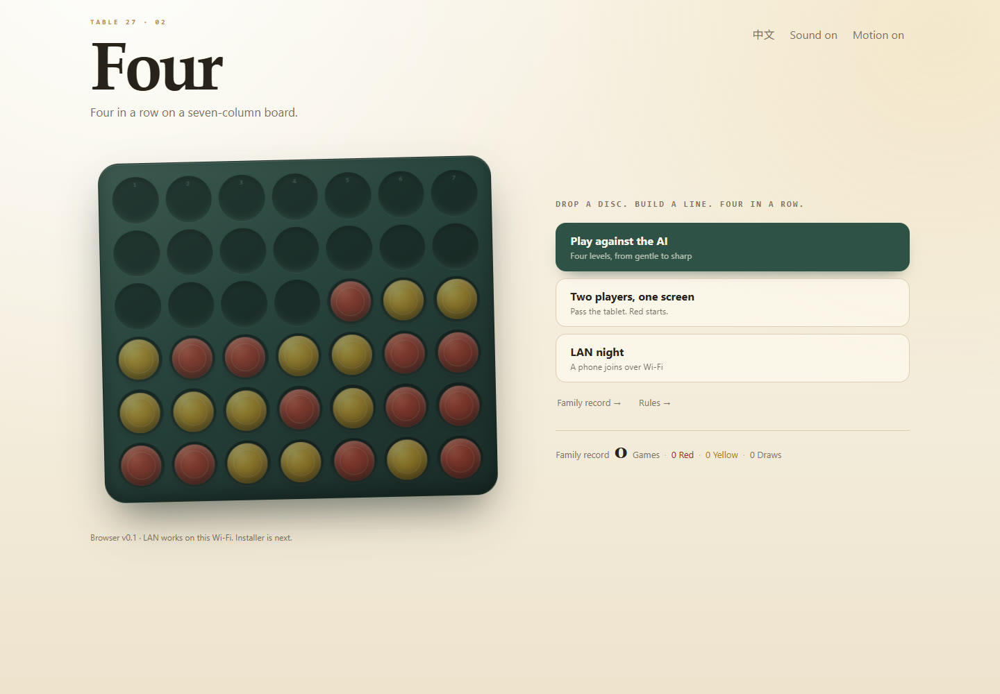
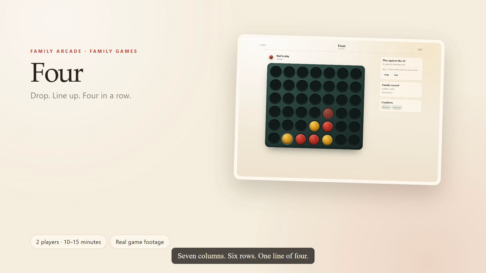
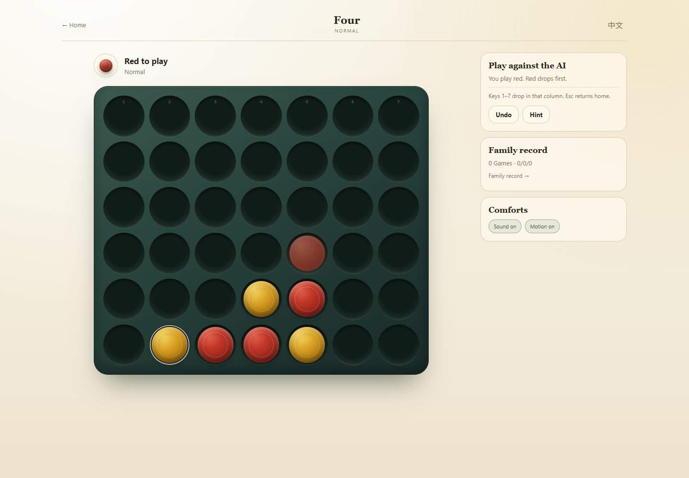
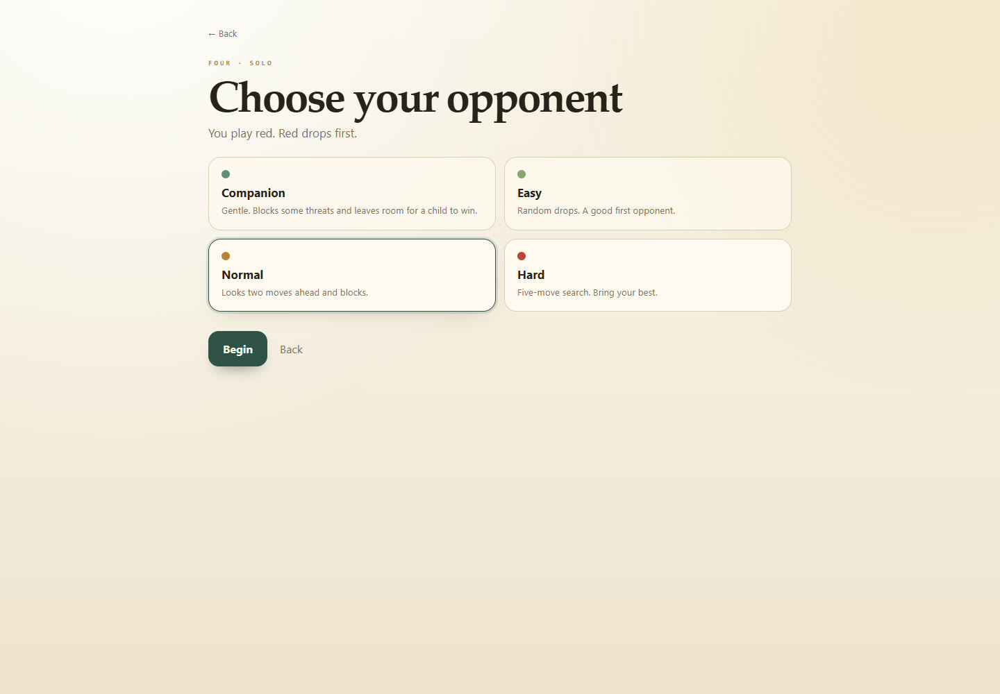
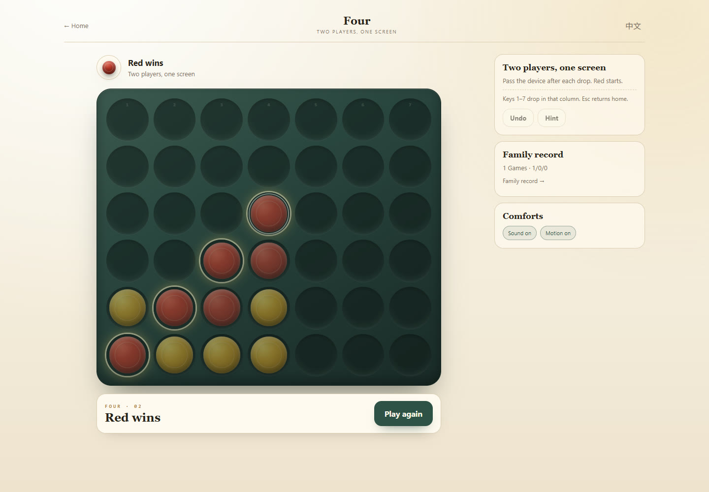
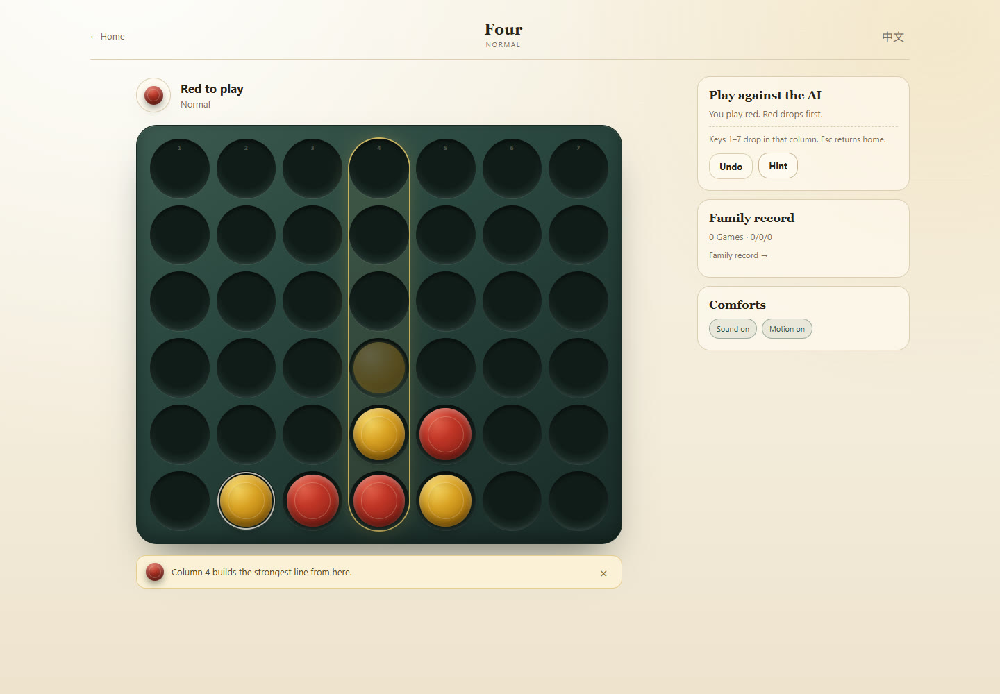
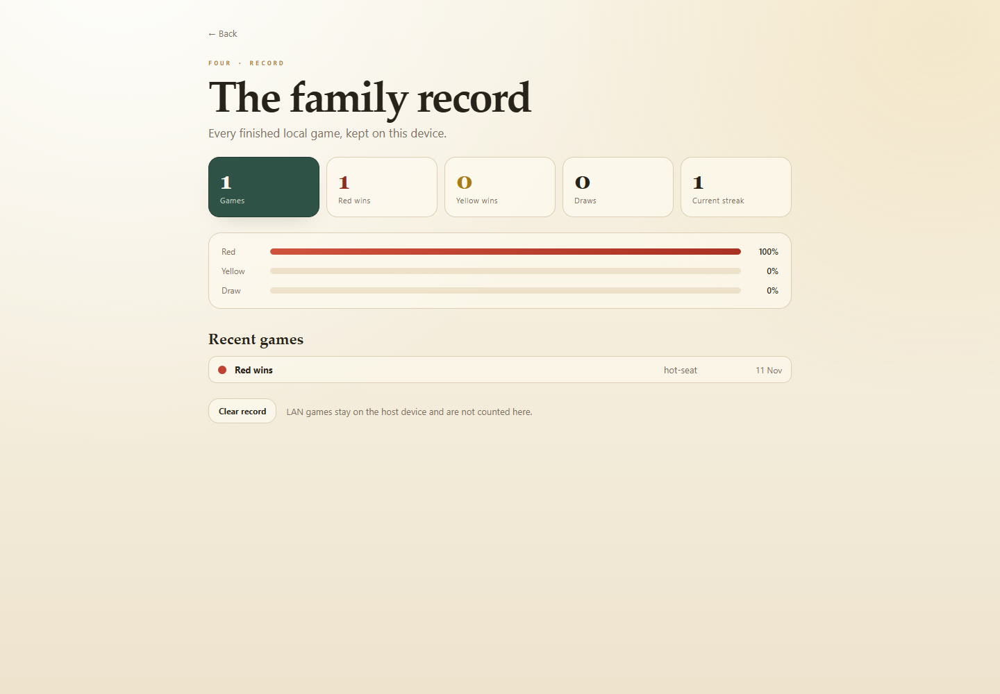
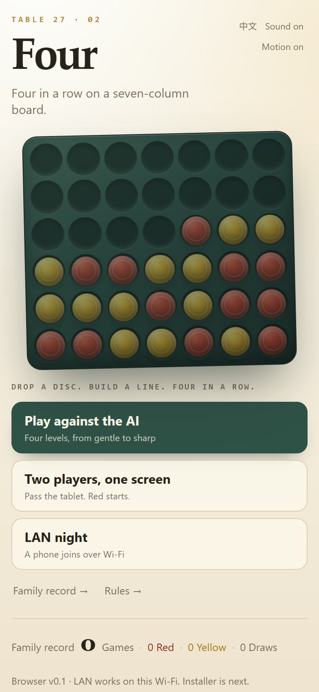

# Four · 四子棋

**English** · [简体中文](README.zh-CN.md)

> **Drop. Line up. Four in a row.**

A small, offline-first Connect Four for the family table: **2 players**, a
**7 × 6** board, **four AI levels**, hot-seat on one screen, and LAN play from a
phone. No account, no ads, no remote fonts or assets. Red always drops first.



[](docs/promo/four-promo-en.mp4)

*45 seconds · 1920×1080 · 60 fps · [中文版](docs/promo/four-promo-zh.mp4) · [video.json](video.json)*

## A turn, in five seconds

| Drop | Fall | Win |
| --- | --- | --- |
| Pick any column that is not full. | The disc falls to the lowest empty slot. | First to connect four in a row, column or diagonal wins. A full board is a draw. |

## What is inside

- **A pure, tested engine.** `src/game/four.ts` has no DOM, clock, network or
  `Math.random`; 35 unit tests cover drops, stacking, all four line directions,
  full columns, seats, views, replay, draws and the AI. See
  [`docs/rules.md`](docs/rules.md).
- **Four AI levels.** Companion plays gently and sometimes leaves a win for a
  child; Easy is random; Normal looks two plies ahead; Hard runs a five-ply
  alpha-beta search with centre-first ordering. Every level is deterministic
  with an injected RNG.
- **Three ways to play.** Solo vs AI, two players passing one device, or LAN
  host/guest with a 4-digit room code and QR invite.
- **Small comforts.** Undo before the game ends, a hint that explains *why*,
  autosave/resume, a local family record with recent results, sound toggle,
  reduced-motion toggle, keyboard 1–7, complete English/Chinese UI and a mobile
  layout.
- **Private by default.** No accounts, telemetry, ads or cloud calls. The only
  network use is your own LAN relay.

## Screenshots

| A real game | Choose an opponent |
| --- | --- |
|  |  |

| Four in a row | Hint with a reason |
| --- | --- |
|  |  |

| Family record | Phone |
| --- | --- |
|  |  |

All screenshots are captured from the running app with Playwright at
**1440 × 1000** (phone **390 × 844 @2×**). There are nine per language in
`docs/screenshots/{en,zh}`: home, setup, game, hint, game-over, rules, record,
mobile home and mobile game.

## Play locally

```bash
npm install
npm run dev        # http://localhost:5181
npm run check      # tsc + 35 tests + production build
npm run e2e        # real Chrome; start npm run dev first
npm run shots      # regenerate docs/screenshots/{en,zh}
```

The game is playable with mouse, touch or the keyboard: **1–7** drop in a
column, **U** undoes, **H** hints and **Esc** returns home.

## LAN night

Browser/dev:

```bash
npm run build
npm run lan        # relay + built app on http://localhost:8080
# in another terminal: npm run dev, open http://localhost:5181
# choose “LAN night”, host a room, then let a phone open the invite URL
```

The host device owns the authoritative state. The guest receives only its own
seat view (`red` = host, `yellow` = guest) and can send only
`{ type: 'place', column }`; the host re-checks the turn, column and game status.
The relay is a dumb message bus on the same Wi-Fi — no internet, account or
matchmaking server is involved.

If port 8080 is already in use, start the shared relay on another port:

```bash
node ../../tools/lan-server.mjs --dist dist --port 8091
# open http://localhost:5181/?lanPort=8091 as the host
```

The QR invite then points at the chosen port. The default packaged app uses the
shared Tauri relay and needs no Node server.

Desktop: the Tauri build starts the same relay internally and serves the built
app to phones.

## Build the Windows installer

```bash
npm install
npx tauri build --bundles nsis
# src-tauri/target/release/bundle/nsis/Four_0.1.0_x64-setup.exe
```

The central Family Arcade build produces the installer; this app keeps the Tauri 2
shell and `lan_start` command intact. The build is unsigned, so a Windows
SmartScreen warning is expected.

## Verification

```bash
npm run check                     # 35 tests + tsc + vite build
node scripts/e2e.mjs              # E2E OK with dev server running
node scripts/shots.mjs            # 18 real PNGs
node scripts/lan-test.mjs         # optional LAN smoke test (dev + relay)
```

The E2E pass covers the home screen, a full hot-seat win, the family record,
restart, undo, hint-with-reason, an AI reply, autosave/resume across a reload,
the keyboard path, the guest deep link and mobile play. The LAN smoke test was
run with the shared relay on a spare port because 8080 was occupied by another
local app.

## Known limitations

- Hard is a 5-ply search, not a solved-game oracle; it can be beaten.
- Companion is intentionally gentle and sometimes misses a block.
- LAN is same-subnet IPv4; no spectators, reconnection screen or online play.
- LAN undo is disabled to keep host and guest in sync; LAN games are not added
  to the family record.
- Saves and records are per browser/device; no cloud.
- The promo is a `video.json` manifest rendered by the root studio, not a video
  bundled in this app.

See [`docs/limitations.md`](docs/limitations.md) for the full honest list.

## Credits

Original code, art and copy for Family Arcade. MIT. See [`NOTICE.md`](NOTICE.md).
The four-in-a-row mechanic is a public-domain folk game.

## Promo

[](docs/promo/four-promo-en.mp4)

- [English cut](docs/promo/four-promo-en.mp4) · [other language](docs/promo/four-promo-zh.mp4)
- [SRT](docs/promo/four-promo-en.srt) · [video.json](video.json)
- Real app screenshots and real engine data; claims match the tests.

