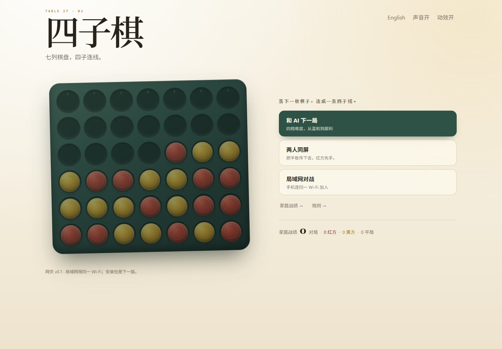
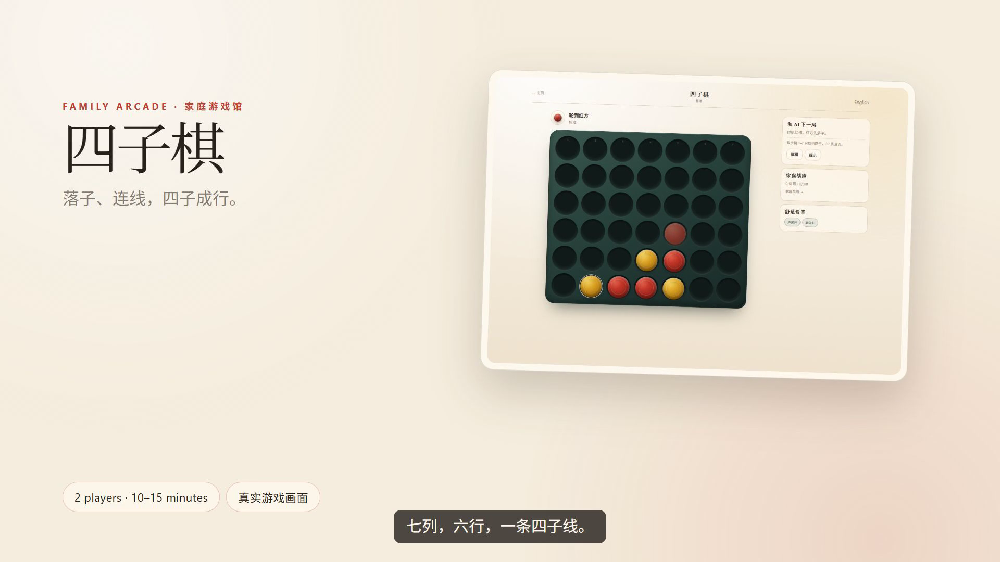
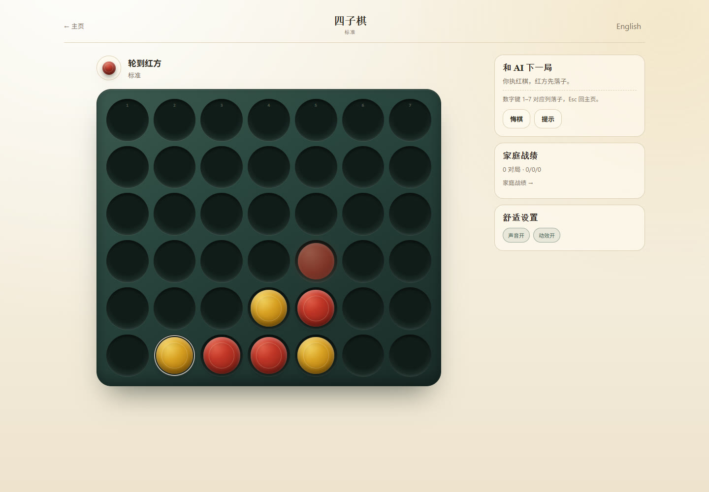
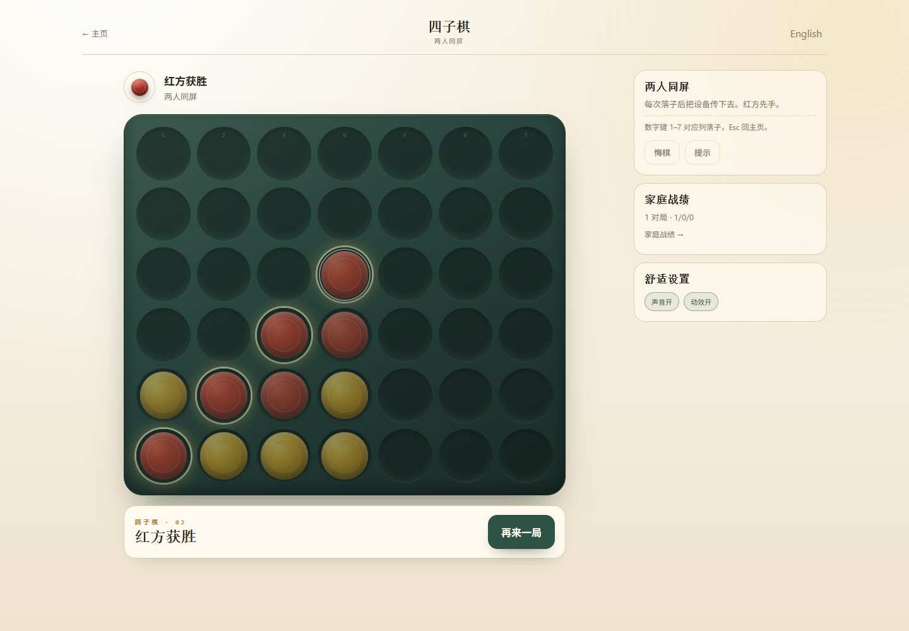
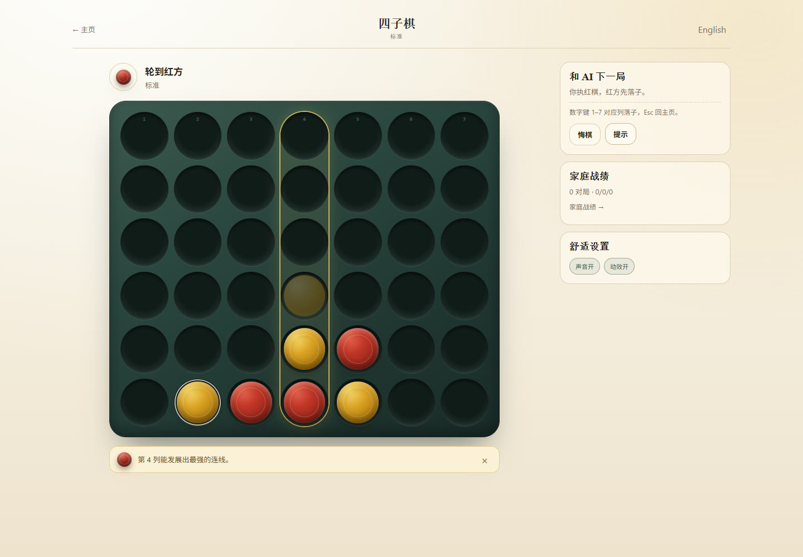

# 四子棋 · Four

[English](README.md) · **简体中文**

> **落子、连线，四子成行。**

给家庭牌桌的一款离线小游戏：**2 人**、**7 × 6** 棋盘、**四档 AI**、同屏热座，
以及手机浏览器直接加入的局域网对战。无账号、无广告、无远程字体或素材。红方永远
先手。



[](docs/promo/four-promo-zh.mp4)

*45 秒 · 1920×1080 · 60fps · [English cut](docs/promo/four-promo-en.mp4) · [video.json](video.json)*

## 一回合，五秒看懂

| 落子 | 下落 | 结束 |
| --- | --- | --- |
| 选择任意未满的列。 | 棋子落到该列最低的空位。 | 横、竖或斜线先连成四个者胜；棋盘填满为平局。 |

## 里面有什么

- **纯规则引擎 + 测试。** `src/game/four.ts` 不碰 DOM、时钟、网络或
  `Math.random`；35 个单元测试覆盖落子、堆叠、四个连线方向、满列、座位、
  视图、回放、平局和 AI。见 [`docs/rules.md`](docs/rules.md)。
- **四档 AI。** 陪玩温和，会给孩子留出胜机；轻松随机；标准看两步；挑战使用
  五层 alpha-beta 搜索和中路优先排序。每一档在注入 RNG 后都是确定性的。
- **三种玩法。** 单人对抗 AI、两人同屏轮换，或局域网主机/访客，带 4 位房间码和
  二维码邀请。
- **小细节。** 终局前可悔棋、会说明理由的提示、自动保存/继续、本机家庭战绩
  （含最近对局）、声音开关、减少动效开关、数字键 1–7、完整中英双语和手机布局。
- **默认私密。** 无账号、无遥测、无广告、无云端调用；唯一的联网是自家局域网中继。

## 截图

| 真实对局 | 选择对手 |
| --- | --- |
|  |  |

| 四子连线 | 带理由的提示 |
| --- | --- |
|  |  |

| 家庭战绩 | 手机 |
| --- | --- |
|  |  |

全部截图来自真实运行的应用，由 Playwright 采集：桌面 **1440 × 1000**，手机
**390 × 844 @2×**。中英各九张，位于 `docs/screenshots/{en,zh}`：主页、设置、
对局、提示、终局、规则、战绩、手机主页、手机对局。

## 本地运行

```bash
npm install
npm run dev        # http://localhost:5181
npm run check      # tsc + 35 个测试 + 生产构建
npm run e2e        # 真实 Chrome；需先运行 npm run dev
npm run shots      # 重新生成 docs/screenshots/{en,zh}
```

鼠标、触摸或键盘都能玩：**1–7** 在对应列落子，**U** 悔棋，**H** 提示，
**Esc** 回主页。

## 局域网之夜

浏览器/开发版：

```bash
npm run build
npm run lan        # :8080 中继，同时托管构建产物
# 另一个终端：npm run dev，打开 http://localhost:5181
# 选“局域网对战”，开房间，然后让手机打开邀请地址
```

主机保存权威状态。访客只收到自己的座位视图（主机 = 红方，访客 = 黄方），并且只能
发送 `{ type: 'place', column }`；主机会重新检查回合、列范围和游戏状态。中继只是
同一 Wi-Fi 下的消息转发，不需要互联网、账号或匹配服务器。

如果 8080 已被占用，可以把共享中继换到另一个端口：

```bash
node ../../tools/lan-server.mjs --dist dist --port 8091
# 主机打开 http://localhost:5181/?lanPort=8091
```

二维码邀请会带上所选端口。打包后的桌面版使用 Tauri 内置中继，不需要 Node 服务。

## 构建 Windows 安装包

```bash
npm install
npx tauri build --bundles nsis
# src-tauri/target/release/bundle/nsis/Four_0.1.0_x64-setup.exe
```

Family Arcade 的统一构建负责产出安装包；本应用保留 Tauri 2 壳和 `lan_start` 命令。
安装包未签名，Windows SmartScreen 提示属于预期。

## 验证

```bash
npm run check                     # 35 个测试 + tsc + vite build
node scripts/e2e.mjs              # 需 dev 服务，输出 E2E OK
node scripts/shots.mjs            # 18 张真实 PNG
node scripts/lan-test.mjs         # 可选局域网冒烟测试（dev + 中继）
```

E2E 覆盖主页、完整同屏胜局、家庭战绩、重开、悔棋、带理由的提示、AI 应答、
刷新后的自动保存/继续、键盘路径、访客深链和手机落子。局域网冒烟测试使用了一个
空闲端口，因为本机的 8080 已被其他应用占用。

## 已知限制

- 挑战档是五层搜索，不是已解算的必胜程序；仍可能被击败。
- 陪玩档故意温和，有时会漏堵。
- 局域网仅支持同一子网的 IPv4；没有观战、断线重连页或在线匹配。
- 局域网中禁用悔棋以免主客状态不同步；局域网结果不计入家庭战绩。
- 存档和战绩保存在当前浏览器/设备，没有云端。
- 宣传片由根目录工作室读取 `video.json` 渲染，本应用不单独打包视频。

完整、诚实的限制清单见 [`docs/limitations.md`](docs/limitations.md)。

## 许可

Family Arcade 原创代码、美术与文案，MIT。见 [`NOTICE.md`](NOTICE.md)。四子连线机制属于
公有领域的民间游戏。

## 宣传片

[](docs/promo/four-promo-zh.mp4)

- [中文成片](docs/promo/four-promo-zh.mp4) · [另一语言](docs/promo/four-promo-en.mp4)
- [字幕](docs/promo/four-promo-zh.srt) · [video.json](video.json)
- 画面来自真实应用与真实引擎数据；数字与测试一致。

