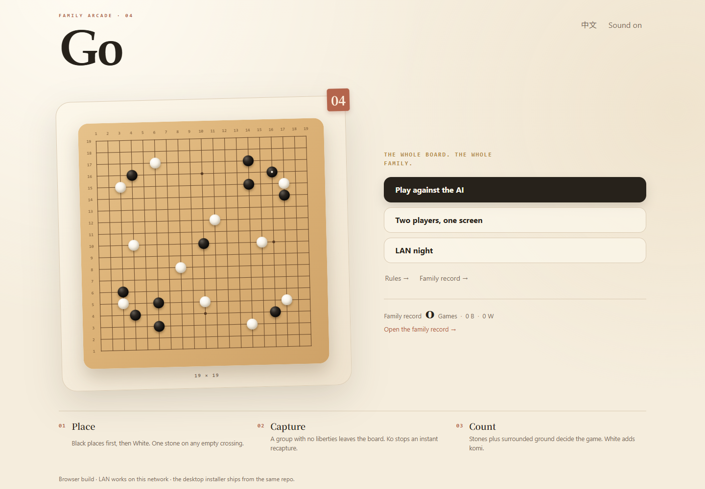
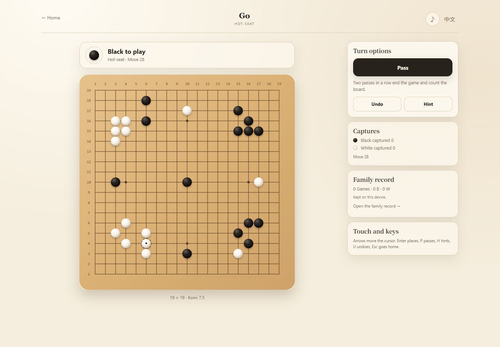
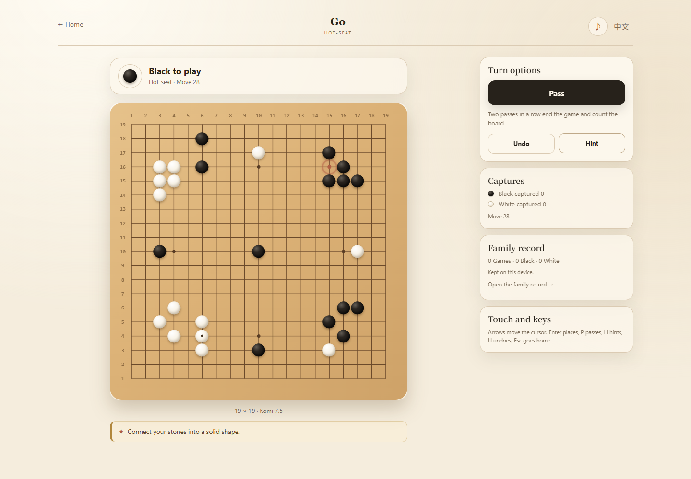
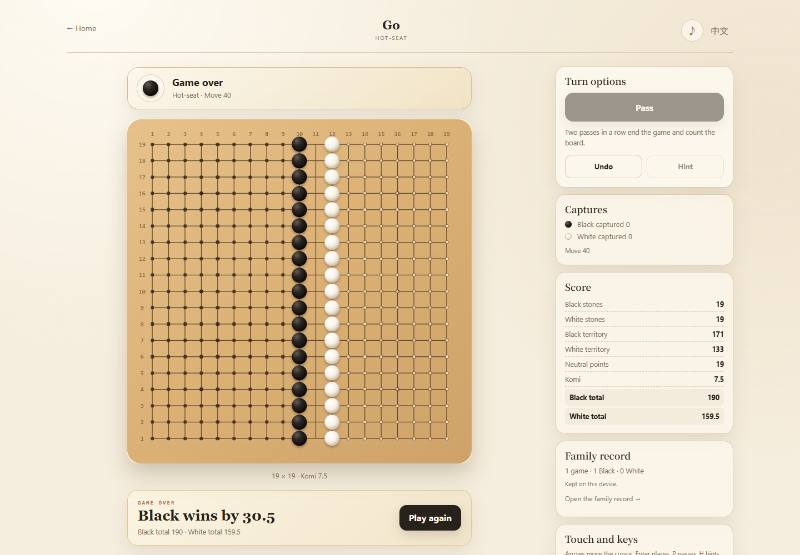
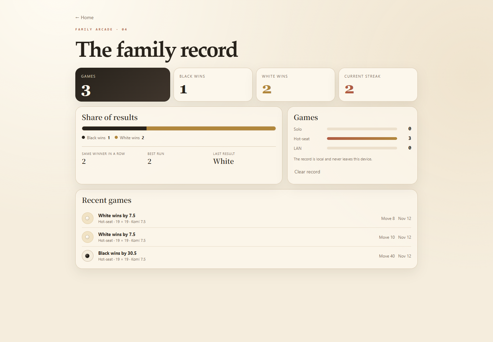
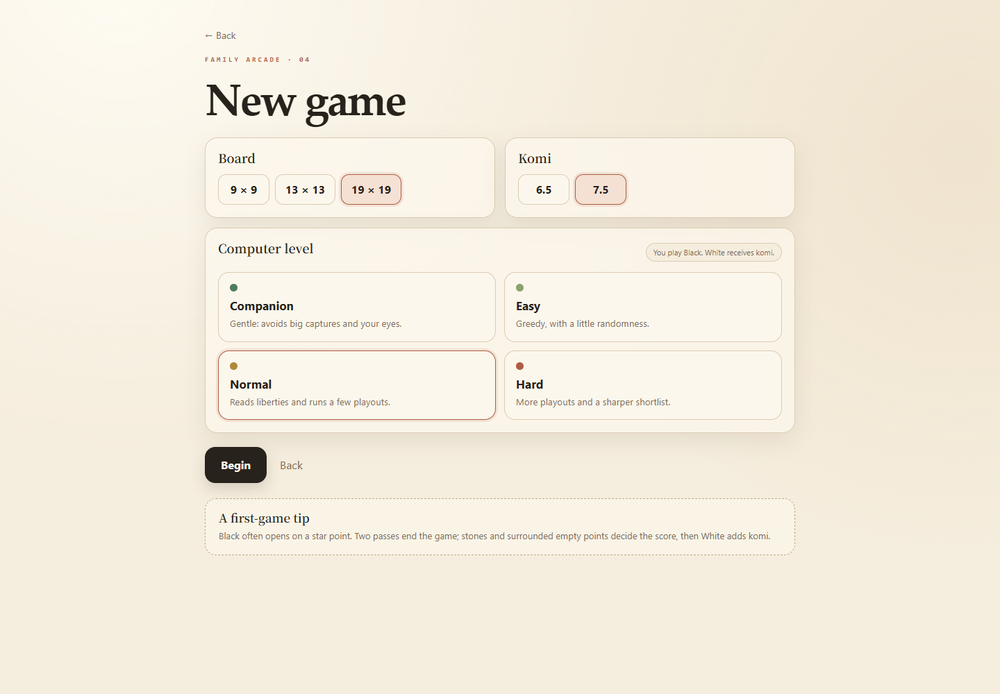
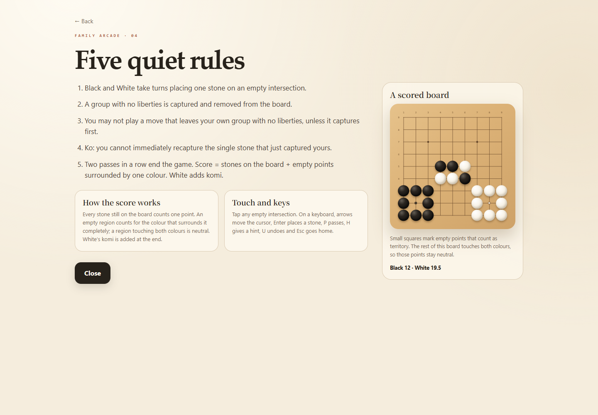
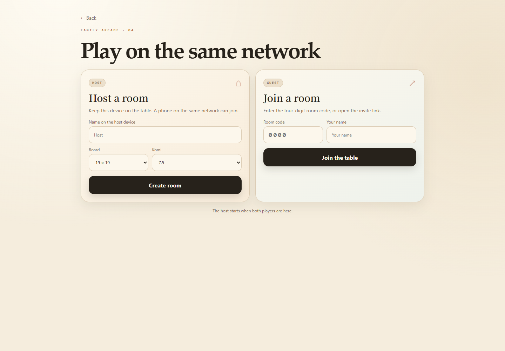
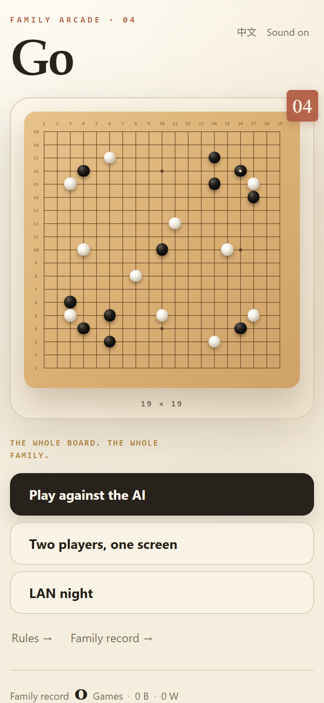
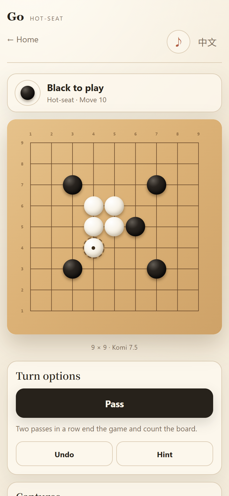

# Go

**English** · [简体中文](README.zh-CN.md)

> **The whole board. The whole family.**

A full, offline-first Go table for the family: **2 players**, **19×19** with
**13×13** and **9×9** options, captures, the suicide ban, simple ko, selectable
**6.5 / 7.5 komi**, and pass/pass territory scoring. Four computer levels, one-screen
hot-seat and LAN play from a phone. No account, no ads, no remote fonts and no network
except your own local network for LAN night.



*45-second bilingual promo manifest: [video.json](video.json) · rendered by the root Family Arcade studio.*

## A turn, in five seconds

| Place | Capture | Count |
| --- | --- | --- |
| Black and White alternate on empty crossings. | A group with no liberties leaves the board. Suicide is illegal; ko stops an instant recapture. | Two passes end the game. Score = stones on the board + surrounded empty points, then White adds komi. |

## What is inside

- **A real, tested Go engine.** Pure TypeScript, deterministic, **45 unit tests**, no
  DOM, network, clock or randomness in the rules. Supports 9×9, 13×13 and 19×19,
  captures, suicide ban, simple ko, two passes, area scoring and 6.5/7.5 komi. See
  [`docs/rules.md`](docs/rules.md).
- **Four computer levels.** Companion plays gently and avoids big captures. Easy is
  greedy with a little randomness. Normal reads liberties and runs a few random
  playouts. Hard uses a sharper shortlist and more playouts. All randomness is
  injected, so a position and RNG stream are deterministic.
- **Three ways to play.** Solo as Black against the computer, two players passing one
  device, or a phone joining the host over the local network.
- **A complete scoring screen.** The second pass marks each side’s surrounded empty
  points on the board and shows stones, territory, neutral points, komi and totals.
- **Small comforts.** Undo (including the computer’s reply and a finished-game result),
  a hint with a plain-language reason, autosave/resume, a local family record, sound
  on/off, reduced-motion support, keyboard navigation and a complete Chinese/English UI.
- **Private by default.** No accounts, telemetry, ads, CDN, remote fonts or downloaded
  art. All stones, wood and icons are drawn in CSS/SVG.

## Screenshots

All images come from the running app at **1440×1000**; phone images are **780×1688**
(390×844 @2×), captured by [`scripts/shots.mjs`](scripts/shots.mjs).

| A real 19×19 game | A hint with a reason |
| --- | --- |
|  |  |

| Finished and scored | Family record |
| --- | --- |
|  |  |

| AI setup | Rules |
| --- | --- |
|  |  |

| LAN lobby | Home |
| --- | --- |
|  |  |

| Phone home | Phone game |
| --- | --- |
|  |  |

## Play locally

```bash
npm install
npm run dev        # http://localhost:5204
npm run check      # tsc + 45 tests + production build
npm run e2e        # real Chrome; run npm run dev first
npm run shots      # regenerate docs/screenshots/{en,zh}
```

Controls: tap an empty crossing, or use the keyboard. Arrow keys move the cursor,
Enter places a stone, **P** passes, **H** gives a hint, **U** undoes and Esc goes home.

## LAN night

Browser build:

```bash
npm run build
npm run lan        # relay + built app on :8080
# open http://localhost:8080, choose LAN night, create a room
# guest: scan the QR, or open the invite and type the four-digit code
```

The host device owns the official board. The guest is White and sends only
`{type:'place', index, moveCount}` or `{type:'pass', moveCount}`; the host re-checks the
seat, turn, move count, ko point and suicide before applying anything. Guests receive
the public view after every move. The host records the LAN result; the guest device
does not duplicate it.

Desktop: the Tauri shell starts the same relay and serves the built app to phones. The
host shows a four-digit room code and a QR invite. Guests open the address on the same
local network; no app install is needed on their side.

## Build the Windows installer

```bash
npm install
npx tauri build --bundles nsis
# src-tauri/target/release/bundle/nsis/Go_0.1.0_x64-setup.exe
```

The installer is per-game and lightweight; WebView2 uses the standard bootstrapper.
A Windows SmartScreen warning is expected for an unsigned family build. This workspace
does not run Tauri builds centrally.

## Known limitations

- **Simple ko only.** No superko, triple-ko or positional-repeat rule.
- **Simple area scoring.** Dead stones are not marked or removed; the board is scored as
  it stands after the second pass. Empty regions touching both colours are neutral.
- **No resignation, handicap or clocks.** Games end with two consecutive passes. Komi
  is chosen from 6.5 or 7.5; there is no bidding or rule-set selection.
- **The AI is heuristic.** Normal and Hard use bounded random playouts. Hard is a good
  family challenge, not a dan-level Go engine.
- **LAN is local-network IPv4.** No cloud, matchmaking or spectator seat. Undo and hints
  are disabled for both LAN seats. A browser QR may use `localhost`; use the desktop
  build or the host machine’s LAN address for a phone.
- **19×19 phone targets are tight.** The board is fully playable, but 9×9 and 13×13 are
  more comfortable on a phone.
- **Undo history after reload is capped.** Autosave keeps the last 120 positions.
- **No installer in this workspace.** The Tauri NSIS build is local and unsigned.
- **No bundled promo video.** `video.json` is the manifest; the root studio renders the
  45-second EN/ZH promo.

See [`docs/limitations.md`](docs/limitations.md) for the honest list.

## Credits

Original code, art and copy for Family Arcade. The rules of Go are public domain. MIT.
See [`NOTICE.md`](NOTICE.md).
