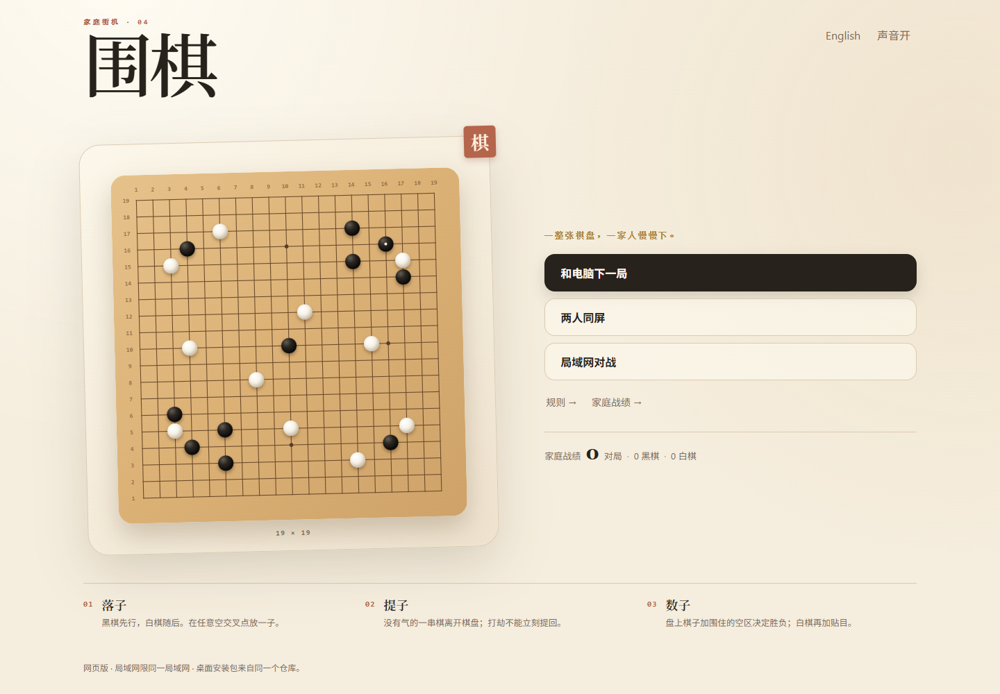
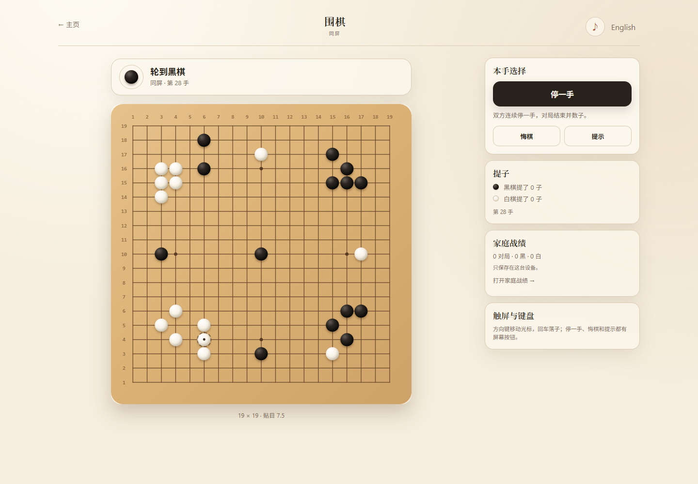
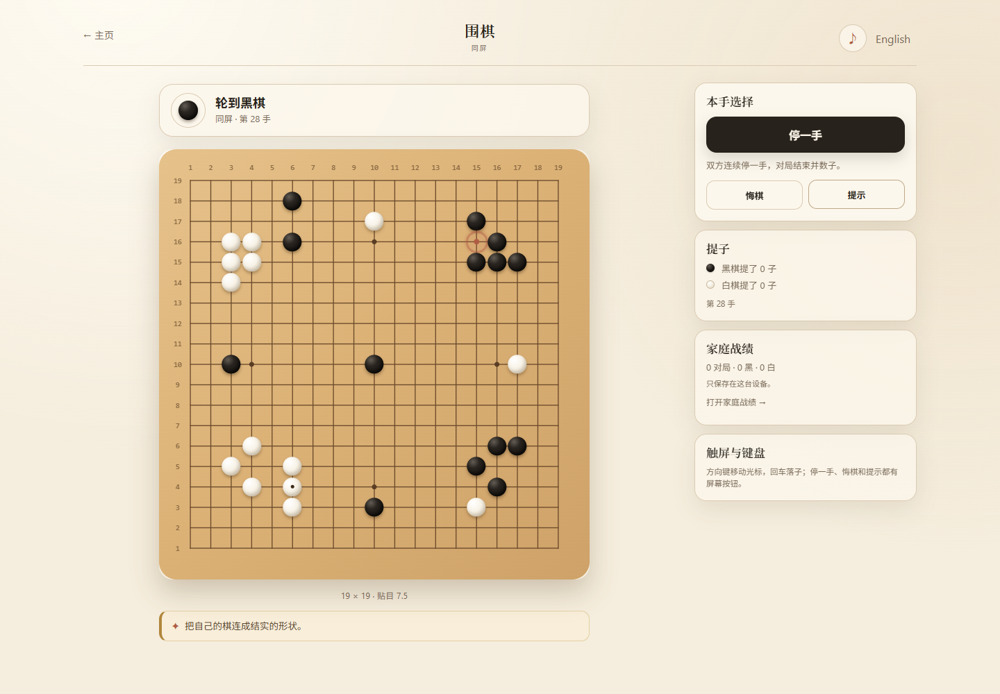
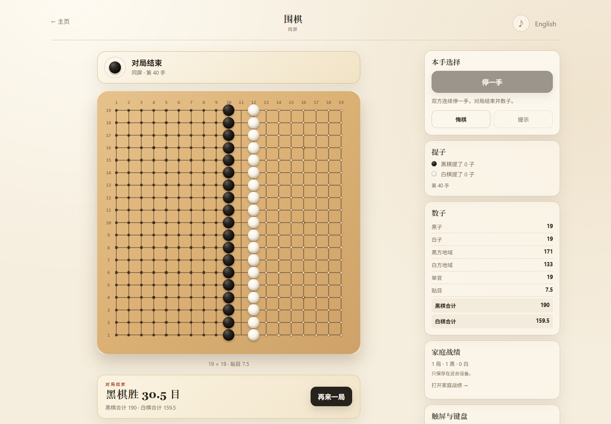
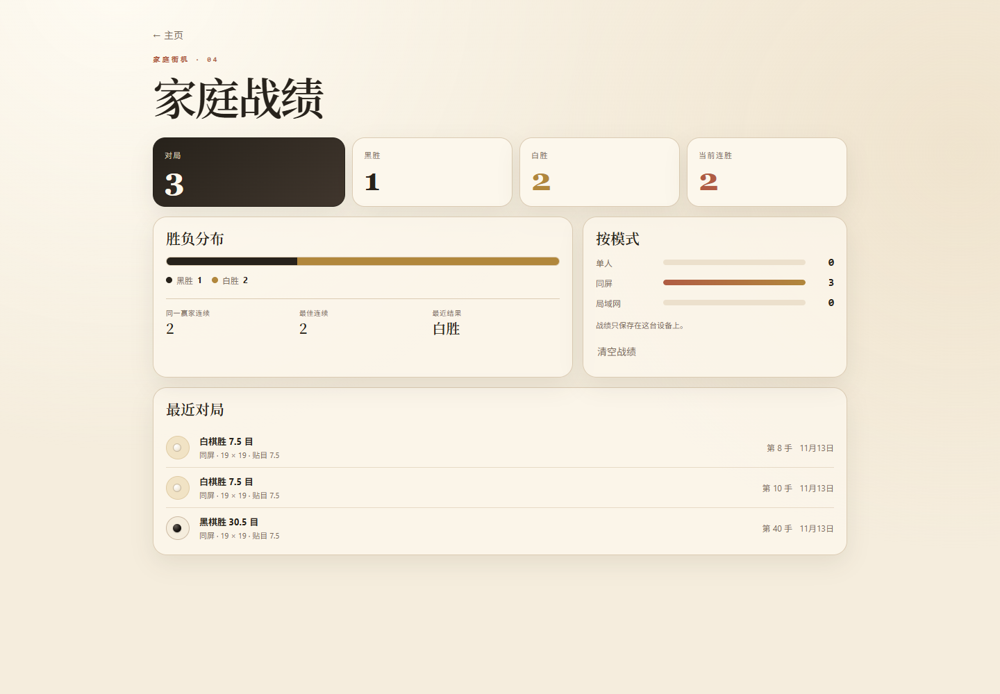
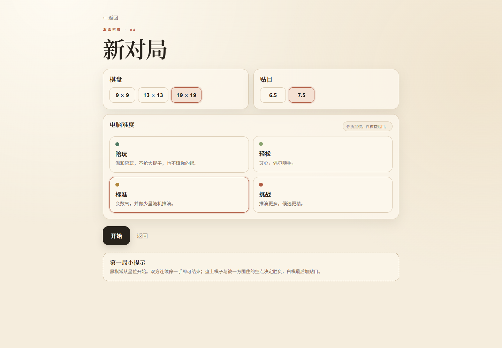
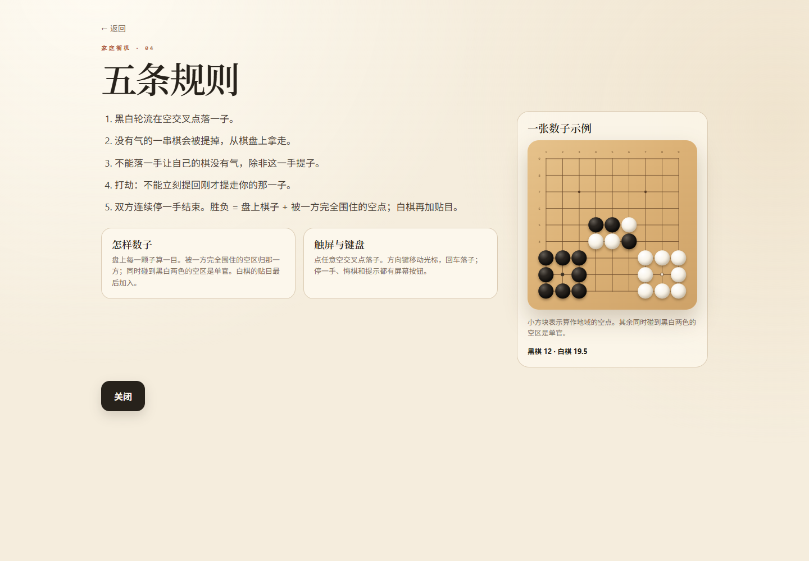
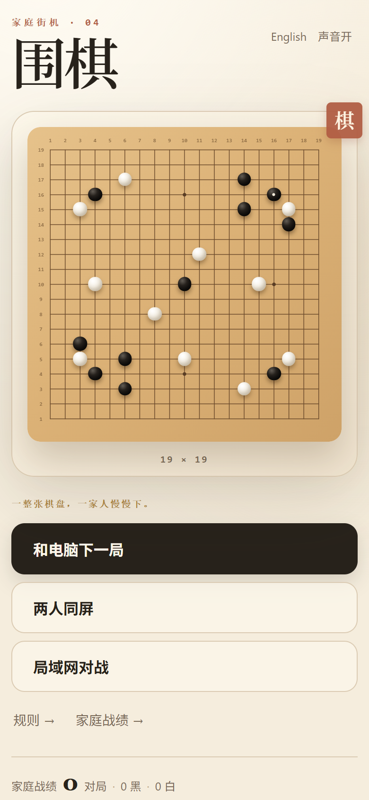
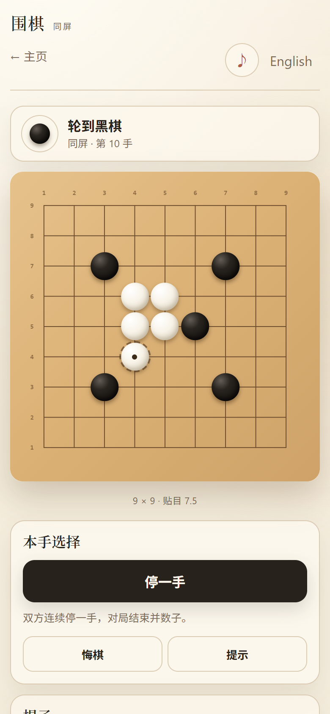

# 围棋

[English](README.md) · **简体中文**

> **一整张棋盘，一家人慢慢下。**

一张离线优先的家庭围棋桌：**2 人**，主打 **19×19**，也可选 **13×13** 和 **9×9**。
完整实现提子、禁入点、简单打劫，贴目可选 **6.5 / 7.5**，双方连续停一手后按
“盘上棋子 + 围住的空点”数子。四档电脑难度、两人同屏，以及手机连同一局域网的
对战。没有账号、没有广告、没有远程字体；除了局域网对战，不需要联网。



*45 秒双语宣传片清单：[video.json](video.json) · 由仓库根目录的家庭游戏馆工作室渲染。*

## 五秒钟看懂一回合

| 落子 | 提子 | 数子 |
| --- | --- | --- |
| 黑白轮流在空交叉点放一子。 | 没有气的一串棋离开棋盘。不能自杀；打劫不能立刻提回。 | 双方连续停一手结束。胜负 = 盘上棋子 + 被一方围住的空点，白棋再加贴目。 |

## 内容

- **真实、经过测试的围棋引擎。** 纯 TypeScript，确定性，**45 个单元测试**；规则层
  不依赖 DOM、网络、时钟或随机数。支持 9×9、13×13、19×19、提子、禁入点、简单
  打劫、连续两次停一手、数子和 6.5 / 7.5 贴目。详见 [`docs/rules.md`](docs/rules.md)。
- **四档电脑难度。** 陪玩温和，不抢大提子；轻松贪心，偶尔随手；标准会数气，并做
  少量随机推演；挑战候选更精、推演更多。所有随机数都由外部注入，同一局面与随机
  序列会得到同一手棋。
- **三种玩法。** 单人执黑对电脑、两人同屏轮流，或手机连同一局域网加入主机。
- **完整的数子界面。** 第二次停一手后，棋盘会标出双方围住的空点，并列出棋子、
  地域、单官、贴目与合计。
- **顺手的小功能。** 悔棋（包括电脑的应手和已结束对局的结果）、带中文理由的提示、
  自动保存与继续、家庭战绩、声音开关、减少动态效果、键盘操作，以及完整中英文界面。
- **默认私密。** 没有账号、遥测、广告、内容分发网络、远程字体或下载素材。棋子、
  木纹和图标全部由 CSS/SVG 绘制。

## 截图

所有图片都来自运行中的应用：桌面 **1440×1000**，手机 **780×1688**
（390×844 @2×），由 [`scripts/shots.mjs`](scripts/shots.mjs) 生成。

| 真实的 19×19 对局 | 带理由的提示 |
| --- | --- |
|  |  |

| 结束并数子 | 家庭战绩 |
| --- | --- |
|  |  |

| 电脑难度设置 | 规则 |
| --- | --- |
|  |  |

| 局域网大厅 | 主页 |
| --- | --- |
|  |  |

| 手机主页 | 手机对局 |
| --- | --- |
|  |  |

## 本地运行

```bash
npm install
npm run dev        # http://localhost:5204
npm run check      # 类型检查 + 45 个测试 + 生产构建
npm run e2e        # 真实 Chrome；先运行 npm run dev
npm run shots      # 重新生成 docs/screenshots/{en,zh}
```

操作：点任意空交叉点落子，或用键盘。方向键移动光标，回车落子，**P** 停一手，
**H** 提示，**U** 悔棋，Esc 回主页。

## 局域网对战

网页版：

```bash
npm run build
npm run lan        # 中继 + 构建产物，端口 8080
# 打开 http://localhost:8080，进入局域网对战，创建房间
# 访客扫码，或打开邀请链接并输入四位房间码
```

主机保存正式棋盘。访客执白，只发送 `{type:'place', index, moveCount}` 或
`{type:'pass', moveCount}`；主机会重新检查座位、轮次、手数、打劫点和禁入点，通过
后才落子。每一步后，访客收到公开视图。局域网对局只记在主机上，访客设备不会重复
记录。

桌面版：Tauri 壳会启动同一个中继，并把构建好的页面提供给手机。主机显示四位房间码
和二维码；访客在同一局域网内打开地址即可，无需安装应用。

## 构建 Windows 安装包

```bash
npm install
npx tauri build --bundles nsis
# src-tauri/target/release/bundle/nsis/Go_0.1.0_x64-setup.exe
```

安装包按游戏独立打包，体积轻巧；WebView2 使用标准引导程序。未签名的家庭版会出现
Windows SmartScreen 提示。本工作区不集中运行 Tauri 构建。

## 已知限制

- **只有简单打劫。** 没有超级劫、三劫循环或全局同形禁着。
- **简单数子。** 不标记、不拿走死子；第二次停一手后按棋盘现状数子。同时碰到黑白
  两色的空区算单官。
- **没有认输、让子或计时。** 对局以连续两次停一手结束。贴目只能在 6.5 和 7.5 之间
  选择，没有竞叫或规则集切换。
- **电脑棋力有限。** 标准和挑战使用有上限的随机推演；挑战是家庭对手，不是职业级
  围棋引擎。
- **局域网限同一局域网的 IPv4。** 没有云端、匹配或观战席。局域网对局中双方都不能
  悔棋或提示。浏览器生成的二维码可能使用 `localhost`；手机加入时请用桌面版，或
  用主机的局域网地址打开。
- **手机上的 19×19 落点较密。** 完全可下，但手机上 9×9 和 13×13 更舒服。
- **重载后悔棋深度有限。** 自动保存保留最近 120 个局面。
- **本工作区不提供安装包。** Tauri NSIS 构建在本地完成，且未签名。
- **不内置宣传片文件。** `video.json` 是清单，45 秒中英文宣传片由根目录工作室渲染。

完整说明见 [`docs/limitations.md`](docs/limitations.md)。

## 致谢

家庭游戏馆的原创代码、美术和文案。围棋规则属于公有领域。MIT 许可。
见 [`NOTICE.md`](NOTICE.md)。
