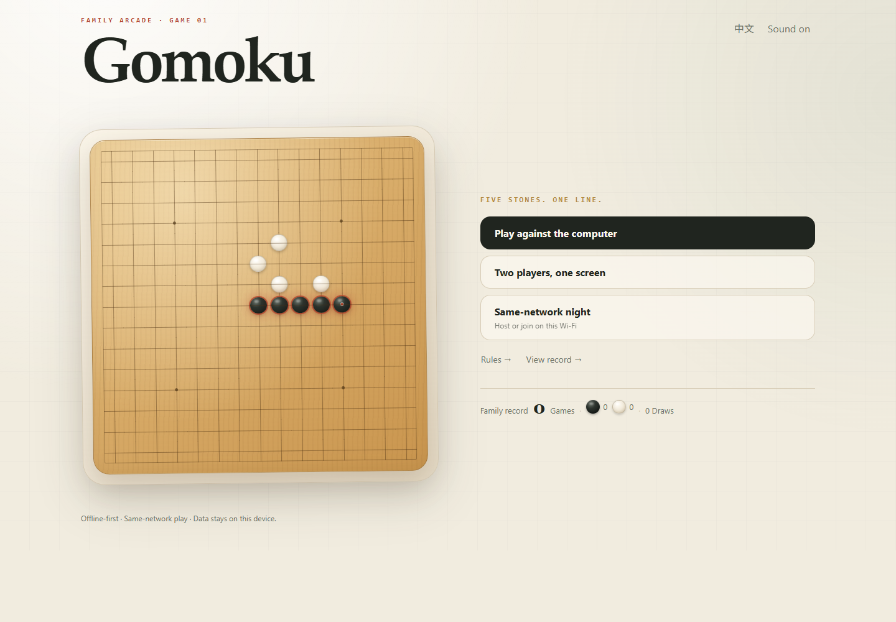
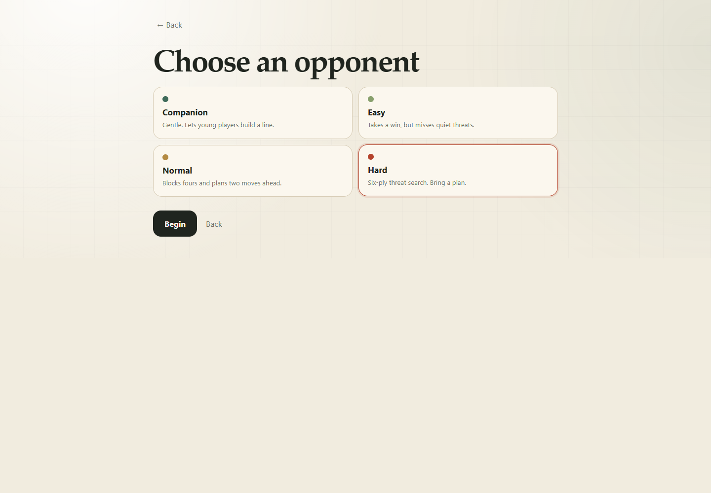
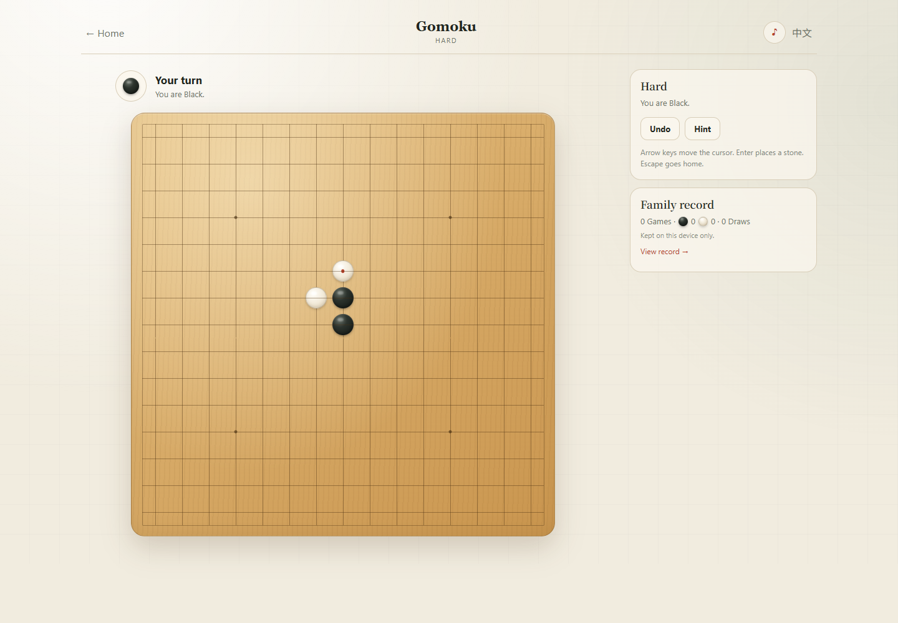
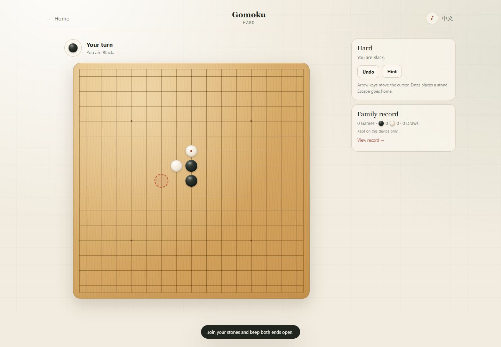
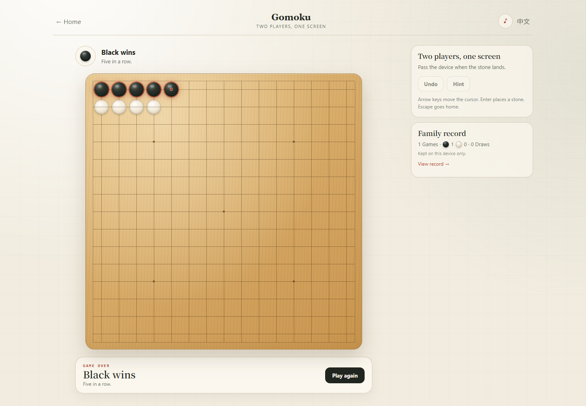
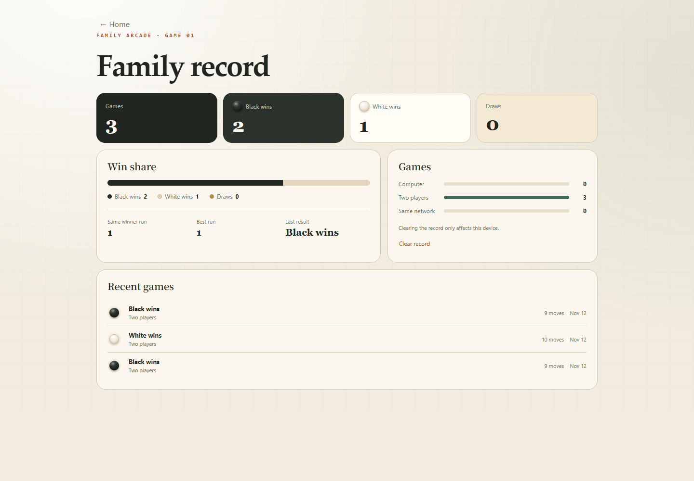
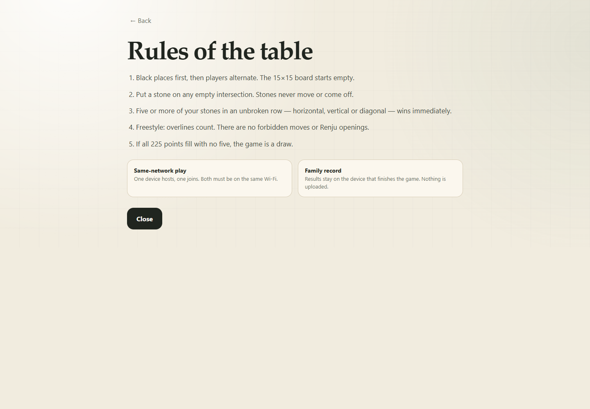
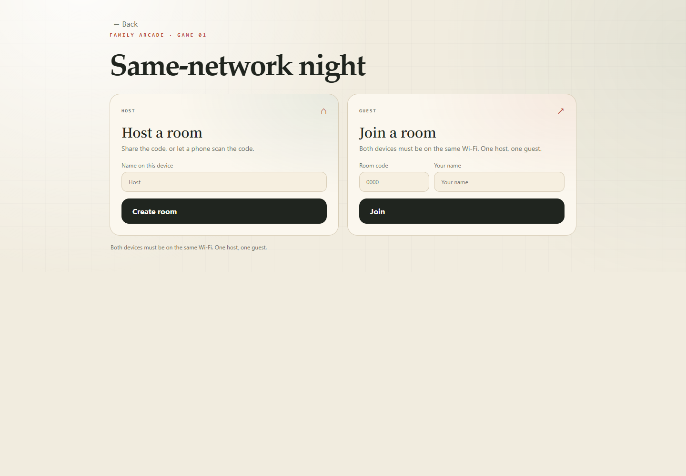
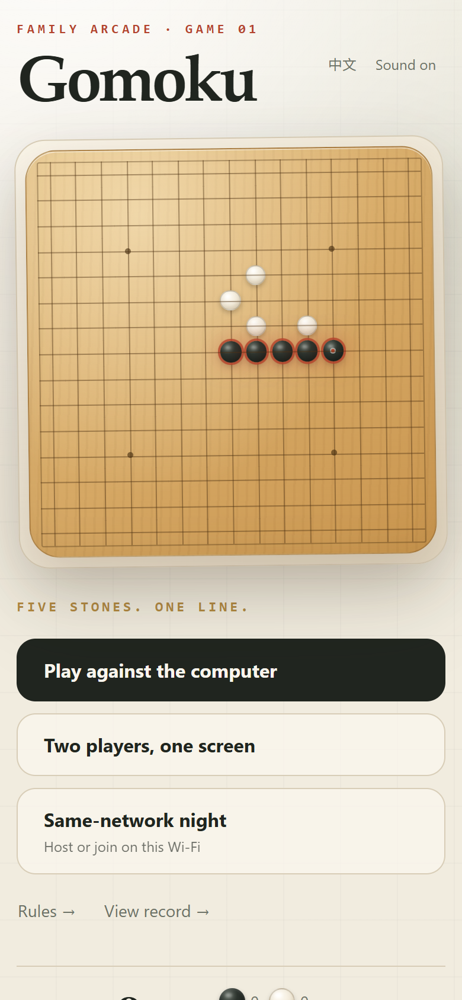
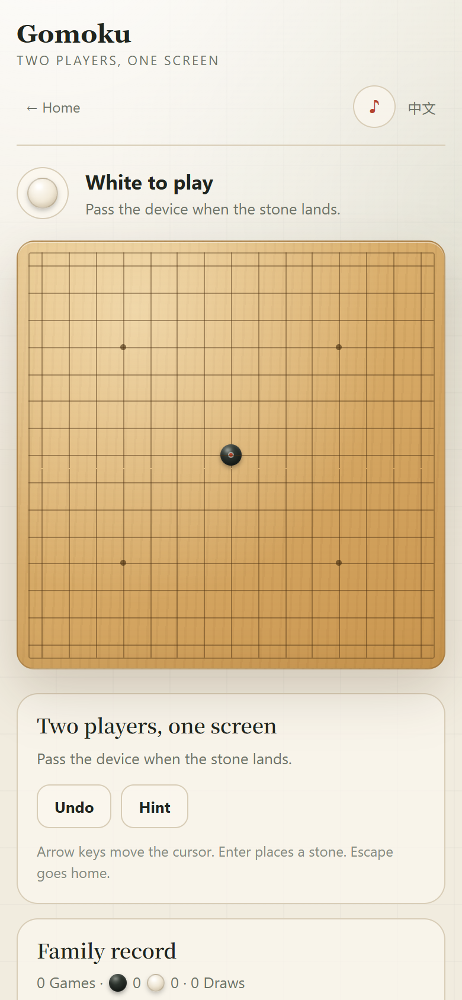

# Gomoku · 五子棋

**English** · [简体中文](README.zh-CN.md)

> **Five stones. One line.**

The full 15×15 freestyle classic for the family table: **2 players**, Black moves
first, and five or more contiguous stones in any direction win. Play solo against
four levels of computer opponent, pass one device, or host a room and let a phone
join over the same Wi-Fi. No account, no ads, no cloud, no remote assets.



## A turn, in five seconds

| Place | Connect | Win |
| --- | --- | --- |
| Black places first, then players alternate on any empty point. | Make an unbroken row of five or more stones: horizontal, vertical or diagonal. | Five wins immediately. A full 225-point board with no five is a draw. |

Freestyle means overlines count and there are no forbidden moves or Renju
openings.

## What is inside

- **A real, tested engine.** Pure TypeScript in `src/game/gomoku.ts`, with no DOM,
  network, clock or `Math.random` in the rules. **43 unit tests** cover turns,
  bounds, all four directions, overlines, gaps, draws, seats, views, AI and hints.
  See [`docs/rules.md`](docs/rules.md).
- **Four AI levels.** Companion plays gently and stops an immediate five without
  building a killing attack. Easy takes a win but misses quiet threats. Normal
  blocks fours and looks two plies ahead. Hard runs a **six-ply threat-space
  search** with a deterministic node budget, focusing on wins, fours and open
  threes. Hard is strong, not a tournament solver.
- **Three ways to play.** Solo against the computer, two players on one screen,
  or a LAN room with the host as Black and the guest as White.
- **A LAN table that handles real life.** Host a room, share the four-digit code
  or QR, and join from a phone. A guest can reload or rejoin mid-game; the host
  resends the current view. The guest result banner is read-only and waits for the
  host to start the next round.
- **A family record.** Totals, Black/White/draw shares, mode split, current and
  best runs, and the eight most recent games. LAN results are recorded on the host
  device; the guest keeps its own local record.
- **Small comforts.** Undo in solo and hot-seat, a hint that explains *why* it is
  good, autosave and resume, sound on/off, arrow-key + Enter board navigation,
  reduced-motion support, complete English/Chinese UI, and a mobile layout that
  shows all 225 points.
- **Private by default.** No accounts, telemetry, ads, remote fonts or downloaded
  art. The only network use is your own LAN relay.

## Screenshots

All screenshots come from the running app at 1440×1000 (phone 780×1688 physical,
390×844 at 2×).

| Home | Choose an opponent |
| --- | --- |
|  |  |

| A real game | Hint with a reason |
| --- | --- |
|  |  |

| Result | Family record |
| --- | --- |
|  |  |

| Rules | Same-network night |
| --- | --- |
|  |  |

| Phone home | Phone game |
| --- | --- |
|  |  |

The Chinese set lives in [`docs/screenshots/zh`](docs/screenshots/zh).

## Play locally

```bash
npm install
npm run dev        # http://localhost:5201
npm run check      # tsc + 43 tests + production build
npm run e2e        # real Chrome, dev server required
npm run shots      # regenerate 10 EN + 10 ZH screenshots
npm run lan:e2e    # starts its own relay on :18927 after a build
```

## LAN night

Browser/dev:

```bash
npm run build
npm run lan        # relay on :8080, serves dist/
# open http://localhost:8080, Same-network night, Create room
# guest: scan the QR, or open the invite and type the code
```

Desktop: the Tauri build starts the same relay internally and serves the built app
to phones. The host shows a four-digit room code and a QR invite. Guests open the
address on the same Wi-Fi; no app install is needed on their side.

The relay is a dumb message bus. The host keeps the authoritative state and sends
only the guest's own seat view. Room codes, reconnect tokens and turn checks are
enforced in TypeScript; stale intents are ignored. The guest's result screen is
read-only and waits for the host to start the next game.

## Build the Windows installer

```bash
npm install
npx tauri build --bundles nsis
# src-tauri/target/release/bundle/nsis/Gomoku_0.1.0_x64-setup.exe
```

The installer is per-game and lightweight; WebView2 uses the standard bootstrapper.
A Windows SmartScreen warning is expected for an unsigned family build.

## Known limitations

- Freestyle only: no Renju forbidden moves; overlines win, as specified.
- Hard is a six-ply threat-space beam with a node cap, not a proof solver. It can
  miss very deep victory-by-continuous-four sequences.
- Two players only; no spectators or matchmaking.
- LAN is IPv4 on the same subnet. The four-digit code is a family convenience, not
  security. The host firewall must allow the app.
- Stats are local to each device. A LAN game is recorded on the host, not duplicated
  on the guest; clearing the record only affects this device.
- A browser-hosted QR may use `localhost`; for a phone on the Wi-Fi use the desktop
  build or open the host machine's LAN IP.
- `video.json` is a manifest for the root studio; this app does not include a
  separate Remotion project or pre-rendered promo file.

See [`docs/limitations.md`](docs/limitations.md).

## Credits

Original code, art and copy for Family Arcade. MIT. See [`NOTICE.md`](NOTICE.md).
