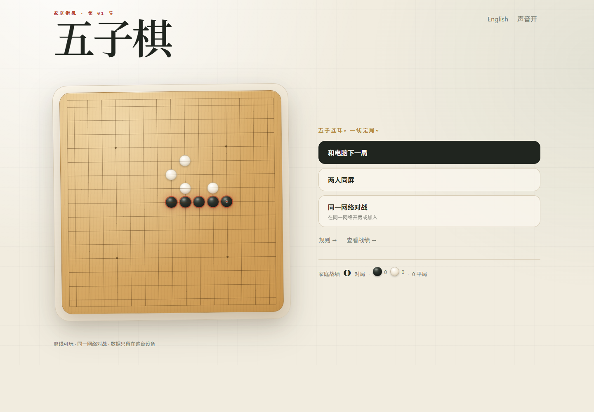
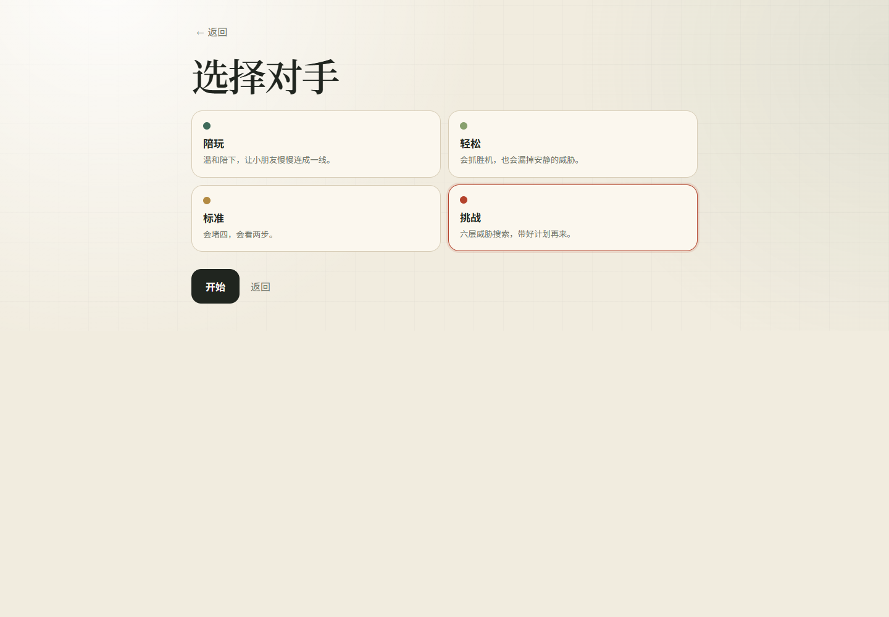
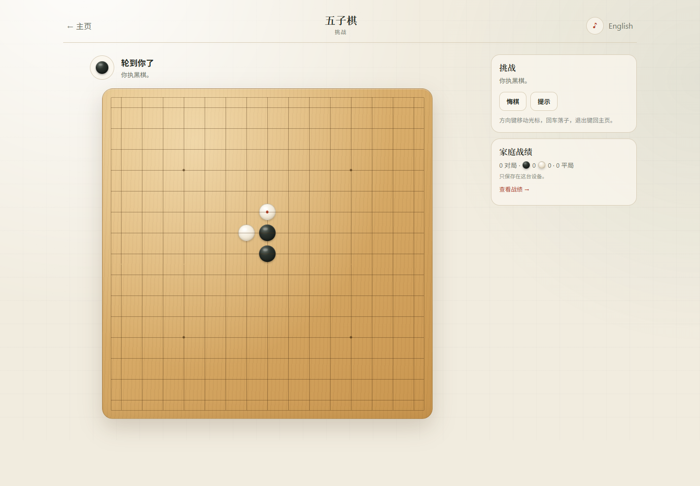
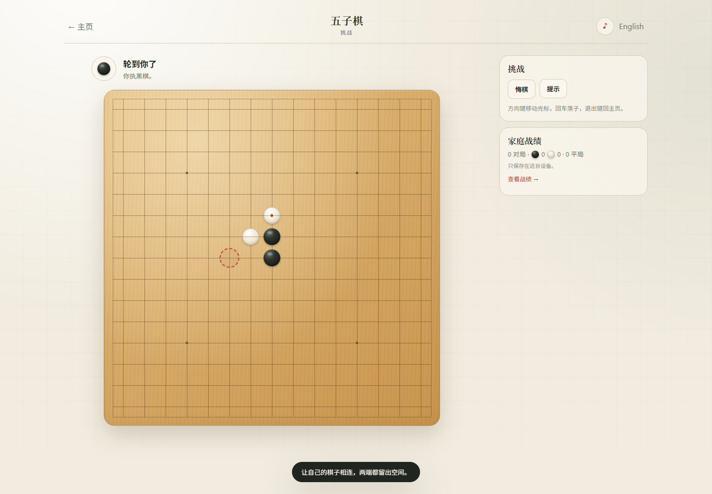
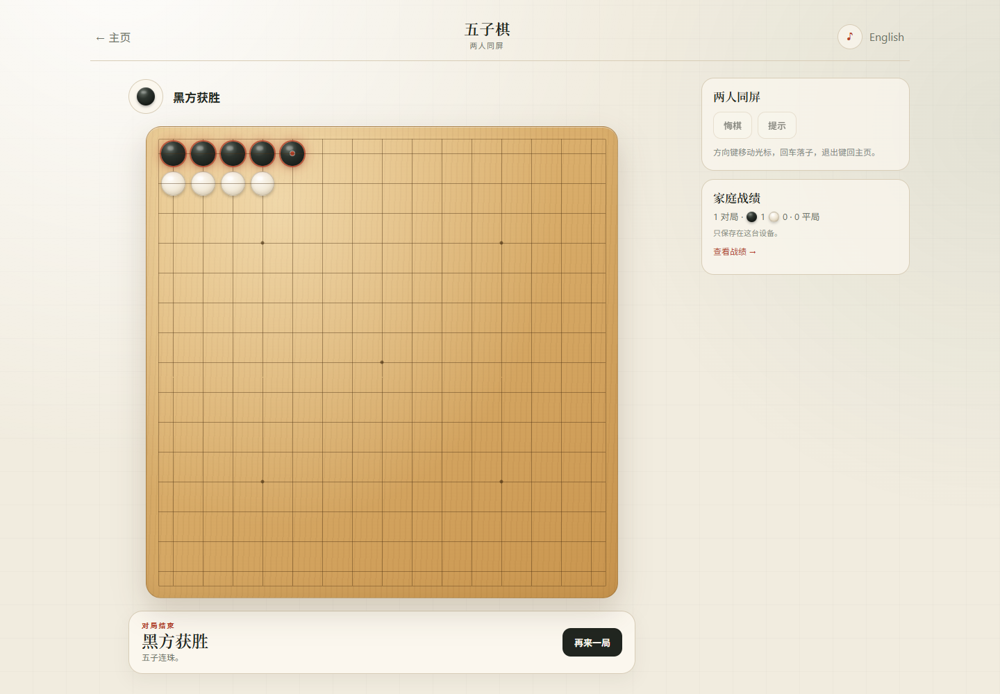
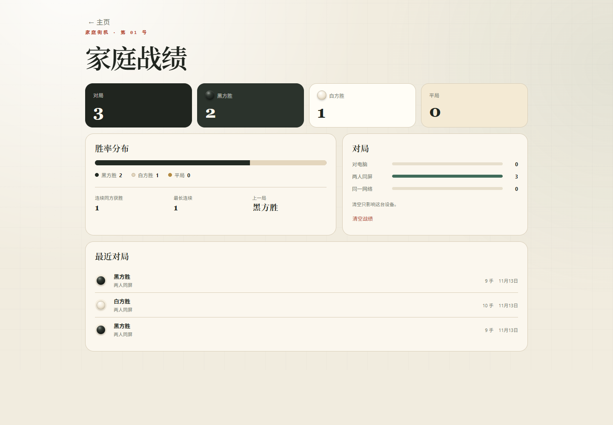
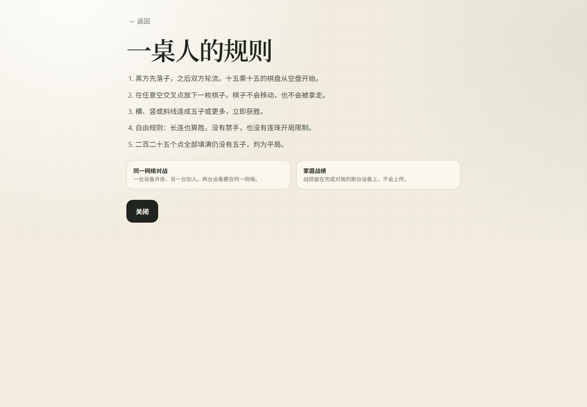
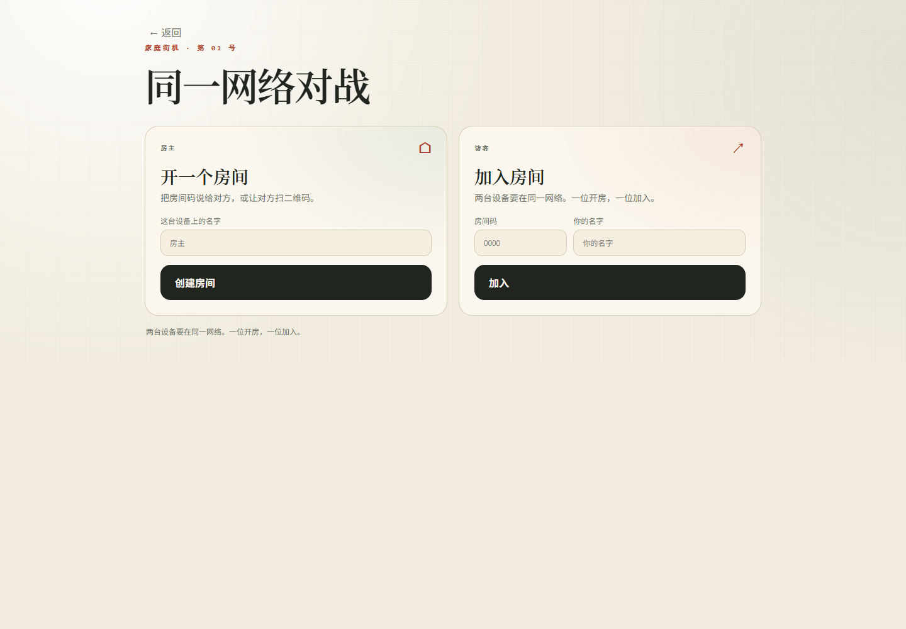
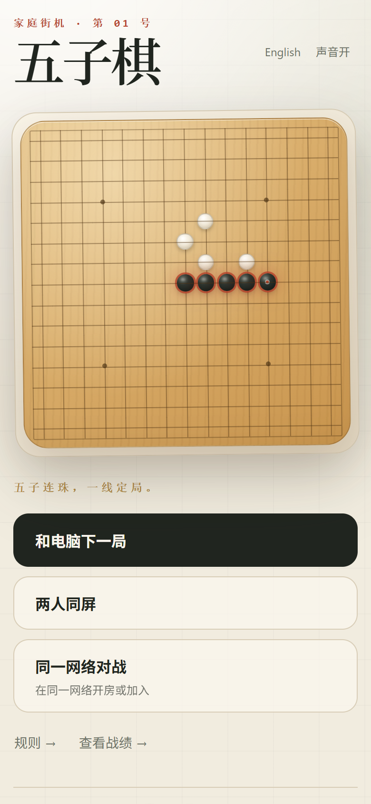
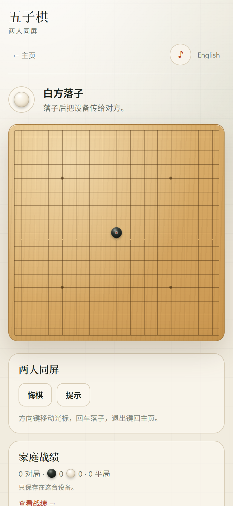

# 五子棋

[English](README.md) · **简体中文**

> **五子连珠，一线定局。**

十五乘十五的自由规则经典五子棋，适合一家人围坐：**两人**对局，黑方先手，
横、竖或斜线连成五子或更多即胜。可以单独挑战四档电脑对手，也可以两人同屏，
或者开一个房间让手机在同一网络加入。没有账号、没有广告、没有云端、没有外部素材。



## 五秒钟看懂一回合

| 落子 | 连线 | 取胜 |
| --- | --- | --- |
| 黑方先下，之后双方轮流在任意空点落子。 | 横、竖或斜线连成五子或更多。 | 五子立即获胜；棋盘填满仍未连成五子则平局。 |

自由规则：长连也算胜，没有禁手，也没有连珠开局限制。

## 里面有什么

- **真正经过测试的规则引擎。** 纯 TypeScript，位于 `src/game/gomoku.ts`，规则中
  没有 DOM、网络、时钟或 `Math.random`。**43 个单元测试**覆盖轮次、边界、四个
  方向、长连、断点、平局、座位、视图、电脑对手和提示。详见
  [`docs/rules.md`](docs/rules.md)。
- **四档电脑对手。** 陪玩温和，会挡住眼前的五子，但不会穷追猛打；轻松会抓胜机，
  也会漏掉安静的威胁；标准会堵四，会看两步；挑战进行**六层威胁空间搜索**，有确定
  的节点预算，重点关注成五、成四和活三。挑战很强，但不是比赛级求解器。
- **三种玩法。** 单独对电脑、两人同屏，或同一网络房间：房主执黑，访客执白。
- **能应付真实家庭的联网牌桌。** 开房后分享四位房间码或二维码，手机即可加入。
  访客刷新或掉线后可以回到原座位，房主会补发当前棋局。访客的结算条只读，等待
  房主开始下一局。
- **家庭战绩。** 总局数、黑白胜率、平局、模式分布、当前和最长连续纪录，以及最近
  八局。联网战绩记在房主设备上，访客设备保留自己的本地记录。
- **小贴心。** 单人和同屏可悔棋；提示会说明理由；自动保存与继续；声音开关；
  方向键加回车落子；支持减少动态效果；中英文界面完整；手机布局显示全部二百二十五
  个交叉点。
- **默认私密。** 无账号、无遥测、无广告、无远程字体、无下载素材。唯一的网络用途
  是家里自己的局域网中继。

## 截图

全部截图来自真实运行的应用：桌面 1440×1000，手机 780×1688 物理像素
（390×844，二倍像素密度）。

| 主页 | 选择对手 |
| --- | --- |
|  |  |

| 真实对局 | 带理由的提示 |
| --- | --- |
|  |  |

| 结算 | 家庭战绩 |
| --- | --- |
|  |  |

| 规则 | 同一网络对战 |
| --- | --- |
|  |  |

| 手机主页 | 手机对局 |
| --- | --- |
|  |  |

英文截图在 [`docs/screenshots/en`](docs/screenshots/en)。

## 本地运行

```bash
npm install
npm run dev        # http://localhost:5201
npm run check      # 类型检查 + 43 个测试 + 生产构建
npm run e2e        # 真实 Chrome，需要开发服务器
npm run shots      # 重新生成中英文各 10 张截图
npm run lan:e2e    # 构建后自动在 :18927 启动中继并测试联网
```

## 局域网之夜

浏览器或开发环境：

```bash
npm run build
npm run lan        # 中继在 :8080，同时提供 dist/
# 打开 http://localhost:8080，进入“同一网络对战”，创建房间
# 访客扫码，或打开邀请链接后输入房间码
```

桌面版：Tauri 构建会启动同一个内置中继，把构建产物提供给手机。房主展示四位房间码
和二维码邀请；访客在同一网络打开地址即可，不需要安装应用。

中继只是消息总线。房主持有权威状态，只向访客发送其座位视图。房间码、重连令牌和
轮次检查都在 TypeScript 中执行，过期意图会被忽略。访客的结算页只读，必须等房主
开始下一局。

## 构建 Windows 安装包

```bash
npm install
npx tauri build --bundles nsis
# src-tauri/target/release/bundle/nsis/Gomoku_0.1.0_x64-setup.exe
```

每个游戏独立打包，安装包很轻；WebView2 使用标准引导程序。未签名的家庭构建出现
Windows SmartScreen 提示属于正常现象。

## 已知限制

- 只实现自由规则：没有连珠禁手；按需求长连也算胜。
- 挑战是六层威胁空间束搜索，有节点上限，不是证明级求解器，可能漏掉极深的连续
  冲四取胜。
- 只支持两位玩家，没有观战或匹配。
- 局域网限同一子网的 IPv4。四位房间码是家庭便利，不是安全措施；房主防火墙需要
  放行应用。
- 战绩只保存在各自设备。联网对局记在房主设备，不会复制到访客；清空战绩只影响
  当前设备。
- 浏览器开房时二维码地址可能是 `localhost`；手机加入请使用桌面版，或在手机上打开
  房主电脑的局域网地址。
- `video.json` 是给根目录工作室使用的清单；本应用不包含独立的 Remotion 工程或
  预渲染宣传片文件。

更多说明见 [`docs/limitations.md`](docs/limitations.md)。

## 致谢

Family Arcade 原创代码、视觉与文案。MIT。见 [`NOTICE.md`](NOTICE.md)。
