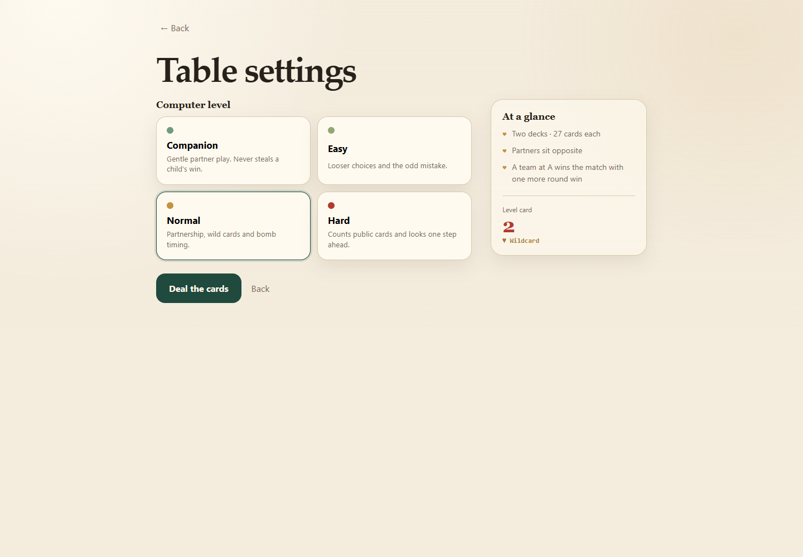
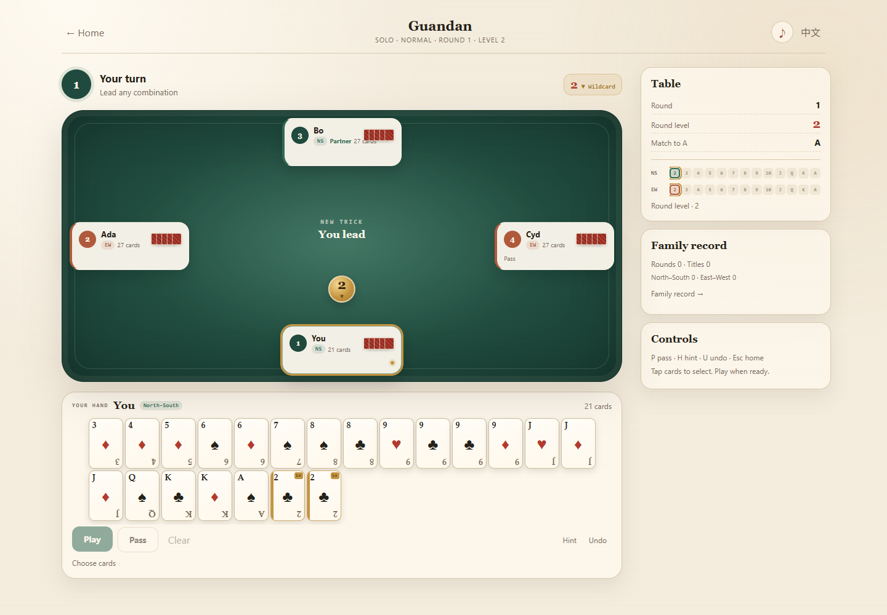
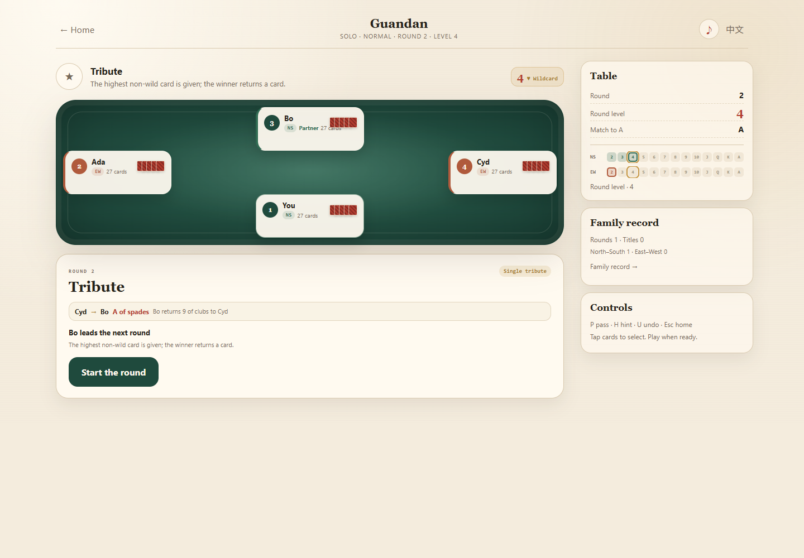
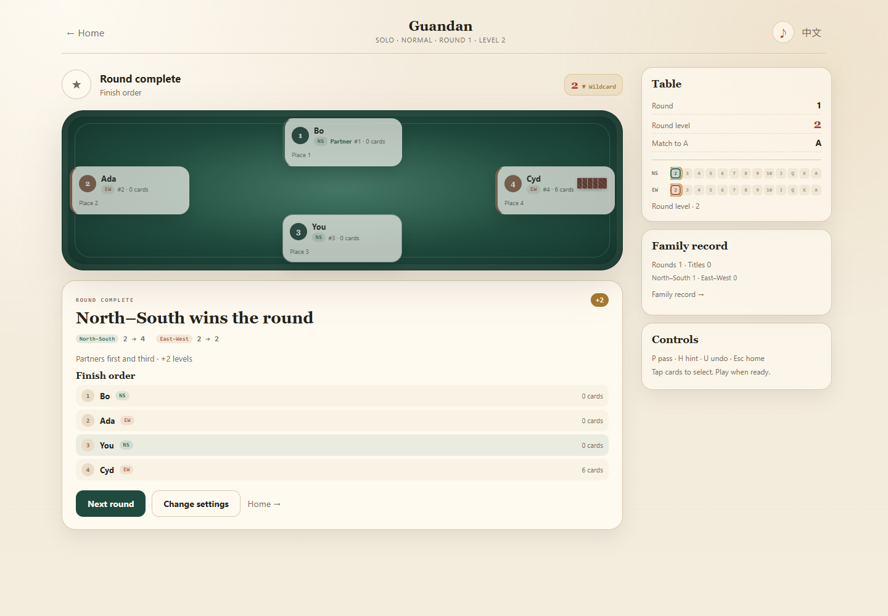
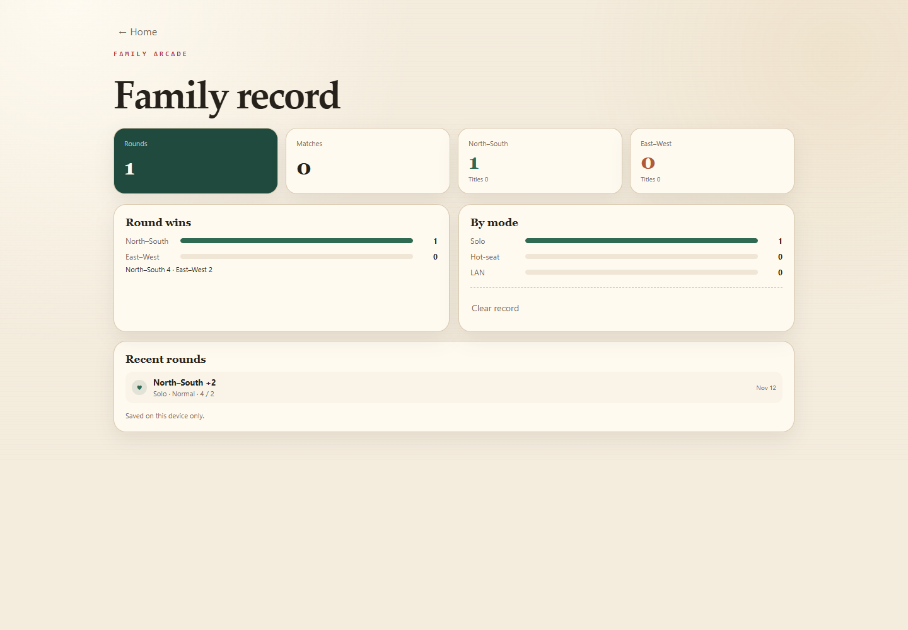

# Guandan

Four-player partnership climbing with two decks. A family table for four, with a
computer partner, a private hot-seat, or three guests on the same network.


## Five-second rules

- Two decks, 108 cards, **27 each**. Seats 0 and 2 are partners; seats 1 and 3 are
  partners.
- The current **level card** ranks just below the jokers. The **heart level card** is
  wild and can stand in for any non-joker card.
- Play a single, pair, triple, triple + pair, straight of five, three consecutive
  pairs, two consecutive triples, a bomb, a straight flush or the joker bomb.
- Beat the same type and length, or play a bomb. **Three passes reset the trick** to
  the last player, or to their partner if they have already finished.
- Partners first and second gain **+3** levels; first and third **+2**; first and
  fourth **+1**. A team at **A** takes the match with one more round win.
- The losing last player pays tribute; the winner returns a card. Anti-tribute when
  the paying side holds both big jokers.

## Modes

- **Solo against the AI** — you and a computer partner against two computer
  opponents. Four levels: Companion, Easy, Normal and Hard.
- **Four-player hot-seat** — one device, four private hands. Each turn starts behind
  a privacy curtain; the next player taps “Show my hand”.
- **LAN table** — the host opens a room, up to three guests join on the same
  network, and empty seats are filled by the computer. Every guest receives only
  their own hand.

## Screens

| | |
| --- | --- |
|  |  |
|  |  |
|  |  |

The rules screen and the LAN lobby are in `docs/screenshots/en/rules.png` and
`docs/screenshots/en/lan.png`. Mobile screens are `home-mobile.png` and
`game-mobile.png` at 780×1688.

## Controls

- Tap or click a card to select it. Select the cards that make the combination, then
  press **Play**.
- **P** pass · **H** hint · **U** undo · **Esc** home.
- The hint highlights the cards and gives a short reason. If the hint is a pass, the
  pass button is outlined.
- On a phone, the hand is a compact three-row grid; all 27 cards fit the screen.

## LAN

1. On the host device, choose **LAN table**, enter a name and press **Create a room**.
2. Share the four-digit code or the invite link. Each guest opens the link, or enters
   the code and a name in **Join**.
3. When at least one guest is in, press **Start the game**. Empty seats play as the
   computer.
4. Keep everyone on the same local network. The relay is local-subnet IPv4; there is
   no internet matchmaking, account or cloud save.

In the browser build the relay is served by `tools/lan-server.mjs`; the packaged
desktop app uses the shared `family_arcade_lan_host` relay. The host is authoritative
and sends a private `view(state, seat)` to each guest. Undo and hints are disabled in
LAN play so no seat gets an information or take-back advantage.

## Build and test

```bash
npm install
npm run check
npm run dev
node scripts/e2e.mjs
node scripts/shots.mjs
LAN_PORT=19020 npm run lan:e2e
```

`npm run check` runs TypeScript, the Vitest suite (**52 tests**) and the production
Vite build. `node scripts/e2e.mjs` covers the hot-seat curtain, hint, undo, a complete
AI round, tribute, autosave/resume, record, rules, language switch and mobile layout.
`node scripts/shots.mjs` regenerates the real screenshots. The LAN E2E needs a built
`dist/` and starts a relay on `LAN_PORT` (19020 by default); it covers a host, three
guests, four unique seats, 108 disjoint cards, live turns, a three-pass reset, a
reconnect and a clean host close.

### Tauri

The Tauri shell is kept in `src-tauri/`. The central build agent produces the
installer; this app does not run `cargo` or `tauri build` itself. The web app is the
same bundle that the shell loads.

## Docs

- [Rule audit](docs/rules.md) — every rule mapped to code and tests.
- [Known limitations](docs/limitations.md) — honest table choices and gaps.
- [Notice](NOTICE.md) — original implementation and assets.
- [中文说明](README.zh-CN.md)

## Design and assets

Everything on the table is drawn with CSS and inline SVG: cards, the felt, seat
badges, level ladder, the LAN QR background and the sound are generated locally. No
remote fonts, CDN, downloaded art or third-party samples are used.

MIT. See [LICENSE](LICENSE).
