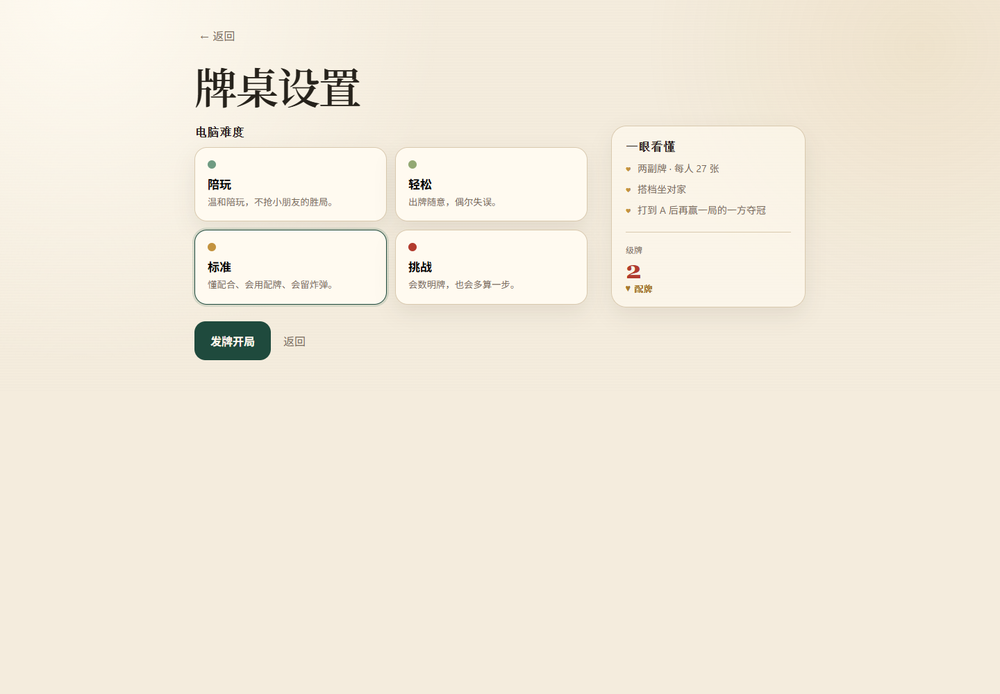
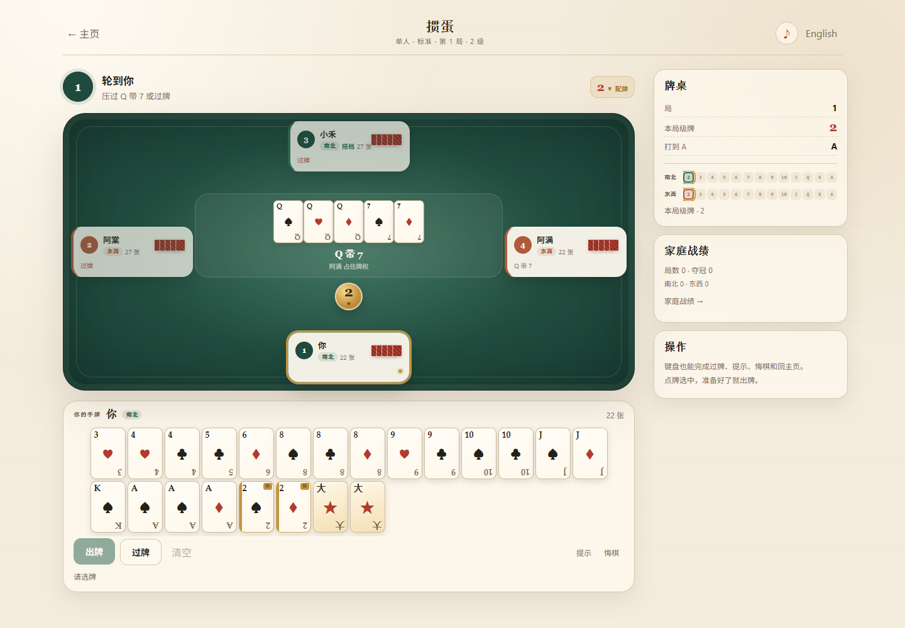
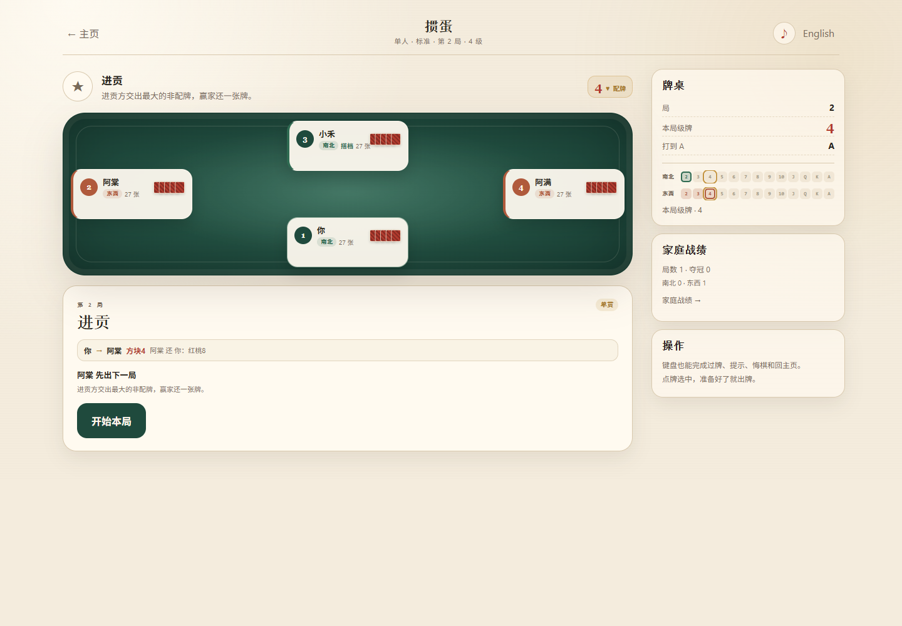
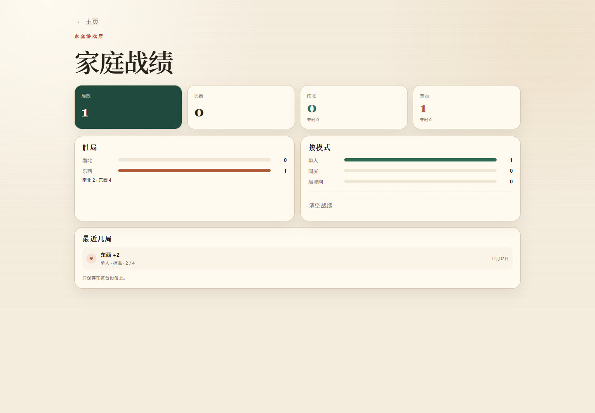

# 掼蛋

四个人、两副牌、搭档一起升级。可以单人带一个电脑搭档，也可以四个人同屏，
或者在同一网络里开一桌。


## 五秒懂规则

- 两副牌，共 108 张，每人 **27 张**。南北两家是搭档，东西两家是搭档。
- 当前的**级牌**排在大小王之下。**红桃级牌**是配牌，可以代替除大小王以外的任意牌。
- 牌型：单张、对子、三张、三带二、五张顺子、三连对、钢板、炸弹、同花顺、天王炸。
- 用同牌型、同张数压过，或者出炸弹。**连续三家过牌**，牌权回到最后出牌的人；
  如果他已经出完，就交给他的搭档。
- 搭档第一、第二升 **3 级**；第一、第三升 **2 级**；第一、第四升 **1 级**。
  打到 A 后再赢一局的一方夺冠。
- 末游进贡，头游还牌。进贡方握有两张大王时可以抗贡。

## 三种玩法

- **单人对抗电脑**：你和一位电脑搭档，对阵两位电脑对手。四档难度：陪玩、轻松、
  标准、挑战。
- **四人同屏热座**：一台设备，四个人的手牌轮流显示。每位玩家开始前都要先揭开
  自己的手牌，下一位准备好后再继续。
- **局域网牌桌**：主机开房间，最多三位访客加入，空座位由电脑补上。每位访客
  只会收到自己的手牌。

## 界面

| | |
| --- | --- |
|  |  |
|  |  |
|  |  |

规则页和局域网大厅分别在 `docs/screenshots/zh/rules.png` 和
`docs/screenshots/zh/lan.png`。手机截图是 `home-mobile.png` 和
`game-mobile.png`，尺寸为 780×1688。

## 操作

- 点牌选中，凑成牌型后按**出牌**。
- 键盘也能完成过牌、提示、悔棋和回主页。
- 提示会高亮要出的牌，并说明理由；如果建议过牌，过牌按钮会加一圈高亮。
- 手机上，27 张手牌排成紧凑的三行，整手牌都能在一屏里看到。

## 局域网

1. 主机设备选择**局域网牌桌**，填好名字，按**创建房间**。
2. 把四位房间码或邀请链接发给家人。访客打开链接，或者输入房间码和名字后
   按**加入**。
3. 至少有一位访客到齐后，主机按**开始游戏**。空座位由电脑补上。
4. 所有人需要连在同一个本地网络。局域网只支持本地网络，不支持互联网匹配、
   账号或云端存档。

浏览器版本由 `tools/lan-server.mjs` 提供局域网服务；桌面安装包使用共享的
`family_arcade_lan_host` 服务。主机保存权威牌局，只把每位访客自己的手牌发送
给该访客。局域网对局中关闭悔棋和提示，避免有人获得额外信息或反悔机会。

## 构建与测试

```bash
npm install
npm run check
npm run dev
node scripts/e2e.mjs
node scripts/shots.mjs
LAN_PORT=19020 npm run lan:e2e
```

`npm run check` 会做类型检查、运行 **52 个测试**，再生成生产版本。
`node scripts/e2e.mjs` 覆盖同屏遮罩、提示、悔棋、完整电脑对局、进贡、自动保存与
继续、家庭战绩、规则、语言切换和手机布局。`node scripts/shots.mjs` 重新生成真实
截图。局域网测试需要先生成 `dist/`，会在 `LAN_PORT`（默认 19020）上启动本地
服务，覆盖主机、三位访客、四个不同座位、108 张互不重复的手牌、实时出牌、
三家过牌重置、断线重连和主机关房。

### 桌面安装包

桌面外壳保留在 `src-tauri/`。安装包由中央构建流程统一生成；本应用不自行运行
`cargo` 或 `tauri build`。网页版和桌面版使用同一份前端代码。

## 文档

- [规则核对](docs/rules.md)
- [已知限制](docs/limitations.md)
- [版权说明](NOTICE.md)
- [英文说明](README.md)

## 设计与素材

牌面、牌桌、座位徽章、升级路线、二维码背景和提示音都在本地用样式和内联图形
绘制。没有远程字体、内容分发网络、下载的美术或第三方音频素材。

MIT 许可证，见 [LICENSE](LICENSE)。
