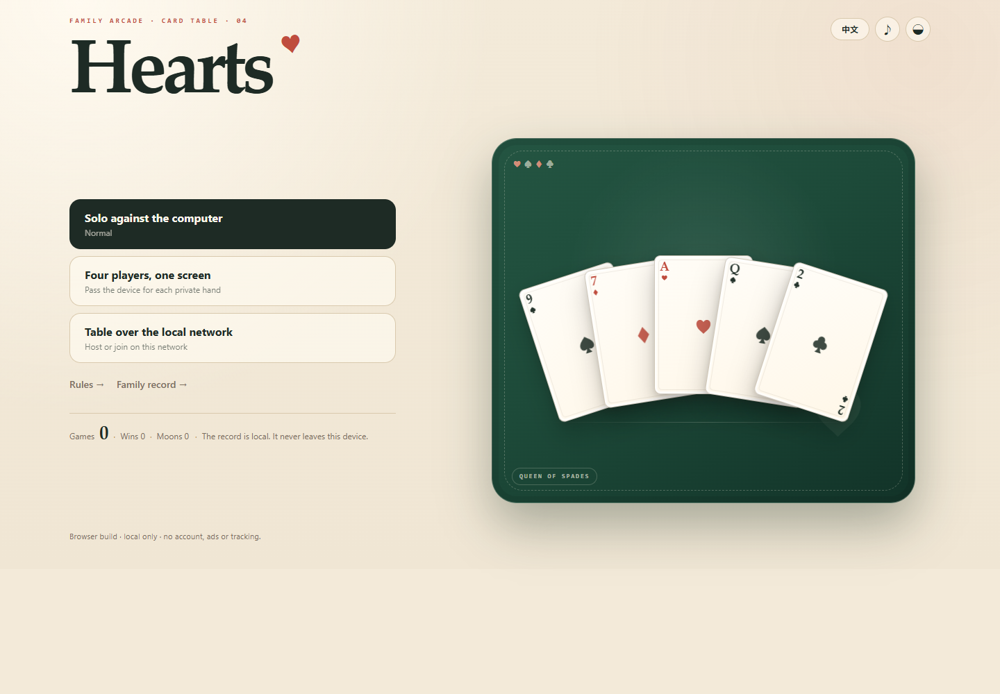
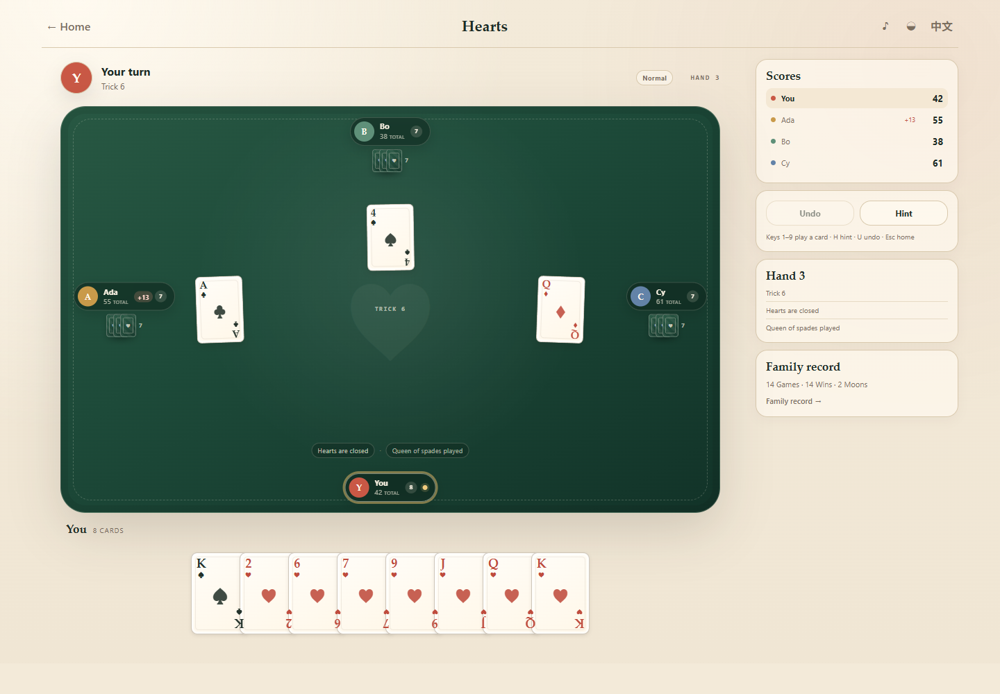
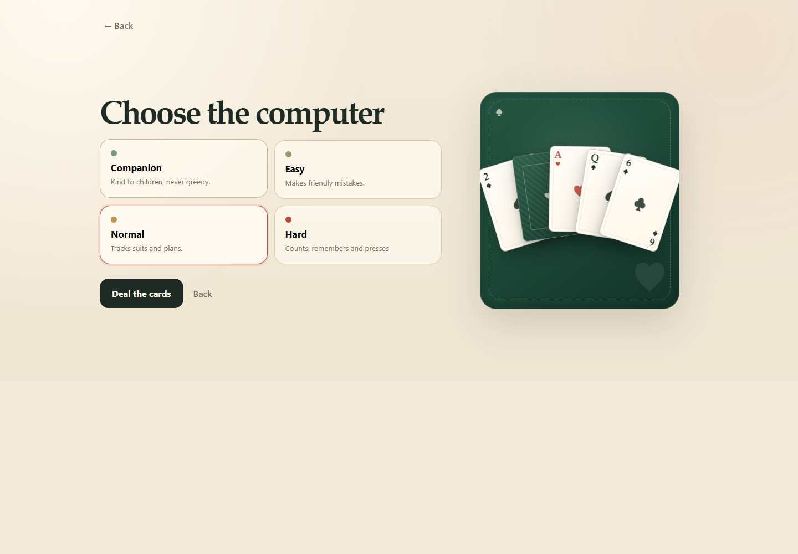
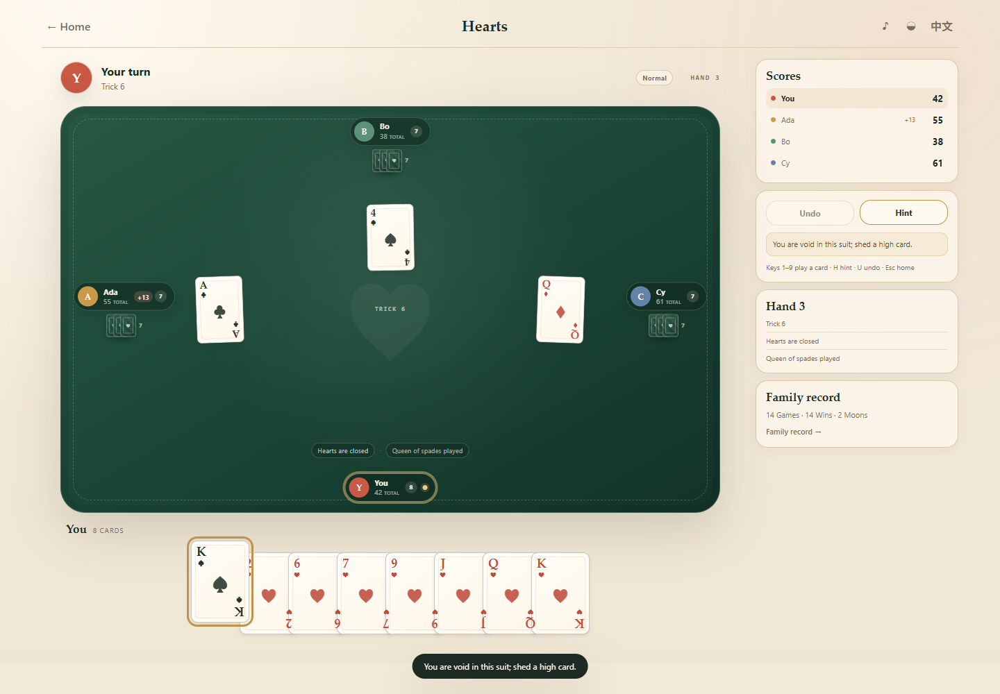
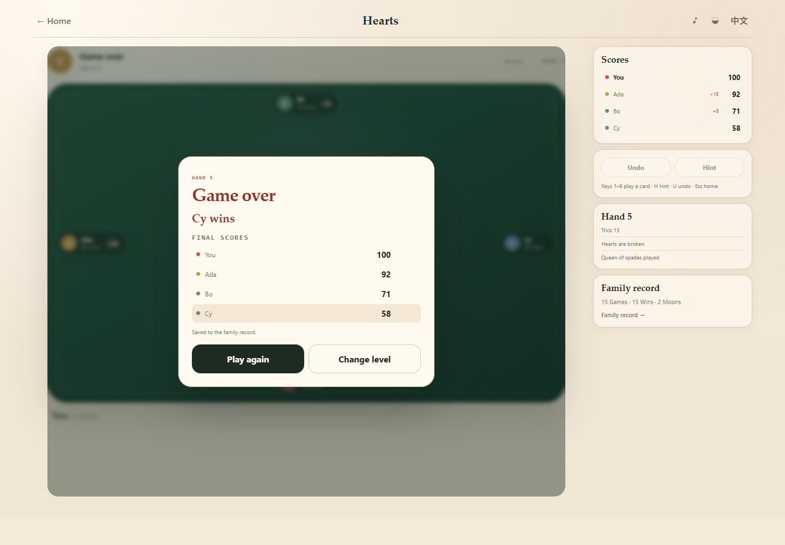
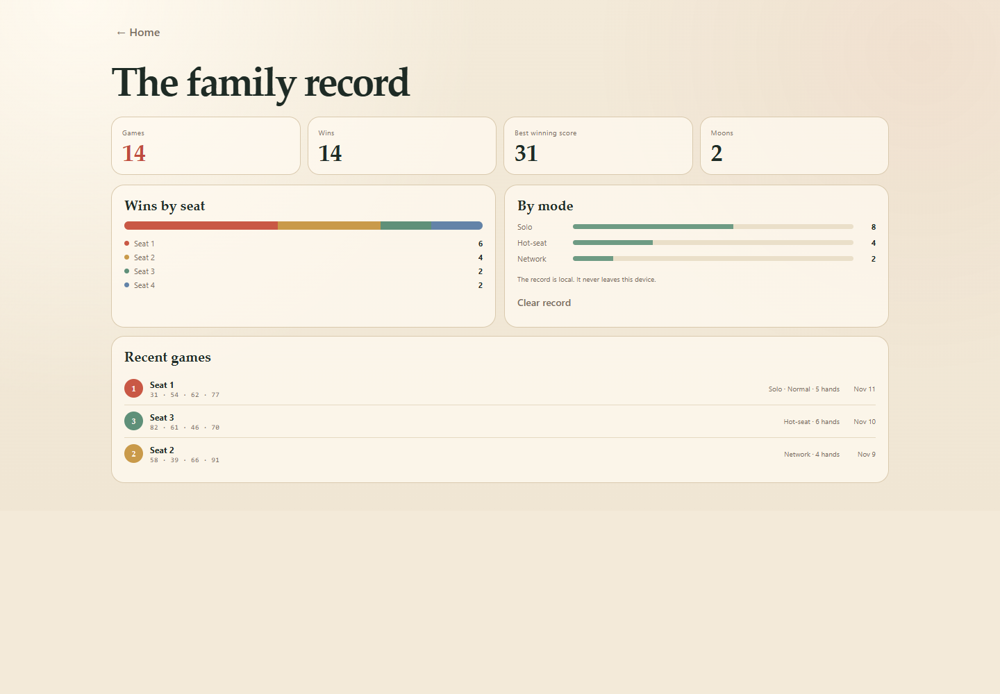
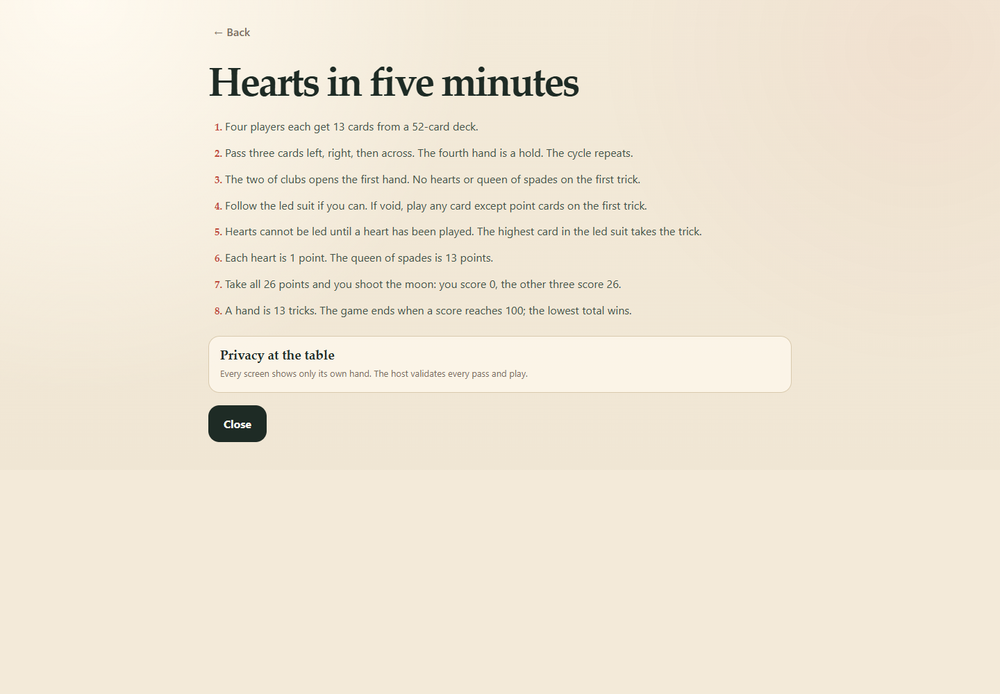
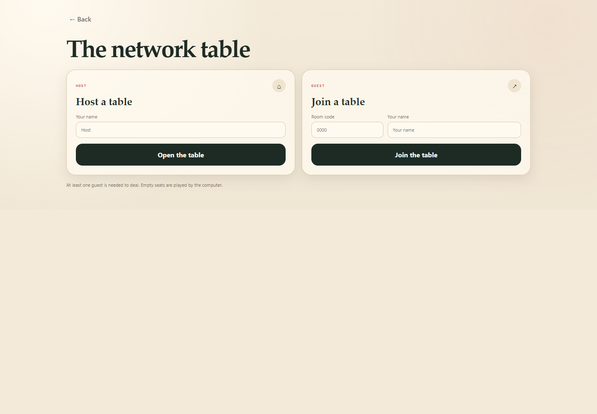
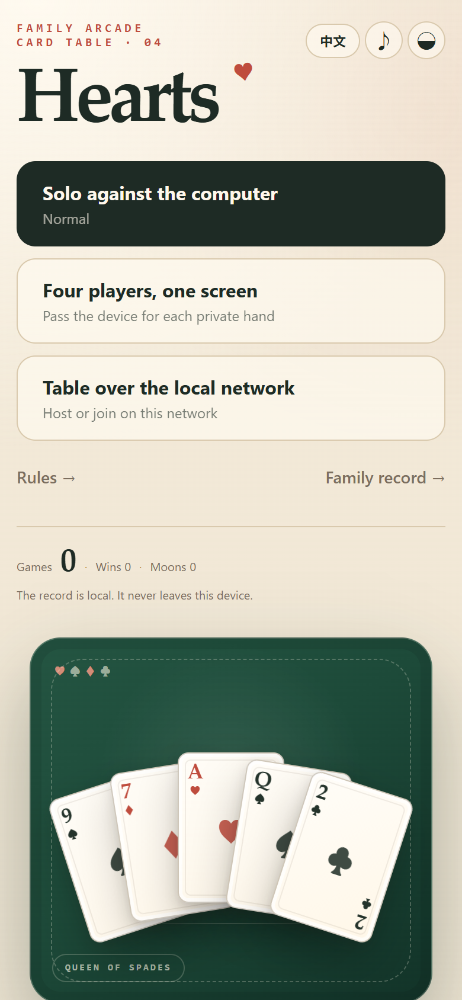
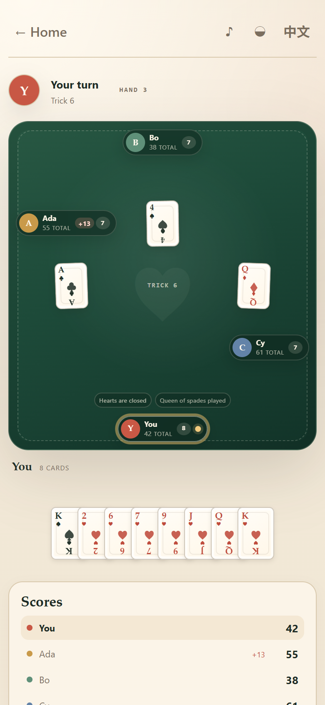

# Hearts

**English** · [简体中文](README.zh-CN.md)

A four-seat, offline-first Hearts table. A real 52-card deck, passing left, right and
across, follow-suit tricks, hearts and the queen of spades, shoot-the-moon scoring and
a 100-point finish. Play solo against four computer personalities, pass one device
around four people with a privacy curtain, or host a LAN table where each screen gets
only its own hand.

## Five-second rules

| Pass | Play | Score |
| --- | --- | --- |
| Pass three cards left, right, then across. Every fourth hand is a hold. | Follow the led suit. The highest card of that suit takes the trick. | Each heart is 1 point, the queen of spades is 13. Take all 26 to shoot the moon. At 100 the lowest total wins. |

The two of clubs opens the first hand. Hearts cannot be led until broken, and the
first trick of each hand carries no point cards unless a player has no alternative.

## What is inside

- **A real, tested engine.** Pure TypeScript in `src/game/hearts.ts`, **32 unit tests**,
  injected shuffling, no DOM, network, clock or `Math.random` in the rules. The full
  audit is in [`docs/rules.md`](docs/rules.md).
- **Four computer levels.** Companion is gentle and avoids taking a child's points.
  Easy makes friendly mistakes. Normal tracks suits and plans. Hard uses known voids,
  sampled hidden hands, moon awareness and a one-hand lookahead.
- **Three ways to play.** Solo against three computers, four human seats on one device,
  or a LAN table with up to three guest phones. Empty LAN seats are covered by the
  computer.
- **Privacy that is real.** The engine's `view()` exposes only one seat's hand plus
  public counts, voids, played cards, trick and scores. The LAN host validates every
  pass and play. Hot-seat adds a full-screen curtain between seats, with a private undo.
- **A proper family record.** Games, wins by seat, best winning score, moons, mode
  split and the eight most recent results. Stored on the host device for LAN games and
  on the local device for solo/hot-seat.
- **Small comforts.** Undo, a hint that explains why, autosave and resume for solo and
  hot-seat, sound and reduced-motion toggles, keyboard play, and a mobile layout built
  as a first-class way to play.
- **Private by default.** No account, telemetry, ads, cloud saves, remote fonts or
  third-party art.

## Screenshots

| Home | A real hand |
| --- | --- |
|  |  |

| AI setup | Hint with a reason |
| --- | --- |
|  |  |

| Result | Family record |
| --- | --- |
|  |  |

| Rules | LAN lobby |
| --- | --- |
|  |  |

| Phone home | Phone game |
| --- | --- |
|  |  |

All screenshots come from the running app: 1440×1000 desktop, 780×1688 phone
(390×844 at 2×). Chinese shots mirror every screen in `docs/screenshots/zh/`.

## Play locally

```bash
npm install
npm run dev        # http://localhost:5208
npm run check      # tsc + 32 tests + production build
npm run e2e        # real Chrome; run the dev server first
npm run shots      # regenerate screenshots (dev server running)
```

The 45-second bilingual promo is rendered centrally from [`video.json`](video.json);
this app ships no separate video project.

## LAN night

The shared relay is the same one used by every Family Arcade game.

```bash
npm run build
npm run lan        # serves dist and the relay on :8080
```

1. Start the dev server (`npm run dev`, port 5208) or open the built app on `:8080`.
2. On the host device choose **Table over the local network** and open a table.
3. A guest scans the QR code, opens the invite link, or types the four-digit code at
   the host address. Repeat for up to three guests; empty seats become computers.
4. The host deals. Every guest receives a per-seat view with only their own hand.

The desktop app starts the same relay inside the Tauri shell. Guests do not install
anything; they only need a browser on the same IPv4 network. The four-digit code keeps
honest family members out, not a determined attacker.

## Build the Windows installer

The Tauri shell is kept ready. The main arcade build produces all installers centrally;
running this command locally builds only Hearts:

```bash
npm install
npx tauri build --bundles nsis
# src-tauri/target/release/bundle/nsis/Hearts_0.1.0_x64-setup.exe
```

WebView2 uses the standard bootstrapper. The installer is unsigned, so Windows may
show a SmartScreen warning.

## Controls

- Click or tap a card to select it while passing, or play it when it is legal.
- Mouse, touch and keyboard all work: **1–9** play a card, **H** gives a hint,
  **U** undoes, **Esc** returns home.
- The hot-seat curtain only opens for the named seat. In LAN rooms undo and hints pause.
- Sound and reduced motion are remembered on this device.

## Known limitations

See [`docs/limitations.md`](docs/limitations.md). The short version: LAN is local
subnet IPv4 only, the host is the authority, the family record stores seat results
rather than player names, and Hard is a strong heuristic rather than a perfect solver.
