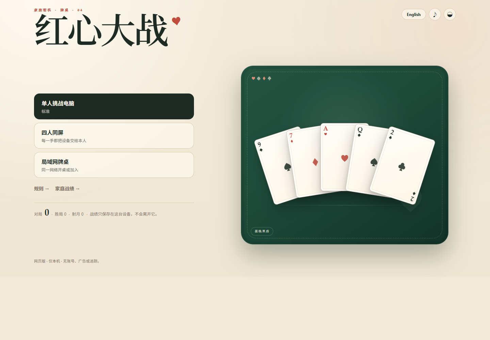
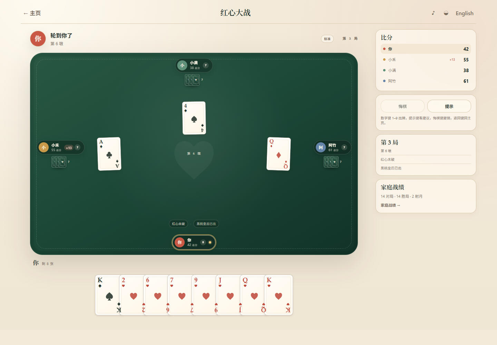
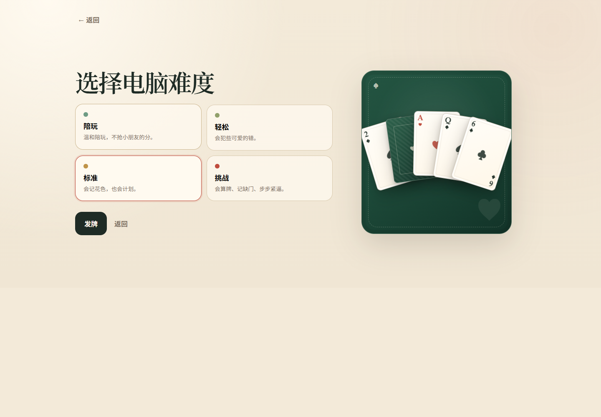
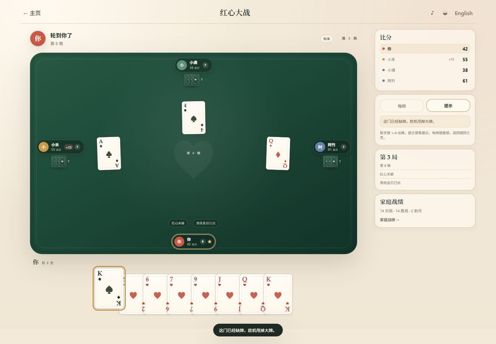
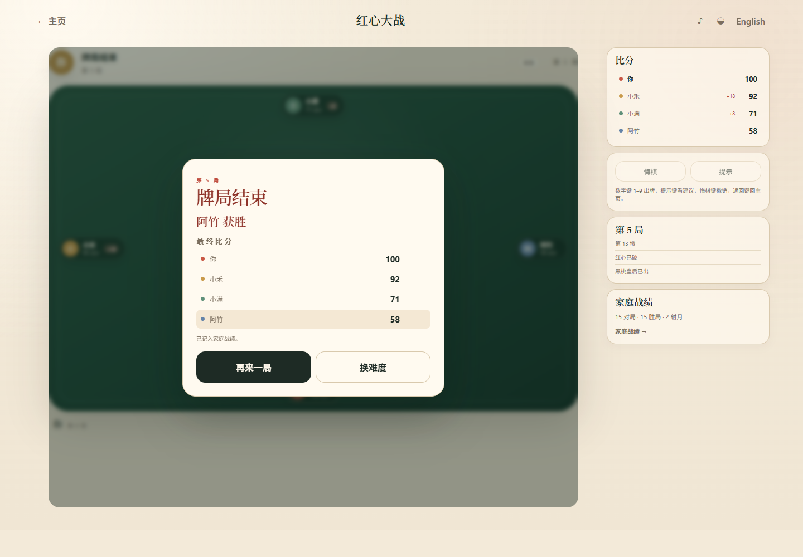
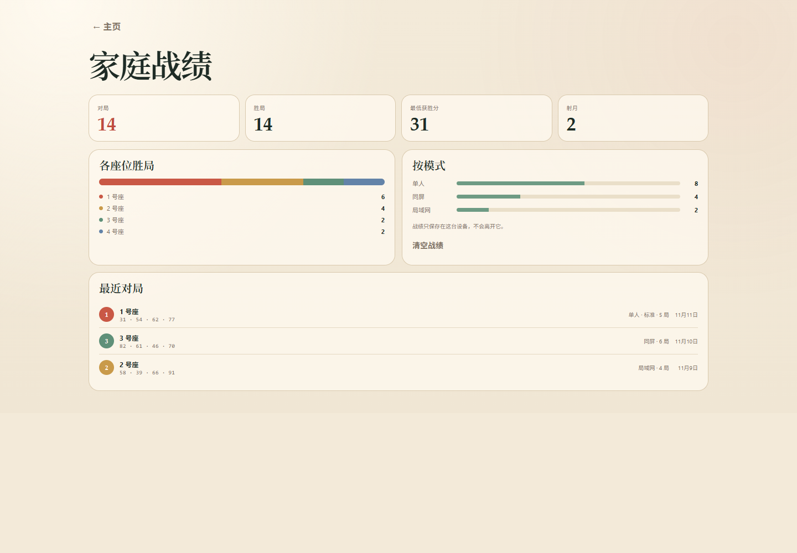
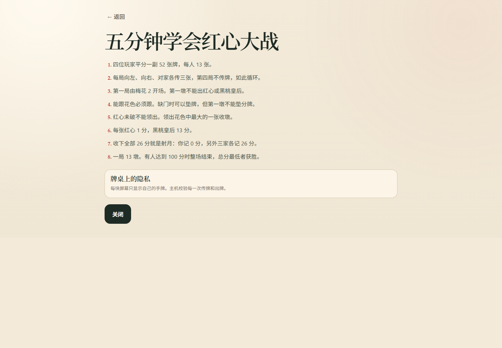
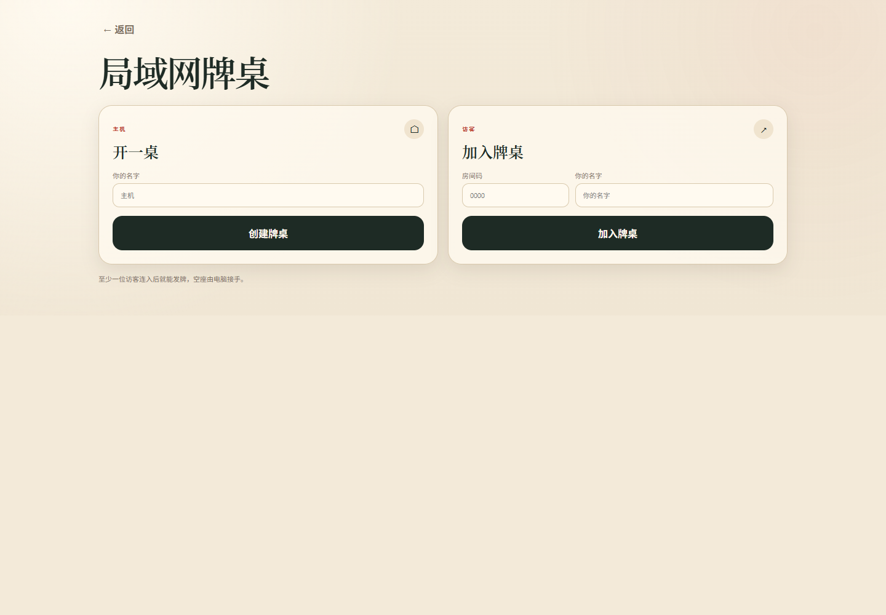
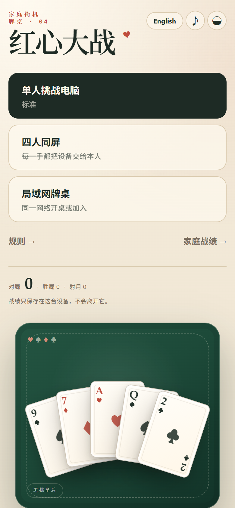
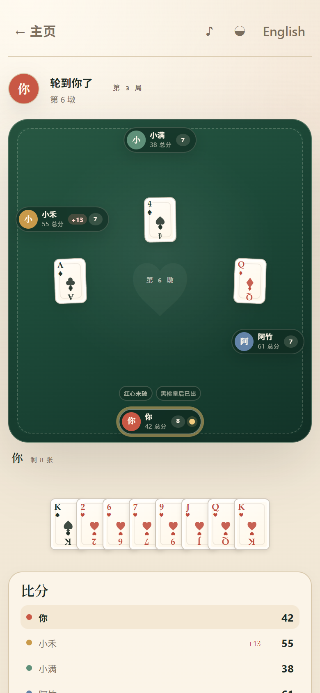

# 红心大战

[English](README.md) · **简体中文**

四家一桌、离线优先的红心大战。52 张真牌、向左向右对家传牌、跟花色、红心与黑桃皇后、
射月结算和 100 分终局。可以单人挑战四档电脑难度，也可以四人在同一台设备上轮流看牌，或者
开一桌局域网，让每块屏幕只看到自己的手牌。

## 五秒看懂

| 传牌 | 出牌 | 计分 |
| --- | --- | --- |
| 每局向左、向右、对家各传三张。第四局不传牌。 | 能跟花色必须跟，领出花色最大的一张收墩。 | 每张红心 1 分，黑桃皇后 13 分。收下 26 分就是射月。达到 100 分时总分最低者获胜。 |

第一局由梅花 2 开场。红心未破不能领出；每局第一墩不能出分牌，除非手里只剩分牌。

## 里面有什么

- **真正的规则引擎。** 纯 TypeScript 写在 `src/game/hearts.ts`，**32 个单元测试**，
  洗牌随机数由外部注入；规则层不碰 DOM、网络、时钟或 `Math.random`。完整审计见
  [`docs/rules.md`](docs/rules.md)。
- **四档电脑难度。** 陪玩温和，不抢小朋友的分；轻松会犯可爱的错；标准会记花色、会计划；
  挑战会记缺门、抽样未知手牌、判断射月，并向前看一手。
- **三种玩法。** 单人对抗三台电脑、四人同屏轮流看牌，或局域网一桌最多三位手机访客。
  局域网空座由电脑接手。
- **真正的隐私。** 引擎的 `view()` 只给一个座位自己的手牌，以及公开的剩牌数、缺门、
  已出牌、当前墩和比分。局域网主机校验每一次传牌与出牌。同屏模式在座位之间拉起
  全屏隐私幕帘，并支持安全悔棋。
- **完整的家庭战绩。** 对局数、各座位胜局、最低获胜分、射月次数、模式分布和最近八局。
  局域网记在主机设备，单人/同屏记在本机。
- **小细节。** 悔棋、会解释原因的提示、单人/同屏自动保存与继续、声音与减少动效开关、
  键盘操作，以及按手机优先设计的布局。
- **默认私密。** 无账号、无遥测、无广告、无云存档、无远程字体、无第三方美术。

## 截图

| 主页 | 真实牌局 |
| --- | --- |
|  |  |

| 电脑难度 | 会解释的提示 |
| --- | --- |
|  |  |

| 终局 | 家庭战绩 |
| --- | --- |
|  |  |

| 规则 | 局域网大厅 |
| --- | --- |
|  |  |

| 手机主页 | 手机牌局 |
| --- | --- |
|  |  |

全部来自真实运行的应用：桌面 1440×1000，手机 780×1688（390×844 @2×）。英文截图在
`docs/screenshots/en/` 一一对应。

## 本地运行

```bash
npm install
npm run dev        # http://localhost:5208
npm run check      # 类型检查 + 32 个测试 + 生产构建
npm run e2e        # 真实 Chrome，需先开 dev
npm run shots      # 重新生成全部截图（需先开 dev）
```

45 秒双语宣传片由根目录工作室根据 [`video.json`](video.json) 统一渲染，本应用不另建
视频工程。

## 局域网牌桌

局域网中继由所有家庭街机游戏共用。

```bash
npm run build
npm run lan        # 在 :8080 同时提供 dist 与中继
```

1. 先运行开发服务器（`npm run dev`，端口 5208），或直接打开 `:8080` 的构建版。
2. 主机选择 **局域网牌桌**，创建牌桌。
3. 访客扫码、打开邀请链接，或在主机地址输入四位房间码。最多三位访客；空座由电脑接手。
4. 主机发牌。每位访客收到只属于自己的座位视图，看不到别人的手牌。

桌面版会在 Tauri 壳内启动同一个中继。访客无需安装，只要同一 IPv4 网络里有浏览器。
四位房间码只挡住诚实的家人，不抵挡刻意的攻击者。

## 构建 Windows 安装包

Tauri 壳保持可用。主街机构建会集中生成全部安装包；本地运行下面命令只会构建红心大战：

```bash
npm install
npx tauri build --bundles nsis
# src-tauri/target/release/bundle/nsis/Hearts_0.1.0_x64-setup.exe
```

WebView2 使用标准引导程序。安装包未签名，Windows 可能显示 SmartScreen 提示。

## 操作

- 传牌时点选三张；出牌时点选合法牌，手机触屏同样可用。
- 键盘也能完成一局：**1–9** 出牌，**H** 提示，**U** 悔棋，**Esc** 回主页。
- 同屏模式的幕帘只让被点名的座位打开；局域网对局中暂停悔棋与提示。
- 声音与减少动效设置会记在这台设备。

## 已知限制

见 [`docs/limitations.md`](docs/limitations.md)。简单说：局域网只支持同一子网的 IPv4，
主机是唯一权威；家庭战绩记录座位结果而非玩家名字；挑战难度是很强的启发式，不是完美解算器。
