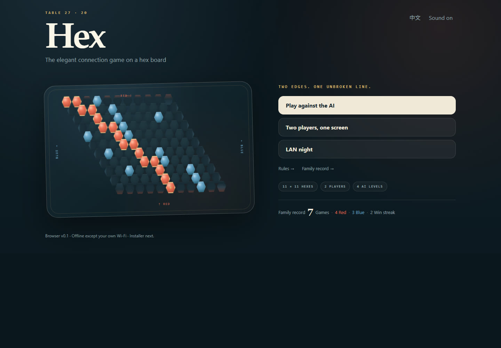
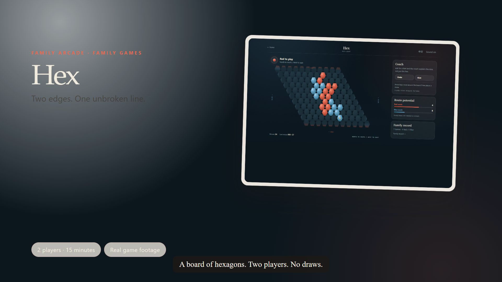
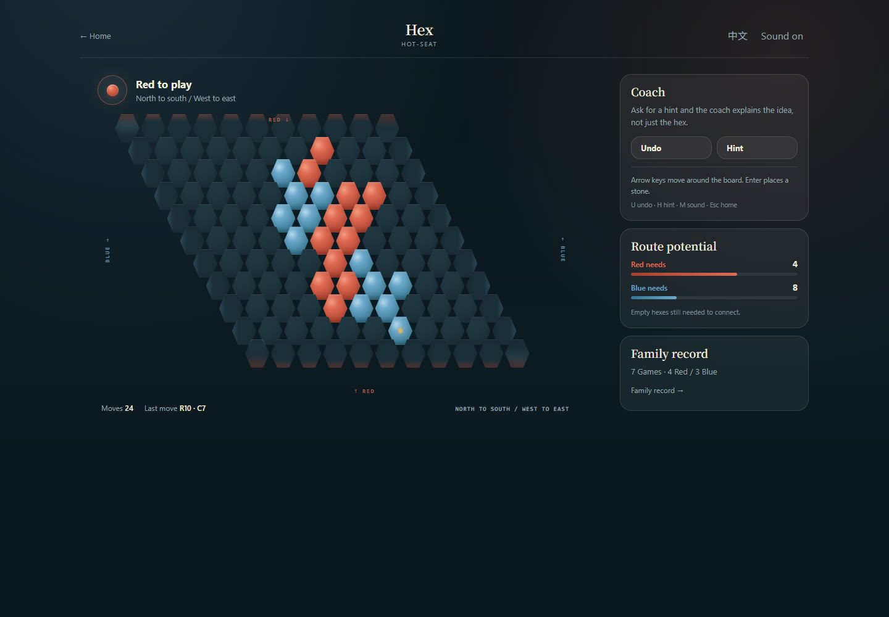
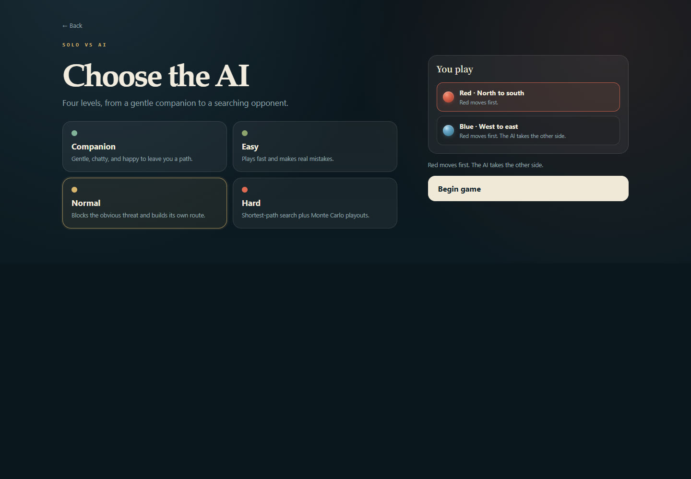
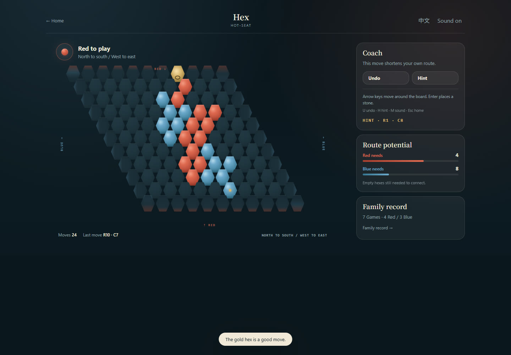
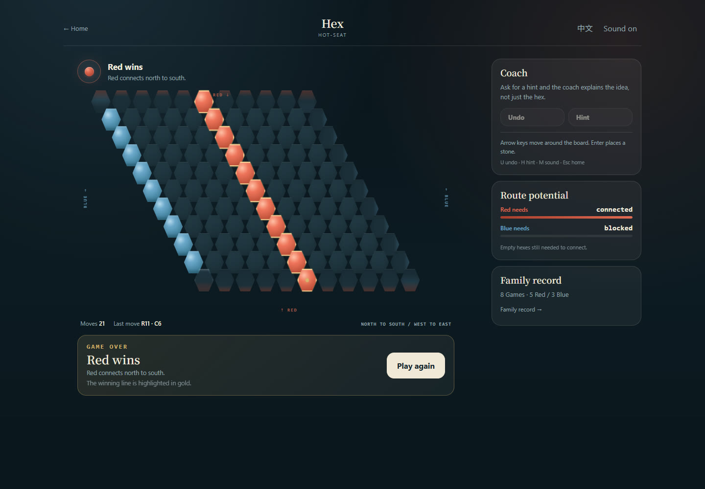
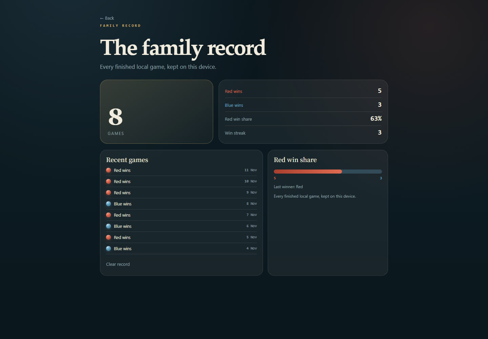
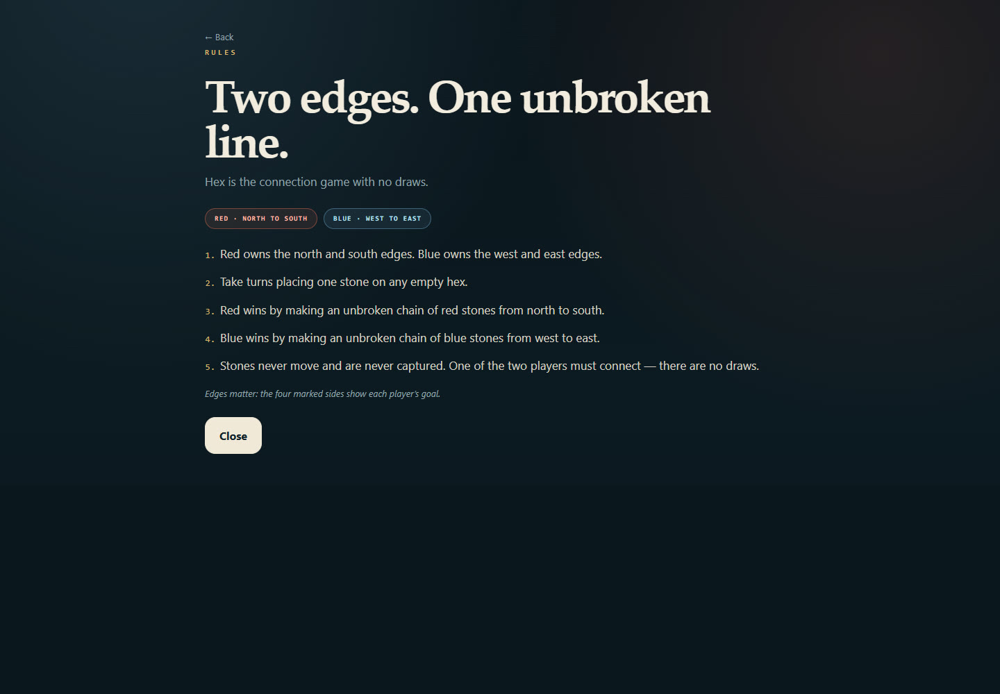
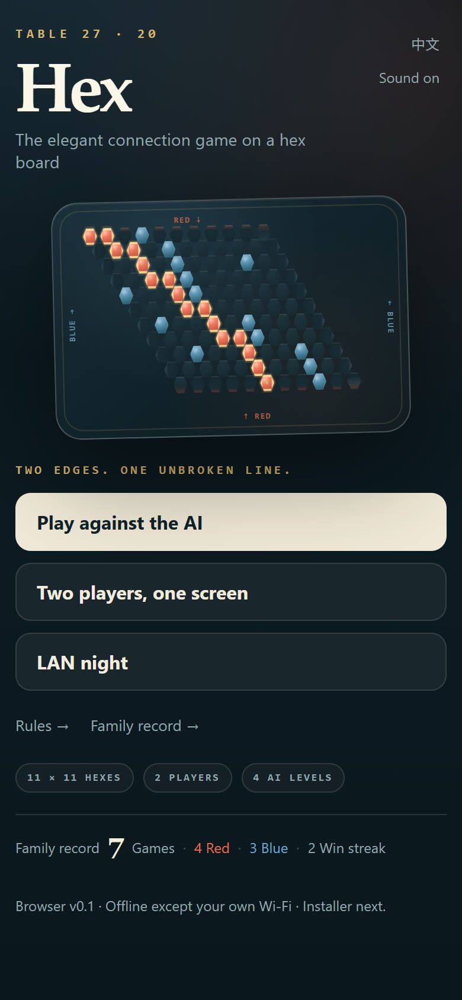
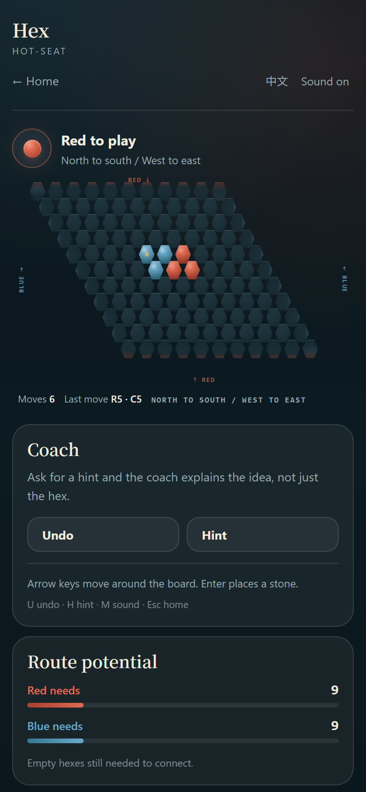

# Hex · 六角棋

**English** · [简体中文](README.zh-CN.md)

> **Two edges. One unbroken line.**

An offline-first connection game for the family table: **2 players**, an 11×11
rhombus of hexagons, four AI levels, one-screen hot-seat and LAN play from a phone.
No account, no ads, no remote assets. Red connects north to south; Blue connects
west to east. There are no draws.



[](docs/promo/hex-promo-en.mp4)

*45 seconds · 1920×1080 · 60 fps · [中文版](docs/promo/hex-promo-zh.mp4) · [video.json](video.json)*

*The 45-second promo is rendered by the Family Arcade studio from [`video.json`](video.json).*

## A turn, in five seconds

| Place | Connect | Win |
| --- | --- | --- |
| Take turns putting one stone on any empty hex. | Build a chain through neighbouring hexes. | Red joins north to south; Blue joins west to east. |

## What is inside

- **A real, tested engine.** Pure TypeScript, deterministic, **36 unit tests**, no
  DOM, clock or randomness in the rules. See [`docs/rules.md`](docs/rules.md).
- **Four AI levels.** Companion blocks immediate threats but plays gently. Easy is
  fast and fallible. Normal uses shortest-path evaluation. Hard adds Monte Carlo
  playouts over union-find, with an injected RNG.
- **Three ways to play.** Solo against the AI as Red or Blue, two players passing one
  device, or LAN host/guest.
- **Small comforts.** Undo (two plies in solo), a hint with a written reason,
  autosave/resume, a local family record with recent games, sound toggle, reduced
  motion, full keyboard navigation, complete Chinese/English UI and a phone layout.
- **Private by default.** No accounts, telemetry, ads, CDN fonts or downloaded art.

## Screenshots

| A real game | AI setup |
| --- | --- |
|  |  |

| Hint with a reason | Result |
| --- | --- |
|  |  |

| Family record | Rules |
| --- | --- |
|  |  |

| Phone home | Phone game |
| --- | --- |
|  |  |

All screenshots are real captures at 1440×1000 (phone 780×1688, i.e. 390×844 @2×).
The Chinese set is in [`docs/screenshots/zh`](docs/screenshots/zh).

## Play locally

```bash
npm install
npm run dev        # http://localhost:5199
npm run check      # tsc + 36 tests + production build
npm run e2e        # real Chrome; dev server must be running
npm run shots      # regenerate docs/screenshots/{en,zh}
```

Keyboard: arrow keys move around the board, Enter places a stone. `U` undo,
`H` hint, `M` sound, `Esc` home. Every hex is a focusable cell with an accessible
label; the layout is usable at 390px wide.

## LAN night

Browser/dev flow:

```bash
npm run build
npm run lan        # relay on :8080, also serves dist/
# open http://localhost:5199, choose LAN night, host a room
```

Open the invite URL (or scan the QR code) on a phone on the same Wi-Fi. The host
keeps the authoritative state and sends the guest its own public view; the guest
only sends `{type:'place', index}` intents. Turn order, occupancy and game-over are
re-checked on the host.

If port 8080 is already busy on your machine, build the browser bundle with an
override and run the relay on the same port:

```bash
# PowerShell: $env:VITE_LAN_PORT='8092'; npm run build
VITE_LAN_PORT=8092 npm run build
node ../../tools/lan-server.mjs --dist dist --port 8092
```

Desktop: the Tauri build starts the same relay internally and serves the built app
to phones. The host shows a 4-digit room code and a QR invite; guests need no app.

## Build the Windows installer

```bash
npm install
npx tauri build --bundles nsis
# src-tauri/target/release/bundle/nsis/Hex_0.1.0_x64-setup.exe
```

The installer is per-game and lightweight; WebView2 uses the standard bootstrapper.
The family build is unsigned, so Windows SmartScreen may warn. The Tauri shell and
native LAN relay are kept from the shared scaffold.

## Known limitations

- Fixed 11×11 board and two players; no swap/pie rule, so Red has the usual
  first-player advantage.
- Hard is a strong Monte Carlo searcher, not a proven perfect player; it can take a
  moment on a fresh board.
- Companion is deliberately gentle and only blocks immediate wins.
- LAN is local-subnet IPv4. The guest cannot undo, hint or restart; the host can.
- The family record and saves live in this browser/device only.
- The installer is local and unsigned; no cloud, accounts, matchmaking or spectators.

See [`docs/limitations.md`](docs/limitations.md) for the honest detail.

## Credits

Original code, art and copy for Family Arcade. Hex is a public-domain connection game
(Piet Hein, 1942; John Nash, 1947); this implementation, name and visual design are
original. MIT. See [`NOTICE.md`](NOTICE.md).

## Promo

[](docs/promo/hex-promo-en.mp4)

- [English cut](docs/promo/hex-promo-en.mp4) · [other language](docs/promo/hex-promo-zh.mp4)
- [SRT](docs/promo/hex-promo-en.srt) · [video.json](video.json)
- Real app screenshots and real engine data; claims match the tests.

