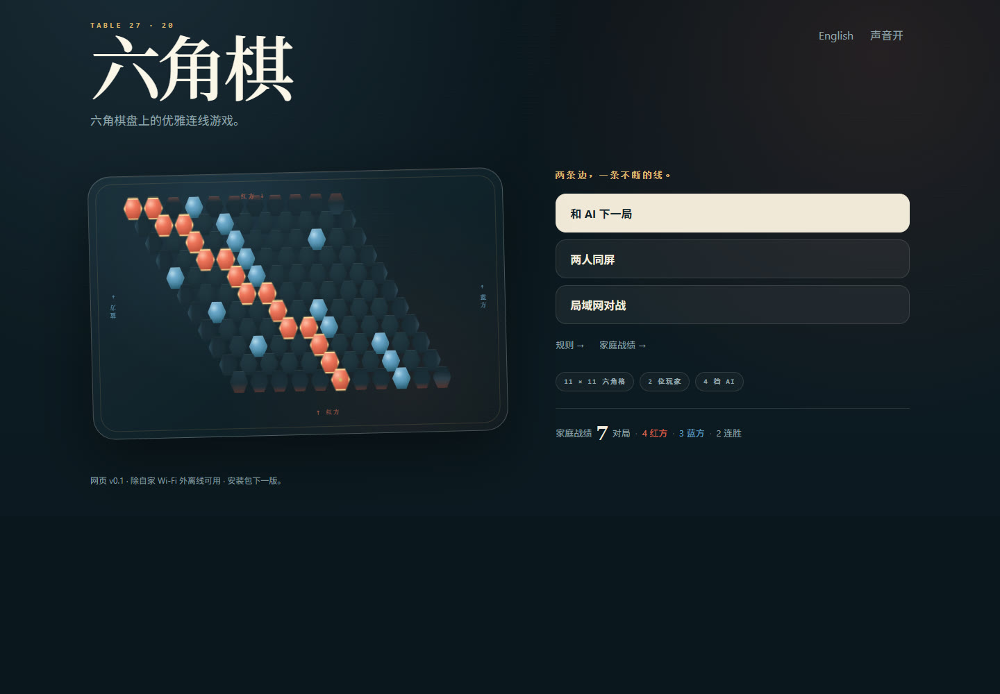
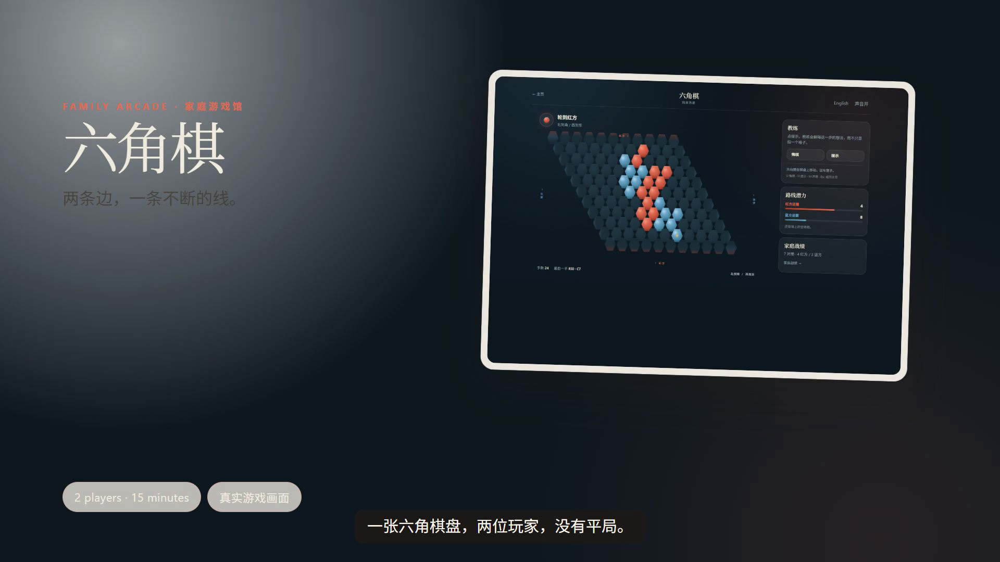
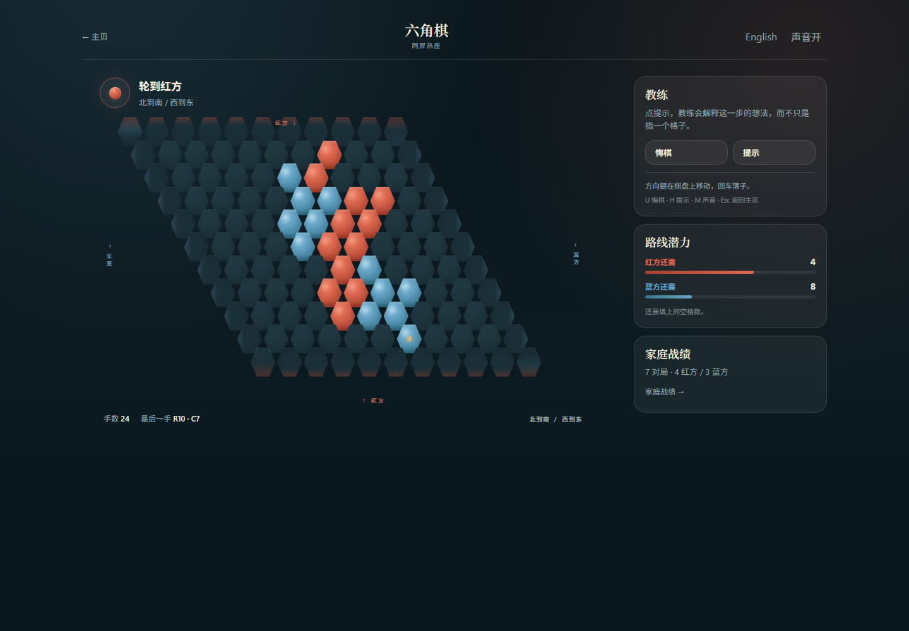
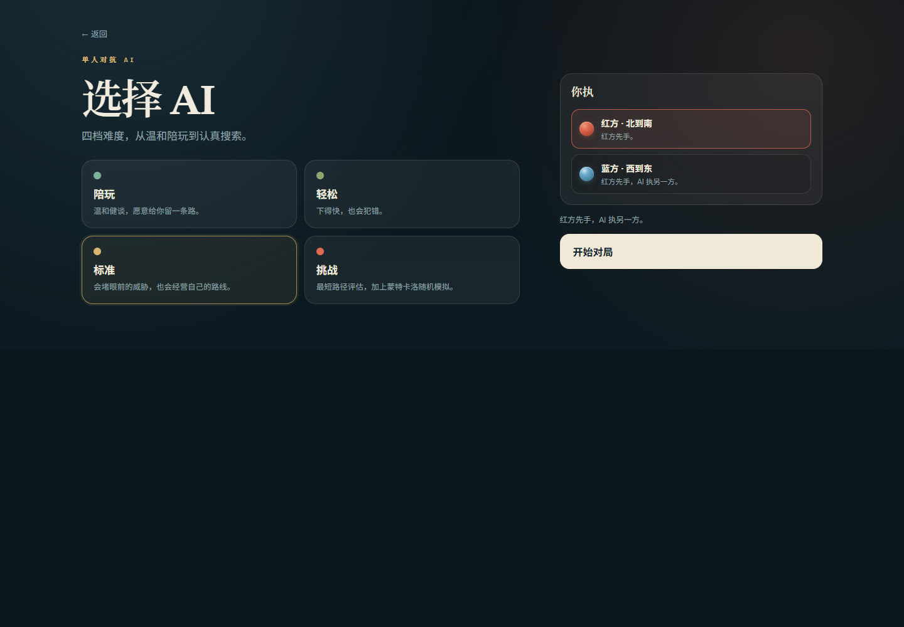
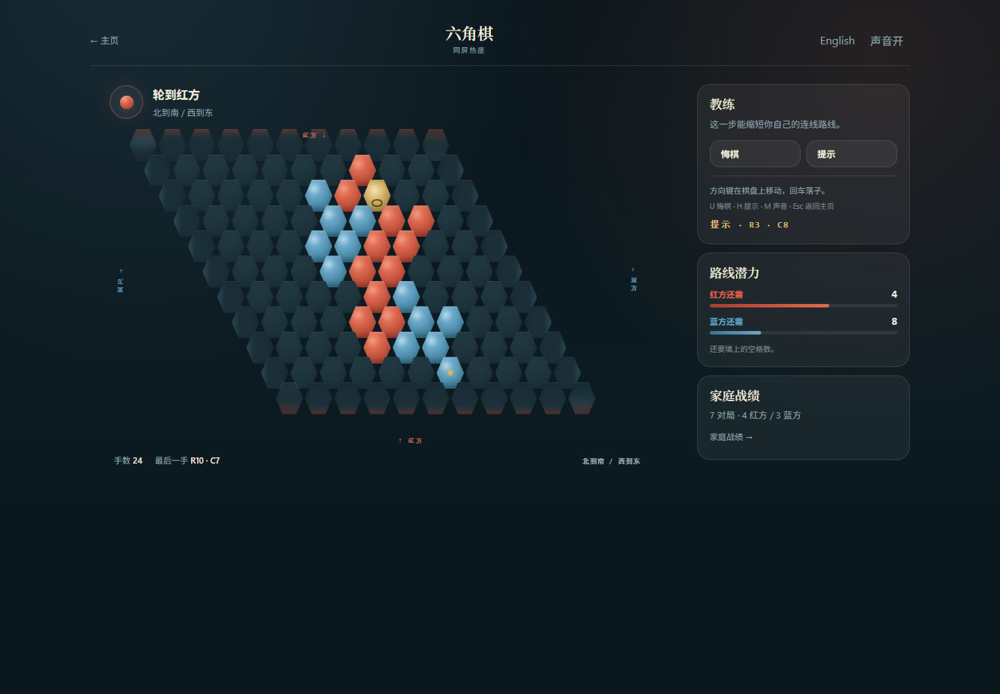
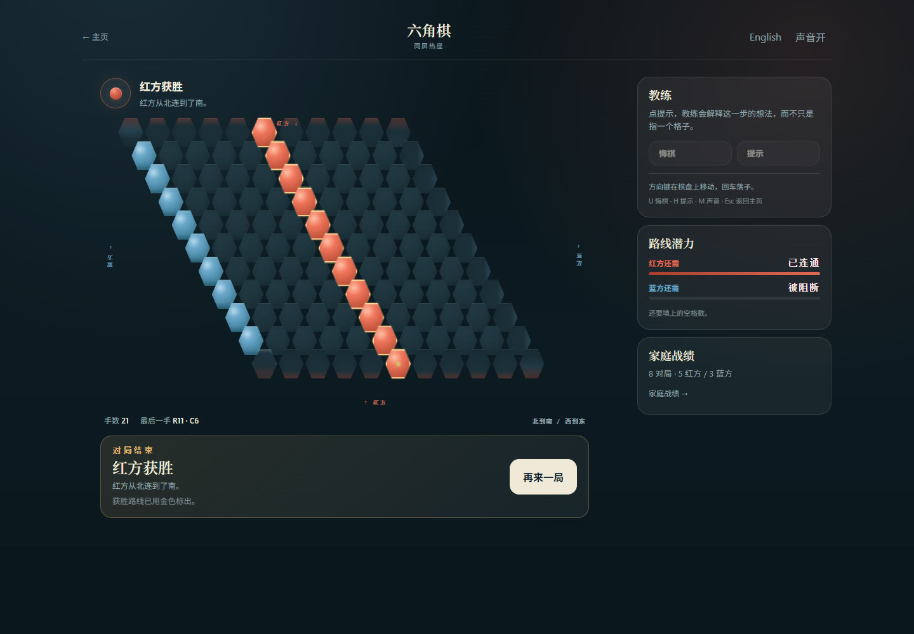
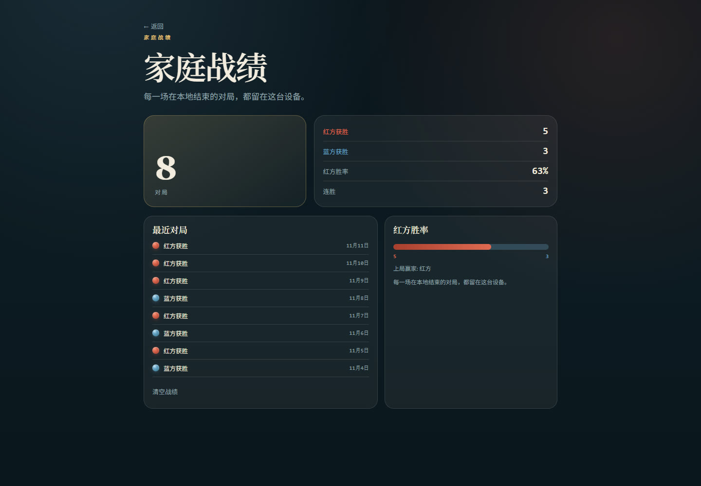
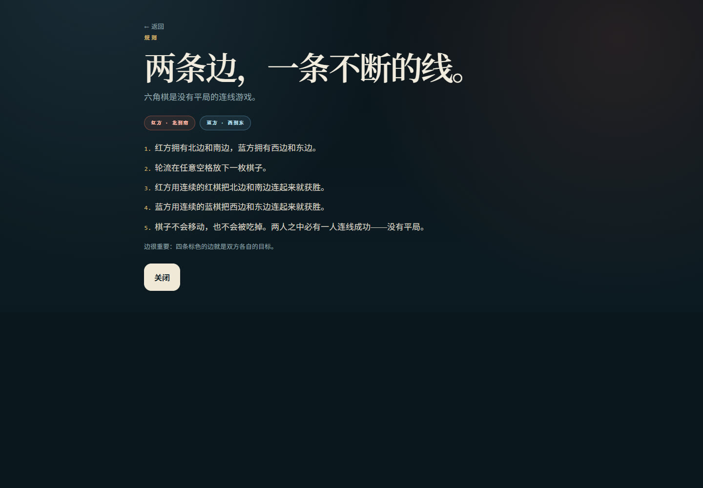
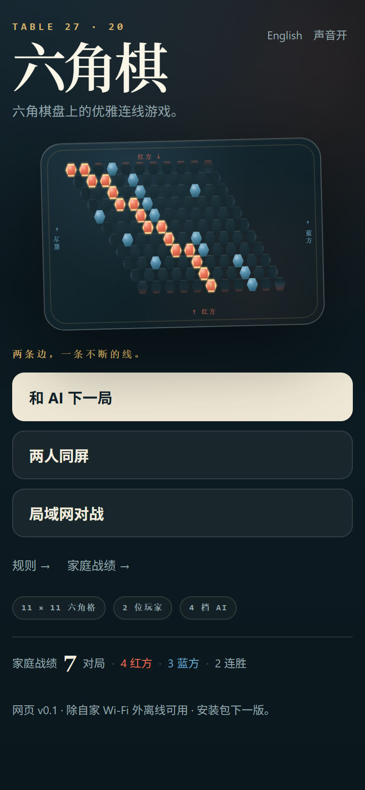
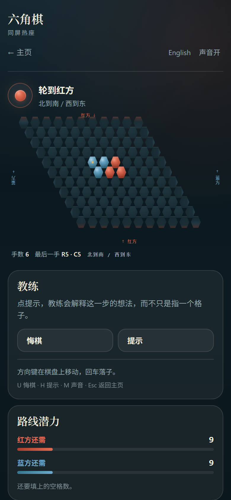

# 六角棋 · Hex

[English](README.md) · **简体中文**

> **两条边，一条不断的线。**

给家庭牌桌的离线优先连线游戏：**2 人**、11×11 六角格棋盘、四档 AI、同屏热座，
以及手机浏览器直接加入的局域网对战。无账号、无广告、无远程素材。红方连接北边与
南边，蓝方连接西边与东边。没有平局。



[](docs/promo/hex-promo-zh.mp4)

*45 秒 · 1920×1080 · 60fps · [English cut](docs/promo/hex-promo-en.mp4) · [video.json](video.json)*

*45 秒宣传片由 Family Arcade 工作室根据 [`video.json`](video.json) 统一渲染。*

## 一回合，五秒看懂

| 落子 | 连线 | 结束 |
| --- | --- | --- |
| 轮流在任意空格放下一枚棋子。 | 用相邻的六角格连成一条不断的链。 | 红方连北到南，蓝方连西到东。 |

## 里面有什么

- **真正的引擎。** 纯 TypeScript、确定性、**36 个单元测试**；规则层不碰 DOM、时钟或
  随机数。见 [`docs/rules.md`](docs/rules.md)。
- **四档 AI。** 陪玩会堵眼前的威胁，但下得温和；轻松快速但会犯错；标准使用最短路径
  评估；挑战再加上基于并查集的蒙特卡洛模拟，随机数由外部注入。
- **三种玩法。** 单人执红或执蓝对抗 AI、两人同屏热座，或局域网主机/访客。
- **小细节。** 悔棋（单人退两手）、带文字理由的提示、自动保存/继续、本机家庭战绩
  与最近对局、声音开关、减少动效、完整键盘操作、中英双语和手机布局。
- **默认私密。** 无账号、无遥测、无广告、无 CDN 字体、无下载素材。

## 截图

| 真实对局 | AI 设置 |
| --- | --- |
|  |  |

| 带理由的提示 | 终局 |
| --- | --- |
|  |  |

| 家庭战绩 | 规则 |
| --- | --- |
|  |  |

| 手机主页 | 手机对局 |
| --- | --- |
|  |  |

全部来自真实运行的应用：桌面 1440×1000，手机 780×1688（390×844 @2×）。英文截图在
[`docs/screenshots/en`](docs/screenshots/en)。

## 本地运行

```bash
npm install
npm run dev        # http://localhost:5199
npm run check      # tsc + 36 个测试 + 生产构建
npm run e2e        # 真实 Chrome，需先运行 dev
npm run shots      # 重新生成 docs/screenshots/{en,zh}
```

键盘：方向键在棋盘上移动，回车落子；`U` 悔棋、`H` 提示、`M` 声音、`Esc` 返回主页。
每个六角格都是可聚焦的按钮，并有完整无障碍标签；390px 宽度下仍可正常游玩。

## 局域网

浏览器/开发版：

```bash
npm run build
npm run lan        # :8080 中继，同时托管 dist/
# 打开 http://localhost:5199，选“局域网对战”，开房间
```

在同一 Wi-Fi 的手机上打开邀请链接（或扫码）即可。主机保存权威状态，只向访客发送
公开视图；访客只发送 `{type:'place', index}` 意图。回合、占用和终局都会在主机上
重新校验。

如果本机 8080 已被占用，可以给浏览器构建换一个中继端口，并让中继监听同一端口：

```bash
# PowerShell: $env:VITE_LAN_PORT='8092'; npm run build
VITE_LAN_PORT=8092 npm run build
node ../../tools/lan-server.mjs --dist dist --port 8092
```

桌面版：Tauri 安装包启动同一个内置中继，并把构建产物托管给手机。主机显示 4 位
房间码和二维码；访客无需安装任何应用。

## 构建 Windows 安装包

```bash
npm install
npx tauri build --bundles nsis
# src-tauri/target/release/bundle/nsis/Hex_0.1.0_x64-setup.exe
```

每款游戏单独打包，安装包保持轻量；WebView2 使用标准引导程序。家庭构建未签名，
Windows SmartScreen 可能提示风险。Tauri 壳和原生局域网中继沿用共享脚手架。

## 已知限制

- 固定 11×11 棋盘、两人对局；没有交换/派规则，所以红方拥有常见先手优势。
- 挑战档是较强的蒙特卡洛搜索，不是被证明的完美棋手；空盘开局时可能思考片刻。
- 陪玩档刻意温和，只保证堵住立即获胜的一手。
- 局域网仅限同一子网 IPv4；访客不能悔棋、提示或重开，主机可以。
- 家庭战绩和存档只保存在当前浏览器/设备。
- 安装包本地且未签名；没有云、账号、匹配或观战。

更完整的说明见 [`docs/limitations.md`](docs/limitations.md)。

## 许可

Family Arcade 原创代码、美术与文案。六角棋是公有领域连线游戏（Piet Hein，1942；
John Nash，1947）；本实现、名称与视觉设计为原创。MIT，见 [`NOTICE.md`](NOTICE.md)。

## 宣传片

[](docs/promo/hex-promo-zh.mp4)

- [中文成片](docs/promo/hex-promo-zh.mp4) · [另一语言](docs/promo/hex-promo-en.mp4)
- [字幕](docs/promo/hex-promo-zh.srt) · [video.json](video.json)
- 画面来自真实应用与真实引擎数据；数字与测试一致。

